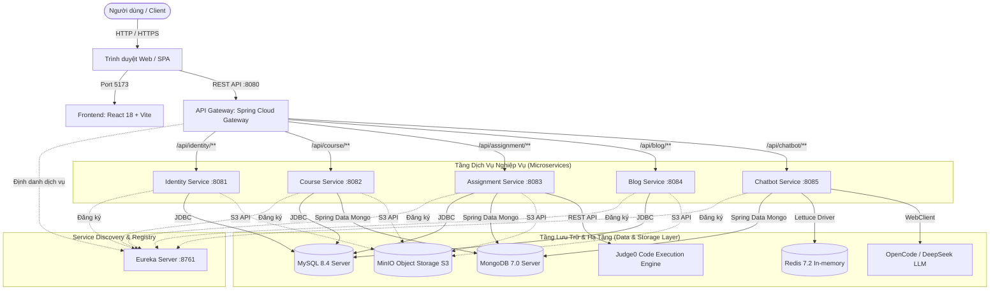
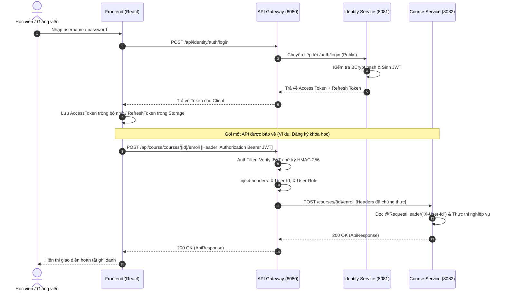

# Kiến Trúc Hệ Thống — EduLearn LMS (ARCHITECTURE.md)

Tài liệu này mô tả chi tiết kiến trúc phân tán theo mô hình Microservices, các thành phần hạ tầng, cơ chế định tuyến, bảo mật, giao tiếp giữa các dịch vụ và giải pháp lưu trữ của dự án **EduLearn LMS**.

---

## 1. Mô Hình Tổ Chức Dự Án (Monorepo)

Hệ thống được tổ chức theo cấu trúc **Monorepo** nhằm tập trung toàn bộ mã nguồn backend, frontend, cấu hình hạ tầng và tài liệu trong cùng một kho lưu trữ nhưng đảm bảo ranh giới đóng gói độc lập:

```text
DoAnCK/
├── backend/
│   ├── service-registry/      # Netflix Eureka Server discovery (Port 8761)
│   ├── api-gateway/           # Spring Cloud Gateway (Port 8080)
│   ├── identity-service/      # Authentication & User Management (Port 8081)
│   ├── course-service/        # Course, Curriculum, Schedule & Progress (Port 8082)
│   ├── assignment-service/    # Quiz, Question Bank & Code Judge (Port 8083)
│   ├── blog-service/          # Community Tech Blog, Comments & Voting (Port 8084)
│   ├── chatbot-service/       # AI Learning Assistant & Generation (Port 8085)
│   └── pom.xml                # Parent POM quản lý versions, plugins và dependency management
├── frontend/                  # React 18 SPA, Vite 5, Tailwind/CSS modules (Port 5173)
├── docker/                    # Docker initialization scripts & database setup
├── docs/                      # Bộ tài liệu kỹ thuật chuẩn mực
├── docker-compose.yml         # Full local deployment stack
└── docker-compose.db.yml      # Isolated database & cache layer stack
```

---

## 2. Kiến Trúc Microservices Tổng Thể



---

## 3. Thành Phần Cốt Lõi (Core Components)

### 3.1 Service Registry (Eureka Server)
- **Cổng**: `8761`
- **Công nghệ**: `spring-cloud-starter-netflix-eureka-server`.
- **Vai trò**: Điểm đăng ký tập trung cho toàn bộ các microservices. Khi một dịch vụ khởi động, nó tự động gửi heartbeat và thông tin instance lên Eureka.
- **Lợi ích**: Giúp API Gateway và các Feign Client phân giải địa chỉ dịch vụ động (`lb://identity-service`) mà không cần hardcode địa chỉ IP hay port tĩnh.

### 3.2 API Gateway (Spring Cloud Gateway)
- **Cổng**: `8080`
- **Công nghệ**: Spring Cloud Gateway (xây dựng trên nền tảng bất đồng bộ Project Reactor & Netty).
- **Trách nhiệm chính**:
  1. **Single Entry Point**: Tất cả các request từ Frontend đều đi qua gateway với tiền tố `/api/<service>`.
  2. **Xác thực tập trung (`AuthFilter`)**: Thẩm định tính hợp lệ của JWT access token trước khi chuyển tiếp vào mạng nội bộ.
  3. **Bảo mật Header (Header Stripping & Injection)**: Tẩy rửa các header giả mạo từ client và inject các header danh tính đáng tin cậy:
     - `X-User-Id`: ID người dùng được giải mã từ JWT.
     - `X-User-Role`: Vai trò người dùng (`STUDENT`, `INSTRUCTOR`, `ADMIN`).
     - `X-User-Email`: Email người dùng.
     - `X-Gateway-Authenticated`: `true`.
  4. **Chống sập tầng (Circuit Breaker)**: Tích hợp Resilience4j bảo vệ từng endpoint khi một microservice bị chậm hoặc quá tải.
  5. **CORS Configuration**: Cho phép Frontend tại `http://localhost:5173` gọi API an toàn.

---

## 4. Luồng Xử Lý Request & Bảo Mật Xác Thực (Auth Workflow)



---

## 5. Giao Tiếp Giữa Các Dịch Vụ (Inter-Service Communication)

Hệ thống kết hợp hai phương thức giao tiếp đồng bộ và bất đồng bộ:

### 5.1 Giao tiếp Đồng bộ (Synchronous via Spring Cloud OpenFeign)
Các service gọi lẫn nhau trực tiếp thông qua declarative REST clients (`OpenFeign`) được định tuyến nội bộ hoặc giải mã qua Eureka:
- **Assignment Service -> Identity Service**: Lấy thông tin họ tên, email học sinh để hiển thị trong bảng điểm Gradebook và kết quả nộp bài.
- **Assignment Service -> Course Service**: Xác thực xem bài tập/quiz có thuộc đúng khóa học của giảng viên đang thao tác hay không.
- **Assignment Service -> Chatbot Service**: Giảng viên yêu cầu AI sinh bộ câu hỏi trắc nghiệm hoặc bộ testcase lập trình.
- **Course Service -> Identity Service**: Lấy thông tin chi tiết giảng viên phụ trách khóa học.

### 5.2 Cơ Chế Chịu Lỗi & Timeouts
Mọi Feign Client đều được cấu hình timeout nghiêm ngặt trong `.env`:
- `FEIGN_CONNECT_TIMEOUT_MS`: 10000ms (10s)
- `FEIGN_READ_TIMEOUT_MS`: 30000ms (30s)
- Riêng luồng gọi sang Chatbot Service để sinh AI được cấu hình timeout đọc mở rộng tới `120000ms` (2 phút) do đặc thù xử lý của Large Language Model.

---

## 6. Chiến Lược Lưu Trữ Dữ Liệu (Database per Service)

Hệ thống áp dụng mô hình phân tách cơ sở dữ liệu theo dịch vụ (**Database per Service Pattern**), kết hợp đa dạng các hệ quản trị CSDL phù hợp nhất với đặc thù nghiệp vụ (Polyglot Persistence):

| Dịch vụ | Loại CSDL | Tên Database | Mục đích sử dụng |
|---|---|---|---|
| **Identity Service** | MySQL 8.4 | `identity_lms` | Người dùng, vai trò, mã xác thực OTP, Refresh Token |
| **Course Service** | MySQL 8.4 + MongoDB 7.0 | `course_lms` (MySQL)<br>`course_lms_mongo` (Mongo) | **MySQL**: Khóa học, danh mục, lịch học, thông báo, ghi danh, tiến độ.<br>**MongoDB**: Cây bài học lồng nhau (`CourseStructure`), nội dung chi tiết bài học (`Lesson`). |
| **Assignment Service** | MySQL 8.4 + MongoDB 7.0 | `assignment_lms` (MySQL)<br>`assignment_lms_mongo` (Mongo) | **MySQL**: Quản lý Quiz, Question Bank, Đề bài lập trình, Testcases, Điểm số.<br>**MongoDB**: Lưu trữ toàn bộ mã nguồn nộp bài (`Submission`), log chấm code chi tiết. |
| **Blog Service** | MySQL 8.4 | `blog_lms` | Bài viết, thẻ tags, bình luận phân cấp, bình chọn upvote/downvote |
| **Chatbot Service** | MongoDB 7.0 + Redis 7.2 | `chatbot_db` (Mongo)<br>Redis Port `6379` | **MongoDB**: Phiên trò chuyện (`ChatSession`), lịch sử tin nhắn (`ChatMessage`).<br>**Redis**: Bộ nhớ đệm tốc độ cao cho tin nhắn gần nhất và kiểm soát hạn ngạch Rate Limit. |

### 6.1 Lưu Trữ Đối Tượng (Object Storage - MinIO)
- MinIO hoạt động độc lập tương thích hoàn toàn giao thức AWS S3 API.
- Các bucket được phân chia theo từng nghiệp vụ:
  - `lms-identity-bucket`: Lưu trữ ảnh đại diện (Avatar).
  - `lms-course-bucket`: Lưu trữ ảnh thumbnail khóa học và tài liệu đính kèm.
  - `lms-assignment-bucket`: Lưu trữ file đề bài, dữ liệu testcase dạng zip.
  - `lms-blog-bucket`: Lưu trữ ảnh thumbnail bài viết công nghệ.
- Hệ thống hỗ trợ sinh **Presigned URLs** với thời hạn 5 phút giúp client upload/download trực tiếp an toàn.

---

## 7. Giải Pháp Chấm Code Tự Động (Code Judge Architecture)

```mermaid
flowchart LR
    Student[Học viên viết Code] -->|Submit Code| AssignSvc[Assignment Service]
    AssignSvc -->|Save PENDING| Mongo[(MongoDB Submissions)]
    AssignSvc -->|Submit Task| Pool[ThreadPool: judge-executor]
    Pool -->|Post Source & TestCases| Judge0[Judge0 API Engine]
    Judge0 -->|Compile & Execute in Sandbox| Sandbox[Docker Sandbox Container]
    Sandbox -->|Output, Time, Memory| Judge0
    Judge0 -->>|Return Status: Accepted / WA / TLE| Pool
    Pool -->|Update Verdict & Test Results| Mongo
    Pool -->|Update User Statistics| MySQL[(MySQL Leaderboard)]
    AssignSvc -->>|Poll Status / Result| Student
```

---

## 8. Giải Pháp Tích Hợp AI Chatbot (LLM Architecture)

- Sử dụng mô hình `deepseek-v4-flash-free` thông qua OpenCode Gateway hoặc OpenAI-compatible API.
- Tích hợp **Rate Limiting** dựa trên thuật toán Fixed Window trên Redis: ngăn ngừa tình trạng spam API và tối ưu chi phí.
- Quản lý cửa sổ ngữ cảnh thông minh: Chỉ gửi tối đa 20 tin nhắn gần nhất và cắt tỉa token tự động nhằm đảm bảo không vượt quá giới hạn ngữ cảnh của LLM.
- Hỗ trợ chế độ sinh nội dung (Generate Mode) với cấu hình nhiệt độ (Temperature) thấp (`0.3`) để đảm bảo định dạng JSON trả về chuẩn xác tuyệt đối khi sinh câu hỏi Quiz hoặc Testcases.
