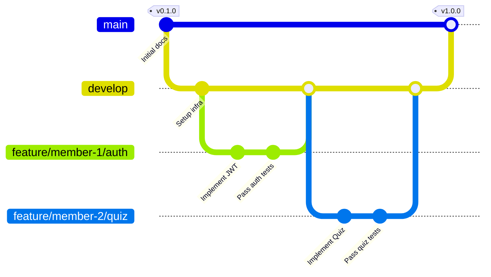

# Quy Trình Quản Lý Mã Nguồn Git — EduLearn LMS (GIT_WORKFLOW.md)

Tài liệu này xác định mô hình phân nhánh, quy trình vòng đời của một tính năng và tiêu chuẩn kiểm soát chất lượng mã nguồn trên Git & GitHub trong suốt dự án `DoAnCK`.

---

## 1. Mô Hình Phân Nhánh (Branching Model)

Dự án áp dụng mô hình phân nhánh chuẩn mực gồm hai nhánh bảo vệ vĩnh viễn (`main`, `develop`) và các nhánh tính năng ngắn hạn:



### 1.1 Nhánh Vĩnh Viễn (Permanent Branches)
- **`main`**:
  - Nhánh chứa mã nguồn phát hành chính thức (Production-ready).
  - Nghiêm cấm commit trực tiếp lên `main`.
  - Chỉ được cập nhật thông qua Pull Request từ `develop` sau khi đã hoàn thành toàn bộ kiểm thử hệ thống.
- **`develop`**:
  - Nhánh tích hợp trung tâm chứa mã nguồn mới nhất đang phát triển.
  - Mọi nhánh tính năng (`feature/*`), sửa lỗi (`fix/*`) đều bắt nguồn từ `develop` và merge trở lại `develop`.

### 1.2 Nhánh Tạm Thời (Temporary Branches)
- `feature/member-1/<tên-tính-năng>`: Nhánh tính năng do Thành viên 1 phụ trách.
- `feature/member-2/<tên-tính-năng>`: Nhánh tính năng do Thành viên 2 phụ trách.
- `fix/<tên-lỗi-ngắn-gọn>`: Nhánh sửa lỗi phát sinh trong quá trình tích hợp.
- `test/<tên-module>`: Nhánh bổ sung hoặc nâng cấp bộ kiểm thử.
- `docs/<nội-dung-tài-liệu>`: Nhánh biên soạn và cập nhật tài liệu kỹ thuật.

---

## 2. Chu Trình Phát Triển Một Tính Năng (Feature Lifecycle)

Mọi chức năng hoặc nhiệm vụ trong dự án đều phải trải qua 9 bước khép kín:

```text
Issue → Branch → Code → Test → Commit → Push → Pull Request → Review → Merge
```

### Bước 1: Issue (Xác định công việc)
Mỗi nhiệm vụ phải gắn liền với một mục tiêu rõ ràng trong [ROADMAP.md](ROADMAP.md) hoặc [FEATURE_PARITY_MATRIX.md](FEATURE_PARITY_MATRIX.md).

### Bước 2: Branch (Tạo nhánh mới)
Luôn pull mã nguồn mới nhất từ `develop` trước khi tạo nhánh:
```bash
git checkout develop
git pull origin develop
git checkout -b feature/member-1/course-management
```

### Bước 3: Code (Lập trình chức năng)
- Tuân thủ bộ quy tắc [CODING_RULES.md](CODING_RULES.md).
- Không sửa đổi mã nguồn nằm ngoài phạm vi của tính năng.
- Không đưa secrets, passwords hoặc token thật vào code.

### Bước 4: Test (Kiểm thử bắt buộc tại máy cá nhân)
Trước khi tạo commit, bắt buộc phải chạy lệnh kiểm thử:
```bash
# Kiểm tra biên dịch backend không lỗi:
mvn clean test-compile -f backend/pom.xml

# Chạy unit tests của module đang làm:
mvn test -f backend/pom.xml -pl course-service

# Kiểm tra frontend (nếu có sửa đổi):
cd frontend && npm run build && npm run test
```
> [!CAUTION]
> **Tuyệt đối không commit nếu lệnh build hoặc test đang báo đỏ (Fail).**

### Bước 5: Commit (Đóng gói thay đổi)
- Đặt thông điệp theo chuẩn Conventional Commits:
  ```bash
  git add .
  git commit -m "feat(course): thêm api tạo khóa học và cấu trúc bài học mongodb"
  ```

### Bước 6: Push (Đẩy nhánh lên GitHub)
```bash
git push origin feature/member-1/course-management
```

### Bước 7: Pull Request (Mở yêu cầu tích hợp)
- Mở PR trên GitHub với nhánh đích là `develop`.
- Điền đầy đủ mô tả thay đổi, danh sách API mới, và đính kèm minh chứng test.

### Bước 8: Review (Kiểm duyệt chéo)
- Thành viên còn lại vào kiểm tra mã nguồn (Code Review) dựa trên bảng Checklist tại [CONTRIBUTING.md](../CONTRIBUTING.md).
- Nếu phát hiện lỗi hoặc không đạt chuẩn coding rules: Yêu cầu sửa đổi (Request Changes).
- Nếu đạt yêu cầu: Phê duyệt (Approve).

### Bước 9: Merge (Tích hợp vào nhánh chính)
- Thực hiện Merge vào nhánh `develop`.
- Xóa nhánh tính năng trên remote để giữ sạch kho lưu trữ.
- Cập nhật trạng thái tính năng trong [FEATURE_PARITY_MATRIX.md](FEATURE_PARITY_MATRIX.md) và ghi nhận vào [CHANGELOG.md](../CHANGELOG.md).

---

## 3. Các Điều Khoản Cấm Kỵ (Git Anti-Patterns)

1. **Tuyệt đối không dùng cờ `--force` (`git push -f`)** lên các nhánh dùng chung (`main`, `develop`).
2. **Tuyệt đối không can thiệp lịch sử Git** bằng cách thay đổi ngày giờ commit giả mạo.
3. **Không tạo nhiều commit rác vô nghĩa**: Gom các thay đổi nhỏ có cùng mục đích vào một commit logic hoàn chỉnh.
4. **Không đưa file rác vào repository**: Đảm bảo `.gitignore` chặn toàn bộ thư mục `.idea/`, `.vscode/`, `target/`, `node_modules/`, `.env`, `*.log`.
