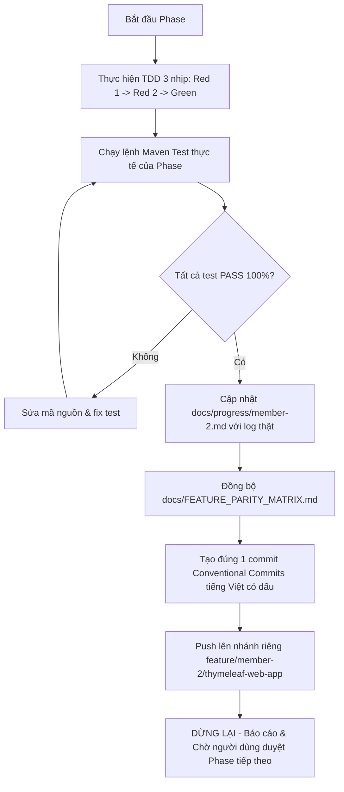

# KẾ HOẠCH CHUYỂN ĐỔI GIAO DIỆN SANG SPRING BOOT MVC + THYMELEAF + BOOTSTRAP 5

> [!IMPORTANT]
> **Tôn chỉ kỹ thuật & Nguyên tắc vận hành**:
> - **Mục tiêu**: Xây dựng toàn bộ giao diện người dùng cho hệ thống LMS bằng **Spring Boot MVC + Thymeleaf + Bootstrap 5** theo mô hình **Backend-For-Frontend (BFF)**, thay thế giao diện React SPA hiện tại, kết nối độc quyền với hệ thống Microservices qua **API Gateway (Port 8080)**.
> - **Quy định Rà Soát Kế Hoạch (Chỉ áp dụng cho lần rà soát hiện tại)**: Ràng buộc "chỉ sửa kế hoạch/tài liệu; tuyệt đối chưa viết mã nguồn, chưa sửa file code, chưa chạy phase, không tự ý chạy git commit, git push hay git merge" chỉ áp dụng cho lần rà soát tài liệu hiện tại. Sau khi người dùng duyệt kế hoạch này, Antigravity mới được phép bắt đầu Phase 1 và triển khai lần lượt từng phase theo đúng Quy trình Vận hành tại Mục 7. Tuyệt đối không để chỉ thị rà soát này trở thành quy tắc thường trực mâu thuẫn với kế hoạch triển khai.
> - **Đánh số Phase**: Đánh số độc lập từ **Phase 1 đến Phase 7** cho kế hoạch này. Căn cứ tương ứng với **Phase 12 đến Phase 18** trong lộ trình tiến độ tổng thể của Thành viên 2 (kế thừa sau Phase 1–10 Backend và Phase 11 React Auth đã kiểm thử trong `docs/progress/member-2.md`).
> - **Trung thực kỹ thuật**: Mọi endpoint, HTTP method, DTO và tham số được đối chiếu trực tiếp từ mã nguồn thực tế. Các nội dung chưa có bằng chứng kiểm thử thực tế được ghi nhận là **`CẦN XÁC NHẬN`**; tuyệt đối không khẳng định hoàn thành hay tương đương (parity) 100% trước khi triển khai và nghiệm thu thực tế.

---

## Bước 0: Khảo Sát & Đối Chiếu Chỉ Đọc `Learning-Management-System-main/` Với Repo Hiện Tại `D:\LMS-main`

### 0.1 Nguyên tắc khảo sát
- Thư mục `Learning-Management-System-main/` là **READ-ONLY tuyệt đối**: Không chỉnh sửa, không build, không cài dependencies (`npm install`, `mvn package`), không chạy lệnh làm thay đổi trạng thái hoặc dữ liệu.
- **Hiện trạng kiến trúc mẫu**: Trong `Learning-Management-System-main/`, giao diện người dùng hoàn toàn là React 18 SPA nằm trong thư mục `frontend/`, backend cung cấp REST APIs thuần túy; **không có module `web-app` hay Thymeleaf trong project mẫu**.
- Do đó, việc xây dựng `backend/web-app` trong `D:\LMS-main` là giải pháp kiến trúc BFF mới. Giao diện Thymeleaf phải tái hiện đầy đủ luồng nghiệp vụ, validation và trường dữ liệu từ các React component mẫu, đồng thời tuân thủ chính xác 100% các API Contracts hiện có của Backend.

### 0.2 Bảng đối chiếu cụ thể có bằng chứng giữa Project Mẫu và Repo Hiện Tại

| Thành phần kỹ thuật | Bằng chứng mã nguồn Project Mẫu (`Learning-Management-System-main`) | Bằng chứng mã nguồn Repo Hiện Tại (`D:\LMS-main`) | Đánh giá & Rủi ro Parity |
| :--- | :--- | :--- | :--- |
| **1. Giao diện Xác thực (Auth)** | - [AuthPage.jsx](file:///d:/LMS-main/Learning-Management-System-main/frontend/src/features/auth/pages/AuthPage.jsx)<br>- [VerifyOtpModal.jsx](file:///d:/LMS-main/Learning-Management-System-main/frontend/src/features/auth/components/VerifyOtpModal.jsx)<br>- [SocialCallbackPage.jsx](file:///d:/LMS-main/Learning-Management-System-main/frontend/src/features/auth/pages/SocialCallbackPage.jsx) | - Đang duy trì React 18 song song tại `frontend/src/features/auth`.<br>- Dự kiến tạo mới: `com.lms.webapp.controller.AuthController` và các template Thymeleaf tại `backend/web-app/src/main/resources/templates/auth/`. | `CẦN XÁC NHẬN`: Cần kiểm chứng luồng submit form HTML có CSRF và bộ đếm ngược countdown OTP bằng Vanilla JS trên cổng 8088. |
| **2. Giao diện Hồ sơ & Đổi vai trò** | - [SettingsPage.jsx](file:///d:/LMS-main/Learning-Management-System-main/frontend/src/features/settings/pages/SettingsPage.jsx)<br>- Endpoint: `PATCH /api/identity/users/myinfo/role`<br>- Endpoint: `PATCH /api/identity/users/myinfo/password` | - [UserController.java](file:///d:/LMS-main/backend/identity-service/src/main/java/com/lms/identityservice/controller/UserController.java#L45-L50): Đã có `@PatchMapping("/myinfo/role")` và `@PatchMapping("/myinfo/password")`. | Khớp mã nguồn Controller Backend. `web-app` phải gọi đúng HTTP method `PATCH`, không dùng `POST /users/select-role`. |
| **3. Khám phá Khóa học & Danh mục** | - [CourseCatalogPage.jsx](file:///d:/LMS-main/Learning-Management-System-main/frontend/src/features/courses/pages/CourseCatalogPage.jsx)<br>- [endpoints.js](file:///d:/LMS-main/Learning-Management-System-main/frontend/src/constants/endpoints.js#L37): `CATEGORIES: /api/course/categories`<br>- `COURSES.BASE: /api/course/courses` | - [CategoryController.java](file:///d:/LMS-main/backend/course-service/src/main/java/com/lms/courseservice/controller/CategoryController.java#L25-L30): `@GetMapping("/categories")`<br>- [CourseController.java](file:///d:/LMS-main/backend/course-service/src/main/java/com/lms/courseservice/controller/CourseController.java#L32-L42): `@GetMapping("/courses")` | Khớp mã nguồn Backend. Danh mục thuộc `/api/course/categories`, danh sách khóa học thuộc `/api/course/courses`. |
| **4. Phòng học & Tiến độ bài giảng** | - [CourseHubPage.jsx](file:///d:/LMS-main/Learning-Management-System-main/frontend/src/features/courses/pages/CourseHubPage.jsx)<br>- [endpoints.js](file:///d:/LMS-main/Learning-Management-System-main/frontend/src/constants/endpoints.js#L45-L46):<br>  * `LESSON_DETAIL: /api/course/courses/{courseId}/lessons/{lessonId}`<br>  * `LESSON_COMPLETE: /api/course/courses/{courseId}/lessons/{lessonId}/complete` | - [LessonController.java](file:///d:/LMS-main/backend/course-service/src/main/java/com/lms/courseservice/controller/LessonController.java#L15): `@RequestMapping("/courses/{courseId}/lessons")`<br>- [LessonProgressController.java](file:///d:/LMS-main/backend/course-service/src/main/java/com/lms/courseservice/controller/LessonProgressController.java#L18): `@PostMapping("/lessons/{lessonId}/complete")` | Khớp mã nguồn Backend. Bắt buộc URL phải chứa cả `{courseId}` và `{lessonId}`, không được dùng đường dẫn thiếu `courseId`. |
| **5. Quản lý Khóa học của Giảng viên** | - [CourseManagementCenter.jsx](file:///d:/LMS-main/Learning-Management-System-main/frontend/src/features/courses/pages/CourseManagementCenter.jsx)<br>- [CourseStructureController.java](file:///d:/LMS-main/Learning-Management-System-main/backend/course-service/src/main/java/com/lms/courseservice/controller/CourseStructureController.java) | - [CourseController.java](file:///d:/LMS-main/backend/course-service/src/main/java/com/lms/courseservice/controller/CourseController.java#L79-L86): `GET /courses/my`<br>- [CourseStructureController.java](file:///d:/LMS-main/backend/course-service/src/main/java/com/lms/courseservice/controller/CourseStructureController.java): Quản lý node đệ quy trên MongoDB. | `CẦN XÁC NHẬN`: Cần kiểm chứng trải nghiệm dựng cây bài học kéo thả/thêm sửa node qua Thymeleaf form và Ajax. |
| **6. Diễn đàn Blog & Bình luận** | - [BlogHubPage.jsx](file:///d:/LMS-main/Learning-Management-System-main/frontend/src/features/blog/pages/BlogHubPage.jsx)<br>- [endpoints.js](file:///d:/LMS-main/Learning-Management-System-main/frontend/src/constants/endpoints.js#L127-L134):<br>  * `PUBLIC_POSTS: /api/blog/posts/public`<br>  * `PUBLIC_DETAIL: /api/blog/posts/public/{slug}`<br>  * `DETAIL (Auth): /api/blog/posts/{id}` | - [PostController.java](file:///d:/LMS-main/backend/blog-service/src/main/java/com/lms/blogservice/controller/PostController.java#L29-L45): Đã phân định rõ `@GetMapping("/public")`, `@GetMapping("/public/{slug}")` và `@GetMapping("/{id}")`.<br>- [CommentController.java](file:///d:/LMS-main/backend/blog-service/src/main/java/com/lms/blogservice/controller/CommentController.java): Hỗ trợ đầy đủ `GET`, `POST`, `PUT`, `DELETE`. | Khớp mã nguồn Backend. Bài viết công khai xem qua slug, xem theo ID yêu cầu đăng nhập. Bình luận hỗ trợ đủ CRUD. |
| **7. Quản trị Admin** | - [AdminDashboard.jsx](file:///d:/LMS-main/Learning-Management-System-main/frontend/src/features/dashboard/pages/AdminDashboard.jsx)<br>- [endpoints.js](file:///d:/LMS-main/Learning-Management-System-main/frontend/src/constants/endpoints.js#L163-L164):<br>  * `USERS: /api/identity/admin/users`<br>  * `USER_STATS: /api/identity/admin/users/stats` | - [AdminUserController.java](file:///d:/LMS-main/backend/identity-service/src/main/java/com/lms/identityservice/controller/AdminUserController.java):<br>  * `GET /admin/users`<br>  * `GET /admin/users/stats`<br>  * `PATCH /admin/users/{id}/active`<br>  * `PATCH /admin/users/{id}/password`<br>  * `PATCH /admin/users/{id}/admin-active` | Khớp mã nguồn Backend. Thống kê dùng `/stats` (không dùng `/dashboard`). Khóa/mở dùng `PATCH /{id}/active`. Reset pass dùng `PATCH /{id}/password`. |
| **8. Tải file MinIO Direct Upload** | - [useFileUpload.js](file:///d:/LMS-main/Learning-Management-System-main/frontend/src/hooks/useFileUpload.js)<br>- `POST /api/identity/storage/presigned-url` trả về `uploadUrl` + `formFields`. Client POST multipart trực tiếp đến MinIO. | - [StorageController.java](file:///d:/LMS-main/backend/identity-service/src/main/java/com/lms/identityservice/controller/StorageController.java#L25): `@PostMapping("/storage/presigned-url")` trả về `PresignedUrlResponse`. | `CẦN XÁC NHẬN`: Cần kiểm chứng script Vanilla JS gửi FormData chứa toàn bộ policy fields lên MinIO bucket thật. |

### 0.3 Đối Chiếu Gateway Whitelist, Route & Bảo Mật Endpoint (AuthFilter vs Backend Controllers)

Bảng dưới đây đối chiếu toàn diện giữa bộ lọc xác thực Gateway ([AuthFilter.java:L45-89, L126-144](file:///d:/LMS-main/backend/api-gateway/src/main/java/com/lms/apigateway/configuration/AuthFilter.java)), cấu hình định tuyến Gateway ([application.yaml:L72-263](file:///d:/LMS-main/backend/api-gateway/src/main/resources/application.yaml)) và các anotation bảo mật tại Controller của từng Microservice trong phạm vi Member 2. Mọi sai khác hoặc điểm chưa đồng nhất đều được ghi rõ là **`CẦN XÁC NHẬN`**, tuyệt đối không tự suy luận.

| Chức năng & Endpoint (BFF gọi) | Route Gateway ID & Predicate | Cơ chế Gateway Filter | Phân quyền Controller Backend | Trạng thái Bảo mật Thống nhất | Bằng chứng Mã nguồn Cụ thể | Đánh giá & Ghi chú Lệch |
| :--- | :--- | :--- | :--- | :---: | :--- | :--- |
| **Đăng ký tài khoản**<br>`POST /api/identity/auth/register` | `id: identity-public`<br>`Path=/api/identity/auth/**` | Bỏ qua Auth<br>`RemoveRequestHeader=Authorization` | Cho phép Anonymous | **Public** | - Gateway: [application.yaml:L72-79](file:///d:/LMS-main/backend/api-gateway/src/main/resources/application.yaml#L72-L79)<br>- Backend: `AuthenticationController.java:L23` | Khớp 100%. |
| **Đăng nhập thường**<br>`POST /api/identity/auth/login` | `id: identity-public`<br>`Path=/api/identity/auth/**` | Bỏ qua Auth<br>`RemoveRequestHeader=Authorization` | Cho phép Anonymous | **Public** | - Gateway: [application.yaml:L72-79](file:///d:/LMS-main/backend/api-gateway/src/main/resources/application.yaml#L72-L79)<br>- Backend: `AuthenticationController.java:L30` | Khớp 100%. |
| **Đăng nhập Google**<br>`POST /api/identity/auth/social-login/google` | `id: identity-public`<br>`Path=/api/identity/auth/**` | Bỏ qua Auth<br>`RemoveRequestHeader=Authorization` | Cho phép Anonymous | **Public** | - Gateway: [application.yaml:L72-79](file:///d:/LMS-main/backend/api-gateway/src/main/resources/application.yaml#L72-L79)<br>- Backend: `AuthenticationController.java:L37` | Khớp 100%. |
| **Gửi OTP Email**<br>`POST /api/identity/auth/verify-email/send` | `id: identity-public`<br>`Path=/api/identity/auth/**` | Bỏ qua Auth<br>`RemoveRequestHeader=Authorization` | Cho phép Anonymous | **Public** | - Gateway: [application.yaml:L72-79](file:///d:/LMS-main/backend/api-gateway/src/main/resources/application.yaml#L72-L79)<br>- Backend: `EmailVerificationController.java:L28` | Khớp 100%. |
| **Xác thực OTP Email**<br>`POST /api/identity/auth/verify-email` | `id: identity-public`<br>`Path=/api/identity/auth/**` | Bỏ qua Auth<br>`RemoveRequestHeader=Authorization` | Cho phép Anonymous | **Public** | - Gateway: [application.yaml:L72-79](file:///d:/LMS-main/backend/api-gateway/src/main/resources/application.yaml#L72-L79)<br>- Backend: `EmailVerificationController.java:L36` | Khớp 100%. |
| **Quên mật khẩu**<br>`POST /api/identity/auth/forgot-password` | `id: identity-public`<br>`Path=/api/identity/auth/**` | Bỏ qua Auth<br>`RemoveRequestHeader=Authorization` | Cho phép Anonymous | **Public** | - Gateway: [application.yaml:L72-79](file:///d:/LMS-main/backend/api-gateway/src/main/resources/application.yaml#L72-L79)<br>- Backend: `EmailVerificationController.java:L44` | Khớp 100%. |
| **Đặt lại mật khẩu OTP**<br>`POST /api/identity/auth/reset-password` | `id: identity-public`<br>`Path=/api/identity/auth/**` | Bỏ qua Auth<br>`RemoveRequestHeader=Authorization` | Cho phép Anonymous | **Public** | - Gateway: [application.yaml:L72-79](file:///d:/LMS-main/backend/api-gateway/src/main/resources/application.yaml#L72-L79)<br>- Backend: `EmailVerificationController.java:L52` | Khớp 100%. |
| **Làm mới Token**<br>`POST /api/identity/auth/refresh` | `id: identity-public`<br>`Path=/api/identity/auth/**` | Bỏ qua Auth<br>`RemoveRequestHeader=Authorization` | Cho phép Anonymous (Body chứa `refreshToken`) | **Public** | - Gateway: [application.yaml:L72-79](file:///d:/LMS-main/backend/api-gateway/src/main/resources/application.yaml#L72-L79)<br>- Backend: `AuthenticationController.java:L53` | Khớp 100%. |
| **Đăng xuất**<br>`POST /api/identity/auth/logout` | `id: identity-public`<br>`Path=/api/identity/auth/**` | Bỏ qua Auth<br>`RemoveRequestHeader=Authorization` | Controller nhận `LogoutRequest(token)` | **Public ở Gateway / Token ở Body** | - Gateway: [application.yaml:L72-79](file:///d:/LMS-main/backend/api-gateway/src/main/resources/application.yaml#L72-L79)<br>- Backend: `AuthenticationController.java:L60` | Gateway không kiểm tra Bearer token trên header; backend nhận token trong body để thu hồi (`revoked=true`) trong bảng `refresh_tokens` (MySQL). `CẦN XÁC NHẬN`: Kiểm chứng luồng hủy session phía BFF khi gọi logout. |
| **Hồ sơ công khai User**<br>`GET /api/identity/users/{id}/profile` | `id: identity-public-profile`<br>`Path=/api/identity/users/*/profile` | Bỏ qua Auth<br>`RemoveRequestHeader=Authorization` | Cho phép Anonymous | **Public** | - Gateway: [application.yaml:L80-93](file:///d:/LMS-main/backend/api-gateway/src/main/resources/application.yaml#L80-L93)<br>- Backend: `UserController.java:L52` | Khớp 100%. |
| **Xem hồ sơ cá nhân**<br>`GET /api/identity/users/myinfo` | `id: identity-private`<br>`Path=/api/identity/users/**` | Áp dụng `AuthFilter`<br>Inject `X-User-Id`, `X-User-Role` | Yêu cầu xác thực qua Gateway | **Cần đăng nhập** | - Gateway: [application.yaml:L94-105](file:///d:/LMS-main/backend/api-gateway/src/main/resources/application.yaml#L94-L105)<br>- Backend: `UserController.java:L24` | Khớp 100%. |
| **Cập nhật hồ sơ cá nhân**<br>`PUT /api/identity/users/myinfo` | `id: identity-private`<br>`Path=/api/identity/users/**` | Áp dụng `AuthFilter` | Yêu cầu xác thực qua Gateway | **Cần đăng nhập** | - Gateway: [application.yaml:L94-105](file:///d:/LMS-main/backend/api-gateway/src/main/resources/application.yaml#L94-L105)<br>- Backend: `UserController.java:L31` | Khớp 100%. |
| **Đổi mật khẩu cá nhân**<br>`PATCH /api/identity/users/myinfo/password` | `id: identity-private`<br>`Path=/api/identity/users/**` | Áp dụng `AuthFilter` | Yêu cầu xác thực qua Gateway | **Cần đăng nhập** | - Gateway: [application.yaml:L94-105](file:///d:/LMS-main/backend/api-gateway/src/main/resources/application.yaml#L94-L105)<br>- Backend: `UserController.java:L38` | Khớp 100%. |
| **Đổi vai trò cá nhân**<br>`PATCH /api/identity/users/myinfo/role` | `id: identity-private`<br>`Path=/api/identity/users/**` | Áp dụng `AuthFilter` | Yêu cầu xác thực qua Gateway | **Cần đăng nhập** | - Gateway: [application.yaml:L94-105](file:///d:/LMS-main/backend/api-gateway/src/main/resources/application.yaml#L94-L105)<br>- Backend: `UserController.java:L45` | Khớp 100%. |
| **Presigned Avatar Upload**<br>`POST /api/identity/storage/presigned-url` | `id: identity-storage`<br>`Path=/api/identity/storage/**` | Áp dụng `AuthFilter` | Yêu cầu xác thực qua Gateway | **Cần đăng nhập** | - Gateway: [application.yaml:L118-129](file:///d:/LMS-main/backend/api-gateway/src/main/resources/application.yaml#L118-L129)<br>- Backend: `StorageController.java:L25` | Khớp 100%. |
| **Admin DS & Stats User**<br>`GET /api/identity/admin/users/**` | `id: identity-admin`<br>`Path=/api/identity/admin/**` | Áp dụng `AuthFilter` | Kiểm tra role ADMIN trong Security/Service | **Yêu cầu ADMIN** | - Gateway: [application.yaml:L106-117](file:///d:/LMS-main/backend/api-gateway/src/main/resources/application.yaml#L106-L117)<br>- Backend: `AdminUserController.java` | Khớp 100%. |
| **Danh mục Khóa học**<br>`GET /api/course/categories` | `id: course-public-read`<br>`Path=/api/course/categories` | Bỏ qua Auth (`isPublicRequest`<br>& `RemoveRequestHeader`) | Cho phép Anonymous | **Public** | - Gateway: [application.yaml:L157-171](file:///d:/LMS-main/backend/api-gateway/src/main/resources/application.yaml#L157-L171)<br>- AuthFilter: [AuthFilter.java:L137](file:///d:/LMS-main/backend/api-gateway/src/main/java/com/lms/apigateway/configuration/AuthFilter.java#L137)<br>- Backend: `CategoryController.java:L25` | Khớp 100%. |
| **Admin CRUD Category**<br>`POST/PUT/DELETE /api/course/categories/**` | `id: course-service`<br>`Path=/api/course/**` | Áp dụng `AuthFilter` | `@PreAuthorize("hasRole('ADMIN')")` | **Yêu cầu ADMIN** | - Gateway: [application.yaml:L172-183](file:///d:/LMS-main/backend/api-gateway/src/main/resources/application.yaml#L172-L183)<br>- Backend: `CategoryController.java:L32, L42, L53` | Khớp 100%. |
| **Danh sách Khóa học**<br>`GET /api/course/courses` | `id: course-public-read`<br>`Path=/api/course/courses` | Bỏ qua Auth (`isPublicRequest`<br>& `RemoveRequestHeader`) | Cho phép Anonymous | **Public** | - Gateway: [application.yaml:L157-171](file:///d:/LMS-main/backend/api-gateway/src/main/resources/application.yaml#L157-L171)<br>- AuthFilter: [AuthFilter.java:L138](file:///d:/LMS-main/backend/api-gateway/src/main/java/com/lms/apigateway/configuration/AuthFilter.java#L138)<br>- Backend: `CourseController.java:L32` | Khớp 100%. |
| **Chi tiết Khóa học**<br>`GET /api/course/courses/{id}` | `id: course-public-read`<br>`Path=/api/course/courses/*` | Bỏ qua Auth (`isPublicRequest`<br>& `RemoveRequestHeader`) | Cho phép Anonymous | **Public** | - Gateway: [application.yaml:L157-171](file:///d:/LMS-main/backend/api-gateway/src/main/resources/application.yaml#L157-L171)<br>- AuthFilter: [AuthFilter.java:L140](file:///d:/LMS-main/backend/api-gateway/src/main/java/com/lms/apigateway/configuration/AuthFilter.java#L140)<br>- Backend: `CourseController.java:L44` | Khớp 100%. |
| **Khóa học của tôi (Giảng viên)**<br>`GET /api/course/courses/my` | `id: course-private-read-shortcuts`<br>`Path=/api/course/courses/my` (order -30) | Áp dụng `AuthFilter` | Kiểm tra role `TEACHER` qua `X-User-Role` | **Yêu cầu TEACHER** | - Gateway: [application.yaml:L143-156](file:///d:/LMS-main/backend/api-gateway/src/main/resources/application.yaml#L143-L156)<br>- Backend: `CourseController.java:L79` | Khớp 100%. Route order -30 ưu tiên trước `course-public-read`. |
| **Khóa học đã ghi danh**<br>`GET /api/course/courses/enrolled` | `id: course-private-read-shortcuts`<br>`Path=/api/course/courses/enrolled` | Áp dụng `AuthFilter` | Yêu cầu xác thực qua Gateway | **Cần đăng nhập** | - Gateway: [application.yaml:L143-156](file:///d:/LMS-main/backend/api-gateway/src/main/resources/application.yaml#L143-L156)<br>- Backend: `CourseController.java:L88` | Khớp 100%. |
| **Ghi danh khóa học**<br>`POST /api/course/courses/{id}/enroll` | `id: course-service`<br>`Path=/api/course/**` | Áp dụng `AuthFilter` | Yêu cầu xác thực qua Gateway | **Cần đăng nhập** | - Gateway: [application.yaml:L172-183](file:///d:/LMS-main/backend/api-gateway/src/main/resources/application.yaml#L172-L183)<br>- Backend: `CourseController.java:L96` | Khớp 100%. |
| **Tạo/Sửa khóa học (Giảng viên)**<br>`POST/PUT /api/course/courses/**` | `id: course-service`<br>`Path=/api/course/**` | Áp dụng `AuthFilter` | Kiểm tra role `TEACHER`/`ADMIN` | **Yêu cầu TEACHER/ADMIN** | - Gateway: [application.yaml:L172-183](file:///d:/LMS-main/backend/api-gateway/src/main/resources/application.yaml#L172-L183)<br>- Backend: `CourseController.java:L51, L60` | Khớp 100%. |
| **Khóa/Mở khóa học (Admin)**<br>`PATCH /api/course/courses/{id}/lock` & `unlock` | `id: course-service`<br>`Path=/api/course/**` | Áp dụng `AuthFilter` | Kiểm tra role `ADMIN` | **Yêu cầu ADMIN** | - Gateway: [application.yaml:L172-183](file:///d:/LMS-main/backend/api-gateway/src/main/resources/application.yaml#L172-L183)<br>- Backend: `CourseController.java:L114, L124` | Khớp 100%. |
| **Xem đề cương & bài học công khai**<br>`GET /api/course/courses/{id}/structure` & `/lessons` | `id: course-public-read`<br>`Path=/api/course/courses/*/structure/**` | Bỏ qua Auth (`isPublicRequest`<br>& `RemoveRequestHeader`) | Cho phép Anonymous xem tóm tắt cấu trúc | **Public** | - Gateway: [application.yaml:L157-171](file:///d:/LMS-main/backend/api-gateway/src/main/resources/application.yaml#L157-L171)<br>- AuthFilter: [AuthFilter.java:L142-143](file:///d:/LMS-main/backend/api-gateway/src/main/java/com/lms/apigateway/configuration/AuthFilter.java#L142-L143)<br>- Backend: `CourseStructureController.java:L28, L66` | Khớp 100%. |
| **Xem chi tiết bài học**<br>`GET /api/course/courses/{courseId}/lessons/{lessonId}` | `id: course-service`<br>`Path=/api/course/**` | Áp dụng `AuthFilter` | Service kiểm tra học viên đã ghi danh hoặc là giảng viên sở hữu | **Cần đăng nhập (Đã ghi danh / Giảng viên)** | - Gateway: [application.yaml:L172-183](file:///d:/LMS-main/backend/api-gateway/src/main/resources/application.yaml#L172-L183)<br>- Backend: `LessonController.java:L22` | `CẦN XÁC NHẬN`: Method không gắn `@PreAuthorize` tường minh mà ủy quyền kiểm tra quyền truy cập bài học trong `LessonService`. |
| **Đánh dấu xong bài học & Tiến độ**<br>`POST /api/course/courses/{courseId}/lessons/{lessonId}/complete` & `GET /progress` | `id: course-service`<br>`Path=/api/course/**` | Áp dụng `AuthFilter` | Yêu cầu xác thực qua Gateway | **Cần đăng nhập** | - Gateway: [application.yaml:L172-183](file:///d:/LMS-main/backend/api-gateway/src/main/resources/application.yaml#L172-L183)<br>- Backend: `LessonProgressController.java:L18, L30` | Khớp 100%. |
| **Lịch học & Thông báo**<br>`/api/course/courses/{courseId}/schedules/**` & `/announcements/**` | `id: course-service`<br>`Path=/api/course/**` | Áp dụng `AuthFilter` | `GET`: Học viên đã ghi danh; `POST/PUT/DELETE`: Giảng viên sở hữu | **Cần đăng nhập / TEACHER** | - Gateway: [application.yaml:L172-183](file:///d:/LMS-main/backend/api-gateway/src/main/resources/application.yaml#L172-L183)<br>- Backend: `ScheduleController.java`, `AnnouncementController.java` | Khớp 100%. |
| **Presigned Khóa học & Multipart Video**<br>`POST /api/storage/presigned-url` vs `/api/course/storage/...` | `id: storage-service`<br>`Path=/api/storage/**` | Áp dụng `AuthFilter` | Yêu cầu xác thực qua Gateway | **Cần đăng nhập (TEACHER)** | - Gateway: [application.yaml:L131-142](file:///d:/LMS-main/backend/api-gateway/src/main/resources/application.yaml#L131-L142)<br>- Backend: `StorageController.java:L25` | `CẦN XÁC NHẬN`: Route Gateway `storage-service` định tuyến `/api/storage/**` sang `course-service` nhưng `course-service` cấu hình `context-path: /course`. Cần xác minh BFF phải gọi `/api/storage/**` hay `/api/course/storage/**`. |
| **Bài viết công khai & Theo slug**<br>`GET /api/blog/posts/public` & `.../public/{slug}` | `id: blog-public`<br>`Path=/api/blog/posts/public/**` | Bỏ qua Auth (`isPublicRequest`<br>& `RemoveRequestHeader`) | Cho phép Anonymous | **Public** | - Gateway: [application.yaml:L225-238](file:///d:/LMS-main/backend/api-gateway/src/main/resources/application.yaml#L225-L238)<br>- AuthFilter: [AuthFilter.java:L132-133](file:///d:/LMS-main/backend/api-gateway/src/main/java/com/lms/apigateway/configuration/AuthFilter.java#L132-L133)<br>- Backend: `PostController.java:L29, L40` | Khớp 100%. |
| **Xem bình luận công khai**<br>`GET /api/blog/posts/{id}/comments` | `id: blog-public`<br>`Path=/api/blog/posts/*/comments` | Bỏ qua Auth (`isPublicRequest`<br>& `RemoveRequestHeader`) | Cho phép Anonymous | **Public** | - Gateway: [application.yaml:L225-238](file:///d:/LMS-main/backend/api-gateway/src/main/resources/application.yaml#L225-L238)<br>- AuthFilter: [AuthFilter.java:L136](file:///d:/LMS-main/backend/api-gateway/src/main/java/com/lms/apigateway/configuration/AuthFilter.java#L136)<br>- Backend: `CommentController.java:L26` | Khớp 100%. |
| **Danh sách & Tìm kiếm Thẻ Tags**<br>`GET /api/blog/tags` & `/tags/search` | `id: blog-public`<br>`Path=/api/blog/tags/**` | Bỏ qua Auth (`isPublicRequest`<br>& `RemoveRequestHeader`) | Cho phép Anonymous | **Public** | - Gateway: [application.yaml:L225-238](file:///d:/LMS-main/backend/api-gateway/src/main/resources/application.yaml#L225-L238)<br>- AuthFilter: [AuthFilter.java:L134-135](file:///d:/LMS-main/backend/api-gateway/src/main/java/com/lms/apigateway/configuration/AuthFilter.java#L134-L135)<br>- Backend: `TagController.java:L26, L40` | Khớp 100%. |
| **Xem bài theo ID (Yêu cầu Auth)**<br>`GET /api/blog/posts/{id}` | `id: blog-service`<br>`Path=/api/blog/**` | Áp dụng `AuthFilter` | `@PreAuthorize("isAuthenticated()")` | **Cần đăng nhập** | - Gateway: [application.yaml:L239-250](file:///d:/LMS-main/backend/api-gateway/src/main/resources/application.yaml#L239-L250)<br>- Backend: `PostController.java:L61` | Khớp 100%. Cả Gateway và Controller đều yêu cầu xác thực. |
| **Bài viết của tôi**<br>`GET /api/blog/posts/me` | `id: blog-service`<br>`Path=/api/blog/**` | Áp dụng `AuthFilter` | Yêu cầu xác thực qua Gateway | **Cần đăng nhập** | - Gateway: [application.yaml:L239-250](file:///d:/LMS-main/backend/api-gateway/src/main/resources/application.yaml#L239-L250)<br>- Backend: `PostController.java:L69` | Khớp 100%. |
| **Tạo/Sửa/Xóa bài viết**<br>`POST/PUT/DELETE /api/blog/posts/**` | `id: blog-service`<br>`Path=/api/blog/**` | Áp dụng `AuthFilter` | Yêu cầu xác thực; Service kiểm tra chính chủ hoặc ADMIN | **Cần đăng nhập** | - Gateway: [application.yaml:L239-250](file:///d:/LMS-main/backend/api-gateway/src/main/resources/application.yaml#L239-L250)<br>- Backend: `PostController.java:L79, L88, L98` | Khớp 100%. |
| **Thêm/Sửa/Xóa bình luận**<br>`POST/PUT/DELETE /api/blog/posts/{id}/comments/**` | `id: blog-service`<br>`Path=/api/blog/**` | Áp dụng `AuthFilter` | Yêu cầu xác thực; Service kiểm tra quyền tác giả bình luận | **Cần đăng nhập** | - Gateway: [application.yaml:L239-250](file:///d:/LMS-main/backend/api-gateway/src/main/resources/application.yaml#L239-L250)<br>- Backend: `CommentController.java:L35, L45, L56` | Khớp 100%. |
| **Bình chọn Vote bài viết & Bình luận**<br>`POST /api/blog/posts/{id}/vote` & `.../comments/{id}/vote` | `id: blog-service`<br>`Path=/api/blog/**` | Áp dụng `AuthFilter` | Yêu cầu xác thực qua Gateway | **Cần đăng nhập** | - Gateway: [application.yaml:L239-250](file:///d:/LMS-main/backend/api-gateway/src/main/resources/application.yaml#L239-L250)<br>- Backend: `VoteController.java:L24, L34` | Khớp 100%. |
| **Admin CRUD Thẻ Tags**<br>`POST/PUT/DELETE /api/blog/tags/**` | `id: blog-service`<br>`Path=/api/blog/**` | Áp dụng `AuthFilter` | `@PreAuthorize("hasRole('ADMIN')")` | **Yêu cầu ADMIN** | - Gateway: [application.yaml:L239-250](file:///d:/LMS-main/backend/api-gateway/src/main/resources/application.yaml#L239-L250)<br>- Backend: `TagController.java:L48, L58, L68` | Khớp 100%. |
| **Admin DS tất cả bài viết**<br>`GET /api/blog/posts/admin` | `id: blog-service`<br>`Path=/api/blog/**` | Áp dụng `AuthFilter` | `@PreAuthorize("hasRole('ADMIN')")` | **Yêu cầu ADMIN** | - Gateway: [application.yaml:L239-250](file:///d:/LMS-main/backend/api-gateway/src/main/resources/application.yaml#L239-L250)<br>- Backend: `PostController.java:L48` | Khớp 100%. |

---

## 1. Rà Soát & Đối Chiếu Danh Mục API Endpoints Theo Mã Nguồn Thực Tế

> [!NOTE]
> - **Cơ chế Gateway StripPrefix**: API Gateway cấu hình `${app.prefix-api}/...` với `StripPrefix=1`. Khi `web-app` gửi request đến Gateway Path `/api/{service}/**`, Gateway sẽ cắt bỏ `/api` và chuyển tiếp đến Service Internal Path `/{service}/**` trên service nội bộ.
> - **Cấu trúc ApiResponse<T>**: Toàn bộ controllers trong backend đều bọc dữ liệu phản hồi trong `ApiResponse<T>` với định dạng thống nhất:
>   ```json
>   {
>     "code": 1000,
>     "message": "...",
>     "data": { ... }
>   }
>   ```
> - **Nguyên tắc đối chiếu**: Không đánh dấu "Khớp mã nguồn" trước khi kiểm chứng; các endpoint đều được trích xuất trực tiếp từ mã nguồn Java hiện có trong repo.

### 1.1 Phân hệ Xác thực, Người dùng & Quản trị Admin (`identity-service` — Port 8081, Context `/identity`)

| Chức năng UI | Gateway Path (BFF gọi) | Service Internal Path | HTTP Method | Request Body DTO / Params | Response Model | Trạng thái đối chiếu mã nguồn |
| :--- | :--- | :--- | :---: | :--- | :--- | :--- |
| Đăng nhập thường | `/api/identity/auth/login` | `/identity/auth/login` | `POST` | `AuthenticationRequest` | `ApiResponse<AuthenticationResponse>` | Trích xuất từ `AuthenticationController.java:L30` |
| Đăng nhập Google | `/api/identity/auth/social-login/google` | `/identity/auth/social-login/google` | `POST` | `SocialLoginRequest` | `ApiResponse<AuthenticationResponse>` | Trích xuất từ `AuthenticationController.java:L37` |
| Đăng ký tài khoản | `/api/identity/auth/register` | `/identity/auth/register` | `POST` | `UserCreationRequest` (pass $\ge 8$) | `ApiResponse<UserCreationResponse>` | Trích xuất từ `AuthenticationController.java:L23` |
| Gửi OTP kích hoạt | `/api/identity/auth/verify-email/send` | `/identity/auth/verify-email/send` | `POST` | `SendEmailVerificationRequest` | `ApiResponse<Void>` | Trích xuất từ `EmailVerificationController.java:L28` |
| Xác thực mã OTP | `/api/identity/auth/verify-email` | `/identity/auth/verify-email` | `POST` | `VerifyEmailRequest` (6 chữ số) | `ApiResponse<Void>` | Trích xuất từ `EmailVerificationController.java:L36` |
| Quên mật khẩu | `/api/identity/auth/forgot-password` | `/identity/auth/forgot-password` | `POST` | `ForgotPasswordRequest` | `ApiResponse<Void>` | Trích xuất từ `EmailVerificationController.java:L44` |
| Đặt lại MK bằng OTP | `/api/identity/auth/reset-password` | `/identity/auth/reset-password` | `POST` | `ResetPasswordRequest` (pass $\ge 8$) | `ApiResponse<Void>` | Trích xuất từ `EmailVerificationController.java:L52` |
| Đăng xuất | `/api/identity/auth/logout` | `/identity/auth/logout` | `POST` | `LogoutRequest` | `ApiResponse<Void>` | Trích xuất từ `AuthenticationController.java:L60` |
| Làm mới Token | `/api/identity/auth/refresh` | `/identity/auth/refresh` | `POST` | `RefreshTokenRequest` | `ApiResponse<AuthenticationResponse>` | Trích xuất từ `AuthenticationController.java:L53` |
| Xem hồ sơ cá nhân | `/api/identity/users/myinfo` | `/identity/users/myinfo` | `GET` | Không | `ApiResponse<UserFullResponse>` | Trích xuất từ `UserController.java:L24` |
| Cập nhật thông tin | `/api/identity/users/myinfo` | `/identity/users/myinfo` | `PUT` | `UserUpdateRequest` | `ApiResponse<UserFullResponse>` | Trích xuất từ `UserController.java:L31` |
| Đổi mật khẩu | `/api/identity/users/myinfo/password` | `/identity/users/myinfo/password` | `PATCH` | `UserUpdatePasswordRequest` | `ApiResponse<UserFullResponse>` | Trích xuất từ `UserController.java:L38` |
| Đổi vai trò cá nhân | `/api/identity/users/myinfo/role` | `/identity/users/myinfo/role` | `PATCH` | `UserRoleUpdateRequest` | `ApiResponse<UserFullResponse>` | Trích xuất từ `UserController.java:L45` |
| Xem hồ sơ công khai | `/api/identity/users/{userId}/profile` | `/identity/users/{userId}/profile` | `GET` | Không | `ApiResponse<UserPublicProfileResponse>` | Trích xuất từ `UserController.java:L52` |
| Xin Presigned Avatar | `/api/identity/storage/presigned-url` | `/identity/storage/presigned-url` | `POST` | `PresignedUrlRequest` | `ApiResponse<PresignedUrlResponse>` | Trích xuất từ `StorageController.java:L25` |
| Admin danh sách user | `/api/identity/admin/users` | `/identity/admin/users` | `GET` | Query: `role, keyword, pageable` | `ApiResponse<Page<UserSummaryResponse>>` | Trích xuất từ `AdminUserController.java:L30` |
| Admin thống kê stats | `/api/identity/admin/users/stats` | `/identity/admin/users/stats` | `GET` | Không | `ApiResponse<UserDashboardResponse>` | Trích xuất từ `AdminUserController.java:L40` |
| Admin xem user | `/api/identity/admin/users/{id}` | `/identity/admin/users/{id}` | `GET` | Không | `ApiResponse<UserFullResponse>` | Trích xuất từ `AdminUserController.java:L47` |
| Admin khóa/mở user | `/api/identity/admin/users/{id}/active` | `/identity/admin/users/{id}/active` | `PATCH` | Không | `ApiResponse<UserFullResponse>` | Trích xuất từ `AdminUserController.java:L54` |
| Admin tạo admin | `/api/identity/admin/users/admins` | `/identity/admin/users/admins` | `POST` | `AdminCreateAdminRequest` | `ApiResponse<UserFullResponse>` | Trích xuất từ `AdminUserController.java:L61` |
| Admin sửa user | `/api/identity/admin/users/{id}` | `/identity/admin/users/{id}` | `PUT` | `UserUpdateRequest` | `ApiResponse<UserFullResponse>` | Trích xuất từ `AdminUserController.java:L68` |
| Admin reset pass | `/api/identity/admin/users/{id}/password` | `/identity/admin/users/{id}/password` | `PATCH` | `AdminResetPasswordRequest` | `ApiResponse<UserFullResponse>` | Trích xuất từ `AdminUserController.java:L76` |
| Admin toggle active admin | `/api/identity/admin/users/{id}/admin-active` | `/identity/admin/users/{id}/admin-active` | `PATCH` | Không | `ApiResponse<UserFullResponse>` | Trích xuất từ `AdminUserController.java:L84` |

### 1.2 Phân hệ Khóa học, Học tập & Giảng viên (`course-service` — Port 8082, Context `/course`)

| Chức năng UI | Gateway Path (BFF gọi) | Service Internal Path | HTTP Method | Request Body DTO / Params | Response Model | Trạng thái đối chiếu mã nguồn |
| :--- | :--- | :--- | :---: | :--- | :--- | :--- |
| Danh mục Categories | `/api/course/categories` | `/course/categories` | `GET` | Không | `ApiResponse<List<CategoryResponse>>` | Trích xuất từ `CategoryController.java:L25` |
| Admin tạo Category | `/api/course/categories` | `/course/categories` | `POST` | `CreateCategoryRequest` | `ApiResponse<CategoryResponse>` | Trích xuất từ `CategoryController.java:L32` |
| Admin sửa Category | `/api/course/categories/{id}` | `/course/categories/{id}` | `PUT` | `UpdateCategoryRequest` | `ApiResponse<CategoryResponse>` | Trích xuất từ `CategoryController.java:L42` |
| Admin xóa Category | `/api/course/categories/{id}` | `/course/categories/{id}` | `DELETE` | Không | `ApiResponse<Void>` | Trích xuất từ `CategoryController.java:L53` |
| Danh sách Khóa học | `/api/course/courses` | `/course/courses` | `GET` | Query: `status, categoryId, keyword, level, pageable` | `ApiResponse<Page<CourseResponse>>` | Trích xuất từ `CourseController.java:L32` |
| Chi tiết Khóa học | `/api/course/courses/{id}` | `/course/courses/{id}` | `GET` | Không | `ApiResponse<CourseResponse>` | Trích xuất từ `CourseController.java:L44` |
| Giảng viên tạo khóa | `/api/course/courses` | `/course/courses` | `POST` | Multipart: `CreateCourseRequest` | `ApiResponse<CourseResponse>` | Trích xuất từ `CourseController.java:L51` |
| Giảng viên sửa khóa | `/api/course/courses/{id}` | `/course/courses/{id}` | `PUT` | Multipart: `UpdateCourseRequest` | `ApiResponse<CourseResponse>` | Trích xuất từ `CourseController.java:L60` |
| Giảng viên xóa khóa | `/api/course/courses/{id}` | `/course/courses/{id}` | `DELETE` | Không | `ApiResponse<String>` | Trích xuất từ `CourseController.java:L70` |
| Khóa học của tôi | `/api/course/courses/my` | `/course/courses/my` | `GET` | Query: `pageable` | `ApiResponse<Page<CourseResponse>>` | Trích xuất từ `CourseController.java:L79` |
| Khóa học đã ghi danh | `/api/course/courses/enrolled` | `/course/courses/enrolled` | `GET` | Không | `ApiResponse<List<CourseResponse>>` | Trích xuất từ `CourseController.java:L88` |
| Ghi danh học (Enroll) | `/api/course/courses/{id}/enroll` | `/course/courses/{id}/enroll` | `POST` | Không | `ApiResponse<EnrollmentResponse>` | Trích xuất từ `CourseController.java:L96` |
| Mời học viên | `/api/course/courses/{id}/invite` | `/course/courses/{id}/invite` | `POST` | `InviteStudentRequest` | `ApiResponse<InviteResultResponse>` | Trích xuất từ `CourseController.java:L104` |
| Admin khóa khóa học | `/api/course/courses/{id}/lock` | `/course/courses/{id}/lock` | `PATCH` | `LockCourseRequest` | `ApiResponse<CourseResponse>` | Trích xuất từ `CourseController.java:L114` |
| Admin mở khóa học | `/api/course/courses/{id}/unlock` | `/course/courses/{id}/unlock` | `PATCH` | Không | `ApiResponse<CourseResponse>` | Trích xuất từ `CourseController.java:L124` |
| Thống kê Giảng viên | `/api/course/courses/my/stats` | `/course/courses/my/stats` | `GET` | Không | `ApiResponse<InstructorStatsResponse>` | Trích xuất từ `CourseController.java:L132` |
| Ghi danh gần đây | `/api/course/courses/my/recent-enrollments` | `/course/courses/my/recent-enrollments` | `GET` | Query: `limit` (default 10) | `ApiResponse<List<RecentEnrollmentResponse>>` | Trích xuất từ `CourseController.java:L140` |
| Đếm số học viên | `/api/course/courses/{id}/students/count` | `/course/courses/{id}/students/count` | `GET` | Không | `ApiResponse<Long>` | Trích xuất từ `CourseController.java:L149` |
| Đếm số bài học | `/api/course/courses/{id}/lessons/count` | `/course/courses/{id}/lessons/count` | `GET` | Không | `ApiResponse<Long>` | Trích xuất từ `CourseController.java:L156` |
| DS Học viên của khóa | `/api/course/courses/{id}/students` | `/course/courses/{id}/students` | `GET` | Query: `pageable` | `ApiResponse<Page<CourseStudentResponse>>` | Trích xuất từ `CourseController.java:L163` |
| Xóa học viên khỏi khóa | `/api/course/courses/{id}/students/{userId}` | `/course/courses/{id}/students/{userId}` | `DELETE` | Không | `ApiResponse<String>` | Trích xuất từ `CourseController.java:L173` |
| Tìm user theo email | `/api/course/courses/users/search` | `/course/courses/users/search` | `GET` | Query: `email` | `ApiResponse<UserInfoDto>` | Trích xuất từ `CourseController.java:L184` |
| Xem cây bài giảng | `/api/course/courses/{courseId}/structure` | `/course/courses/{courseId}/structure` | `GET` | Không | `ApiResponse<CourseStructureResponse>` | Trích xuất từ `CourseStructureController.java:L28` |
| Thêm node cấu trúc | `/api/course/courses/{courseId}/structure/nodes` | `/course/courses/{courseId}/structure/nodes` | `POST` | `AddNodeRequest` | `ApiResponse<CourseStructureResponse>` | Trích xuất từ `CourseStructureController.java:L36` |
| Thêm hàng loạt node | `/api/course/courses/{courseId}/structure/nodes/batch` | `/course/courses/{courseId}/structure/nodes/batch` | `POST` | `AddMultipleNodesRequest` | `ApiResponse<CourseStructureResponse>` | Trích xuất từ `CourseStructureController.java:L46` |
| Sắp xếp lại node | `/api/course/courses/{courseId}/structure/reorder` | `/course/courses/{courseId}/structure/reorder` | `PUT` | `ReorderNodesRequest` | `ApiResponse<CourseStructureResponse>` | Trích xuất từ `CourseStructureController.java:L56` |
| Lấy DS node bài học | `/api/course/courses/{courseId}/structure/lessons` | `/course/courses/{courseId}/structure/lessons` | `GET` | Không | `ApiResponse<List<StructureNodeResponse>>` | Trích xuất từ `CourseStructureController.java:L66` |
| Sửa tiêu đề node | `/api/course/courses/{courseId}/structure/nodes/{nodeId}` | `/course/courses/{courseId}/structure/nodes/{nodeId}` | `PATCH` | `UpdateNodeTitleRequest` | `ApiResponse<CourseStructureResponse>` | Trích xuất từ `CourseStructureController.java:L74` |
| Xóa node cấu trúc | `/api/course/courses/{courseId}/structure/nodes/{nodeId}` | `/course/courses/{courseId}/structure/nodes/{nodeId}` | `DELETE` | Không | `ApiResponse<String>` | Trích xuất từ `CourseStructureController.java:L85` |
| Xem chi tiết bài học | `/api/course/courses/{courseId}/lessons/{lessonId}` | `/course/courses/{courseId}/lessons/{lessonId}` | `GET` | Không | `ApiResponse<LessonResponse>` | Trích xuất từ `LessonController.java:L22` |
| Cập nhật bài học | `/api/course/courses/{courseId}/lessons/{lessonId}` | `/course/courses/{courseId}/lessons/{lessonId}` | `PUT` | `UpdateLessonRequest` | `ApiResponse<LessonResponse>` | Trích xuất từ `LessonController.java:L32` |
| Đánh dấu xong bài học | `/api/course/courses/{courseId}/lessons/{lessonId}/complete` | `/course/courses/{courseId}/lessons/{lessonId}/complete` | `POST` | `CompleteLessonRequest` | `ApiResponse<Void>` | Trích xuất từ `LessonProgressController.java:L18` |
| Tiến độ khóa học | `/api/course/courses/{courseId}/progress` | `/course/courses/{courseId}/progress` | `GET` | Không | `ApiResponse<CourseProgressResponse>` | Trích xuất từ `LessonProgressController.java:L30` |
| Tiến độ trung bình | `/api/course/courses/{courseId}/progress/average` | `/course/courses/{courseId}/progress/average` | `GET` | Không | `ApiResponse<Double>` | Trích xuất từ `LessonProgressController.java:L39` |
| Lịch học trực tuyến | `/api/course/courses/{courseId}/schedules` | `/course/courses/{courseId}/schedules` | `GET` | Không | `ApiResponse<List<ScheduleResponse>>` | Trích xuất từ `ScheduleController.java:L25` |
| Tạo lịch học mới | `/api/course/courses/{courseId}/schedules` | `/course/courses/{courseId}/schedules` | `POST` | `CreateScheduleRequest` | `ApiResponse<ScheduleResponse>` | Trích xuất từ `ScheduleController.java:L34` |
| Cập nhật lịch học | `/api/course/courses/{courseId}/schedules/{scheduleId}` | `/course/courses/{courseId}/schedules/{scheduleId}` | `PUT` | `UpdateScheduleRequest` | `ApiResponse<ScheduleResponse>` | Trích xuất từ `ScheduleController.java:L44` |
| Xóa lịch học | `/api/course/courses/{courseId}/schedules/{scheduleId}` | `/course/courses/{courseId}/schedules/{scheduleId}` | `DELETE` | Không | `ApiResponse<String>` | Trích xuất từ `ScheduleController.java:L55` |
| Bảng tin thông báo | `/api/course/courses/{courseId}/announcements` | `/course/courses/{courseId}/announcements` | `GET` | Query: `pageable` | `ApiResponse<Page<AnnouncementResponse>>` | Trích xuất từ `AnnouncementController.java:L25` |
| Tạo thông báo mới | `/api/course/courses/{courseId}/announcements` | `/course/courses/{courseId}/announcements` | `POST` | `CreateAnnouncementRequest` | `ApiResponse<AnnouncementResponse>` | Trích xuất từ `AnnouncementController.java:L34` |
| Xóa thông báo | `/api/course/courses/{courseId}/announcements/{announcementId}` | `/course/courses/{courseId}/announcements/{announcementId}` | `DELETE` | Không | `ApiResponse<String>` | Trích xuất từ `AnnouncementController.java:L45` |
| Xin Presigned Khóa | `/api/course/storage/presigned-url` | `/course/storage/presigned-url` | `POST` | `PresignedUrlRequest` | `ApiResponse<PresignedUrlResponse>` | Trích xuất từ `StorageController.java:L25` |
| Xóa file MinIO | `/api/course/storage/file` | `/course/storage/file` | `DELETE` | Query: `url` | `ApiResponse<Void>` | Trích xuất từ `StorageController.java:L32` |
| Khởi tạo Multipart | `/api/course/storage/multipart/initiate` | `/course/storage/multipart/initiate` | `POST` | `InitiateMultipartRequest` | `ApiResponse<InitiateMultipartResponse>` | Trích xuất từ `StorageController.java:L38` |
| Hoàn tất Multipart | `/api/course/storage/multipart/complete` | `/course/storage/multipart/complete` | `POST` | `CompleteMultipartRequest` | `ApiResponse<CompleteMultipartResponse>` | Trích xuất từ `StorageController.java:L47` |

### 1.3 Phân hệ Diễn đàn & Bài viết (`blog-service` — Port 8084, Context `/blog`)

| Chức năng UI | Gateway Path (BFF gọi) | Service Internal Path | HTTP Method | Request Body DTO / Params | Response Model | Trạng thái đối chiếu mã nguồn |
| :--- | :--- | :--- | :---: | :--- | :--- | :--- |
| Bài viết công khai | `/api/blog/posts/public` | `/blog/posts/public` | `GET` | Query: `tagId, keyword, pageable` | `ApiResponse<Page<PostSummaryResponse>>` | Trích xuất từ `PostController.java:L29` |
| Chi tiết bài qua slug | `/api/blog/posts/public/{slug}` | `/blog/posts/public/{slug}` | `GET` | Không | `ApiResponse<PostResponse>` | Trích xuất từ `PostController.java:L40` |
| Admin DS tất cả bài | `/api/blog/posts/admin` | `/blog/posts/admin` | `GET` | Query: `status, tagId, keyword, pageable` | `ApiResponse<Page<PostSummaryResponse>>` | Trích xuất từ `PostController.java:L48` |
| Xem bài theo ID (Auth) | `/api/blog/posts/{id}` | `/blog/posts/{id}` | `GET` | Không | `ApiResponse<PostResponse>` | Trích xuất từ `PostController.java:L61` |
| Bài viết của tôi | `/api/blog/posts/me` | `/blog/posts/me` | `GET` | Query: `status, pageable` | `ApiResponse<Page<PostSummaryResponse>>` | Trích xuất từ `PostController.java:L69` |
| Tạo bài viết mới | `/api/blog/posts` | `/blog/posts` | `POST` | Multipart: `CreatePostRequest` | `ApiResponse<PostResponse>` | Trích xuất từ `PostController.java:L79` |
| Cập nhật bài viết | `/api/blog/posts/{id}` | `/blog/posts/{id}` | `PUT` | Multipart: `UpdatePostRequest` | `ApiResponse<PostResponse>` | Trích xuất từ `PostController.java:L88` |
| Xóa bài viết | `/api/blog/posts/{id}` | `/blog/posts/{id}` | `DELETE` | Không | `ApiResponse<String>` | Trích xuất từ `PostController.java:L98` |
| DS Bình luận bài viết | `/api/blog/posts/{postId}/comments` | `/blog/posts/{postId}/comments` | `GET` | Query: `pageable` | `ApiResponse<Page<CommentResponse>>` | Trích xuất từ `CommentController.java:L26` |
| Gửi bình luận mới | `/api/blog/posts/{postId}/comments` | `/blog/posts/{postId}/comments` | `POST` | `CreateCommentRequest` | `ApiResponse<CommentResponse>` | Trích xuất từ `CommentController.java:L35` |
| Sửa bình luận | `/api/blog/posts/{postId}/comments/{commentId}` | `/blog/posts/{postId}/comments/{commentId}` | `PUT` | `UpdateCommentRequest` | `ApiResponse<CommentResponse>` | Trích xuất từ `CommentController.java:L45` |
| Xóa bình luận | `/api/blog/posts/{postId}/comments/{commentId}` | `/blog/posts/{postId}/comments/{commentId}` | `DELETE` | Không | `ApiResponse<String>` | Trích xuất từ `CommentController.java:L56` |
| Vote bài viết | `/api/blog/posts/{postId}/vote` | `/blog/posts/{postId}/vote` | `POST` | `VoteRequest` | `ApiResponse<VoteResponse>` | Trích xuất từ `VoteController.java:L24` |
| Vote bình luận | `/api/blog/posts/{postId}/comments/{commentId}/vote` | `/blog/posts/{postId}/comments/{commentId}/vote` | `POST` | `VoteRequest` | `ApiResponse<VoteResponse>` | Trích xuất từ `VoteController.java:L34` |
| Danh sách Thẻ Tags | `/api/blog/tags` | `/blog/tags` | `GET` | Không | `ApiResponse<List<TagResponse>>` | Trích xuất từ `TagController.java:L26` |
| Chi tiết Thẻ Tag | `/api/blog/tags/{id}` | `/blog/tags/{id}` | `GET` | Không | `ApiResponse<TagResponse>` | Trích xuất từ `TagController.java:L33` |
| Tìm kiếm Thẻ Tag | `/api/blog/tags/search` | `/blog/tags/search` | `GET` | Query: `keyword` | `ApiResponse<List<TagResponse>>` | Trích xuất từ `TagController.java:L40` |
| Admin tạo Tag | `/api/blog/tags` | `/blog/tags` | `POST` | `CreateTagRequest` | `ApiResponse<TagResponse>` | Trích xuất từ `TagController.java:L48` |
| Admin sửa Tag | `/api/blog/tags/{id}` | `/blog/tags/{id}` | `PUT` | `UpdateTagRequest` | `ApiResponse<TagResponse>` | Trích xuất từ `TagController.java:L58` |
| Admin xóa Tag | `/api/blog/tags/{id}` | `/blog/tags/{id}` | `DELETE` | Không | `ApiResponse<String>` | Trích xuất từ `TagController.java:L68` |

---

## 2. Kiến Trúc Kỹ Thuật, Ràng Buộc Dữ Liệu & Bảo Mật Module BFF `web-app`

### 2.1 Ràng buộc kiến trúc dữ liệu bắt buộc
1. **Truy cập duy nhất qua API Gateway**:
   - Module `backend/web-app` là một Spring Boot MVC application đóng vai trò Backend-For-Frontend.
   - **TUYỆT ĐỐI KHÔNG TRUY CẬP TRỰC TIẾP CSDL**: Không kết nối MySQL, MongoDB hay Redis. Trong `web-app/pom.xml` tuyệt đối không khai báo `spring-boot-starter-data-jpa`, `spring-boot-starter-data-mongodb` hay `spring-boot-starter-data-redis`.
   - Toàn bộ dữ liệu hiển thị và thao tác nghiệp vụ đều được thực hiện thông qua HTTP REST Client gọi xuống **API Gateway (`http://api-gateway:8080/api` hoặc `http://localhost:8080/api`)**.
2. **Cơ chế gọi HTTP đồng bộ với RestClient**:
   - Sử dụng **`RestClient`** của Spring Boot 3.3.5 (Spring 6 standard) thay cho `RestTemplate` (đang ở chế độ maintenance).
   - Tích hợp `ClientHttpRequestInterceptor` tự động lấy JWT `accessToken` từ `HttpSession` và đính kèm vào header `Authorization: Bearer <token>`.
   - **Cơ chế Refresh Token có kiểm soát an toàn**:
     * Khi nhận HTTP `401 Unauthorized` từ Gateway: Interceptor kiểm tra cờ retry (chỉ thử lại tối đa 1 lần duy nhất cho mỗi request).
     * Tuyệt đối không kích hoạt refresh đối với chính request gọi endpoint `/api/identity/auth/refresh`.
     * **Không tự ý replay các request upload/multipart**: Nếu request gặp lỗi 401 là request upload file nhị phân lớn hoặc multipart stream, interceptor không tự động phát lại mà trả về lỗi yêu cầu người dùng xác thực lại để tránh cạn kiệt bộ nhớ hoặc corrupt stream.
     * Khi refresh thành công: Cập nhật cặp token mới vào `HttpSession` và replay lại request ban đầu.
     * Khi refresh thất bại (HTTP 401/400 từ Gateway): Gọi `session.invalidate()` hủy hoàn toàn phiên làm việc và chuyển hướng người dùng về `/login` với thông báo "Phiên làm việc đã hết hạn".

### 2.2 Luồng Direct Upload MinIO qua Presigned POST Policy
Trình duyệt người dùng và module `web-app` không sử dụng AWS SDK hay MinIO Java Client kết nối trực tiếp đến S3 để tránh lộ Secret Key và giảm tải cho máy chủ web:
1. **Bước 1 (Xin Presigned Policy)**: Trình duyệt gửi yêu cầu qua form/AJAX tới controller `web-app`. `web-app` gọi Gateway `POST /api/identity/storage/presigned-url` (Request: `PresignedUrlRequest`).
2. **Bước 2 (Nhận Policy)**: Gateway và `identity-service` phản hồi `ApiResponse<PresignedUrlResponse>` chứa `uploadUrl` (trỏ đến MinIO S3 endpoint) và từ điển các trường ẩn `formFields` (chứa policy, key, credential, signature, token).
3. **Bước 3 (Direct Upload từ Trình duyệt)**: Trình duyệt đóng gói đối tượng `FormData` gồm toàn bộ các trường trong `formFields` kèm file dữ liệu, thực hiện lệnh `fetch POST` multipart/form-data trực tiếp đến `uploadUrl` của MinIO.
4. **Bước 4 (Cập nhật Profile)**: Sau khi MinIO phản hồi thành công (HTTP 204 No Content), trình duyệt gửi request tới `web-app` (`PUT /api/identity/users/myinfo`) để lưu URL công khai của ảnh đại diện vào hồ sơ người dùng trong MySQL.

### 2.3 Đặc tả luồng Google OAuth 2.0 toàn trình
1. **Khởi tạo Đăng nhập Google**:
   - Người dùng nhấn nút "Đăng nhập Google" tại trang `/login`.
   - Controller `web-app` sinh một chuỗi ngẫu nhiên `oauth_state` (sử dụng `UUID.randomUUID().toString()`) và lưu vào `HttpSession`.
   - Controller chuyển hướng (HTTP 302) trình duyệt sang Google OAuth 2.0 Authorization Endpoint:
     `https://accounts.google.com/o/oauth2/v2/auth?client_id=${GOOGLE_CLIENT_ID}&redirect_uri=http://localhost:8088/auth/callback/google&response_type=code&scope=openid%20email%20profile&state=${oauth_state}`
   - Biến `${GOOGLE_CLIENT_ID}` được nạp an toàn từ biến môi trường của hệ điều hành, tuyệt đối không hardcode trong mã nguồn.
2. **Callback & Kiểm tra CSRF State**:
   - Google chuyển hướng trình duyệt về endpoint callback: `GET http://localhost:8088/auth/callback/google?code=${AUTH_CODE}&state=${RECEIVED_STATE}`.
   - Controller lấy `oauth_state` đã lưu trong `HttpSession`, đối chiếu với `RECEIVED_STATE` từ Google. Nếu không khớp hoặc rỗng -> Từ chối ngay lập tức với lỗi `400 Bad Request (Invalid OAuth State)` để chống tấn công CSRF.
3. **Cấu hình Cookie Session SameSite=Lax**:
   - Cookie `JSESSIONID` được cấu hình bắt buộc `SameSite=Lax`, `HttpOnly=true`, và `Secure` (trên môi trường production).
   - Thuộc tính `SameSite=Lax` cho phép trình duyệt gửi kèm cookie session của người dùng khi tiếp nhận điều hướng GET từ tên miền bên thứ ba (`accounts.google.com`) trở về `web-app`, ngăn chặn tình trạng mất phiên hoặc mất `oauth_state`.
4. **Đổi Authorization Code lấy JWT Token qua API Gateway**:
   - Sau khi xác thực state hợp lệ, controller `web-app` gửi `POST` request xuống Gateway:
     `POST http://api-gateway:8080/api/identity/auth/social-login/google`
   - Request Body (`SocialLoginRequest`):
     ```json
     {
       "code": "${AUTH_CODE}",
       "redirectUri": "http://localhost:8088/auth/callback/google",
       "ipAddress": "${CLIENT_IP}",
       "deviceInfo": "${USER_AGENT}"
     }
     ```
5. **Thiết lập Phiên làm việc**:
   - `identity-service` xác thực code với Google API, cấp cặp token JWT (`accessToken`, `refreshToken`) và dữ liệu người dùng bọc trong `ApiResponse<AuthenticationResponse>`.
   - `web-app` lưu trữ token và thông tin người dùng vào `HttpSession` phía máy chủ, thiết lập Authentication trong Spring Security Context và chuyển hướng người dùng về trang chủ (`/`).

---

## 3. Ranh Giới Phân Công Member 2 & Cơ Chế Tích Hợp Hệ Thống

### 3.1 Phân định trách nhiệm chuẩn xác (Theo `docs/TEAM_ROLES.md`)

| Phân hệ nghiệp vụ | Phạm vi trách nhiệm Thành viên 2 (`NVCuong3112`) | Tích hợp với Thành viên 1 (`Trí`) |
| :--- | :--- | :--- |
| **1. Xác thực & Hồ sơ** | Xây dựng toàn bộ giao diện MVC: Đăng nhập thường/OAuth, Đăng ký, OTP email, Quên/Đặt lại mật khẩu, Hồ sơ cá nhân, Đổi mật khẩu, Đổi vai trò `PATCH /myinfo/role`, Upload avatar MinIO. | Đóng gói phiên làm việc chuẩn để chia sẻ qua API Gateway. |
| **2. Khóa học Học viên** | Xây dựng giao diện Danh mục Categories, Khám phá khóa học, Chi tiết khóa học, Ghi danh, Danh sách khóa học đã ghi danh, Phòng học Learning Hub xem video/markdown, Cây bài giảng, Đánh dấu hoàn thành bài học, Xem tiến độ, Lịch học, Bảng tin. | Nếu bài học thuộc loại Bài tập lập trình hoặc Quiz: Nhúng khung iframe hoặc cung cấp liên kết chuyển tiếp sang phân hệ Assignment của Thành viên 1. |
| **3. Quản lý Khóa học Giảng viên** | Xây dựng giao diện Studio Giảng viên, Thống kê doanh thu/học viên, Tạo/sửa khóa học, Soạn cây cấu trúc chương mục đệ quy trên MongoDB, Quản lý học viên, Mời học viên qua email, Lên lịch học Google Meet, Đăng bảng tin khóa học. | Quản lý ngân hàng câu hỏi và tạo bài quiz/coding do Thành viên 1 đảm nhiệm; giao diện Giảng viên giữ liên kết điều hướng sang module của Thành viên 1. |
| **4. Diễn đàn Blog** | Xây dựng giao diện Danh sách bài viết công khai/theo thẻ, Xem chi tiết bài viết qua slug, Soạn thảo Markdown với live preview, Quản lý bài viết của tôi, Hệ thống bình luận đa cấp lồng nhau (CRUD), Bình chọn Vote Up/Down. | Độc lập hoàn toàn thuộc phạm vi Thành viên 2. |
| **5. Quản trị Admin** | Xây dựng giao diện Quản trị viên: Thống kê số liệu người dùng `/stats`, Danh sách người dùng, Khóa/mở tài khoản, Đổi mật khẩu khẩn cấp, Khóa/mở khóa học, CRUD Danh mục Categories, CRUD Thẻ bài viết Tags. | Bảng điều khiển chấm code và ngân hàng bài tập lớn của Admin do Thành viên 1 phụ trách. |

### 3.2 Cơ chế chuyển đổi song song
- Thư mục `frontend/` (React 18 SPA chạy trên cổng `5173`) được **duy trì nguyên vẹn 100%** trong suốt quá trình chuyển đổi.
- Module mới `backend/web-app` chạy trên cổng `8088`. Cả hai ứng dụng đều kết nối xuống cùng một API Gateway (Port `8080`).
- Giúp kiểm thử A/B testing, so sánh trực quan từng màn hình và đảm bảo không làm gián đoạn tiến độ chung của toàn đội.

---

## 4. Cấu Hình Docker Compose Đầy Đủ & Hạ Tầng Triển Khai Module `web-app`

### 4.1 Hiện trạng hạ tầng Docker, Phân tích thiếu sót & Danh sách file cần tạo ở Phase 7
- **Hiện trạng kho lưu trữ `D:\LMS-main`**:
  * Hiện tại trong `D:\LMS-main` **chưa có file `docker-compose.yml` gốc**, mà chỉ có duy nhất file `docker-compose.db.yml` (khởi chạy các container CSDL: MySQL, MongoDB, Redis, MinIO và Mailpit).
  * Kiểm tra thực tế mã nguồn Java trong `backend/`: Hiện tại **chưa có bất kỳ Dockerfile nào** cho các microservices (`service-registry`, `api-gateway`, `identity-service`, `course-service`, `blog-service`) cũng như module mới `web-app`.
- **Thiếu sót của bản nháp Compose trước đó**:
  * Bản nháp Compose trước đây mới chỉ khai báo 4 service (`mysql`, `service-registry`, `api-gateway`, `lms-web-app`), **thiếu hoàn toàn** `mongodb`, `redis`, `minio`, `identity-service`, `course-service` và `blog-service`.
  * Thiếu các container phụ trách lưu trữ và xử lý nghiệp vụ khiến các bài kiểm thử khói E2E (đăng nhập, upload avatar) không thể thực thi thật.
- **Danh sách các Dockerfile bắt buộc phải tạo mới trong Phase 7**:
  1. `backend/web-app/Dockerfile`: Multi-stage build (Maven 3.9 + Eclipse Temurin 21 JRE Alpine, tích hợp `wget` healthcheck).
  2. `backend/service-registry/Dockerfile`: Đóng gói Spring Cloud Netflix Eureka Server.
  3. `backend/api-gateway/Dockerfile`: Đóng gói Spring Cloud Gateway (Port 8080).
  4. `backend/identity-service/Dockerfile`: Đóng gói Identity Service (Port 8081).
  5. `backend/course-service/Dockerfile`: Đóng gói Course Service (Port 8082).
  6. `backend/blog-service/Dockerfile`: Đóng gói Blog Service (Port 8084).
  7. `docker-compose.yml`: File Compose hoàn chỉnh đặt tại thư mục gốc `D:\LMS-main`, liên thông toàn bộ 12 services (11 service chạy dài hạn và 1 job khởi tạo bucket).
- **Lộ trình triển khai không phụ thuộc**:
  * Từ **Phase 1 đến Phase 6**: Toàn bộ bài kiểm thử TDD được chạy cô lập 100% bằng Java/Maven khi Docker tắt hoàn toàn.
  * Tại **Phase 7**: Tạo các Dockerfiles và file `docker-compose.yml`, khởi động môi trường container và chạy các bài Docker Smoke Test / E2E trên hạ tầng thật.

### 4.2 Cấu hình Spring Boot Actuator trong `backend/web-app`
Để container hỗ trợ kiểm tra sức khỏe độc lập qua HTTP, module `web-app` khai báo dependency `spring-boot-starter-actuator` trong `pom.xml` và cấu hình trong `application.yml`:
```yaml
management:
  endpoints:
    web:
      exposure:
        include: health, info
  endpoint:
    health:
      show-details: always
      probes:
        enabled: true
```

### 4.3 Đặc tả Dockerfile Đa Tầng Cho `web-app` (`backend/web-app/Dockerfile`) & Giải Pháp Reactor Build
Parent POM `backend/pom.xml` đóng vai trò root aggregator chứa `<modules>`, khai báo các module con: `service-registry`, `api-gateway`, `identity-service`, `course-service`, `blog-service` và `web-app`.

> [!IMPORTANT]
> **Nguyên lý Maven Reactor Build & Build Context**:
> - Nếu Dockerfile chỉ sao chép riêng file `web-app/pom.xml` và thư mục `web-app/src`, Maven sẽ thất bại ngay lập tức khi build vì không tìm thấy parent POM `lms-backend`, hoặc khi phân tích parent POM sẽ gặp lỗi `[ERROR] Child module ... does not exist` do thiếu các thư mục module anh em khai báo trong thẻ `<modules>` của parent.
> - **Giải pháp cấu hình**: Build context trong `docker-compose.yml` được đặt tại `./backend`. Trong `backend/web-app/Dockerfile`, Stage 1 (`builder`) đưa toàn bộ các POM cần thiết vào build context:
>   1. Sao chép parent POM: `COPY pom.xml .`
>   2. Sao chép POM của tất cả các module anh em: `COPY service-registry/pom.xml service-registry/pom.xml`, `COPY api-gateway/pom.xml api-gateway/pom.xml`, `COPY identity-service/pom.xml identity-service/pom.xml`, `COPY course-service/pom.xml course-service/pom.xml`, `COPY blog-service/pom.xml blog-service/pom.xml`.
>   3. Sao chép POM và mã nguồn của module mục tiêu: `COPY web-app/pom.xml web-app/` và `COPY web-app/src web-app/src`.
>   4. Thực thi lệnh reactor build: `RUN mvn -f pom.xml clean package -pl web-app -am -DskipTests`. Cờ `-pl web-app` chỉ định build gói đích là `web-app`, cờ `-am` (also-make) tự động giải quyết các module phụ thuộc nếu có.
> - **Danh sách 6 Dockerfile cần tạo trong Phase 7** (do repo hiện tại chưa có Dockerfile Java nào):
>   1. `backend/web-app/Dockerfile`
>   2. `backend/service-registry/Dockerfile`
>   3. `backend/api-gateway/Dockerfile`
>   4. `backend/identity-service/Dockerfile`
>   5. `backend/course-service/Dockerfile`
>   6. `backend/blog-service/Dockerfile`

Hình ảnh runtime sử dụng `eclipse-temurin:21-jre-alpine`; Dockerfile cài `wget` tường minh để healthcheck không phụ thuộc vào tiện ích có sẵn của image:
```dockerfile
# Stage 1: Build source với đầy đủ POM của Maven Reactor
FROM maven:3.9.9-eclipse-temurin-21-alpine AS builder
WORKDIR /build
COPY pom.xml .
COPY service-registry/pom.xml service-registry/pom.xml
COPY api-gateway/pom.xml api-gateway/pom.xml
COPY identity-service/pom.xml identity-service/pom.xml
COPY course-service/pom.xml course-service/pom.xml
COPY blog-service/pom.xml blog-service/pom.xml
COPY web-app/pom.xml web-app/
COPY web-app/src web-app/src
RUN mvn -f pom.xml clean package -pl web-app -am -DskipTests

# Stage 2: Minimal runtime image
FROM eclipse-temurin:21-jre-alpine
WORKDIR /app
RUN apk add --no-cache wget \
    && addgroup -S lmsgroup \
    && adduser -S lmsuser -G lmsgroup

COPY --from=builder /build/web-app/target/*.jar app.jar
USER lmsuser

EXPOSE 8088
ENV SERVER_PORT=8088

# Healthcheck sử dụng wget có sẵn trong Alpine image
HEALTHCHECK --interval=20s --timeout=5s --start-period=35s --retries=3 \
  CMD wget --no-verbose --tries=1 --spider http://localhost:8088/actuator/health || exit 1

ENTRYPOINT ["java", "-Djava.security.egd=file:/dev/./urandom", "-jar", "app.jar"]
```

### 4.4 Khai báo Docker Compose Hoàn Chỉnh (File `docker-compose.yml` sẽ tạo tại Phase 7)
Cấu hình mục tiêu gồm 11 service chạy dài hạn (`mysql`, `mongodb`, `redis`, `minio`, `mailpit`, `service-registry`, `identity-service`, `course-service`, `blog-service`, `api-gateway`, `lms-web-app`) và job chạy một lần `minio-create-buckets`: tổng cộng 12 service/job. Đây là thiết kế dự kiến cho repo hiện tại, không phải Compose đã tồn tại hoặc đã được chạy kiểm chứng.

> [!WARNING]
> **Ràng buộc hạ tầng & Điểm kiểm thử quan trọng**:
> - **Mailpit Readiness**: `mailpit` sử dụng cổng 1025 (SMTP) và 8025 (HTTP API). Đặt probe `wget --spider http://localhost:8025/api/v1/info`. **`CẦN XÁC NHẬN`** tính sẵn sàng của công cụ/endpoint trong image `axllent/mailpit`; trước khi chạy bài E2E gửi OTP phải kiểm tra SMTP socket readiness trên cổng 1025. Tuyệt đối không dùng `depends_on: service_started` làm bằng chứng SMTP đã sẵn sàng nhận kết nối.
> - **MinIO Direct Upload & CORS**: Upload avatar chạy trực tiếp từ trình duyệt host (`http://localhost:8088`) đến MinIO S3 API (`http://localhost:9000`), do đó bắt buộc phải cấu hình S3 CORS cho origin `http://localhost:8088`, các HTTP methods `POST, PUT, GET, OPTIONS, HEAD`, allowed headers `*` và exposed headers `ETag`. Cấu hình dự kiến được áp dụng qua script khởi tạo trong `minio-create-buckets`. **`CẦN XÁC NHẬN`** cú pháp chính xác của lệnh `mc cors` / `mc anonymous` theo phiên bản image `minio/mc`; Docker Smoke Test phải kiểm tra preflight `OPTIONS` và upload multipart từ trình duyệt thật (hoặc client giả lập có header `Origin: http://localhost:8088`), không chỉ gọi MinIO từ JVM backend.
> - **Fixture Seed An Toàn & Tắt Bootstrap Mặc Định**: Đặt `BOOTSTRAP_ADMIN_ENABLED=false` trong `identity-service` để vô hiệu hóa tài khoản mặc định `admin/admin`. Fixture tài khoản test được seed an toàn qua SQL init script `./docker/mysql/init/01_seed_test_users.sql` với mật khẩu mã hóa BCrypt lấy từ biến môi trường `TEST_USER_PASSWORD` (không commit). Không hardcode secrets.
> - **Điều Kiện Kiểm Thử Google OAuth**: Chỉ kiểm thử liên thông Google OAuth 2.0 khi có đầy đủ Client ID và Secret thực tế từ Google Cloud Console và authorized redirect URI `http://localhost:8088/auth/callback/google`. Nếu chưa có credentials hoặc không kết nối được Google server, giữ trạng thái **`CẦN XÁC NHẬN`**, không tuyên bố test OAuth đã pass.

```yaml
version: '3.8'

networks:
  lms-network:
    driver: bridge

volumes:
  mysql-data:
  mongo-data:
  redis-data:
  minio-data:

services:
  # ==========================================
  # 1. HẠ TẦNG DỮ LIỆU & STORAGE (INFRASTRUCTURE)
  # ==========================================
  mysql:
    image: mysql:8.4
    container_name: lms-mysql
    environment:
      MYSQL_ROOT_PASSWORD: ${MYSQL_ROOT_PASSWORD:?Cần đặt MYSQL_ROOT_PASSWORD trong file .env không commit}
    ports:
      - "3306:3306"
    volumes:
      - mysql-data:/var/lib/mysql
      - ./docker/mysql/init:/docker-entrypoint-initdb.d:ro
    healthcheck:
      test: ["CMD-SHELL", "mysqladmin ping -h localhost -uroot -p$${MYSQL_ROOT_PASSWORD} --silent"]
      interval: 10s
      timeout: 5s
      retries: 5
    networks:
      - lms-network

  mongodb:
    image: mongo:7.0
    container_name: lms-mongodb
    ports:
      - "27017:27017"
    volumes:
      - mongo-data:/data/db
    healthcheck:
      test: ["CMD-SHELL", "mongosh --quiet --eval 'db.runCommand(\"ping\").ok' || exit 1"]
      interval: 10s
      timeout: 5s
      retries: 5
    networks:
      - lms-network

  redis:
    image: redis:7.4-alpine
    container_name: lms-redis
    ports:
      - "6379:6379"
    volumes:
      - redis-data:/data
    healthcheck:
      test: ["CMD", "redis-cli", "ping"]
      interval: 10s
      timeout: 5s
      retries: 5
    networks:
      - lms-network

  minio:
    image: minio/minio:RELEASE.2024-09-13T20-26-02Z
    container_name: lms-minio
    ports:
      - "9000:9000"
      - "9001:9001"
    environment:
      MINIO_ROOT_USER: ${MINIO_ROOT_USER:?Cần đặt MINIO_ROOT_USER trong file .env không commit}
      MINIO_ROOT_PASSWORD: ${MINIO_ROOT_PASSWORD:?Cần đặt MINIO_ROOT_PASSWORD trong file .env không commit}
    command: server /data --console-address ":9001"
    volumes:
      - minio-data:/data
    healthcheck:
      test: ["CMD-SHELL", "wget --no-verbose --tries=1 --spider http://localhost:9000/minio/health/live || exit 1"]
      interval: 15s
      timeout: 5s
      retries: 5
    networks:
      - lms-network

  # Container hỗ trợ tự động khởi tạo các Buckets cần thiết và thiết lập CORS cho MinIO
  # CẦN XÁC NHẬN: Cú pháp CLI cấu hình CORS theo phiên bản chính thức của minio/mc; không cấp quyền anonymous upload/download.
  minio-create-buckets:
    image: minio/mc:RELEASE.2024-09-16T17-43-42Z
    container_name: lms-minio-init
    depends_on:
      minio:
        condition: service_healthy
    environment:
      MINIO_ROOT_USER: ${MINIO_ROOT_USER:?Cần đặt MINIO_ROOT_USER trong file .env không commit}
      MINIO_ROOT_PASSWORD: ${MINIO_ROOT_PASSWORD:?Cần đặt MINIO_ROOT_PASSWORD trong file .env không commit}
    entrypoint: >
      /bin/sh -c "
      /usr/bin/mc alias set local http://minio:9000 \"$$MINIO_ROOT_USER\" \"$$MINIO_ROOT_PASSWORD\";
      /usr/bin/mc mb --ignore-existing local/lms-identity-bucket;
      /usr/bin/mc mb --ignore-existing local/lms-course-bucket;
      /usr/bin/mc mb --ignore-existing local/lms-blog-bucket;
      # Tuyệt đối không bật anonymous upload (mc anonymous set upload); upload avatar được cấp quyền độc quyền qua Presigned POST policy.
      # Không bật anonymous download nếu chưa có yêu cầu nghiệp vụ và bằng chứng xác minh.
      # Cấu hình CORS cho origin http://localhost:8088 (CẦN XÁC NHẬN cú pháp CLI mc cors với release mc được chọn):
      cat << 'EOF' > /tmp/cors.json
      {
        \"CORSRules\": [{
          \"AllowedOrigins\": [\"http://localhost:8088\"],
          \"AllowedMethods\": [\"GET\", \"POST\", \"PUT\", \"OPTIONS\", \"HEAD\"],
          \"AllowedHeaders\": [\"*\"],
          \"ExposeHeaders\": [\"ETag\"],
          \"MaxAgeSeconds\": 3600
        }]
      }
      EOF
      # Không dùng || true; nếu áp dụng CORS thất bại, job phải báo lỗi để Compose không coi job là hoàn tất thành công:
      /usr/bin/mc cors set local/lms-identity-bucket /tmp/cors.json;
      exit 0;
      "
    networks:
      - lms-network

  # ==========================================
  # 2. MICROSERVICES NỀN TẢNG (BACKEND)
  # ==========================================
  service-registry:
    build:
      context: ./backend
      dockerfile: service-registry/Dockerfile
    container_name: lms-service-registry
    ports:
      - "8761:8761"
    environment:
      - SERVER_PORT=8761
    healthcheck:
      test: ["CMD-SHELL", "wget --no-verbose --tries=1 --spider http://localhost:8761/actuator/health || exit 1"]
      interval: 15s
      timeout: 5s
      retries: 5
      start_period: 25s
    networks:
      - lms-network

  mailpit:
    image: axllent/mailpit:latest
    container_name: lms-mailpit
    ports:
      - "1025:1025"
      - "8025:8025"
    # Dùng SMTP nội bộ để kiểm thử gửi OTP; không bật auth/TLS trong mạng dev cô lập.
    # CẦN XÁC NHẬN: Healthcheck qua HTTP API /api/v1/info. Tuyệt đối không coi 'condition: service_started' là bằng chứng SMTP đã sẵn sàng nhận kết nối socket trước các bài test gửi OTP.
    healthcheck:
      test: ["CMD-SHELL", "wget --no-verbose --tries=1 --spider http://localhost:8025/api/v1/info || exit 1"]
      interval: 10s
      timeout: 5s
      retries: 5
      start_period: 10s
    networks:
      - lms-network

  identity-service:
    build:
      context: ./backend
      dockerfile: identity-service/Dockerfile
    container_name: lms-identity-service
    ports:
      - "8081:8081"
    environment:
      - SERVER_PORT=8081
      - IDENTITY_URL_DB=jdbc:mysql://mysql:3306/identity_lms?useUnicode=true&characterEncoding=UTF-8&serverTimezone=UTC&allowPublicKeyRetrieval=true&useSSL=false&createDatabaseIfNotExist=true
      - IDENTITY_DB_USERNAME=root
      - IDENTITY_DB_PASSWORD=${MYSQL_ROOT_PASSWORD:?Cần đặt MYSQL_ROOT_PASSWORD trong file .env không commit}
      # Tắt bootstrap mặc định admin/admin; E2E dùng fixture seed an toàn qua ./docker/mysql/init/
      - BOOTSTRAP_ADMIN_ENABLED=false
      - BOOTSTRAP_ADMIN_USERNAMES=
      - BOOTSTRAP_ADMIN_PASSWORDS=
      - BOOTSTRAP_ADMIN_EMAILS=
      - SPRING_DATA_REDIS_HOST=redis
      - SPRING_DATA_REDIS_PORT=6379
      - EUREKA_URL=http://service-registry:8761/eureka
      - EUREKA_CLIENT_SERVICEURL_DEFAULTZONE=http://service-registry:8761/eureka/
      - JWT_SIGNER_KEY=${JWT_SIGNER_KEY:?Cần đặt JWT_SIGNER_KEY trong file .env không commit}
      - MINIO_URL=http://minio:9000
      - MINIO_PUBLIC_URL=http://localhost:9000
      - MINIO_ACCESS_KEY=${MINIO_ROOT_USER:?Cần đặt MINIO_ROOT_USER trong file .env không commit}
      - MINIO_SECRET_KEY=${MINIO_ROOT_PASSWORD:?Cần đặt MINIO_ROOT_PASSWORD trong file .env không commit}
      - MINIO_IDENTITY_BUCKET=lms-identity-bucket
      - MAIL_HOST=mailpit
      - MAIL_PORT=1025
      - MAIL_USERNAME=
      - MAIL_PASSWORD=
      - SPRING_MAIL_PROPERTIES_MAIL_SMTP_AUTH=false
      - SPRING_MAIL_PROPERTIES_MAIL_SMTP_STARTTLS_ENABLE=false
      - GOOGLE_CLIENT_ID=${GOOGLE_CLIENT_ID:-replace-with-google-client-id}
      - GOOGLE_CLIENT_SECRET=${GOOGLE_CLIENT_SECRET:-replace-with-google-client-secret}
      - GOOGLE_ALLOWED_REDIRECT_URIS=http://localhost:8088/auth/callback/google
    depends_on:
      mysql:
        condition: service_healthy
      redis:
        condition: service_healthy
      service-registry:
        condition: service_healthy
      mailpit:
        condition: service_started # CẦN XÁC NHẬN: nếu image Mailpit hỗ trợ wget/curl thì chuyển sang condition: service_healthy
      minio-create-buckets:
        condition: service_completed_successfully
    healthcheck:
      test: ["CMD-SHELL", "wget --no-verbose --tries=1 --spider http://localhost:8081/identity/actuator/health || exit 1"]
      interval: 15s
      timeout: 5s
      retries: 5
      start_period: 30s
    networks:
      - lms-network

  course-service:
    build:
      context: ./backend
      dockerfile: course-service/Dockerfile
    container_name: lms-course-service
    ports:
      - "8082:8082"
    environment:
      - SERVER_PORT=8082
      - COURSE_DB_URL=jdbc:mysql://mysql:3306/course_lms?useUnicode=true&characterEncoding=UTF-8&serverTimezone=UTC&allowPublicKeyRetrieval=true&useSSL=false&createDatabaseIfNotExist=true
      - COURSE_DB_USERNAME=root
      - COURSE_DB_PASSWORD=${MYSQL_ROOT_PASSWORD:?Cần đặt MYSQL_ROOT_PASSWORD trong file .env không commit}
      - SPRING_DATA_MONGODB_URI=mongodb://mongodb:27017/course_lms
      - EUREKA_CLIENT_SERVICEURL_DEFAULTZONE=http://service-registry:8761/eureka/
      - JWT_SIGNER_KEY=${JWT_SIGNER_KEY:?Cần đặt JWT_SIGNER_KEY trong file .env không commit}
      - MINIO_URL=http://minio:9000
      - MINIO_PUBLIC_URL=http://localhost:9000
      - MINIO_ACCESS_KEY=${MINIO_ROOT_USER:?Cần đặt MINIO_ROOT_USER trong file .env không commit}
      - MINIO_SECRET_KEY=${MINIO_ROOT_PASSWORD:?Cần đặt MINIO_ROOT_PASSWORD trong file .env không commit}
      - MINIO_BUCKET=lms-course-bucket
    depends_on:
      mysql:
        condition: service_healthy
      mongodb:
        condition: service_healthy
      minio:
        condition: service_healthy
      minio-create-buckets:
        condition: service_completed_successfully
      service-registry:
        condition: service_healthy
    healthcheck:
      test: ["CMD-SHELL", "wget --no-verbose --tries=1 --spider http://localhost:8082/course/actuator/health || exit 1"]
      interval: 15s
      timeout: 5s
      retries: 5
      start_period: 30s
    networks:
      - lms-network

  blog-service:
    build:
      context: ./backend
      dockerfile: blog-service/Dockerfile
    container_name: lms-blog-service
    ports:
      - "8084:8084"
    environment:
      - SERVER_PORT=8084
      - BLOG_DB_URL=jdbc:mysql://mysql:3306/blog_lms?useUnicode=true&characterEncoding=UTF-8&serverTimezone=UTC&allowPublicKeyRetrieval=true&useSSL=false&createDatabaseIfNotExist=true
      - BLOG_DB_USERNAME=root
      - BLOG_DB_PASSWORD=${MYSQL_ROOT_PASSWORD:?Cần đặt MYSQL_ROOT_PASSWORD trong file .env không commit}
      - SPRING_DATA_MONGODB_URI=mongodb://mongodb:27017/blog_lms
      - EUREKA_CLIENT_SERVICEURL_DEFAULTZONE=http://service-registry:8761/eureka/
      - JWT_SIGNER_KEY=${JWT_SIGNER_KEY:?Cần đặt JWT_SIGNER_KEY trong file .env không commit}
      - MINIO_URL=http://minio:9000
      - MINIO_PUBLIC_URL=http://localhost:9000
      - MINIO_ACCESS_KEY=${MINIO_ROOT_USER:?Cần đặt MINIO_ROOT_USER trong file .env không commit}
      - MINIO_SECRET_KEY=${MINIO_ROOT_PASSWORD:?Cần đặt MINIO_ROOT_PASSWORD trong file .env không commit}
      - MINIO_BLOG_BUCKET=lms-blog-bucket
    depends_on:
      mysql:
        condition: service_healthy
      mongodb:
        condition: service_healthy
      minio:
        condition: service_healthy
      minio-create-buckets:
        condition: service_completed_successfully
      service-registry:
        condition: service_healthy
    healthcheck:
      test: ["CMD-SHELL", "wget --no-verbose --tries=1 --spider http://localhost:8084/blog/actuator/health || exit 1"]
      interval: 15s
      timeout: 5s
      retries: 5
      start_period: 30s
    networks:
      - lms-network

  # ==========================================
  # 3. API GATEWAY & GIAO DIỆN WEB BFF
  # ==========================================
  api-gateway:
    build:
      context: ./backend
      dockerfile: api-gateway/Dockerfile
    container_name: lms-api-gateway
    ports:
      - "8080:8080"
    environment:
      - SERVER_PORT=8080
      - EUREKA_CLIENT_SERVICEURL_DEFAULTZONE=http://service-registry:8761/eureka/
      - FRONTEND_URL=http://localhost:8088
      - JWT_SIGNER_KEY=${JWT_SIGNER_KEY:?Cần đặt JWT_SIGNER_KEY trong file .env không commit}
    depends_on:
      service-registry:
        condition: service_healthy
      identity-service:
        condition: service_healthy
      course-service:
        condition: service_healthy
      blog-service:
        condition: service_healthy
    healthcheck:
      test: ["CMD-SHELL", "wget --no-verbose --tries=1 --spider http://localhost:8080/actuator/health || exit 1"]
      interval: 15s
      timeout: 5s
      retries: 5
      start_period: 30s
    networks:
      - lms-network

  lms-web-app:
    build:
      context: ./backend
      dockerfile: web-app/Dockerfile
    container_name: lms-web-app
    ports:
      - "8088:8088"
    environment:
      - SERVER_PORT=8088
      - GATEWAY_URL=http://api-gateway:8080/api
      - SPRING_PROFILES_ACTIVE=prod
      - EUREKA_CLIENT_ENABLED=false
    depends_on:
      api-gateway:
        condition: service_healthy
    healthcheck:
      test: ["CMD-SHELL", "wget --no-verbose --tries=1 --spider http://localhost:8088/actuator/health || exit 1"]
      interval: 15s
      timeout: 5s
      retries: 3
      start_period: 30s
    networks:
      - lms-network
    restart: unless-stopped
```

### 4.5 Phân Tích Dependencies Chạy Các Bài Smoke Test Trong Compose
Để các bài kiểm thử khói trong Phase 7 hoạt động chính xác trên môi trường container:
1. **Bài Smoke Test Định Tuyến Gateway Nội Bộ (`gatewayRoutingAccessible`)**:
   - Các service phụ thuộc đang chạy: `lms-web-app` (UI BFF port 8088), `lms-api-gateway` (Port 8080), `lms-service-registry` (Eureka), `lms-course-service` (Service nghiệp vụ danh mục).
   - **Ranh giới kiểm thử mạng Docker**:
     * Lệnh Maven test runner chạy trên máy Host. Nếu test runner gọi trực tiếp `http://localhost:8080`, điều đó chỉ chứng minh kết nối giữa Host và cổng forwarded của Gateway, hoàn toàn **không chứng minh** được container `lms-web-app` có thể kết nối với `http://api-gateway:8080` qua Docker bridge `lms-network`.
     * Để thực sự chứng minh đường truyền nội bộ giữa `lms-web-app` và `api-gateway`: Test runner trên Host gửi request tới **luồng BFF public thật của web-app**: `GET http://localhost:8088/courses`.
     * Khi nhận request, `CourseStudentController` của `lms-web-app` sử dụng cấu hình biến môi trường `GATEWAY_URL=http://api-gateway:8080/api` để gửi request HTTP GET nội bộ sang `http://api-gateway:8080/api/course/categories` qua mạng `lms-network`.
     * `api-gateway` định tuyến sang `course-service`, trả về danh sách danh mục cho `lms-web-app`, và `lms-web-app` render HTML view trả về cho test runner trên Host.
     * Nếu `lms-web-app` không thể kết nối tới `api-gateway` (do sai hostname, lỗi mạng Docker bridge, hoặc Gateway chưa sẵn sàng), `GatewayClient` sẽ ném ngoại lệ `ConnectException` / `ResourceAccessException`, khiến `lms-web-app` trả về HTTP 500 hoặc 503, làm test assertion fail ngay lập tức.
     * Bổ trợ: Test helper có thể thực thi lệnh probe kiểm tra socket nội bộ từ bên trong container bằng lệnh `docker exec lms-web-app wget --spider -T 5 http://api-gateway:8080/actuator/health` để kiểm tra khả năng phân giải DNS và kết nối TCP nội bộ trực tiếp giữa hai container.
     * **CẦN XÁC NHẬN**: Tuyệt đối không tự tạo endpoint giả (như `/test-gateway`) chỉ để làm test pass; không tuyên bố Test 2 chứng minh kết nối nội bộ nếu chỉ thực hiện gọi HTTP trực tiếp từ máy host tới `localhost:8080`. Cần kiểm chứng luồng public BFF tối ưu giữa `GET /courses` và probe trực tiếp trong container.
2. **Bài Smoke Test Đăng Nhập (`authAndSessionFlowE2E`)**:
   - Các service phụ thuộc đang chạy: `lms-mysql` (chứa bảng user và token revocation), `lms-service-registry` (Eureka), `lms-identity-service` (xử lý auth), `lms-api-gateway` (định tuyến & filter), `lms-web-app` (UI BFF). Lưu ý: `identity-service` lưu trữ và thu hồi refresh token trực tiếp trong bảng `refresh_tokens` của MySQL; Redis phục vụ cache/rate limit và chatbot trong hệ thống LMS tổng.
   - Luồng hoạt động: Web-app gửi request đăng nhập sang Gateway -> Gateway StripPrefix chuyển sang `identity-service` -> `identity-service` truy vấn MySQL và tạo JWT token -> Web-app lưu token vào Session và chuyển hướng.
   - **Cơ chế Fixture Seed An Toàn, Tương Thích BCrypt & Tắt Bootstrap Mặc Định**:
     * Trong `docker-compose.yml`, tắt hoàn toàn bootstrap admin mặc định: `BOOTSTRAP_ADMIN_ENABLED=false`, `BOOTSTRAP_ADMIN_USERNAMES=`, `BOOTSTRAP_ADMIN_PASSWORDS=`.
     * **Tính tương thích BCrypt Password**: `identity-service` sử dụng `BCryptPasswordEncoder(10)` ([SecurityConfig.java:L183](file:///d:/LMS-main/backend/identity-service/src/main/java/com/lms/identityservice/configuration/SecurityConfig.java#L183)). Mật khẩu lưu trong cột `password` bắt buộc phải là hash BCrypt chuẩn. Câu lệnh SQL tiêu chuẩn trong MySQL không có cơ chế tự hash mật khẩu từ biến môi trường runtime. Do đó, không thể dùng SQL thuần để tự tính hash BCrypt từ `${TEST_USER_PASSWORD}`.
     * **Cơ chế Fixture Runner Idempotent**: Thư mục `/docker-entrypoint-initdb.d/` của MySQL chỉ chạy script khi volume dữ liệu rỗng. Nếu volume `mysql-data` đã tồn tại, init script sẽ không được chạy lại. Vì vậy, giải pháp an toàn là sử dụng một **Java Fixture Runner / Seed Runner trong test suite**:
       - Runner đọc mật khẩu kiểm thử từ biến môi trường `TEST_USER_PASSWORD` (tuyệt đối không hardcode credentials trong source hay markdown).
       - Sử dụng chính `BCryptPasswordEncoder(10)` để sinh hash tương thích 100%.
       - Chèn/cập nhật tài khoản kiểm thử theo cơ chế **idempotent** (UPSERT hoặc kiểm tra sự tồn tại trước khi tạo mới), tương thích hoàn hảo kể cả khi volume MySQL đã tồn tại dữ liệu cũ.
       - Do cấu trúc schema thực tế (các cột ràng buộc, quan hệ vai trò trong bảng `user_roles`) chưa được xác minh trực tiếp trên database đang chạy, nội dung này được đánh dấu là **`CẦN XÁC NHẬN`**; tuyệt đối không tuyên bố login E2E đã sẵn sàng khi chưa kiểm chứng cơ chế fixture này.
     * **Điều kiện kiểm thử Google OAuth**: Kiểm thử liên thông Google OAuth 2.0 yêu cầu phải cấu hình Client ID và Client Secret thực tế từ Google Cloud Console, đồng thời authorized redirect URI phải khớp chính xác `http://localhost:8088/auth/callback/google`. Nếu thiếu credentials hoặc chưa thể chạy tương tác thật với Google OAuth server, test case OAuth phải giữ trạng thái **`CẦN XÁC NHẬN`**, tuyệt đối không tuyên bố test đã pass.
3. **Bài Smoke Test Upload Avatar (`directMinioUploadE2E`)**:
   - Các service phụ thuộc đang chạy: `lms-minio` (S3 storage), `minio-create-buckets` (khởi tạo bucket `lms-identity-bucket` theo cấu hình `MINIO_IDENTITY_BUCKET` và nạp CORS), `lms-identity-service`, `lms-mysql`, `mailpit`, `lms-service-registry`, `lms-api-gateway`, `lms-web-app`.
   - Luồng hoạt động: Web-app xin presigned URL qua Gateway từ `identity-service` -> `identity-service` sinh POST policy trỏ đến MinIO -> Client gửi multipart data trực tiếp lên MinIO port 9000 -> MinIO trả về 204 No Content -> Web-app cập nhật avatar URL vào MySQL qua Gateway.
   - **Bảo Mật Quyền MinIO & Cấu Hình CORS Trình Duyệt Thực Tế**:
     * **Quyền Bucket**: Tuyệt đối **không cấp quyền `anonymous upload`** cho bucket (`mc anonymous set upload`). Cơ chế cấp quyền upload duy nhất và an toàn là Presigned POST Policy do `identity-service` phát hành (chứa chữ ký AWS S3 Signature V4, policy conditions về expiration, bucket, key).
     * **Quyền Đọc**: Không cấp quyền đọc công khai (`anonymous download`) nếu chưa có yêu cầu nghiệp vụ và bằng chứng xác minh rằng bucket đó cần public read.
     * **Không Che Giấu Lỗi CORS**: Xóa hoàn toàn `|| true` khỏi lệnh `mc cors set`. Nếu lệnh cấu hình CORS thất bại, container `minio-create-buckets` phải trả về exit code khác 0 để Compose dừng lại và không đánh dấu `service_completed_successfully`, ngăn các service phụ thuộc khởi động sai trạng thái.
     * **Đối Chiếu Cú Pháp CORS CLI**: Đánh dấu **`CẦN XÁC NHẬN`** cú pháp CLI cấu hình CORS theo tài liệu chính thức của phiên bản `minio/mc:RELEASE.2024-09-16T17-43-42Z` (cú pháp lệnh `mc cors set` hoặc cấu hình qua S3 PutBucketCors API). Không tự ý khẳng định cấu hình đã hoạt động khi chưa kiểm chứng.
     * **Yêu Cầu Kiểm Thử Browser E2E Thật**: Bài kiểm thử upload avatar bắt buộc phải được kiểm tra trực tiếp qua trình duyệt tự động (như Playwright for Java / Chromium headless). Một HTTP client thông thường chỉ tự gắn thêm header `Origin: http://localhost:8088` không được coi là đã kiểm tra cơ chế CORS của trình duyệt, vì trình duyệt thật thực hiện preflight `OPTIONS`, xử lý chính sách SOP (Same-Origin Policy), header credentials và từ chối request nếu thiếu `Access-Control-Allow-Origin`. Do repo hiện tại chưa cấu hình browser E2E test runner, nội dung này giữ trạng thái **`CẦN XÁC NHẬN`** và yêu cầu bổ sung Playwright runner trước khi nghiệm thu.
4. **Kiểm tra Readiness của Mailpit Trước Khi Test Gửi OTP**:
   - Mailpit cung cấp dịch vụ SMTP (cổng 1025) và Web API (cổng 8025).
   - Đánh dấu **`CẦN XÁC NHẬN`** healthcheck readiness của Mailpit (qua API `/api/v1/info` hoặc kiểm tra socket cổng 1025); tuyệt đối không dùng `service_started` làm bằng chứng SMTP đã sẵn sàng tiếp nhận gửi OTP.

---

## 5. Cấu Hình Profile Test Theo Test Isolation Rule & Kiểm Thử Cô Lập Khi Docker Tắt

### 5.1 Giải thích đáp ứng Test Isolation Rule cho Module `web-app`
- **Bản chất kiến trúc**: `web-app` đóng vai trò Backend-For-Frontend (BFF), **không có tầng JPA Repository nội bộ** và không truy cập trực tiếp MySQL, MongoDB hay Redis. Toàn bộ dữ liệu hiển thị và thao tác đều thông qua HTTP REST Client gọi xuống API Gateway.
- **Tại sao cần cấu hình H2 in-memory và tắt Eureka**:
  * Dù `web-app` không truy cập database trực tiếp, vẫn khai báo H2 in-memory để profile `test` có datasource cô lập nếu classpath/autoconfiguration hoặc test context cần JDBC. Test không cần datasource không truy vấn H2; cấu hình này không cho phép kết nối tới hạ tầng dev.
  * Khi thực hiện lệnh `mvn test` trên môi trường dev local hoặc CI/CD khi **Docker đang tắt hoàn toàn**, Spring Boot Test Context có thể tự động kích hoạt `DataSourceAutoConfiguration` nếu trong classpath có driver JDBC hoặc nếu module sử dụng Spring Session JDBC.
  * Nếu không cấu hình, Spring Boot sẽ tìm kiếm MySQL tại `localhost:3306` hoặc Eureka tại `localhost:8761`, dẫn đến ném lỗi `ConnectException` và làm fail toàn bộ test suite.
  * Do đó, tuân thủ nghiêm ngặt **Test Isolation Rule**, cấu hình `src/test/resources/application-test.yaml` bắt buộc:
    1. Cung cấp H2 In-Memory DataSource (`jdbc:h2:mem:testdb`) để thỏa mãn mọi kiểm tra DataSource nếu có.
    2. Đặt `spring.session.store-type: none` để phiên làm việc test sử dụng `MockHttpSession` trong bộ nhớ, không phụ thuộc Redis.
    3. Tắt hoàn toàn `eureka.client.enabled: false`, `eureka.client.register-with-eureka: false`, `eureka.client.fetch-registry: false` để Spring không cố kết nối Eureka Server.
    4. Toàn bộ các tương tác HTTP giữa `web-app` và API Gateway được **cô lập và giả lập 100% bằng `MockRestServiceServer`**.

### 5.2 Cấu hình Profile Test Hoàn Chỉnh (`backend/web-app/src/test/resources/application-test.yaml`)
```yaml
server:
  port: 0

spring:
  application:
    name: web-app-test
  session:
    store-type: none

  # H2 In-Memory DataSource thỏa mãn Test Isolation Rule
  datasource:
    url: jdbc:h2:mem:testdb;DB_CLOSE_DELAY=-1;DB_CLOSE_ON_EXIT=FALSE;MODE=MySQL
    driver-class-name: org.h2.Driver
    username: sa
    password: ""
  h2:
    console:
      enabled: false

# Vô hiệu hóa hoàn toàn Eureka Client khi chạy test
eureka:
  client:
    enabled: false
    register-with-eureka: false
    fetch-registry: false

# Endpoint Gateway giả lập cho MockRestServiceServer
lms:
  gateway:
    base-url: http://localhost:8080/api

management:
  endpoints:
    enabled-by-default: false
```

### 5.3 Dependencies Test Cần Thiết Trong `backend/web-app/pom.xml`
Để hỗ trợ kiểm thử cô lập TDD và phân tách bài smoke test:
```xml
<dependencies>
    <!-- Spring Boot Starter Test (JUnit 5, Mockito, AssertJ, Spring Test, MockRestServiceServer) -->
    <dependency>
        <groupId>org.springframework.boot</groupId>
        <artifactId>spring-boot-starter-test</artifactId>
        <scope>test</scope>
    </dependency>

    <!-- Spring Security Test (@WithMockUser, csrf() post processors) -->
    <dependency>
        <groupId>org.springframework.security</groupId>
        <artifactId>spring-security-test</artifactId>
        <scope>test</scope>
    </dependency>

    <!-- Spring JDBC chỉ ở test scope để cấu hình H2 in-memory được áp dụng -->
    <dependency>
        <groupId>org.springframework.boot</groupId>
        <artifactId>spring-boot-starter-jdbc</artifactId>
        <scope>test</scope>
    </dependency>

    <!-- H2 Database In-Memory cho Test Isolation Profile -->
    <dependency>
        <groupId>com.h2database</groupId>
        <artifactId>h2</artifactId>
        <scope>test</scope>
    </dependency>
</dependencies>
```

### 5.4 Cấu hình Maven Surefire Tách Biệt Docker Smoke Test & Lệnh Chứng Minh Cô Lập
Cấu hình Surefire Plugin trong `pom.xml` loại trừ `@Tag("docker-smoke")` khỏi vòng chạy kiểm thử mặc định:
```xml
<properties>
    <excludedTestGroups>docker-smoke</excludedTestGroups>
    <includedTestGroups></includedTestGroups>
</properties>

<build>
    <plugins>
        <plugin>
            <groupId>org.apache.maven.plugins</groupId>
            <artifactId>maven-surefire-plugin</artifactId>
            <configuration>
                <excludedGroups>${excludedTestGroups}</excludedGroups>
                <groups>${includedTestGroups}</groups>
            </configuration>
        </plugin>
    </plugins>
</build>

<profiles>
    <profile>
        <id>docker-smoke</id>
        <properties>
            <excludedTestGroups></excludedTestGroups>
            <includedTestGroups>docker-smoke</includedTestGroups>
        </properties>
    </profile>
</profiles>
```

- **Quy trình kiểm tra kiểm thử TDD chạy độc lập khi Docker tắt an toàn (Không làm mất dữ liệu)**:
  ```bash
  # Bước 1: Ưu tiên người dùng chủ động tắt Docker Desktop hoặc dịch vụ Docker daemon trên máy host.
  # Nếu cần dừng stack đang chạy trước Phase 7 (repo chỉ có docker-compose.db.yml, chưa có docker-compose.yml):
  docker compose -f docker-compose.db.yml stop

  # CẢNH BÁO AN TOÀN: TUYỆT ĐỐI KHÔNG dùng lệnh xóa volume như "docker compose down -v" hoặc "docker volume rm"!
  # Lệnh stop chỉ tạm dừng container, bảo toàn 100% dữ liệu MySQL, MongoDB, Redis trong volumes bền vững.

  # Bước 2: Xác nhận Docker daemon hoàn toàn không truy cập được trước khi chạy test cô lập:
  docker info
  # Lệnh trên phải trả về lỗi kết nối daemon (ví dụ: "error during connect: Cannot connect to the Docker daemon...").

  # Bước 3: Chạy test cô lập TDD (không phụ thuộc bất kỳ container nào):
  mvn clean test -pl web-app -f backend/pom.xml -Dspring.profiles.active=test
  ```
- **Lệnh chạy Docker Smoke Test (Chỉ chạy khi toàn bộ Docker Compose đang bật ở Phase 7)**:
  ```bash
  mvn test -pl web-app -f backend/pom.xml -Pdocker-smoke
  ```
- **Kích hoạt profile test**: Test tích hợp/slice dùng `@ActiveProfiles("test")`; nếu chạy test ngoài Spring test context, dùng `-Dspring.profiles.active=test`. Không đặt `spring.profiles.active` bên trong `application-test.yaml` vì profile-specific config không được dùng để kích hoạt chính profile đó.
- **Nguyên tắc kỹ thuật**: `MockRestServiceServer` chỉ dùng để kiểm tra ranh giới HTTP cô lập phía BFF (kiểm tra gắn đúng Bearer token, đúng path, parse đúng DTO). Tuyệt đối **không dùng test mock để tuyên bố microservices thật hoặc luồng Docker đã hoạt động**; việc kiểm thử dịch vụ thật sẽ được thực hiện riêng biệt trong Phase 7 qua các bài Docker Smoke Test / E2E.

---

## 6. Kế Hoạch Chi Tiết 7 Phase Triển Khai (Phase 1 đến Phase 7)

> [!IMPORTANT]
> **Quy chuẩn 3 nhịp TDD bắt buộc cho từng test case**:
> - **Red 1 (Compile Fail)**: Test source được tạo trong `src/test/java/` tham chiếu trực tiếp tới application class/method hoặc test helper symbol chưa tồn tại. Lệnh chạy `mvn test-compile -pl web-app -f backend/pom.xml` bắt buộc tạo ra lỗi biên dịch `cannot find symbol` mong đợi. Lưu ý: Lệnh `test-compile` biên dịch toàn bộ test source, không nhận flag `-Dtest=...` của surefire; thiếu chính test class không tự tạo compile error nếu không có test source tham chiếu tới symbol chưa tồn tại.
> - **Red 2 (Assertion Fail)**: Tạo stub class/method rỗng hoặc trả về giá trị mặc định. Lệnh chạy `mvn test -pl web-app -f backend/pom.xml -Dtest=...` biên dịch thành công nhưng assertion cụ thể trên stub fail.
> - **Green (Logic tối thiểu)**: Thêm logic xử lý tối thiểu để assertion cụ thể đó pass 100%. Lệnh chạy `mvn test -pl web-app -f backend/pom.xml -Dtest=...` cho kết quả `BUILD SUCCESS`.
> - **Trạng thái**: Toàn bộ 45 test case dưới đây đều ở trạng thái **`[DỰ KIẾN - CHƯA CHẠY]`** cho đến khi thực thi thật. Tuyệt đối không dùng test mock để tuyên bố microservices thật đã hoạt động.

### Phase 1: Thiết Lập Nền Tảng BFF `web-app`, Spring Security, RestClient & Layouts Cơ Sở
*(Tương ứng Phase 12 trong lộ trình tổng thể Member 2)*
* **Mục tiêu**: Khởi tạo module `backend/web-app`, cấu hình Spring Security cho Session & CSRF, RestClient Interceptor gắn Token / Auto-refresh và hệ thống Layouts Bootstrap 5.
* **Các file dự kiến tạo mới / sửa đổi**:
  - `backend/pom.xml`: Khai báo thêm `<module>web-app</module>`.
  - `backend/web-app/pom.xml`: Khai báo dependencies Spring Web, Thymeleaf, Security, Actuator, WebJars Bootstrap 5.3.3, Icons 1.11.3, CommonMark 0.22.2.
  - `backend/web-app/src/main/resources/application.yml` và `backend/web-app/src/test/resources/application-test.yaml`.
  - `com.lms.webapp.config.SecurityConfig`: Cấu hình phân quyền URL, Session `SameSite=Lax`, Cookie `HttpOnly=true`, CSRF Token.
  - `com.lms.webapp.config.RestClientConfig`: Bean `RestClient` kèm `ClientHttpRequestInterceptor` tự động đính kèm Token và refresh khi 401.
  - `com.lms.webapp.client.GatewayClient`: Client đóng gói lệnh gọi API sang Gateway.
  - Templates Layout: `templates/layouts/main.html`, `templates/fragments/navbar.html`, `footer.html`, `alerts.html`, `error/403.html`, `404.html`, `503.html`.
* **Kế hoạch kiểm thử TDD 3 nhịp chi tiết (Chỉ tiêu dự kiến: 6 tests)**:
  1. *Test 1: `WebAppApplicationTests.contextLoads()`*
     - Assertion: Khởi động Spring ApplicationContext không ném lỗi trong môi trường test cô lập.
     - **Red 1**: Viết test khi chưa tạo class `WebAppApplication`. Lệnh: `mvn test-compile -pl web-app -f backend/pom.xml -Dtest=WebAppApplicationTests`. Lỗi mong đợi: `cannot find symbol: class WebAppApplication`.
     - **Red 2**: Tạo class `WebAppApplication` rỗng không có `@SpringBootApplication`. Lệnh: `mvn test -pl web-app -f backend/pom.xml -Dtest=WebAppApplicationTests`. Lỗi mong đợi: `IllegalStateException: Unable to find a @SpringBootConfiguration`.
     - **Green**: Thêm annotation `@SpringBootApplication` và `SpringApplication.run(...)`. Lệnh: `mvn test -pl web-app -f backend/pom.xml -Dtest=WebAppApplicationTests`. Kết quả mong đợi: `BUILD SUCCESS`.
  2. *Test 2: `HomeControllerTest.homePageRenders200()`*
     - Assertion: `GET /` trả về HTTP 200, view name là `"home"`, chứa thẻ `<title>`.
     - **Red 1**: Viết test khi chưa tạo class `HomeController`. Lệnh: `mvn test-compile -pl web-app -f backend/pom.xml -Dtest=HomeControllerTest#homePageRenders200`. Lỗi mong đợi: `cannot find symbol: class HomeController`.
     - **Red 2**: Tạo `HomeController` rỗng không map URL hoặc trả về null. Lệnh: `mvn test -pl web-app -f backend/pom.xml -Dtest=HomeControllerTest#homePageRenders200`. Lỗi mong đợi: `AssertionFailedError: expected <200> but was <404>`.
     - **Green**: Thêm `@GetMapping("/") public String home() { return "home"; }` và template `home.html`. Lệnh: `mvn test -pl web-app -f backend/pom.xml -Dtest=HomeControllerTest#homePageRenders200`. Kết quả mong đợi: `BUILD SUCCESS`.
  3. *Test 3: `SecurityConfigTest.csrfProtectionEnabled()`*
     - Assertion: Request `POST /` không có CSRF token trả về HTTP 403 Forbidden.
     - **Red 1**: Viết test khi chưa tạo `SecurityConfig`. Lệnh: `mvn test-compile -pl web-app -f backend/pom.xml -Dtest=SecurityConfigTest#csrfProtectionEnabled`. Lỗi mong đợi: `cannot find symbol: class SecurityConfig`.
     - **Red 2**: Tạo `SecurityConfig` vô hiệu hóa CSRF (`csrf.disable()`). Lệnh: `mvn test -pl web-app -f backend/pom.xml -Dtest=SecurityConfigTest#csrfProtectionEnabled`. Lỗi mong đợi: `AssertionFailedError: expected <403> but was <200>`.
     - **Green**: Kích hoạt bảo vệ CSRF mặc định trong `SecurityFilterChain`. Lệnh: `mvn test -pl web-app -f backend/pom.xml -Dtest=SecurityConfigTest#csrfProtectionEnabled`. Kết quả mong đợi: `BUILD SUCCESS`.
  4. *Test 4: `SecurityConfigTest.sessionCookieHasHttpOnlyAndSameSiteLax()`*
     - Assertion: Header `Set-Cookie` chứa `HttpOnly` và `SameSite=Lax`.
     - **Red 1**: Chưa định nghĩa bean cấu hình cookie. Lệnh: `mvn test-compile -pl web-app -f backend/pom.xml -Dtest=SecurityConfigTest#sessionCookieHasHttpOnlyAndSameSiteLax`. Lỗi mong đợi: `cannot find symbol: method cookieSerializer()`.
     - **Red 2**: Tạo bean `DefaultCookieSerializer` nhưng chưa set thuộc tính SameSite. Lệnh: `mvn test -pl web-app -f backend/pom.xml -Dtest=SecurityConfigTest#sessionCookieHasHttpOnlyAndSameSiteLax`. Lỗi mong đợi: `AssertionFailedError: header Set-Cookie does not contain "SameSite=Lax"`.
     - **Green**: Cấu hình `serializer.setSameSite("Lax")` và `serializer.setUseHttpOnlyCookie(true)`. Lệnh: `mvn test -pl web-app -f backend/pom.xml -Dtest=SecurityConfigTest#sessionCookieHasHttpOnlyAndSameSiteLax`. Kết quả mong đợi: `BUILD SUCCESS`.
  5. *Test 5: `GatewayClientTest.bearerTokenInjectedFromSession()`*
     - Assertion: Header `Authorization: Bearer mock-jwt` được gửi tự động khi session có token.
     - **Red 1**: Viết test khi chưa tạo `GatewayClient`. Lệnh: `mvn test-compile -pl web-app -f backend/pom.xml -Dtest=GatewayClientTest#bearerTokenInjectedFromSession`. Lỗi mong đợi: `cannot find symbol: class GatewayClient`.
     - **Red 2**: Tạo `GatewayClient` nhưng Interceptor không lấy token từ session. Lệnh: `mvn test -pl web-app -f backend/pom.xml -Dtest=GatewayClientTest#bearerTokenInjectedFromSession`. Lỗi mong đợi: `AssertionFailedError: expected header "Authorization" to be "Bearer mock-jwt" but was null`.
     - **Green**: Cài đặt Interceptor đọc token từ `RequestContextHolder` và gắn vào header request. Lệnh: `mvn test -pl web-app -f backend/pom.xml -Dtest=GatewayClientTest#bearerTokenInjectedFromSession`. Kết quả mong đợi: `BUILD SUCCESS`.
  6. *Test 6: `GatewayClientTest.autoRefreshOn401()`*
     - Assertion: Khi Gateway trả về 401, client tự động gọi `POST /api/identity/auth/refresh` lấy token mới và retry tối đa 1 lần.
     - **Red 1**: Viết test khi chưa tạo interceptor xử lý refresh token. Lệnh: `mvn test-compile -pl web-app -f backend/pom.xml -Dtest=GatewayClientTest#autoRefreshOn401`. Lỗi mong đợi: `cannot find symbol: class TokenRefreshInterceptor`.
     - **Red 2**: Tạo interceptor nhưng không bắt mã 401 hoặc không gọi endpoint refresh. Lệnh: `mvn test -pl web-app -f backend/pom.xml -Dtest=GatewayClientTest#autoRefreshOn401`. Lỗi mong đợi: `AssertionFailedError: expected HTTP 200 after refresh retry but got 401`.
     - **Green**: Bổ sung logic bắt 401, gọi Gateway `/api/identity/auth/refresh`, cập nhật Session và phát lại request. Lệnh: `mvn test -pl web-app -f backend/pom.xml -Dtest=GatewayClientTest#autoRefreshOn401`. Kết quả mong đợi: `BUILD SUCCESS`.
* **Trạng thái**: `[DỰ KIẾN - CHƯA CHẠY]`

---

### Phase 2: Xác Thực, Đăng Nhập, Đăng Ký, OTP, Google OAuth & Hồ Sơ Cá Nhân
*(Tương ứng Phase 13 trong lộ trình tổng thể Member 2)*
* **Mục tiêu**: Xây dựng toàn bộ luồng Auth chuẩn xác với backend: Đăng nhập thường, Đăng ký (pass $\ge 8$), Xác thực OTP 6 số, Quên/Đặt lại mật khẩu, Google OAuth 2.0 toàn trình với kiểm tra CSRF state, Xem/sửa thông tin, Đổi vai trò `PATCH /myinfo/role` và Direct Upload avatar MinIO.
* **Các file dự kiến tạo mới**:
  - `com.lms.webapp.controller.AuthController`, `ProfileController`.
  - `com.lms.webapp.dto.form`: `LoginForm`, `RegisterForm`, `VerifyOtpForm`, `ForgotPasswordForm`, `ResetPasswordForm`, `ChangePasswordForm`, `ProfileUpdateForm`, `RoleUpdateForm`.
  - Templates: `templates/auth/login.html`, `register.html`, `verify-email.html`, `forgot-password.html`, `reset-password.html`, `templates/profile/index.html`.
  - Static JS: `static/js/otp-countdown.js`, `static/js/avatar-upload.js`.
* **Kế hoạch kiểm thử TDD 3 nhịp chi tiết (Chỉ tiêu dự kiến: 8 tests)**:
  1. *Test 1: `AuthControllerTest.loginPageRendersWithCsrf()`*
     - Assertion: `GET /login` trả về HTTP 200, view `"auth/login"`, form chứa input ẩn `_csrf`.
     - **Red 1**: Viết test khi chưa tạo `AuthController`. Lệnh: `mvn test-compile -pl web-app -f backend/pom.xml -Dtest=AuthControllerTest#loginPageRendersWithCsrf`. Lỗi mong đợi: `cannot find symbol: class AuthController`.
     - **Red 2**: Tạo `AuthController` với method `loginPage()` trả về null hoặc view rỗng. Lệnh: `mvn test -pl web-app -f backend/pom.xml -Dtest=AuthControllerTest#loginPageRendersWithCsrf`. Lỗi mong đợi: `AssertionFailedError: expected <200> but was <404>` (hoặc view name expected "auth/login" but was null).
     - **Green**: Thêm `@GetMapping("/login")` trả về `"auth/login"` kèm template `templates/auth/login.html` có token `_csrf`. Lệnh: `mvn test -pl web-app -f backend/pom.xml -Dtest=AuthControllerTest#loginPageRendersWithCsrf`. Kết quả mong đợi: `BUILD SUCCESS`.
  2. *Test 2: `AuthControllerTest.loginSuccessSetsSessionAndRedirects()`*
     - Assertion: `POST /login` với credentials đúng gọi Gateway `/api/identity/auth/login`, lưu token vào Session, chuyển hướng về `/`.
     - **Red 1**: Viết test khi chưa tạo method `handleLogin` hoặc DTO `LoginForm`. Lệnh: `mvn test-compile -pl web-app -f backend/pom.xml -Dtest=AuthControllerTest#loginSuccessSetsSessionAndRedirects`. Lỗi mong đợi: `cannot find symbol: class LoginForm`.
     - **Red 2**: Method `handleLogin` stub trả về view đăng nhập mà không lưu session. Lệnh: `mvn test -pl web-app -f backend/pom.xml -Dtest=AuthControllerTest#loginSuccessSetsSessionAndRedirects`. Lỗi mong đợi: `AssertionFailedError: expected redirect to "/" but was "auth/login"` (session token is null).
     - **Green**: Thêm logic gọi Gateway qua `RestClient`, lấy token từ `ApiResponse<AuthenticationResponse>`, lưu vào `session.setAttribute("token", ...)` và redirect về `/`. Lệnh: `mvn test -pl web-app -f backend/pom.xml -Dtest=AuthControllerTest#loginSuccessSetsSessionAndRedirects`. Kết quả mong đợi: `BUILD SUCCESS`.
  3. *Test 3: `AuthControllerTest.registerValidationRejectsShortPassword()`*
     - Assertion: `POST /register` với mật khẩu 7 ký tự bị từ chối ngay tại Bean Validation với mã lỗi `Size`, không gọi Gateway.
     - **Red 1**: Viết test khi chưa tạo class `RegisterForm`. Lệnh: `mvn test-compile -pl web-app -f backend/pom.xml -Dtest=AuthControllerTest#registerValidationRejectsShortPassword`. Lỗi mong đợi: `cannot find symbol: class RegisterForm`.
     - **Red 2**: `RegisterForm` thiếu annotation `@Size(min = 8)` trên trường password. Lệnh: `mvn test -pl web-app -f backend/pom.xml -Dtest=AuthControllerTest#registerValidationRejectsShortPassword`. Lỗi mong đợi: `AssertionFailedError: expected field error "password" with code "Size" but had 0 errors`.
     - **Green**: Thêm `@Size(min = 8, message = "Mật khẩu phải từ 8 ký tự trở lên")` vào trường `password` của `RegisterForm` và xử lý `BindingResult` trong controller. Lệnh: `mvn test -pl web-app -f backend/pom.xml -Dtest=AuthControllerTest#registerValidationRejectsShortPassword`. Kết quả mong đợi: `BUILD SUCCESS`.
  4. *Test 4: `AuthControllerTest.verifyEmailOtpSuccess()`*
     - Assertion: `POST /verify-email` với OTP 6 số gọi đúng endpoint `/api/identity/auth/verify-email`.
     - **Red 1**: Viết test khi chưa tạo `VerifyOtpForm`. Lệnh: `mvn test-compile -pl web-app -f backend/pom.xml -Dtest=AuthControllerTest#verifyEmailOtpSuccess`. Lỗi mong đợi: `cannot find symbol: class VerifyOtpForm`.
     - **Red 2**: Method `verifyOtp` stub trả về lỗi hoặc gọi sai path. Lệnh: `mvn test -pl web-app -f backend/pom.xml -Dtest=AuthControllerTest#verifyEmailOtpSuccess`. Lỗi mong đợi: `AssertionFailedError: MockRestServiceServer expected 1 request to "/api/identity/auth/verify-email" but was 0`.
     - **Green**: Cài đặt gọi Gateway `POST /api/identity/auth/verify-email` với DTO `VerifyEmailRequest`, chuyển hướng sang `/login?verified=true`. Lệnh: `mvn test -pl web-app -f backend/pom.xml -Dtest=AuthControllerTest#verifyEmailOtpSuccess`. Kết quả mong đợi: `BUILD SUCCESS`.
  5. *Test 5: `AuthControllerTest.resetPasswordEnforces8Chars()`*
     - Assertion: `POST /reset-password` gọi đúng endpoint `/api/identity/auth/reset-password` khi OTP đúng và mật khẩu mới $\ge 8$ ký tự.
     - **Red 1**: Viết test khi chưa tạo `ResetPasswordForm`. Lệnh: `mvn test-compile -pl web-app -f backend/pom.xml -Dtest=AuthControllerTest#resetPasswordEnforces8Chars`. Lỗi mong đợi: `cannot find symbol: class ResetPasswordForm`.
     - **Red 2**: Form không có validation `@Size(min = 8)` hoặc controller không gọi Gateway. Lệnh: `mvn test -pl web-app -f backend/pom.xml -Dtest=AuthControllerTest#resetPasswordEnforces8Chars`. Lỗi mong đợi: `AssertionFailedError: expected Gateway call but no request was executed`.
     - **Green**: Thêm validation `@Size(min = 8)` trên `newPassword`, cài đặt gọi Gateway `POST /api/identity/auth/reset-password`. Lệnh: `mvn test -pl web-app -f backend/pom.xml -Dtest=AuthControllerTest#resetPasswordEnforces8Chars`. Kết quả mong đợi: `BUILD SUCCESS`.
  6. *Test 6: `AuthControllerTest.googleOAuthFlowValidatesState()`*
     - Assertion: `GET /auth/callback/google` với `state` giả mạo trả về HTTP 400 Bad Request; với `state` hợp lệ gọi Gateway đổi code lấy token.
     - **Red 1**: Viết test khi chưa có method `googleCallback` trong `AuthController`. Lệnh: `mvn test-compile -pl web-app -f backend/pom.xml -Dtest=AuthControllerTest#googleOAuthFlowValidatesState`. Lỗi mong đợi: `cannot find symbol: method googleCallback(...)`.
     - **Red 2**: Method stub chấp nhận mọi state mà không so sánh với `HttpSession`. Lệnh: `mvn test -pl web-app -f backend/pom.xml -Dtest=AuthControllerTest#googleOAuthFlowValidatesState`. Lỗi mong đợi: `AssertionFailedError: expected HTTP 400 Bad Request for invalid state but was 302`.
     - **Green**: Thêm logic so sánh `state.equals(session.getAttribute("oauth_state"))`, từ chối 400 nếu sai; nếu đúng gọi Gateway `/api/identity/auth/social-login/google`. Lệnh: `mvn test -pl web-app -f backend/pom.xml -Dtest=AuthControllerTest#googleOAuthFlowValidatesState`. Kết quả mong đợi: `BUILD SUCCESS`.
  7. *Test 7: `ProfileControllerTest.updateRoleCallsPatchEndpoint()`*
     - Assertion: Submit form đổi vai trò gọi đúng HTTP `PATCH /api/identity/users/myinfo/role` với DTO `UserRoleUpdateRequest`.
     - **Red 1**: Viết test khi chưa tạo `ProfileController` hoặc `RoleUpdateForm`. Lệnh: `mvn test-compile -pl web-app -f backend/pom.xml -Dtest=ProfileControllerTest#updateRoleCallsPatchEndpoint`. Lỗi mong đợi: `cannot find symbol: class ProfileController`.
     - **Red 2**: Method gọi HTTP `POST` thay vì `PATCH` hoặc gọi sai path `/users/select-role`. Lệnh: `mvn test -pl web-app -f backend/pom.xml -Dtest=ProfileControllerTest#updateRoleCallsPatchEndpoint`. Lỗi mong đợi: `AssertionFailedError: expected HTTP PATCH /api/identity/users/myinfo/role but was POST /api/identity/users/select-role`.
     - **Green**: Cài đặt RestClient gọi `patch().uri("/api/identity/users/myinfo/role").body(new UserRoleUpdateRequest(role))`. Lệnh: `mvn test -pl web-app -f backend/pom.xml -Dtest=ProfileControllerTest#updateRoleCallsPatchEndpoint`. Kết quả mong đợi: `BUILD SUCCESS`.
  8. *Test 8: `ProfileControllerTest.avatarPresignedPostRequested()`*
     - Assertion: Yêu cầu upload avatar gọi Gateway `POST /api/identity/storage/presigned-url` nhận `uploadUrl` và `formFields`.
     - **Red 1**: Viết test khi chưa tạo method `getAvatarUploadPolicy` trong `ProfileController`. Lệnh: `mvn test-compile -pl web-app -f backend/pom.xml -Dtest=ProfileControllerTest#avatarPresignedPostRequested`. Lỗi mong đợi: `cannot find symbol: method getAvatarUploadPolicy(...)`.
     - **Red 2**: Method stub trả về URL rỗng hoặc không gọi Gateway. Lệnh: `mvn test -pl web-app -f backend/pom.xml -Dtest=ProfileControllerTest#avatarPresignedPostRequested`. Lỗi mong đợi: `AssertionFailedError: expected JSON with "uploadUrl" but data was null`.
     - **Green**: Cài đặt gọi Gateway `POST /api/identity/storage/presigned-url` với DTO `PresignedUrlRequest` và trả về `ApiResponse<PresignedUrlResponse>`. Lệnh: `mvn test -pl web-app -f backend/pom.xml -Dtest=ProfileControllerTest#avatarPresignedPostRequested`. Kết quả mong đợi: `BUILD SUCCESS`.
* **Trạng thái**: `[DỰ KIẾN - CHƯA CHẠY]`

---

### Phase 3: Khám Phá Khóa Học, Đề Cương & Trình Học Tập Dành Cho Học Viên
*(Tương ứng Phase 14 trong lộ trình tổng thể Member 2)*
* **Mục tiêu**: Khám phá khóa học công khai, lọc theo danh mục `/api/course/categories`, chi tiết khóa học, ghi danh `/enroll`, danh sách khóa học đã ghi danh `/enrolled`, phòng học Learning Hub 2 cột xem video/markdown, cây bài giảng MongoDB, đánh dấu hoàn thành `/complete`, xem tiến độ `/progress`, xem lịch học `/schedules` và thông báo `/announcements`.
* **Các file dự kiến tạo mới**:
  - `com.lms.webapp.controller.CourseStudentController`.
  - `com.lms.webapp.dto.view.CourseCatalogFilter`.
  - Templates: `templates/courses/student/catalog.html`, `detail.html`, `my-courses.html`, `learning-hub.html`, `fragments/lesson-content.html`, `fragments/schedules-modal.html`, `fragments/announcements-modal.html`.
  - Static JS: `static/js/learning-hub.js` (Ajax complete lesson, update progress bar).
* **Kế hoạch kiểm thử TDD 3 nhịp chi tiết (Chỉ tiêu dự kiến: 7 tests)**:
  1. *Test 1: `CourseStudentControllerTest.catalogDisplaysCategoriesFromApi()`*
     - Assertion: `GET /courses` gọi `/api/course/categories` nạp danh mục vào model và hiển thị dropdown bộ lọc.
     - **Red 1**: Viết test khi chưa tạo `CourseStudentController`. Lệnh: `mvn test-compile -pl web-app -f backend/pom.xml -Dtest=CourseStudentControllerTest#catalogDisplaysCategoriesFromApi`. Lỗi mong đợi: `cannot find symbol: class CourseStudentController`.
     - **Red 2**: Controller không nạp attribute `"categories"` vào Model. Lệnh: `mvn test -pl web-app -f backend/pom.xml -Dtest=CourseStudentControllerTest#catalogDisplaysCategoriesFromApi`. Lỗi mong đợi: `AssertionFailedError: model attribute "categories" expected not null but was null`.
     - **Green**: Gọi Gateway `GET /api/course/categories`, gán danh sách danh mục vào `model.addAttribute("categories", ...)`. Lệnh: `mvn test -pl web-app -f backend/pom.xml -Dtest=CourseStudentControllerTest#catalogDisplaysCategoriesFromApi`. Kết quả mong đợi: `BUILD SUCCESS`.
  2. *Test 2: `CourseStudentControllerTest.courseDetailShowsOutline()`*
     - Assertion: `GET /courses/{id}` gọi `/api/course/courses/{id}` và `/structure` render đề cương chương mục.
     - **Red 1**: Viết test khi chưa tạo method `courseDetail` trong controller. Lệnh: `mvn test-compile -pl web-app -f backend/pom.xml -Dtest=CourseStudentControllerTest#courseDetailShowsOutline`. Lỗi mong đợi: `cannot find symbol: method courseDetail(...)`.
     - **Red 2**: Controller chỉ gọi chi tiết khóa học mà thiếu gọi cây cấu trúc `/structure`. Lệnh: `mvn test -pl web-app -f backend/pom.xml -Dtest=CourseStudentControllerTest#courseDetailShowsOutline`. Lỗi mong đợi: `AssertionFailedError: model attribute "structure" is missing`.
     - **Green**: Gọi Gateway lấy `CourseResponse` và `CourseStructureResponse`, nạp vào Model. Lệnh: `mvn test -pl web-app -f backend/pom.xml -Dtest=CourseStudentControllerTest#courseDetailShowsOutline`. Kết quả mong đợi: `BUILD SUCCESS`.
  3. *Test 3: `CourseStudentControllerTest.enrollCourseCallsGateway()`*
     - Assertion: `POST /courses/{id}/enroll` gọi Gateway `POST /api/course/courses/{id}/enroll`, chuyển hướng vào phòng học.
     - **Red 1**: Viết test khi chưa có method `enrollCourse`. Lệnh: `mvn test-compile -pl web-app -f backend/pom.xml -Dtest=CourseStudentControllerTest#enrollCourseCallsGateway`. Lỗi mong đợi: `cannot find symbol: method enrollCourse(...)`.
     - **Red 2**: Method stub không gọi Gateway hoặc chuyển hướng sai URL. Lệnh: `mvn test -pl web-app -f backend/pom.xml -Dtest=CourseStudentControllerTest#enrollCourseCallsGateway`. Lỗi mong đợi: `AssertionFailedError: expected 1 request to /api/course/courses/1/enroll but was 0`.
     - **Green**: Gọi Gateway `POST /api/course/courses/{id}/enroll` và trả về `redirect:/learn/" + id + "/lessons/" + firstLessonId`. Lệnh: `mvn test -pl web-app -f backend/pom.xml -Dtest=CourseStudentControllerTest#enrollCourseCallsGateway`. Kết quả mong đợi: `BUILD SUCCESS`.
  4. *Test 4: `CourseStudentControllerTest.enrolledCoursesDisplaysUserCourses()`*
     - Assertion: `GET /my-courses` gọi `/api/course/courses/enrolled` hiển thị danh sách các khóa học đã đăng ký.
     - **Red 1**: Viết test khi chưa có method `myCourses`. Lệnh: `mvn test-compile -pl web-app -f backend/pom.xml -Dtest=CourseStudentControllerTest#enrolledCoursesDisplaysUserCourses`. Lỗi mong đợi: `cannot find symbol: method myCourses(...)`.
     - **Red 2**: Controller trả về view nhưng danh sách khóa học rỗng (chưa gọi Gateway). Lệnh: `mvn test -pl web-app -f backend/pom.xml -Dtest=CourseStudentControllerTest#enrolledCoursesDisplaysUserCourses`. Lỗi mong đợi: `AssertionFailedError: model attribute "courses" expected size 2 but was null`.
     - **Green**: Gọi Gateway `GET /api/course/courses/enrolled`, gán `ApiResponse<List<CourseResponse>>` vào model. Lệnh: `mvn test -pl web-app -f backend/pom.xml -Dtest=CourseStudentControllerTest#enrolledCoursesDisplaysUserCourses`. Kết quả mong đợi: `BUILD SUCCESS`.
  5. *Test 5: `CourseStudentControllerTest.lessonDetailEnforcesCourseIdInPath()`*
     - Assertion: `GET /learn/{courseId}/lessons/{lessonId}` gọi đúng Gateway path `/api/course/courses/{courseId}/lessons/{lessonId}`.
     - **Red 1**: Viết test khi chưa có mapping method `learningHub`. Lệnh: `mvn test-compile -pl web-app -f backend/pom.xml -Dtest=CourseStudentControllerTest#lessonDetailEnforcesCourseIdInPath`. Lỗi mong đợi: `cannot find symbol: method learningHub(...)`.
     - **Red 2**: Controller gọi đường dẫn thiếu `courseId` (ví dụ `/api/course/lessons/{lessonId}`). Lệnh: `mvn test -pl web-app -f backend/pom.xml -Dtest=CourseStudentControllerTest#lessonDetailEnforcesCourseIdInPath`. Lỗi mong đợi: `AssertionFailedError: expected request to contain "/courses/10/lessons/20" but was "/lessons/20"`.
     - **Green**: Gọi chính xác Gateway path `/api/course/courses/{courseId}/lessons/{lessonId}` và nạp dữ liệu bài học vào view. Lệnh: `mvn test -pl web-app -f backend/pom.xml -Dtest=CourseStudentControllerTest#lessonDetailEnforcesCourseIdInPath`. Kết quả mong đợi: `BUILD SUCCESS`.
  6. *Test 6: `CourseStudentControllerTest.completeLessonCallsGatewayWithCourseId()`*
     - Assertion: Ajax hoàn thành bài học gọi đúng `POST /api/course/courses/{courseId}/lessons/{lessonId}/complete`.
     - **Red 1**: Viết test khi chưa có method `completeLesson`. Lệnh: `mvn test-compile -pl web-app -f backend/pom.xml -Dtest=CourseStudentControllerTest#completeLessonCallsGatewayWithCourseId`. Lỗi mong đợi: `cannot find symbol: method completeLesson(...)`.
     - **Red 2**: Method stub trả về HTTP 200 mà không phát lệnh POST sang Gateway. Lệnh: `mvn test -pl web-app -f backend/pom.xml -Dtest=CourseStudentControllerTest#completeLessonCallsGatewayWithCourseId`. Lỗi mong đợi: `AssertionFailedError: MockRestServiceServer expected call to complete endpoint but none executed`.
     - **Green**: Gọi Gateway `POST /api/course/courses/{courseId}/lessons/{lessonId}/complete` và trả về `ResponseEntity.ok()`. Lệnh: `mvn test -pl web-app -f backend/pom.xml -Dtest=CourseStudentControllerTest#completeLessonCallsGatewayWithCourseId`. Kết quả mong đợi: `BUILD SUCCESS`.
  7. *Test 7: `CourseStudentControllerTest.markdownLessonRenderedSafely()`*
     - Assertion: Nội dung lý thuyết bài học Markdown được CommonMark biên dịch thành HTML an toàn (chống XSS script tags).
     - **Red 1**: Viết test khi chưa có bean `MarkdownService`. Lệnh: `mvn test-compile -pl web-app -f backend/pom.xml -Dtest=CourseStudentControllerTest#markdownLessonRenderedSafely`. Lỗi mong đợi: `cannot find symbol: class MarkdownService`.
     - **Red 2**: `MarkdownService` chưa cấu hình HTML Sanitizer, để lọt thẻ `<script>alert('xss')</script>`. Lệnh: `mvn test -pl web-app -f backend/pom.xml -Dtest=CourseStudentControllerTest#markdownLessonRenderedSafely`. Lỗi mong đợi: `AssertionFailedError: expected rendered HTML to not contain "<script>" but found script tag`.
     - **Green**: Tích hợp CommonMark Parser + HtmlRenderer và loại bỏ các thẻ script/iframe nguy hiểm. Lệnh: `mvn test -pl web-app -f backend/pom.xml -Dtest=CourseStudentControllerTest#markdownLessonRenderedSafely`. Kết quả mong đợi: `BUILD SUCCESS`.
* **Trạng thái**: `[DỰ KIẾN - CHƯA CHẠY]`

---

### Phase 4: Quản Lý Khóa Học & Xây Dựng Bài Giảng Dành Cho Giảng Viên
*(Tương ứng Phase 15 trong lộ trình tổng thể Member 2)*
* **Mục tiêu**: Studio Giảng viên (`ROLE_INSTRUCTOR`): Danh sách khóa học sở hữu `/courses/my`, thống kê `/my/stats`, tạo/sửa thông tin khóa học (multipart), quản lý danh sách học viên, mời học viên `/invite`, xóa học viên, trình xây dựng cây giáo trình MongoDB đệ quy (`/structure/nodes`, `/structure/reorder`), cập nhật bài học, quản lý lịch học (CRUD schedules) và bảng tin (POST/DELETE announcements).
* **Các file dự kiến tạo mới**:
  - `com.lms.webapp.controller.CourseInstructorController`.
  - `com.lms.webapp.dto.form.CourseForm`, `StructureNodeForm`, `ScheduleForm`, `AnnouncementForm`.
  - Templates: `templates/courses/instructor/dashboard.html`, `course-form.html`, `curriculum-builder.html`, `students.html`, `schedules.html`, `announcements.html`.
  - Static JS: `static/js/curriculum-builder.js` (Thêm node, kéo thả reorder).
* **Kế hoạch kiểm thử TDD 3 nhịp chi tiết (Chỉ tiêu dự kiến: 7 tests)**:
  1. *Test 1: `CourseInstructorControllerTest.instructorEndpointsRequireInstructorRole()`*
     - Assertion: Học viên thường (`ROLE_USER`) truy cập `/instructor/**` bị chặn HTTP 403 Forbidden.
     - **Red 1**: Viết test khi chưa tạo `CourseInstructorController`. Lệnh: `mvn test-compile -pl web-app -f backend/pom.xml -Dtest=CourseInstructorControllerTest#instructorEndpointsRequireInstructorRole`. Lỗi mong đợi: `cannot find symbol: class CourseInstructorController`.
     - **Red 2**: Controller không có kiểm tra phân quyền, trả về HTTP 200 cho user thường. Lệnh: `mvn test -pl web-app -f backend/pom.xml -Dtest=CourseInstructorControllerTest#instructorEndpointsRequireInstructorRole`. Lỗi mong đợi: `AssertionFailedError: expected <403> but was <200>`.
     - **Green**: Cấu hình `@PreAuthorize("hasRole('TEACHER')")` hoặc URL matching trong `SecurityConfig` cho `/instructor/**`. Lệnh: `mvn test -pl web-app -f backend/pom.xml -Dtest=CourseInstructorControllerTest#instructorEndpointsRequireInstructorRole`. Kết quả mong đợi: `BUILD SUCCESS`.
  2. *Test 2: `CourseInstructorControllerTest.dashboardDisplaysInstructorStats()`*
     - Assertion: `GET /instructor/courses` gọi `/api/course/courses/my/stats` hiển thị KPI giảng viên.
     - **Red 1**: Viết test khi chưa có method `instructorDashboard`. Lệnh: `mvn test-compile -pl web-app -f backend/pom.xml -Dtest=CourseInstructorControllerTest#dashboardDisplaysInstructorStats`. Lỗi mong đợi: `cannot find symbol: method instructorDashboard(...)`.
     - **Red 2**: Method stub không nạp attribute `"stats"` vào Model. Lệnh: `mvn test -pl web-app -f backend/pom.xml -Dtest=CourseInstructorControllerTest#dashboardDisplaysInstructorStats`. Lỗi mong đợi: `AssertionFailedError: model attribute "stats" expected not null but was null`.
     - **Green**: Gọi Gateway `GET /api/course/courses/my/stats` và `GET /api/course/courses/my`, gán vào Model. Lệnh: `mvn test -pl web-app -f backend/pom.xml -Dtest=CourseInstructorControllerTest#dashboardDisplaysInstructorStats`. Kết quả mong đợi: `BUILD SUCCESS`.
  3. *Test 3: `CourseInstructorControllerTest.createCourseMultipartCallsGateway()`*
     - Assertion: `POST /instructor/courses/new` đóng gói multipart request gọi Gateway `POST /api/course/courses`.
     - **Red 1**: Viết test khi chưa tạo class `CourseForm`. Lệnh: `mvn test-compile -pl web-app -f backend/pom.xml -Dtest=CourseInstructorControllerTest#createCourseMultipartCallsGateway`. Lỗi mong đợi: `cannot find symbol: class CourseForm`.
     - **Red 2**: Method gửi dạng `application/json` thay vì `multipart/form-data`. Lệnh: `mvn test -pl web-app -f backend/pom.xml -Dtest=CourseInstructorControllerTest#createCourseMultipartCallsGateway`. Lỗi mong đợi: `AssertionFailedError: expected Content-Type multipart/form-data but was application/json`.
     - **Green**: Đóng gói `MultiValueMap<String, Object>` gửi multipart sang Gateway và redirect về `/instructor/courses`. Lệnh: `mvn test -pl web-app -f backend/pom.xml -Dtest=CourseInstructorControllerTest#createCourseMultipartCallsGateway`. Kết quả mong đợi: `BUILD SUCCESS`.
  4. *Test 4: `CourseInstructorControllerTest.curriculumAddNodeCallsStructureApi()`*
     - Assertion: Thêm chương/bài học gọi đúng `POST /api/course/courses/{courseId}/structure/nodes`.
     - **Red 1**: Viết test khi chưa có `StructureNodeForm`. Lệnh: `mvn test-compile -pl web-app -f backend/pom.xml -Dtest=CourseInstructorControllerTest#curriculumAddNodeCallsStructureApi`. Lỗi mong đợi: `cannot find symbol: class StructureNodeForm`.
     - **Red 2**: Method stub không gọi Gateway hoặc gọi sai path. Lệnh: `mvn test -pl web-app -f backend/pom.xml -Dtest=CourseInstructorControllerTest#curriculumAddNodeCallsStructureApi`. Lỗi mong đợi: `AssertionFailedError: expected 1 request to /api/course/courses/1/structure/nodes but was 0`.
     - **Green**: Gọi Gateway `POST /api/course/courses/{courseId}/structure/nodes` với DTO `AddNodeRequest`. Lệnh: `mvn test -pl web-app -f backend/pom.xml -Dtest=CourseInstructorControllerTest#curriculumAddNodeCallsStructureApi`. Kết quả mong đợi: `BUILD SUCCESS`.
  5. *Test 5: `CourseInstructorControllerTest.curriculumReorderCallsPutReorder()`*
     - Assertion: Thao tác sắp xếp lại cây bài giảng gọi đúng `PUT /api/course/courses/{courseId}/structure/reorder`.
     - **Red 1**: Viết test khi chưa có method `reorderCurriculum`. Lệnh: `mvn test-compile -pl web-app -f backend/pom.xml -Dtest=CourseInstructorControllerTest#curriculumReorderCallsPutReorder`. Lỗi mong đợi: `cannot find symbol: method reorderCurriculum(...)`.
     - **Red 2**: Method gọi HTTP `POST` thay vì `PUT`. Lệnh: `mvn test -pl web-app -f backend/pom.xml -Dtest=CourseInstructorControllerTest#curriculumReorderCallsPutReorder`. Lỗi mong đợi: `AssertionFailedError: expected HTTP PUT but was POST`.
     - **Green**: Cài đặt gọi Gateway `PUT /api/course/courses/{courseId}/structure/reorder` với DTO `ReorderNodesRequest`. Lệnh: `mvn test -pl web-app -f backend/pom.xml -Dtest=CourseInstructorControllerTest#curriculumReorderCallsPutReorder`. Kết quả mong đợi: `BUILD SUCCESS`.
  6. *Test 6: `CourseInstructorControllerTest.scheduleManagementSupportsPutAndDelete()`*
     - Assertion: Sửa lịch học gọi `PUT /schedules/{id}`, xóa lịch học gọi `DELETE /schedules/{id}`.
     - **Red 1**: Viết test khi chưa có method `updateSchedule` hoặc `deleteSchedule`. Lệnh: `mvn test-compile -pl web-app -f backend/pom.xml -Dtest=CourseInstructorControllerTest#scheduleManagementSupportsPutAndDelete`. Lỗi mong đợi: `cannot find symbol: method updateSchedule(...)`.
     - **Red 2**: Method xóa lịch học gọi HTTP `GET` thay vì `DELETE`. Lệnh: `mvn test -pl web-app -f backend/pom.xml -Dtest=CourseInstructorControllerTest#scheduleManagementSupportsPutAndDelete`. Lỗi mong đợi: `AssertionFailedError: expected HTTP DELETE but was GET`.
     - **Green**: Cài đặt xử lý `PUT /api/course/courses/{courseId}/schedules/{scheduleId}` và `DELETE`. Lệnh: `mvn test -pl web-app -f backend/pom.xml -Dtest=CourseInstructorControllerTest#scheduleManagementSupportsPutAndDelete`. Kết quả mong đợi: `BUILD SUCCESS`.
  7. *Test 7: `CourseInstructorControllerTest.deleteAnnouncementCallsDeleteEndpoint()`*
     - Assertion: Xóa thông báo gọi đúng `DELETE /api/course/courses/{courseId}/announcements/{announcementId}`.
     - **Red 1**: Viết test khi chưa có method `deleteAnnouncement`. Lệnh: `mvn test-compile -pl web-app -f backend/pom.xml -Dtest=CourseInstructorControllerTest#deleteAnnouncementCallsDeleteEndpoint`. Lỗi mong đợi: `cannot find symbol: method deleteAnnouncement(...)`.
     - **Red 2**: Method stub không gửi lệnh DELETE tới Gateway. Lệnh: `mvn test -pl web-app -f backend/pom.xml -Dtest=CourseInstructorControllerTest#deleteAnnouncementCallsDeleteEndpoint`. Lỗi mong đợi: `AssertionFailedError: expected DELETE request to Gateway but none executed`.
     - **Green**: Gọi Gateway `DELETE /api/course/courses/{courseId}/announcements/{announcementId}` và trả về status 200. Lệnh: `mvn test -pl web-app -f backend/pom.xml -Dtest=CourseInstructorControllerTest#deleteAnnouncementCallsDeleteEndpoint`. Kết quả mong đợi: `BUILD SUCCESS`.
* **Trạng thái**: `[ĐANG KHẮC PHỤC - ĐANG XỬ LÝ 8 NHÓM LỖI & BỔ SUNG KIỂM THỬ THỰC TẾ]`

---

### Phase 5: Chuyên Mục Diễn Đàn & Bài Viết (Community Blog & Discussions)
*(Tương ứng Phase 16 trong lộ trình tổng thể Member 2)*
* **Mục tiêu**: Diễn đàn trao đổi học thuật: Danh sách bài viết công khai `/posts/public`, chi tiết bài viết qua slug `/posts/public/{slug}`, xem bài theo ID yêu cầu auth `/posts/{id}`, bài viết của tôi `/posts/me`, tạo/sửa bài viết (multipart), xóa bài viết `DELETE`, hệ thống bình luận đa cấp lồng nhau với đầy đủ CRUD (`GET`, `POST`, `PUT`, `DELETE /comments`), bình chọn Vote Up/Down bài viết và bình luận.
* **Các file dự kiến tạo mới**:
  - `com.lms.webapp.controller.BlogController`.
  - `com.lms.webapp.dto.form.PostForm`, `CommentForm`.
  - Templates: `templates/blog/index.html`, `detail.html`, `post-form.html`, `my-posts.html`, `fragments/comment-thread.html`.
  - Static JS: `static/js/blog-interactions.js` (Vote, Ajax comment add/edit/delete).
* **Kế hoạch kiểm thử TDD 3 nhịp chi tiết (Chỉ tiêu dự kiến: 7 tests)**:
  1. *Test 1: `BlogControllerTest.publicBlogListCallsPublicEndpoint()`*
     - Assertion: `GET /blog` không cần đăng nhập, gọi đúng Gateway path `/api/blog/posts/public`.
     - **Red 1**: Viết test khi chưa tạo `BlogController`. Lệnh: `mvn test-compile -pl web-app -f backend/pom.xml -Dtest=BlogControllerTest#publicBlogListCallsPublicEndpoint`. Lỗi mong đợi: `cannot find symbol: class BlogController`.
     - **Red 2**: Controller bắt buộc đăng nhập (trả về 302 về `/login`) thay vì cho phép Public. Lệnh: `mvn test -pl web-app -f backend/pom.xml -Dtest=BlogControllerTest#publicBlogListCallsPublicEndpoint`. Lỗi mong đợi: `AssertionFailedError: expected <200> but was <302>`.
     - **Green**: Cho phép Public `GET /blog` trong SecurityConfig và gọi Gateway `GET /api/blog/posts/public`. Lệnh: `mvn test -pl web-app -f backend/pom.xml -Dtest=BlogControllerTest#publicBlogListCallsPublicEndpoint`. Kết quả mong đợi: `BUILD SUCCESS`.
  2. *Test 2: `BlogControllerTest.publicDetailBySlugRendersMarkdownSafely()`*
     - Assertion: `GET /blog/{slug}` gọi đúng `/api/blog/posts/public/{slug}`, nội dung được CommonMark render an toàn.
     - **Red 1**: Viết test khi chưa có method `postDetailBySlug`. Lệnh: `mvn test-compile -pl web-app -f backend/pom.xml -Dtest=BlogControllerTest#publicDetailBySlugRendersMarkdownSafely`. Lỗi mong đợi: `cannot find symbol: method postDetailBySlug(...)`.
     - **Red 2**: Method stub không parse Markdown hoặc gọi sai path `/posts/{slug}` (thiếu `/public`). Lệnh: `mvn test -pl web-app -f backend/pom.xml -Dtest=BlogControllerTest#publicDetailBySlugRendersMarkdownSafely`. Lỗi mong đợi: `AssertionFailedError: expected request to /api/blog/posts/public/bai-viet-hay but was /api/blog/posts/bai-viet-hay`.
     - **Green**: Gọi Gateway `GET /api/blog/posts/public/{slug}`, dùng `MarkdownService` render HTML an toàn và nạp vào view. Lệnh: `mvn test -pl web-app -f backend/pom.xml -Dtest=BlogControllerTest#publicDetailBySlugRendersMarkdownSafely`. Kết quả mong đợi: `BUILD SUCCESS`.
  3. *Test 3: `BlogControllerTest.postByIdRequiresAuthentication()`*
     - Assertion: `GET /blog/view/{id}` khi chưa đăng nhập bị chuyển hướng về `/login`.
     - **Red 1**: Viết test khi chưa có method `postDetailById`. Lệnh: `mvn test-compile -pl web-app -f backend/pom.xml -Dtest=BlogControllerTest#postByIdRequiresAuthentication`. Lỗi mong đợi: `cannot find symbol: method postDetailById(...)`.
     - **Red 2**: Endpoint cho phép anonymous truy cập trái phép. Lệnh: `mvn test -pl web-app -f backend/pom.xml -Dtest=BlogControllerTest#postByIdRequiresAuthentication`. Lỗi mong đợi: `AssertionFailedError: expected redirect to /login but status was 200`.
     - **Green**: Cấu hình yêu cầu xác thực cho `/blog/view/**` trong `SecurityConfig` và gọi Gateway `GET /api/blog/posts/{id}`. Lệnh: `mvn test -pl web-app -f backend/pom.xml -Dtest=BlogControllerTest#postByIdRequiresAuthentication`. Kết quả mong đợi: `BUILD SUCCESS`.
  4. *Test 4: `BlogControllerTest.createPostMultipartCallsGateway()`*
     - Assertion: `POST /blog/new` đóng gói multipart gọi Gateway `POST /api/blog/posts`.
     - **Red 1**: Viết test khi chưa tạo `PostForm`. Lệnh: `mvn test-compile -pl web-app -f backend/pom.xml -Dtest=BlogControllerTest#createPostMultipartCallsGateway`. Lỗi mong đợi: `cannot find symbol: class PostForm`.
     - **Red 2**: Method gửi JSON thay vì multipart hoặc không đính kèm file ảnh bìa. Lệnh: `mvn test -pl web-app -f backend/pom.xml -Dtest=BlogControllerTest#createPostMultipartCallsGateway`. Lỗi mong đợi: `AssertionFailedError: expected multipart request to /api/blog/posts but content type was application/json`.
     - **Green**: Đóng gói multipart body gồm tiêu đề, tóm tắt, nội dung, tagIds và file ảnh thumbnail gửi Gateway `POST /api/blog/posts`. Lệnh: `mvn test -pl web-app -f backend/pom.xml -Dtest=BlogControllerTest#createPostMultipartCallsGateway`. Kết quả mong đợi: `BUILD SUCCESS`.
  5. *Test 5: `BlogControllerTest.commentCrudEndpointsCallCorrectMethods()`*
     - Assertion: Sửa bình luận gọi `PUT /posts/{postId}/comments/{commentId}`, xóa bình luận gọi `DELETE`.
     - **Red 1**: Viết test khi chưa có các method `editComment` hoặc `deleteComment`. Lệnh: `mvn test-compile -pl web-app -f backend/pom.xml -Dtest=BlogControllerTest#commentCrudEndpointsCallCorrectMethods`. Lỗi mong đợi: `cannot find symbol: method editComment(...)`.
     - **Red 2**: Xóa bình luận gọi HTTP `POST` thay vì `DELETE`. Lệnh: `mvn test -pl web-app -f backend/pom.xml -Dtest=BlogControllerTest#commentCrudEndpointsCallCorrectMethods`. Lỗi mong đợi: `AssertionFailedError: expected HTTP DELETE but was POST`.
     - **Green**: Cài đặt đầy đủ `PUT /api/blog/posts/{postId}/comments/{commentId}` và `DELETE /api/blog/posts/{postId}/comments/{commentId}`. Lệnh: `mvn test -pl web-app -f backend/pom.xml -Dtest=BlogControllerTest#commentCrudEndpointsCallCorrectMethods`. Kết quả mong đợi: `BUILD SUCCESS`.
  6. *Test 6: `BlogControllerTest.votePostCallsVoteApi()`*
     - Assertion: Nhấn vote bài viết gọi đúng `POST /api/blog/posts/{postId}/vote` với DTO `VoteRequest`.
     - **Red 1**: Viết test khi chưa có method `votePost`. Lệnh: `mvn test-compile -pl web-app -f backend/pom.xml -Dtest=BlogControllerTest#votePostCallsVoteApi`. Lỗi mong đợi: `cannot find symbol: method votePost(...)`.
     - **Red 2**: Method stub không gửi body `VoteRequest(voteType)`. Lệnh: `mvn test -pl web-app -f backend/pom.xml -Dtest=BlogControllerTest#votePostCallsVoteApi`. Lỗi mong đợi: `AssertionFailedError: expected request body containing "voteType" but was empty`.
     - **Green**: Gọi Gateway `POST /api/blog/posts/{postId}/vote` với DTO `VoteRequest`, trả về JSON cập nhật số vote. Lệnh: `mvn test -pl web-app -f backend/pom.xml -Dtest=BlogControllerTest#votePostCallsVoteApi`. Kết quả mong đợi: `BUILD SUCCESS`.
  7. *Test 7: `BlogControllerTest.voteCommentCallsCommentVoteApi()`*
     - Assertion: Nhấn vote bình luận gọi đúng `POST /api/blog/posts/{postId}/comments/{commentId}/vote`.
     - **Red 1**: Viết test khi chưa có method `voteComment`. Lệnh: `mvn test-compile -pl web-app -f backend/pom.xml -Dtest=BlogControllerTest#voteCommentCallsCommentVoteApi`. Lỗi mong đợi: `cannot find symbol: method voteComment(...)`.
     - **Red 2**: Method gọi sai URL (thiếu postId hoặc commentId). Lệnh: `mvn test -pl web-app -f backend/pom.xml -Dtest=BlogControllerTest#voteCommentCallsCommentVoteApi`. Lỗi mong đợi: `AssertionFailedError: expected URL containing /comments/5/vote but was /comments/vote`.
     - **Green**: Gọi Gateway `POST /api/blog/posts/{postId}/comments/{commentId}/vote` với DTO `VoteRequest`. Lệnh: `mvn test -pl web-app -f backend/pom.xml -Dtest=BlogControllerTest#voteCommentCallsCommentVoteApi`. Kết quả mong đợi: `BUILD SUCCESS`.
* **Trạng thái**: `[DỰ KIẾN - CHƯA CHẠY]`

---

### Phase 6: Trung Tâm Quản Trị Hệ Thống (Admin Management Portal)
*(Tương ứng Phase 17 trong lộ trình tổng thể Member 2)*
* **Mục tiêu**: Giao diện Quản trị viên (`ROLE_ADMIN`):
  - Quản trị Người dùng: Thống kê `/stats`, danh sách phân trang, khóa/mở user `PATCH /admin/users/{id}/active`, đổi mật khẩu khẩn cấp `PATCH /admin/users/{id}/password`, khóa/mở quyền admin `PATCH /admin/users/{id}/admin-active`.
  - Quản trị Khóa học: Khóa khóa học vi phạm `PATCH /courses/{id}/lock`, mở khóa `PATCH /courses/{id}/unlock`.
  - Quản trị Danh mục: CRUD đầy đủ `/categories` (`POST`, `PUT`, `DELETE`).
  - Quản trị Thẻ Tags: CRUD đầy đủ `/tags` (`POST`, `PUT`, `DELETE`).
* **Các file dự kiến tạo mới**:
  - `com.lms.webapp.controller.AdminController`.
  - `com.lms.webapp.dto.form.AdminResetPasswordForm`, `CategoryForm`, `TagForm`.
  - Templates: `templates/admin/dashboard.html`, `templates/admin/users/list.html`, `templates/admin/courses/list.html`, `templates/admin/categories/list.html`, `templates/admin/tags/list.html`.
* **Kế hoạch kiểm thử TDD 3 nhịp chi tiết (Chỉ tiêu dự kiến: 6 tests)**:
  1. *Test 1: `AdminControllerTest.adminEndpointsRejectNonAdminWith403()`*
     - Assertion: User không có `ROLE_ADMIN` truy cập `/admin/**` bị chặn HTTP 403 Forbidden.
     - **Red 1**: Viết test khi chưa tạo `AdminController`. Lệnh: `mvn test-compile -pl web-app -f backend/pom.xml -Dtest=AdminControllerTest#adminEndpointsRejectNonAdminWith403`. Lỗi mong đợi: `cannot find symbol: class AdminController`.
     - **Red 2**: User có role `ROLE_USER` truy cập `/admin` nhận HTTP 200 (chưa chặn quyền). Lệnh: `mvn test -pl web-app -f backend/pom.xml -Dtest=AdminControllerTest#adminEndpointsRejectNonAdminWith403`. Lỗi mong đợi: `AssertionFailedError: expected <403> but was <200>`.
     - **Green**: Cấu hình `hasRole('ADMIN')` cho toàn bộ path `/admin/**` trong `SecurityConfig`. Lệnh: `mvn test -pl web-app -f backend/pom.xml -Dtest=AdminControllerTest#adminEndpointsRejectNonAdminWith403`. Kết quả mong đợi: `BUILD SUCCESS`.
  2. *Test 2: `AdminControllerTest.dashboardCallsStatsEndpoint()`*
     - Assertion: `GET /admin` gọi đúng endpoint `/api/identity/admin/users/stats` hiển thị KPI dashboard.
     - **Red 1**: Viết test khi chưa có method `adminDashboard`. Lệnh: `mvn test-compile -pl web-app -f backend/pom.xml -Dtest=AdminControllerTest#dashboardCallsStatsEndpoint`. Lỗi mong đợi: `cannot find symbol: method adminDashboard(...)`.
     - **Red 2**: Controller gọi nhầm endpoint `/api/identity/admin/users/dashboard` không tồn tại. Lệnh: `mvn test -pl web-app -f backend/pom.xml -Dtest=AdminControllerTest#dashboardCallsStatsEndpoint`. Lỗi mong đợi: `AssertionFailedError: expected request to /api/identity/admin/users/stats but was /api/identity/admin/users/dashboard`.
     - **Green**: Gọi đúng Gateway path `GET /api/identity/admin/users/stats` nạp `UserDashboardResponse` vào Model. Lệnh: `mvn test -pl web-app -f backend/pom.xml -Dtest=AdminControllerTest#dashboardCallsStatsEndpoint`. Kết quả mong đợi: `BUILD SUCCESS`.
  3. *Test 3: `AdminControllerTest.toggleUserActiveCallsPatchEndpoint()`*
     - Assertion: Khóa/mở user gọi đúng `PATCH /api/identity/admin/users/{id}/active`.
     - **Red 1**: Viết test khi chưa có method `toggleUserActive`. Lệnh: `mvn test-compile -pl web-app -f backend/pom.xml -Dtest=AdminControllerTest#toggleUserActiveCallsPatchEndpoint`. Lỗi mong đợi: `cannot find symbol: method toggleUserActive(...)`.
     - **Red 2**: Method gọi HTTP `PUT` hoặc `POST` thay vì `PATCH`. Lệnh: `mvn test -pl web-app -f backend/pom.xml -Dtest=AdminControllerTest#toggleUserActiveCallsPatchEndpoint`. Lỗi mong đợi: `AssertionFailedError: expected HTTP PATCH but was PUT`.
     - **Green**: Gọi Gateway `PATCH /api/identity/admin/users/{id}/active` và trả về thông báo trạng thái. Lệnh: `mvn test -pl web-app -f backend/pom.xml -Dtest=AdminControllerTest#toggleUserActiveCallsPatchEndpoint`. Kết quả mong đợi: `BUILD SUCCESS`.
  4. *Test 4: `AdminControllerTest.adminResetPasswordCallsPatchEndpoint()`*
     - Assertion: Reset mật khẩu user gọi đúng `PATCH /api/identity/admin/users/{id}/password`.
     - **Red 1**: Viết test khi chưa tạo `AdminResetPasswordForm`. Lệnh: `mvn test-compile -pl web-app -f backend/pom.xml -Dtest=AdminControllerTest#adminResetPasswordCallsPatchEndpoint`. Lỗi mong đợi: `cannot find symbol: class AdminResetPasswordForm`.
     - **Red 2**: Method gọi sai endpoint `PUT /admin/users/reset-password`. Lệnh: `mvn test -pl web-app -f backend/pom.xml -Dtest=AdminControllerTest#adminResetPasswordCallsPatchEndpoint`. Lỗi mong đợi: `AssertionFailedError: expected PATCH /api/identity/admin/users/1/password but was PUT /admin/users/reset-password`.
     - **Green**: Gọi Gateway `PATCH /api/identity/admin/users/{id}/password` với DTO `AdminResetPasswordRequest`. Lệnh: `mvn test -pl web-app -f backend/pom.xml -Dtest=AdminControllerTest#adminResetPasswordCallsPatchEndpoint`. Kết quả mong đợi: `BUILD SUCCESS`.
  5. *Test 5: `AdminControllerTest.lockAndUnlockCourseCallsPatchEndpoints()`*
     - Assertion: Khóa khóa học gọi `PATCH /courses/{id}/lock`, mở khóa gọi `PATCH /courses/{id}/unlock`.
     - **Red 1**: Viết test khi chưa có method `lockCourse` hoặc `unlockCourse`. Lệnh: `mvn test-compile -pl web-app -f backend/pom.xml -Dtest=AdminControllerTest#lockAndUnlockCourseCallsPatchEndpoints`. Lỗi mong đợi: `cannot find symbol: method lockCourse(...)`.
     - **Red 2**: Method gọi `POST` thay vì `PATCH`. Lệnh: `mvn test -pl web-app -f backend/pom.xml -Dtest=AdminControllerTest#lockAndUnlockCourseCallsPatchEndpoints`. Lỗi mong đợi: `AssertionFailedError: expected HTTP PATCH but was POST`.
     - **Green**: Gọi Gateway `PATCH /api/course/courses/{id}/lock` và `PATCH /api/course/courses/{id}/unlock`. Lệnh: `mvn test -pl web-app -f backend/pom.xml -Dtest=AdminControllerTest#lockAndUnlockCourseCallsPatchEndpoints`. Kết quả mong đợi: `BUILD SUCCESS`.
  6. *Test 6: `AdminControllerTest.categoryAndTagCrudCallsCorrectEndpoints()`*
     - Assertion: Tạo/Sửa/Xóa category và tag gọi đúng các endpoint Admin tương ứng trong `course-service` và `blog-service`.
     - **Red 1**: Viết test khi chưa có các method CRUD danh mục và tag. Lệnh: `mvn test-compile -pl web-app -f backend/pom.xml -Dtest=AdminControllerTest#categoryAndTagCrudCallsCorrectEndpoints`. Lỗi mong đợi: `cannot find symbol: method createCategory(...)`.
     - **Red 2**: Method xóa category gọi HTTP `GET` thay vì `DELETE`. Lệnh: `mvn test -pl web-app -f backend/pom.xml -Dtest=AdminControllerTest#categoryAndTagCrudCallsCorrectEndpoints`. Lỗi mong đợi: `AssertionFailedError: expected HTTP DELETE /api/course/categories/1 but was GET`.
     - **Green**: Cài đặt đầy đủ `POST/PUT/DELETE /api/course/categories/**` và `POST/PUT/DELETE /api/blog/tags/**`. Lệnh: `mvn test -pl web-app -f backend/pom.xml -Dtest=AdminControllerTest#categoryAndTagCrudCallsCorrectEndpoints`. Kết quả mong đợi: `BUILD SUCCESS`.
* **Trạng thái**: `[DỰ KIẾN - CHƯA CHẠY]`

---

### Phase 7: Khởi Tạo Docker Compose Hoàn Chỉnh, Docker Smoke Test & Nghiệm Thu Toàn Trình
*(Tương ứng Phase 18 trong lộ trình tổng thể Member 2)*
* **Mục tiêu**: Khởi tạo file `docker-compose.yml` tích hợp 11 service chạy dài hạn và 1 job khởi tạo bucket, đóng gói các image Docker, chạy Docker Smoke Test độc lập trên hạ tầng container sống và nghiệm thu liên thông toàn trình.
* **Các nội dung thực hiện**:
  - Tạo 6 Dockerfiles cho các Java service (`web-app`, `service-registry`, `api-gateway`, `identity-service`, `course-service`, `blog-service`).
  - Tạo file `docker-compose.yml` hoàn chỉnh tại thư mục gốc của dự án (thay thế việc chỉ có `docker-compose.db.yml` trước Phase 7).
  - Xây dựng bài kiểm thử khói Docker độc lập: `WebAppDockerDeploymentSmokeTest` trong `src/test/java/com/lms/webapp/deployment/` (đánh dấu `@Tag("docker-smoke")`).
  - Khởi động hệ thống: `docker compose up -d`.
  - Kiểm tra sức khỏe: `wget --spider http://localhost:8088/actuator/health` trả về status `UP`.
  - Thực thi kiểm thử khói: `mvn test -pl web-app -f backend/pom.xml -Pdocker-smoke`.
* **Kế hoạch kiểm thử khói Docker chuẩn TDD (Chỉ tiêu dự kiến: 4 tests)**:
  1. *Test 1: `WebAppDockerDeploymentSmokeTest.actuatorHealthReturnsUp()`*
     - Assertion: Container `lms-web-app` khởi động thành công và endpoint `/actuator/health` trả về HTTP 200 `{"status":"UP"}`.
     - **Red 1**: Tạo file `WebAppDockerDeploymentSmokeTest.java` với test method tham chiếu tới helper class chưa tồn tại `com.lms.webapp.smoke.ActuatorHealthSmokeVerifier`. Khi chạy `mvn test-compile -pl web-app -f backend/pom.xml`, trình biên dịch javac báo lỗi biên dịch thực tế: `[ERROR] cannot find symbol: class ActuatorHealthSmokeVerifier`. (Lưu ý: Không dùng `-Dtest` cho phase `test-compile` vì `-Dtest` không lọc biên dịch mà thuộc plugin test; thiếu test class đơn thuần không tạo compile error nếu classpath không tham chiếu symbol thiếu).
     - **Red 2**: Tạo stub class `ActuatorHealthSmokeVerifier` với method `verifyActuatorHealth(String baseUrl)` trả về chuỗi `null`. Khi chạy `mvn test -pl web-app -f backend/pom.xml -Pdocker-smoke -Dtest=WebAppDockerDeploymentSmokeTest#actuatorHealthReturnsUp`, mã nguồn biên dịch thành công nhưng assertion cụ thể `assertThat(healthStatus).isEqualTo("UP")` fail với lỗi: `AssertionFailedError: expected "UP" but was null` (hoặc connection refused khi container chưa chạy / status DOWN).
     - **Green**: Cài đặt logic kết nối HTTP tới `http://localhost:8088/actuator/health`, phân tích JSON phản hồi và trả về status `"UP"`. Lệnh chạy `mvn test -pl web-app -f backend/pom.xml -Pdocker-smoke -Dtest=WebAppDockerDeploymentSmokeTest#actuatorHealthReturnsUp` cho kết quả assertion `assertThat(healthStatus).isEqualTo("UP")` pass 100%, log `BUILD SUCCESS`.
  2. *Test 2: `WebAppDockerDeploymentSmokeTest.gatewayRoutingAccessible()`*
     - **Bản chất kiểm thử kết nối nội bộ qua mạng Docker**:
       * *Nơi thực thi test runner*: Máy host (lệnh `mvn test -pl web-app -f backend/pom.xml -Pdocker-smoke -Dtest=...`).
       * *Ranh giới kết nối*: Nếu test runner trên host gọi trực tiếp `http://localhost:8080`, lệnh chỉ chứng minh host kết nối được cổng forwarded của Gateway, hoàn toàn **không chứng minh** `lms-web-app` kết nối được `api-gateway` trong mạng Docker bridge `lms-network`.
       * *Luồng kiểm thử BFF thật*: Test runner trên host phát request `GET http://localhost:8088/courses` tới container `lms-web-app`. Container `lms-web-app` xử lý request qua `CourseStudentController`, kích hoạt `GatewayClient` gọi sang Gateway nội bộ bằng biến môi trường `GATEWAY_URL=http://api-gateway:8080/api`. Cuộc gọi HTTP GET `http://api-gateway:8080/api/course/categories` được phát đi từ bên trong container `lms-web-app` xuyên qua mạng Docker bridge `lms-network` tới container `api-gateway`.
       * *Cơ chế xác thực lỗi kết nối*: Nếu `lms-web-app` không phân giải được DNS `api-gateway` hoặc không kết nối được cổng 8080 qua `lms-network`, `GatewayClient` sẽ ném `ResourceAccessException` / `ConnectException`, khiến `GET http://localhost:8088/courses` trả về HTTP 500 hoặc 503 thay vì 200.
       * *Xác minh bổ trợ nội bộ*: Helper có thể kết hợp kiểm tra trực tiếp từ bên trong container qua lệnh `docker exec lms-web-app wget --spider -T 5 http://api-gateway:8080/actuator/health` để kiểm tra thông suốt TCP socket giữa hai container.
     - **Assertion**:
       * Response từ `http://localhost:8088/courses` trả về HTTP 200 OK.
       * Body phản hồi render hợp lệ danh sách danh mục lấy từ microservice qua Gateway, không chứa thông báo lỗi kết nối `ConnectException` hay mã lỗi 503.
     - **Red 1**: Trong file test `WebAppDockerDeploymentSmokeTest.java`, method `gatewayRoutingAccessible` tham chiếu tới helper class chưa tồn tại `com.lms.webapp.smoke.GatewayRoutingSmokeVerifier`. Khi chạy `mvn test-compile -pl web-app -f backend/pom.xml`, trình biên dịch javac báo lỗi biên dịch thực tế: `[ERROR] cannot find symbol: class GatewayRoutingSmokeVerifier`.
     - **Red 2**: Tạo stub class `GatewayRoutingSmokeVerifier` với method `verifyGatewayRoutingViaBff(String webAppBaseUrl)` trả về mã HTTP `0` hoặc kết quả `null`. Khi chạy `mvn test -pl web-app -f backend/pom.xml -Pdocker-smoke -Dtest=WebAppDockerDeploymentSmokeTest#gatewayRoutingAccessible`, biên dịch thành công nhưng assertion cụ thể `assertThat(httpStatusCode).isEqualTo(200)` fail với lỗi: `AssertionFailedError: expected <200> but was <0>` (hoặc nhận lỗi HTTP 503 khi mạng Docker bị ngắt).
     - **Green**: Cài đặt logic trong `GatewayRoutingSmokeVerifier`: Gửi HTTP GET tới `http://localhost:8088/courses`, kích hoạt luồng BFF thật trong `lms-web-app` gọi sang `http://api-gateway:8080/api/course/categories` qua mạng Docker `lms-network`. Lệnh chạy `mvn test -pl web-app -f backend/pom.xml -Pdocker-smoke -Dtest=WebAppDockerDeploymentSmokeTest#gatewayRoutingAccessible` cho kết quả assertion `assertThat(httpStatusCode).isEqualTo(200)` pass 100%, log `BUILD SUCCESS`.
     - **CẦN XÁC NHẬN**: Tuyệt đối không tự tạo endpoint giả (như `/test-gateway`) chỉ để làm test pass. Cần xác minh luồng public BFF qua `GET /courses` so với việc probe trực tiếp bằng container command. Không tuyên bố Test 2 chứng minh kết nối nội bộ nếu chỉ thực hiện gọi HTTP trực tiếp từ máy host tới `localhost:8080`.
  3. *Test 3: `WebAppDockerDeploymentSmokeTest.authAndSessionFlowE2E()`*
     - Assertion: Luồng đăng nhập thật, thiết lập cookie `JSESSIONID` và truy cập trang cá nhân hoạt động liên thông qua Gateway, Identity Service và MySQL container.
     - **Red 1**: Trong test method `authAndSessionFlowE2E`, tham chiếu tới helper class chưa tồn tại `com.lms.webapp.smoke.AuthSessionSmokeVerifier`. Khi chạy `mvn test-compile -pl web-app -f backend/pom.xml`, trình biên dịch javac báo lỗi biên dịch thực tế: `[ERROR] cannot find symbol: class AuthSessionSmokeVerifier`.
     - **Red 2**: Tạo stub class `AuthSessionSmokeVerifier` với method `executeLoginAndFetchProfile(String user, String pass)` trả về `LoginProfileResult` chứa `sessionCookie = null` và `httpStatus = 401`. Khi chạy `mvn test -pl web-app -f backend/pom.xml -Pdocker-smoke -Dtest=WebAppDockerDeploymentSmokeTest#authAndSessionFlowE2E`, assertion cụ thể `assertThat(result.getSessionCookie()).isNotNull()` fail với lỗi: `AssertionFailedError: expected not null but was null`.
     - **Green**: Sử dụng Java Fixture Runner seed an toàn một tài khoản kiểm thử vào MySQL (sử dụng `BCryptPasswordEncoder(10)`, mật khẩu đọc từ biến môi trường `TEST_USER_PASSWORD`, tắt bootstrap admin mặc định). Thực hiện đăng nhập thật qua `POST /login`, nhận session cookie `JSESSIONID`, gọi `/profile` trả về HTTP 200 cùng dữ liệu người dùng thật. Lệnh chạy `mvn test -pl web-app -f backend/pom.xml -Pdocker-smoke -Dtest=WebAppDockerDeploymentSmokeTest#authAndSessionFlowE2E` cho kết quả cả hai assertions `assertThat(result.getSessionCookie()).isNotNull()` và `assertThat(result.getHttpStatus()).isEqualTo(200)` pass 100%, log `BUILD SUCCESS`.
     - **CẦN XÁC NHẬN**: Chi tiết cấu trúc schema bảng `users` và cơ chế seed idempotent bằng Java Runner tương thích với volume MySQL đã tồn tại cần được kiểm chứng trên runtime thật. Tuyệt đối không tuyên bố login E2E sẵn sàng khi chưa xác minh. Kiểm thử Google OAuth E2E yêu cầu Client ID & Secret thực từ Google Cloud Console; nếu thiếu credentials thì giữ `CẦN XÁC NHẬN`, không tuyên bố test đã pass.
  4. *Test 4: `WebAppDockerDeploymentSmokeTest.directMinioUploadE2E()`*
     - Assertion: Xin presigned POST policy từ Identity Service qua Gateway và thực hiện direct upload file avatar lên MinIO container port 9000 thành công (HTTP 204 No Content), vượt qua kiểm tra CORS preflight từ trình duyệt.
     - **Red 1**: Trong test method `directMinioUploadE2E`, tham chiếu tới helper class chưa tồn tại `com.lms.webapp.smoke.MinioDirectUploadSmokeVerifier`. Khi chạy `mvn test-compile -pl web-app -f backend/pom.xml`, trình biên dịch javac báo lỗi biên dịch thực tế: `[ERROR] cannot find symbol: class MinioDirectUploadSmokeVerifier`.
     - **Red 2**: Tạo stub class `MinioDirectUploadSmokeVerifier` với method `executeDirectBrowserUpload(...)` trả về mã HTTP `0`. Khi chạy `mvn test -pl web-app -f backend/pom.xml -Pdocker-smoke -Dtest=WebAppDockerDeploymentSmokeTest#directMinioUploadE2E`, assertion cụ thể `assertThat(uploadResponseStatus).isEqualTo(204)` fail với lỗi: `AssertionFailedError: expected <204> but was <0>`.
     - **Green**: Cấu hình CORS MinIO cho origin `http://localhost:8088` (không nuốt lỗi `|| true`). Xin POST policy từ `identity-service`, gửi multipart data trực tiếp lên MinIO port 9000 thông qua trình duyệt tự động E2E, nhận HTTP 204 No Content. Lệnh chạy `mvn test -pl web-app -f backend/pom.xml -Pdocker-smoke -Dtest=WebAppDockerDeploymentSmokeTest#directMinioUploadE2E` cho kết quả assertion `assertThat(uploadResponseStatus).isEqualTo(204)` pass 100%, log `BUILD SUCCESS`.
     - **CẦN XÁC NHẬN**: Cú pháp lệnh cấu hình MinIO CORS trong `minio/mc` phải khớp tài liệu chính thức release mc được chọn. Bắt buộc kiểm tra trực tiếp qua trình duyệt tự động (Playwright for Java / Chromium); việc chỉ dùng HTTP client gắn header `Origin` không được coi là đã kiểm tra cơ chế CORS của trình duyệt. Do repo chưa tích hợp Playwright runner, giữ trạng thái `CẦN XÁC NHẬN` và mô tả điều kiện tích hợp browser E2E runner trước khi nghiệm thu.
* **Trạng thái**: `[DỰ KIẾN - CHƯA CHẠY]`

---

### 6.1 Tổng Hợp Chỉ Tiêu Test Cases Dự Kiến Giữa Các Phase
$$\text{Tổng số Test Cases Dự Kiến} = 6 + 8 + 7 + 7 + 7 + 6 + 4 = \mathbf{45\text{ test cases}}$$
*(Ghi chú: Toàn bộ 45 bài test đều là chỉ tiêu thiết kế ban đầu; số lượng test thực tế và log chạy thật sẽ được ghi nhận minh bạch sau khi thực hiện từng phase).*

---

## 7. Quy Trình Vận Hành, Cập Nhật Tiến Độ, Commit & Push Sau Từng Phase

Khi được người dùng phê duyệt để triển khai trong tương lai, quy trình sau đây **bắt buộc tuân thủ nghiêm ngặt**:



### 7.1 Quy tắc quản lý nhánh Git
1. **Nhánh làm việc độc lập**:
   - Khi được phép bắt đầu, toàn bộ 7 Phase sẽ được phát triển trên **CÙNG MỘT NHÁNH RIÊNG DUY NHẤT** được khởi tạo từ `develop`:
     ```bash
     git checkout develop
     git pull origin develop
     git checkout -b feature/member-2/thymeleaf-web-app
     ```
   - **Tuyệt đối không tạo nhánh mới cho từng phase**.
   - **TUYỆT ĐỐI KHÔNG MERGE vào `dev`, `develop` hoặc `main`**.
2. **Quy tắc tạo Commit & Push**:
   - Mỗi phase hoàn thành tạo **ĐÚNG MỘT COMMIT DUY NHẤT** theo chuẩn Conventional Commits với mô tả bằng **tiếng Việt có dấu**:
     * Phase 1: `feat(web-app): thiết lập nền tảng bff web-app, spring security, restclient và layout bootstrap 5`
     * Phase 2: `feat(web-app-auth): triển khai xác thực, đăng nhập, otp, google oauth và hồ sơ cá nhân`
     * Phase 3: `feat(web-app-course): triển khai khám phá khóa học, phòng học learning hub và tiến độ`
     * Phase 4: `feat(web-app-instructor): triển khai studio giảng viên, cây bài giảng mongodb và lịch học`
     * Phase 5: `feat(web-app-blog): triển khai diễn đàn blog, markdown reader, bình luận lồng nhau và vote`
     * Phase 6: `feat(web-app-admin): hoàn thiện trung tâm quản trị admin người dùng, khóa học, category và tag`
     * Phase 7: `test(web-app): hoàn thiện cấu hình docker compose, docker smoke test và nghiệm thu parity`
   - Chỉ commit và push khi toàn bộ bài test của phase đó đã chạy thật và PASS 100%. Nếu có lỗi build hoặc fail test: **Sửa cho pass trước, tuyệt đối không commit/push mã lỗi**.
   - Không đưa bất kỳ thay đổi nào ngoài phạm vi phase vào commit.
3. **Nguyên tắc trong lần chỉnh sửa tài liệu này**:
   - Chỉ chỉnh sửa tài liệu kế hoạch; **TUYỆT ĐỐI KHÔNG CHẠY GIT COMMIT, PUSH HOẶC MERGE**.

---

## 8. Bảng Tổng Hợp Điểm Đã Đối Chiếu & Danh Sách Điểm `CẦN XÁC NHẬN`

### 8.1 Bảng tổng hợp các điểm kỹ thuật đã đối chiếu thành công với mã nguồn

| Điểm kỹ thuật | Trạng thái đối chiếu | Minh chứng mã nguồn |
| :--- | :---: | :--- |
| **Đổi vai trò cá nhân** | **Đã xác minh** | Gọi `PATCH /api/identity/users/myinfo/role` với `UserRoleUpdateRequest` ([UserController.java:L45](file:///d:/LMS-main/backend/identity-service/src/main/java/com/lms/identityservice/controller/UserController.java#L45)). |
| **Admin User Stats** | **Đã xác minh** | Gọi `GET /api/identity/admin/users/stats` ([AdminUserController.java:L40](file:///d:/LMS-main/backend/identity-service/src/main/java/com/lms/identityservice/controller/AdminUserController.java#L40)). Không có endpoint `/dashboard`. |
| **Admin Khóa/Mở user** | **Đã xác minh** | Gọi `PATCH /api/identity/admin/users/{id}/active` ([AdminUserController.java:L54](file:///d:/LMS-main/backend/identity-service/src/main/java/com/lms/identityservice/controller/AdminUserController.java#L54)). Không có `PUT .../toggle-active`. |
| **Admin Reset password** | **Đã xác minh** | Gọi `PATCH /api/identity/admin/users/{id}/password` ([AdminUserController.java:L76](file:///d:/LMS-main/backend/identity-service/src/main/java/com/lms/identityservice/controller/AdminUserController.java#L76)). Không có `PUT .../reset-password`. |
| **Blog công khai** | **Đã xác minh** | Gọi `GET /api/blog/posts/public` và `GET /api/blog/posts/public/{slug}` ([PostController.java:L29-L45](file:///d:/LMS-main/backend/blog-service/src/main/java/com/lms/blogservice/controller/PostController.java#L29-L45)). |
| **Blog theo ID cần Auth** | **Đã xác minh** | Endpoint `GET /api/blog/posts/{id}` yêu cầu `@PreAuthorize("isAuthenticated()")` ([PostController.java:L61](file:///d:/LMS-main/backend/blog-service/src/main/java/com/lms/blogservice/controller/PostController.java#L61)). |
| **Danh mục Khóa học** | **Đã xác minh** | Gọi `GET /api/course/categories` ([CategoryController.java:L25](file:///d:/LMS-main/backend/course-service/src/main/java/com/lms/courseservice/controller/CategoryController.java#L25)), không thuộc `/courses`. |
| **URL Lesson & Complete** | **Đã xác minh** | URL bắt buộc chứa `courseId`: `/api/course/courses/{courseId}/lessons/{lessonId}` và `/complete`. |
| **CRUD Bình luận** | **Đã xác minh** | Đầy đủ `GET`, `POST`, `PUT`, `DELETE` tại `/api/blog/posts/{postId}/comments` ([CommentController.java](file:///d:/LMS-main/backend/blog-service/src/main/java/com/lms/blogservice/controller/CommentController.java)). |
| **CRUD Lịch học & Bảng tin** | **Đã xác minh** | Đầy đủ `PUT /schedules/{scheduleId}` và `DELETE /announcements/{announcementId}`. |
| **Admin Lock/Unlock Khóa** | **Đã xác minh** | Gọi `PATCH /api/course/courses/{id}/lock` và `unlock` ([CourseController.java:L114-L130](file:///d:/LMS-main/backend/course-service/src/main/java/com/lms/courseservice/controller/CourseController.java#L114-L130)). |
| **Thu hồi Token khi Đăng xuất** | **Đã xác minh** | `identity-service` thu hồi token trong bảng `refresh_tokens` (MySQL) qua `refreshTokenRepository.findByTokenHash` ([AuthenticationServiceImpl.java:L430-456](file:///d:/LMS-main/backend/identity-service/src/main/java/com/lms/identityservice/service/impl/AuthenticationServiceImpl.java#L430-L456)), không dùng Redis blacklist. |
| **Gateway Token Offloading** | **Đã xác minh** | `AuthFilter.java` trích xuất JWT, inject `X-User-Id`, `X-User-Role`, `X-Gateway-Authenticated` và gỡ bỏ header `Authorization` khi chuyển vào Microservice. |
| **Wrapper Response** | **Đã xác minh** | Toàn bộ controllers trả về `ApiResponse<T>` với trường dữ liệu là `data`. |

### 8.2 Danh sách các điểm `CẦN XÁC NHẬN`

> [!WARNING]
> Kế hoạch hiện tại **tuyệt đối không tuyên bố đạt parity 100%** do còn các điểm phụ thuộc vào kiểm thử thực tế và môi trường runtime cần được xác nhận trong quá trình triển khai:

1. **`[CẦN XÁC NHẬN 1]`**: Xác nhận module `web-app` đóng gói thành công khi thêm vào `backend/pom.xml` mà không gây xung đột phiên bản dependency với BOM Spring Cloud `2023.0.4`. *(Sẽ xác nhận bằng lệnh `mvn validate -f backend/pom.xml` ở đầu Phase 1)*.
2. **`[CẦN XÁC NHẬN 2]`**: Kiểm chứng thực tế cơ chế tự động refresh token của `RestClient` khi nhận HTTP 401 từ API Gateway trong môi trường mock test cô lập. *(Sẽ xác nhận tại Test 6 của Phase 1)*.
3. **`[CẦN XÁC NHẬN 3]`**: Xác nhận URL callback Google OAuth trong Google Cloud Console (`http://localhost:8088/auth/callback/google`) khớp với `redirectUri` gửi trong `SocialLoginRequest` khi chạy trên môi trường thực tế. *(Sẽ xác nhận tại Phase 2)*.
4. **`[CẦN XÁC NHẬN 4]`**: Xác nhận tính tương thích của Presigned POST Policy từ `identity-service` khi upload avatar từ form HTML/Fetch API phía Thymeleaf lên MinIO bucket. *(Sẽ xác nhận tại Test 8 của Phase 2)*.
5. **`[CẦN XÁC NHẬN 5]`**: Kiểm chứng hiệu năng và độ ổn định của việc render đệ quy cây bài giảng MongoDB (`CourseStructure`) khi chuyển đổi sang giao diện Thymeleaf Accordion/Sidebar 2 cột. *(Sẽ xác nhận tại Phase 3)*.
6. **`[CẦN XÁC NHẬN 6]`**: Xác nhận tính toàn vẹn của Docker healthcheck bằng `wget` trên container `lms-web-app` khi khởi động liên thông trong mạng Docker `lms-network`. *(Sẽ xác nhận tại Phase 7)*.
7. **`[CẦN XÁC NHẬN 7]`**: Xác minh đường dẫn gọi Gateway cho phân hệ Storage của khóa học: Route Gateway `storage-service` định nghĩa `Path=${app.prefix-api}/storage/**` với `StripPrefix=1` trỏ sang `course-service`. Tuy nhiên, `course-service` có `server.servlet.context-path: /course`. Cần kiểm chứng thực tế xem BFF gọi `/api/storage/...` hay gọi qua route `/api/course/storage/...` để không bị lỗi HTTP 404 do lệch context path. *(Sẽ xác nhận tại Phase 4 & Phase 7)*.
8. **`[CẦN XÁC NHẬN 8]`**: Kiểm chứng cơ chế tự động khởi tạo đúng `lms-identity-bucket`, `lms-course-bucket`, `lms-blog-bucket` của MinIO thông qua container `minio-create-buckets` (`minio/mc`) và dependency `service_completed_successfully` trên Docker thực tế. *(Sẽ xác nhận tại Phase 7)*.
9. **`[CẦN XÁC NHẬN 9]`**: Chốt cơ chế seed fixture tài khoản kiểm thử an toàn, idempotent bằng Java Runner sử dụng `BCryptPasswordEncoder(10)` tương thích với mã nguồn backend, nạp mật khẩu từ biến môi trường `TEST_USER_PASSWORD` (không hardcode); xác minh cấu trúc schema bảng `users` và tính tương thích khi chạy trên volume MySQL đã tồn tại. Tuyệt đối không tuyên bố login E2E đã sẵn sàng.
10. **`[CẦN XÁC NHẬN 10]`**: Xác nhận Google OAuth E2E chỉ chạy khi có credentials thực tế từ Google Cloud Console; nếu thiếu credentials, giữ trạng thái `CẦN XÁC NHẬN`, tuyệt đối không tuyên bố test đã pass.
11. **`[CẦN XÁC NHẬN 11]`**: Xác định healthcheck/readiness probe cho Mailpit image (API `/api/v1/info` hoặc socket 1025); không dùng `condition: service_started` làm bằng chứng SMTP đã sẵn sàng nhận thư trước các test gửi OTP.
12. **`[CẦN XÁC NHẬN 12]`**: Xác nhận cú pháp cấu hình CORS CLI trên `minio/mc:RELEASE.2024-09-16T17-43-42Z` theo tài liệu chính thức (xóa `|| true` để không che giấu lỗi); nghiệm thu upload avatar bắt buộc kiểm chứng từ trình duyệt tự động (Playwright/Chromium) để kiểm tra CORS preflight thực tế, xác định điều kiện thiết lập browser E2E runner trước khi nghiệm thu.
13. **`[CẦN XÁC NHẬN 13]`**: Xác minh luồng kiểm thử Test 2 (`gatewayRoutingAccessible`): Chứng minh kết nối nội bộ từ `lms-web-app` tới `api-gateway` qua Docker network `lms-network` bằng luồng BFF public thật (`GET http://localhost:8088/courses` gọi `http://api-gateway:8080/api/course/categories`) hoặc container probe `docker exec`. Tuyệt đối không tạo endpoint giả và không lấy việc host gọi `localhost:8080` làm bằng chứng kết nối nội bộ giữa các container.

---

### 8.3 Bảng Tổng Hợp 10 Điểm Đã Rà Soát & Hoàn Thiện Theo Yêu Cầu

| STT | Yêu cầu rà soát | Trạng thái | Chi tiết nội dung đã hoàn thiện trong kế hoạch |
| :---: | :--- | :---: | :--- |
| **1** | **Dockerfile Reactor Build (Mục 4.3)** | **Đã hoàn thiện** | Giải thích cơ chế parent POM aggregator: để reactor build không lỗi missing child module, Dockerfile phải sao chép parent POM và toàn bộ POM module anh em (`service-registry`, `api-gateway`, `identity-service`, `course-service`, `blog-service`, `web-app`) vào build context trước khi chạy `mvn -f pom.xml clean package -pl web-app -am`. Liệt kê 6 Dockerfile Java cần tạo trong Phase 7. |
| **2** | **Chuẩn hóa lệnh Maven `-f backend/pom.xml` (Mục 5 & 6)** | **Đã hoàn thiện** | Do repo không có `pom.xml` ở root, toàn bộ lệnh Maven cho `web-app` đều bắt buộc chỉ rõ `-f backend/pom.xml`. Đã rà soát và chuẩn hóa 100% lệnh Red 1, Red 2, Green (45 tests) và Docker Smoke test. |
| **3** | **Docker Compose Đầy Đủ 11 Service + 1 Job (Mục 4.4)** | **Đã hoàn thiện thiết kế** | Khai báo chi tiết 11 service sống (`mysql`, `mongodb`, `redis`, `minio`, `mailpit`, `service-registry`, `identity-service`, `course-service`, `blog-service`, `api-gateway`, `lms-web-app`) và 1 job `minio-create-buckets`. Xóa bỏ quyền anonymous upload/download; xóa bỏ `|| true` ở lệnh CORS; cấu hình image mc có tag cố định. |
| **4** | **CORS MinIO Direct Upload & Browser E2E (Mục 4.4, 4.5 & Phase 7)** | **Đã hoàn thiện thiết kế** | Cấu hình CORS cho origin `http://localhost:8088`, methods `GET, POST, PUT, OPTIONS, HEAD`, allowed headers `*`, exposed headers `ETag`. Xóa `|| true` để job fail nếu áp dụng CORS thất bại. Đánh dấu `CẦN XÁC NHẬN 12` cú pháp `mc cors` và bắt buộc nghiệm thu qua trình duyệt tự động (Playwright/Chromium), không chấp nhận mock Origin header. |
| **5** | **Fixture Seed An Toàn, BCrypt & Google OAuth (Mục 4.5 & Phase 7)** | **Đã hoàn thiện thiết kế** | Tắt bootstrap mặc định `admin/admin` (`BOOTSTRAP_ADMIN_ENABLED=false`). Làm rõ cơ chế Java Fixture Runner mã hóa BCrypt tương thích `BCryptPasswordEncoder(10)`, đọc mật khẩu từ `TEST_USER_PASSWORD`, chạy idempotent trên volume MySQL cũ. Đánh dấu `CẦN XÁC NHẬN 9` schema và runner; `CẦN XÁC NHẬN 10` Google OAuth. |
| **6** | **Mailpit Readiness Probe (Mục 4.4, 4.5 & Phase 7)** | **Đã hoàn thiện thiết kế** | Bổ sung probe HTTP API `/api/v1/info` cho Mailpit. Đánh dấu `CẦN XÁC NHẬN 11` tính tương thích của công cụ trong image; cấm lấy `service_started` làm bằng chứng SMTP sẵn sàng trước test OTP. |
| **7** | **Profile Test `application-test.yaml` Cô Lập & Dừng Docker An Toàn (Mục 5)** | **Đã hoàn thiện thiết kế** | Sử dụng H2 in-memory, tắt Eureka, tắt Redis session store. Hướng dẫn dừng Docker an toàn không mất dữ liệu: ưu tiên tắt Docker Desktop/daemon và kiểm tra bằng `docker info` không kết nối được trước khi chạy test cô lập; nếu dùng compose stop phải chỉ rõ `docker-compose.db.yml` (do chưa có `docker-compose.yml` trước Phase 7). Nghiêm cấm dùng `docker compose down -v`. |
| **8** | **Quy Chuẩn TDD 3 Nhịp & Red 1 Compile Symbol Error (Mục 6)** | **Đã hoàn thiện** | Chuẩn hóa Red 1: Test source tham chiếu tới application/helper symbol chưa tồn tại tạo lỗi compile thực tế `cannot find symbol` qua `mvn test-compile -pl web-app -f backend/pom.xml`. Red 2 assertion cụ thể fail trên stub; Green assertion pass. Riêng Test 2 Docker Smoke làm rõ luồng gọi BFF thật `GET /courses` kích hoạt kết nối nội bộ sang Gateway qua `lms-network` (không chấp nhận host gọi trực tiếp Gateway). Áp dụng cho toàn bộ 45 bài test trong cả 7 Phase, tất cả mang trạng thái `[DỰ KIẾN - CHƯA CHẠY]`. |
| **9** | **Đối Chiếu Gateway Whitelist & Security (Mục 0.3)** | **Đã hoàn thiện** | Bảng Mục 0.3 đối chiếu toàn diện giữa `AuthFilter.java`, Gateway route predicates và Controller annotations; xác định rõ Public / Cần đăng nhập / Yêu cầu Role, dẫn chứng mã nguồn thật và đánh dấu `CẦN XÁC NHẬN` các điểm cần kiểm chứng. |
| **10** | **Tên Kế Hoạch, Phạm Vi & Giới Hạn Chỉ Sửa Plan (Mục 0, 7 & 8)** | **Đã hoàn thiện** | Giữ tên chuẩn "Kế hoạch chuyển đổi giao diện sang Spring Boot MVC + Thymeleaf + Bootstrap 5" (không dùng "Đợt 3"). Phạm vi Member 2 độc lập (Phase 1–7 ứng với Phase 12–18). Giới hạn rõ ràng quy định "chỉ sửa plan" chỉ áp dụng cho lần rà soát hiện tại; sau khi được duyệt sẽ triển khai từng phase theo quy trình. Tuyệt đối không tuyên bố parity 100% trước khi triển khai và nghiệm thu thực tế. |
