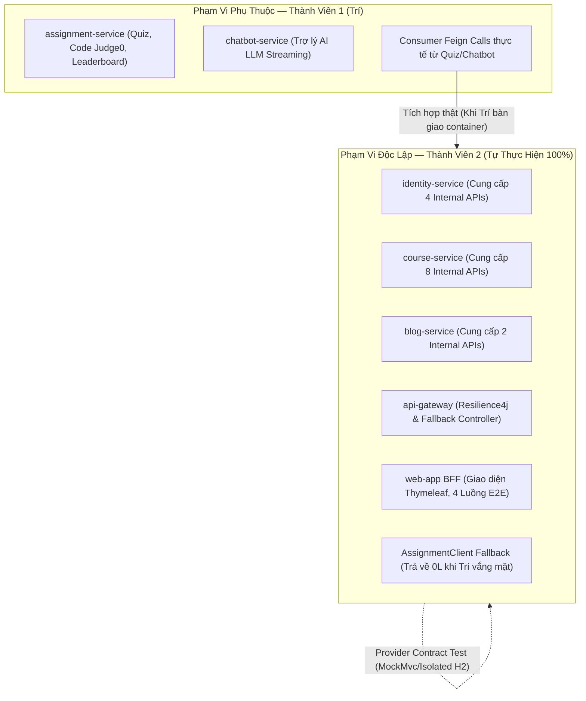
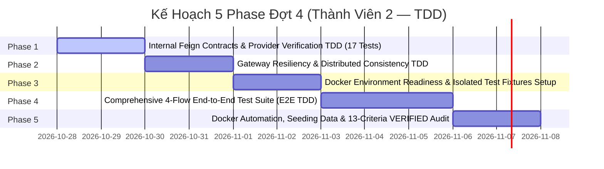

# Kế Hoạch Triển Khai Đợt 4 — Tích Hợp Đa Dịch Vụ, Chuẩn Bị Hạ Tầng & Kiểm Thử Toàn Trình (E2E) Theo TDD

- **Dự án**: EduLearn LMS (`LMS-main`)
- **Người thực hiện**: Thành viên 2 (`NVCuong3112`)
- **Nhánh làm việc chuyên biệt**: `feature/member-2-dot-4-integration`
- **Phương pháp chủ đạo**: **TDD (Test-Driven Development)** và **Test Isolation** áp dụng cho Contract Test, Resiliency Test, Docker Smoke và Toàn trình (End-to-End).
- **Tiêu chuẩn chất lượng**: Đánh giá trung thực từng tính năng theo **13 tiêu chí nghiệm thu nghiêm ngặt** quy định tại [AGENTS.md](file:///D:/LMS-main/AGENTS.md), không tự động tick `VERIFIED` trong [docs/FEATURE_PARITY_MATRIX.md](file:///D:/LMS-main/docs/FEATURE_PARITY_MATRIX.md) khi chưa đủ bằng chứng thực thi.
- **Ràng buộc lần này**: **Chỉ khảo sát chỉ đọc và cập nhật tài liệu kế hoạch**. Không viết code, không triển khai phase, không thay đổi hạ tầng, không commit/push/merge/tag. Giữ nguyên mọi thay đổi ngoài phạm vi.

---

## I. Bước 0 — Đối Chiếu Thực Tế & Khảo Sát Mã Nguồn (Code Evidence)

### 1. Nguồn tài liệu quy định và tham chiếu đối chiếu
- [AGENTS.md](file:///D:/LMS-main/AGENTS.md): Phân vùng quyền hạn (READ-ONLY với `Learning-Management-System-main/`, READ-WRITE với `D:\LMS-main`), 13 tiêu chí nghiệm thu VERIFIED, cấm giả lập dữ liệu (mocking) để báo hoàn thành.
- [docs/TEAM_ROLES.md](file:///D:/LMS-main/docs/TEAM_ROLES.md): Phân định trách nhiệm — Member 2 phụ trách `identity-service`, `course-service`, `blog-service`, `web-app` BFF, và phần dùng chung `api-gateway`, `service-registry`. Member 1 (Trí) phụ trách `assignment-service`, `chatbot-service`.
- [docs/GIT_WORKFLOW.md](file:///D:/LMS-main/docs/GIT_WORKFLOW.md): Quy trình phân nhánh, commit Conventional Commits tiếng Việt có dấu, cấm force-push, cấm commit mã nguồn khi test còn fail.
- [docs/CODING_RULES.md](file:///D:/LMS-main/docs/CODING_RULES.md): Chuẩn kiến trúc Clean Architecture, DTO validation, xử lý exception tập trung.
- [docs/API_CONTRACT.md](file:///D:/LMS-main/docs/API_CONTRACT.md): Hợp đồng API công khai và nội bộ.
- [docs/FEATURE_PARITY_MATRIX.md](file:///D:/LMS-main/docs/FEATURE_PARITY_MATRIX.md): Ma trận đối chiếu tính năng giữa dự án mẫu và `LMS-main`.
- [docs/progress/member-2.md](file:///D:/LMS-main/docs/progress/member-2.md): Nhật ký tiến độ thực tế đã ghi nhận.

### 2. Mốc tham chiếu số liệu kiểm thử Phase 7 (Báo cáo lịch sử)
Theo báo cáo nghiệm thu Phase 7 được ghi nhận tại [docs/progress/member-2.md](file:///D:/LMS-main/docs/progress/member-2.md#L74-L81) và [docs/DOCKER_SMOKE_TESTS.md](file:///D:/LMS-main/docs/DOCKER_SMOKE_TESTS.md):
- **Java Test Cases**: **284 test cases** trong một lần chạy Maven reactor (`mvn test -f backend/pom.xml`).
- **JavaScript Test Cases**: **53 test cases** của `web-app` (logic countdown OTP, form validation, DOM assertions).
- **Docker HTTP Smoke Test Cases**: **4 test cases** (Actuator health, Login JWT, Profile avatar presigned URL, Public courses).
- **Browser Playwright E2E Test Cases**: **3 test cases** (kiểm thử trình duyệt Chromium với direct upload MinIO CORS).

*(Ghi chú bắt buộc: Đây là mốc tham chiếu kết quả lịch sử đã được báo cáo nghiệm thu tại Phase 7; tài liệu Đợt 4 không tuyên bố đã chạy lại toàn bộ mốc này trong bước chỉnh sửa tài liệu).*

### 3. Bảng bằng chứng đối chiếu phân hệ, cổng và tuyến bảo mật thực tế

| Phân hệ / Dịch vụ | Cổng Container & Host Thực Tế | Tuyến Gateway & Bộ Lọc | Whitelist / Security Trong Service | Bằng chứng File / Class / Method | Trạng thái Thực Tế Tại LMS-main |
|---|:---:|---|---|---|:---:|
| `service-registry` | `8761:8761` | Không qua Gateway | Cho phép kết nối đăng ký service nội bộ | [ServiceRegistryApplication.java](file:///D:/LMS-main/backend/service-registry/src/main/java/com/lms/serviceregistry/ServiceRegistryApplication.java) | `VERIFIED` (Đang chạy healthy) |
| `api-gateway` | `8080:8080` / `/api` | Định tuyến ngược, `AuthFilter` (inject `X-User-*`), CircuitBreaker Resilience4j | Không có route riêng cho `/internal/**` | [application.yaml](file:///D:/LMS-main/backend/api-gateway/src/main/resources/application.yaml), [AuthFilter.java:54](file:///D:/LMS-main/backend/api-gateway/src/main/java/com/lms/apigateway/configuration/AuthFilter.java#L54) | `TESTED` (**Chưa có GatewayFallbackController.java**) |
| `identity-service` | `8081:8081` / `/identity` | Whitelist `/auth/**`, Private `/users/**`, `/admin/**` | Whitelist `"/internal/**"` (`SecurityConfig:56`) | [InternalUserController.java](file:///D:/LMS-main/backend/identity-service/src/main/java/com/lms/identityservice/controller/InternalUserController.java), [SecurityConfig.java:56](file:///D:/LMS-main/backend/identity-service/src/main/java/com/lms/identityservice/configuration/SecurityConfig.java#L56) | `TESTED` (Đang chạy healthy) |
| `course-service` | `8082:8082` / `/course` | Whitelist `/courses` (GET public), Private `/courses/**` | Whitelist `"/internal/**"` (`SecurityConfig:43`) | [InternalCourseController.java](file:///D:/LMS-main/backend/course-service/src/main/java/com/lms/courseservice/controller/InternalCourseController.java), [SecurityConfig.java:43](file:///D:/LMS-main/backend/course-service/src/main/java/com/lms/courseservice/configuration/SecurityConfig.java#L43) | `TESTED` (Đang chạy healthy) |
| `blog-service` | `8084:8084` / `/blog` | Whitelist `/posts/public/**`, Private `/posts/**` | Whitelist `"/internal/**"` (`SecurityConfig:43`) | [InternalBlogController.java](file:///D:/LMS-main/backend/blog-service/src/main/java/com/lms/blogservice/controller/InternalBlogController.java), [SecurityConfig.java:43](file:///D:/LMS-main/backend/blog-service/src/main/java/com/lms/blogservice/configuration/SecurityConfig.java#L43) | `TESTED` (Đang chạy healthy) |
| `web-app` (BFF) | Container `8088`, Host `8088` (`8088:8088`) | Giao diện người dùng Thymeleaf MVC, gọi API qua Gateway :8080 | Session cookie, CSRF token, Spring Security Form Login | [application.yml:2](file:///D:/LMS-main/backend/web-app/src/main/resources/application.yml#L2) (`server.port: 8088`), [docker-compose.yml:318](file:///D:/LMS-main/docker-compose.yml#L318), [GatewayClient.java](file:///D:/LMS-main/backend/web-app/src/main/java/com/lms/webapp/client/GatewayClient.java), [AuthController.java:56](file:///D:/LMS-main/backend/web-app/src/main/java/com/lms/webapp/controller/AuthController.java#L56) | `TESTED` (Đang chạy healthy trên cổng 8088) |
| `mysql` | Container `3306`, Host mặc định `3307` (`${MYSQL_PORT:-3307}:3306`) | CSDL quan hệ nội bộ cho Identity, Course, Blog | Tài khoản root / mật khẩu môi trường | [docker-compose.yml:21](file:///D:/LMS-main/docker-compose.yml#L21) (`${MYSQL_PORT:-3307}:3306`) | `VERIFIED` (Đang chạy healthy) |
| `assignment-service` *(Trí)* | Container `8083:8083` / `/assignment` | Định tuyến qua Gateway `id: assignment-service` | Whitelist `/internal/**` trong sample | [InternalController.java (sample)](file:///D:/LMS-main/Learning-Management-System-main/backend/assignment-service/src/main/java/com/lms/assignmentservice/controller/InternalController.java) | `NOT_STARTED` trong `D:\LMS-main` *(Phụ thuộc Trí)* |
| `chatbot-service` *(Trí)* | Container `8086:8086` / `/chatbot` | Định tuyến qua Gateway `id: chatbot-service` | Whitelist `/internal/**` trong sample | [InternalController.java (sample)](file:///D:/LMS-main/Learning-Management-System-main/backend/chatbot-service/src/main/java/com/lms/chatbotservice/controller/InternalController.java) | `NOT_STARTED` trong `D:\LMS-main` *(Phụ thuộc Trí)* |

---

## II. Kiểm Kê Thực Tế & Thống Nhất Số Lượng Internal APIs

### 1. Phân loại 16 Internal Endpoints thực tế
- **Tổng số endpoint nội bộ có sẵn trong controller của Member 2**: **14 endpoints** (4 Identity + 8 Course + 2 Blog).
- **Số endpoint đã xác nhận có Consumer thực tế đang gọi**: **8 endpoints** (5 endpoints được `assignment-service` và `chatbot-service` của Trí gọi + 3 endpoints được nội bộ `course-service` và `blog-service` gọi).
- **Số endpoint có sẵn trong code Member 2 nhưng chưa xác nhận nhu cầu từ Trí**: **6 endpoints** (1 Identity + 3 Course + 2 Blog).
- **Số endpoint do Trí cung cấp mà Member 2 tiêu thụ**: **2 endpoints** (`course-service` gọi `assignment-service` qua `AssignmentClient`).

### 2. Bảng kiểm kê chi tiết từng Internal Endpoint

| STT | Service Cung Cấp | HTTP Method & Đường Dẫn (Path) | Request / Param DTO | Response Model | Quyền Truy Cập (Auth) | Service Tiêu Thụ Thực Tế (Consumer) | Vị Trí Mã Nguồn Cung Cấp | Trạng Thái Hiện Tại |
|:---:|---|---|---|---|---|---|---|:---:|
| **1** | `identity-service` | `GET /internal/user/{id}` | Path: `id` (String) | `UserFullResponse` (Direct DTO) | Whitelist (`SecurityConfig:56`) | `course-service` ([IdentityClient:22](file:///D:/LMS-main/backend/course-service/src/main/java/com/lms/courseservice/configuration/IdentityClient.java#L22)), `assignment-service` ([IdentityClient:26](file:///D:/LMS-main/Learning-Management-System-main/backend/assignment-service/src/main/java/com/lms/assignmentservice/repository/httpclient/IdentityClient.java#L26)) | [InternalUserController.java:23](file:///D:/LMS-main/backend/identity-service/src/main/java/com/lms/identityservice/controller/InternalUserController.java#L23) | **Đã có sẵn — Đã xác nhận consumer** |
| **2** | `identity-service` | `POST /internal/users/batch` | Body: `Set<String>` userIds | `List<UserFullResponse>` (Direct DTO) | Whitelist (`SecurityConfig:56`) | `assignment-service` ([IdentityClient:30](file:///D:/LMS-main/Learning-Management-System-main/backend/assignment-service/src/main/java/com/lms/assignmentservice/repository/httpclient/IdentityClient.java#L30) — Leaderboard) | [InternalUserController.java:28](file:///D:/LMS-main/backend/identity-service/src/main/java/com/lms/identityservice/controller/InternalUserController.java#L28) | **Đã có sẵn — Đã xác nhận consumer** |
| **3** | `identity-service` | `GET /internal/users/{userId}/exists` | Path: `userId` (String) | `boolean` (Primitive) | Whitelist (`SecurityConfig:56`) | `course-service` ([IdentityClient:19](file:///D:/LMS-main/backend/course-service/src/main/java/com/lms/courseservice/configuration/IdentityClient.java#L19)), `blog-service` ([IdentityClient:17](file:///D:/LMS-main/backend/blog-service/src/main/java/com/lms/blogservice/configuration/IdentityClient.java#L17)) | [InternalUserController.java:33](file:///D:/LMS-main/backend/identity-service/src/main/java/com/lms/identityservice/controller/InternalUserController.java#L33) | **Đã có sẵn — Đã xác nhận consumer** |
| **4** | `identity-service` | `GET /internal/users/search/by-email` | Query: `email` (String) | `UserFullResponse` (Direct DTO) | Whitelist (`SecurityConfig:56`) | `course-service` ([IdentityClient:25](file:///D:/LMS-main/backend/course-service/src/main/java/com/lms/courseservice/configuration/IdentityClient.java#L25)). Trí chưa gọi | [InternalUserController.java:38](file:///D:/LMS-main/backend/identity-service/src/main/java/com/lms/identityservice/controller/InternalUserController.java#L38) | **Đã có sẵn — Chưa xác nhận nhu cầu từ Trí** |
| **5** | `course-service` | `GET /internal/courses/{courseId}` | Path: `courseId` (String) | `InternalCourseResponse` (Direct DTO) | Whitelist (`SecurityConfig:43`) | `assignment-service` ([CourseClient:20](file:///D:/LMS-main/Learning-Management-System-main/backend/assignment-service/src/main/java/com/lms/assignmentservice/repository/httpclient/CourseClient.java#L20) — Validate khóa học) | [InternalCourseController.java:23](file:///D:/LMS-main/backend/course-service/src/main/java/com/lms/courseservice/controller/InternalCourseController.java#L23) | **Đã có sẵn — Đã xác nhận consumer** |
| **6** | `course-service` | `GET /internal/courses/{courseId}/lessons/{lessonId}` | Path: `courseId`, `lessonId` (String) | `InternalLessonResponse` (Direct DTO) | Whitelist (`SecurityConfig:43`) | Trí chưa khai báo trong `CourseClient` | [InternalCourseController.java:28](file:///D:/LMS-main/backend/course-service/src/main/java/com/lms/courseservice/controller/InternalCourseController.java#L28) | **Đã có sẵn — Chưa xác nhận nhu cầu từ Trí** |
| **7** | `course-service` | `GET /internal/courses/{courseId}/enrollments/{userId}` | Path: `courseId`, `userId` (String) | `Boolean` (Wrapper) | Whitelist (`SecurityConfig:43`) | `assignment-service` ([CourseClient:27](file:///D:/LMS-main/Learning-Management-System-main/backend/assignment-service/src/main/java/com/lms/assignmentservice/repository/httpclient/CourseClient.java#L27) — Kiểm tra quyền nộp bài) | [InternalCourseController.java:33](file:///D:/LMS-main/backend/course-service/src/main/java/com/lms/courseservice/controller/InternalCourseController.java#L33) | **Đã có sẵn — Đã xác nhận consumer** |
| **8** | `course-service` | `GET /internal/courses/{courseId}/students/count` | Path: `courseId` (String) | `Long` (Wrapper) | Whitelist (`SecurityConfig:43`) | `assignment-service` ([CourseClient:31](file:///D:/LMS-main/Learning-Management-System-main/backend/assignment-service/src/main/java/com/lms/assignmentservice/repository/httpclient/CourseClient.java#L31) — Thống kê) | [InternalCourseController.java:38](file:///D:/LMS-main/backend/course-service/src/main/java/com/lms/courseservice/controller/InternalCourseController.java#L38) | **Đã có sẵn — Đã xác nhận consumer** |
| **9** | `course-service` | `GET /internal/courses/{courseId}/exists` | Path: `courseId` (String) | `Boolean` (Wrapper) | Whitelist (`SecurityConfig:43`) | Trí dùng `getCourse` bắt 404 thay vì gọi API này | [InternalCourseController.java:43](file:///D:/LMS-main/backend/course-service/src/main/java/com/lms/courseservice/controller/InternalCourseController.java#L43) | **Đã có sẵn — Chưa xác nhận nhu cầu từ Trí** |
| **10** | `course-service` | `GET /internal/courses/{courseId}/lessons/{lessonId}/exists` | Path: `courseId`, `lessonId` (String) | `Boolean` (Wrapper) | Whitelist (`SecurityConfig:43`) | Trí chưa khai báo gọi | [InternalCourseController.java:48](file:///D:/LMS-main/backend/course-service/src/main/java/com/lms/courseservice/controller/InternalCourseController.java#L48) | **Đã có sẵn — Chưa xác nhận nhu cầu từ Trí** |
| **11** | `course-service` | `GET /internal/courses` | Không có | `ApiResponse<List<ChatbotCourseResponse>>` | Whitelist (`SecurityConfig:43`) | `chatbot-service` ([CourseClient:23](file:///D:/LMS-main/Learning-Management-System-main/backend/chatbot-service/src/main/java/com/lms/chatbotservice/feign/CourseClient.java#L23) — RAG Context) | [InternalCourseController.java:53](file:///D:/LMS-main/backend/course-service/src/main/java/com/lms/courseservice/controller/InternalCourseController.java#L53) | **Đã có sẵn — Đã xác nhận consumer** |
| **12** | `course-service` | `GET /internal/courses/enrolled` | Query: `userId` (String) | `ApiResponse<List<ChatbotCourseResponse>>` | Whitelist (`SecurityConfig:43`) | `chatbot-service` ([CourseClient:19](file:///D:/LMS-main/Learning-Management-System-main/backend/chatbot-service/src/main/java/com/lms/chatbotservice/feign/CourseClient.java#L19) — RAG Context) | [InternalCourseController.java:60](file:///D:/LMS-main/backend/course-service/src/main/java/com/lms/courseservice/controller/InternalCourseController.java#L60) | **Đã có sẵn — Đã xác nhận consumer** |
| **13** | `blog-service` | `GET /internal/posts/{postId}` | Path: `postId` (Long) | `ApiResponse<InternalPostResponse>` | Whitelist (`SecurityConfig:43`) | Chưa có Feign Client nào trong codebase của Trí gọi | [InternalBlogController.java:22](file:///D:/LMS-main/backend/blog-service/src/main/java/com/lms/blogservice/controller/InternalBlogController.java#L22) | **Đã có sẵn — Chưa xác nhận nhu cầu từ Trí** |
| **14** | `blog-service` | `GET /internal/posts/{postId}/exists` | Path: `postId` (Long) | `ApiResponse<Boolean>` | Whitelist (`SecurityConfig:43`) | Chưa có Feign Client nào trong codebase của Trí gọi | [InternalBlogController.java:30](file:///D:/LMS-main/backend/blog-service/src/main/java/com/lms/blogservice/controller/InternalBlogController.java#L30) | **Đã có sẵn — Chưa xác nhận nhu cầu từ Trí** |
| **15** | `assignment-service` *(Trí)* | `GET /internal/courses/{courseId}/exercise-count` | Path: `courseId` (String) | `ApiResponse<Long>` | Whitelist internal | `course-service` ([AssignmentClient:21](file:///D:/LMS-main/backend/course-service/src/main/java/com/lms/courseservice/configuration/AssignmentClient.java#L21)) | [InternalController.java:35 (sample)](file:///D:/LMS-main/Learning-Management-System-main/backend/assignment-service/src/main/java/com/lms/assignmentservice/controller/InternalController.java#L35) | **Cần kiểm chứng Fallback (Trí chưa chạy)** |
| **16** | `assignment-service` *(Trí)* | `POST /internal/courses/exercise-counts` | Body: `List<String>` courseIds | `ApiResponse<Map<String, Long>>` | Whitelist internal | `course-service` ([AssignmentClient:24](file:///D:/LMS-main/backend/course-service/src/main/java/com/lms/courseservice/configuration/AssignmentClient.java#L24)) | [InternalController.java:42 (sample)](file:///D:/LMS-main/Learning-Management-System-main/backend/assignment-service/src/main/java/com/lms/assignmentservice/controller/InternalController.java#L42) | **Cần kiểm chứng Fallback (Trí chưa chạy)** |

---

## III. Phân Tích & Làm Rõ Bảo Mật API Nội Bộ (Service-to-Service Security)

### 1. Cơ chế định tuyến và luồng gọi thực tế
- **Feign gọi trực tiếp service, KHÔNG qua API Gateway**:
  * Tại [course-service/src/main/resources/application.yaml:51-54](file:///D:/LMS-main/backend/course-service/src/main/resources/application.yaml#L51-L54) và [blog-service/src/main/resources/application.yaml:60](file:///D:/LMS-main/backend/blog-service/src/main/resources/application.yaml#L60), URL của Feign Client trỏ trực tiếp vào hostname/cổng của service đích (ví dụ `${IDENTITY_SERVICE_URL:http://localhost:8081/identity}`).
  * Tại [api-gateway/src/main/resources/application.yaml](file:///D:/LMS-main/backend/api-gateway/src/main/resources/application.yaml), không có route riêng cho `/internal/**`.

### 2. Phân tích rủi ro khi có Route Rộng (Wildcard Routes) tại Gateway
- **Rà soát tuyến wildcard**: Gateway có cấu hình route rộng:
  * `id: course-service`: `Path=${app.prefix-api}/course/**` với filter `StripPrefix=1` và `AuthFilter`.
  * `id: blog-service`: `Path=${app.prefix-api}/blog/**` với filter `StripPrefix=1` và `AuthFilter`.
- **Hành vi chuyển tiếp khi gọi đường dẫn có tiền tố service**:
  * Khi client gọi `GET /api/course/internal/courses` hoặc `GET /api/blog/internal/posts/1`:
    1. Gateway match predicate `/api/course/**`.
    2. Filter `StripPrefix=1` loại bỏ `/api`, chuyển đường dẫn thành `/course/internal/courses`.
    3. `AuthFilter` kiểm tra JWT: Nếu không có JWT (anonymous), trả về HTTP 401 Unauthorized.
    4. **Nếu client gửi kèm JWT hợp lệ của một người dùng thông thường (ROLE_STUDENT)**: `AuthFilter` inject các headers `X-User-*` và forward request xuống downstream `course-service`.
    5. Tại `course-service`: `context-path` là `/course`, controller match `/internal/courses`. Vì `SecurityConfig.java:43` đang khai báo `permitAll("/internal/**")`, request từ người dùng thông thường này **có nguy cơ lọt qua và được xử lý thành công**!
  * **Kết luận**: Khẳng định "Gateway không route internal, mọi request đều nhận 404" là **chưa chính xác**. Đường dẫn dạng `/internal/**` không có prefix service sẽ nhận 404, nhưng đường dẫn dạng `/api/course/internal/**` có thể bị route wildcard chuyển tiếp xuống downstream.

### 3. Kịch bản kiểm thử bảo mật API nội bộ dự kiến (Security Test Matrix)

| STT | Loại Yêu Cầu (Caller Type) | Đường Dẫn Thử Nghiệm (Path) | Headers Kèm Theo | Trạng Thái Mong Đợi Theo Chính Sách An Toàn | Kết Quả Runtime Thực Tế |
|:---:|---|---|---|:---:|:---:|
| 1 | Anonymous (Chưa đăng nhập) | `GET :8080/internal/user/1` | Không | **HTTP 404 Not Found** (Gateway không match route) | Cần kiểm chứng tại Phase 1 |
| 2 | Anonymous (Chưa đăng nhập) | `GET :8080/api/course/internal/courses` | Không | **HTTP 401 Unauthorized** (Bị `AuthFilter` Gateway chặn) | Cần kiểm chứng tại Phase 1 |
| 3 | User thường (`ROLE_STUDENT`) | `GET :8080/api/course/internal/courses` | Bearer Token hợp lệ | **Phải bị từ chối: HTTP 403 Forbidden hoặc 404** (Cần chính sách chặn gọi endpoint internal từ client) | Cần kiểm chứng tại Phase 1 |
| 4 | Lời gọi nội bộ hợp lệ (Feign) | `GET :8081/identity/internal/user/{id}` | Internal Direct Call | **HTTP 200 OK** (Dữ liệu trả về đúng schema DTO) | Cần kiểm chứng tại Phase 1 |

### 4. Đề xuất phương án bảo mật nội bộ & Mục CẦN XÁC NHẬN
- **Network Isolation**: Chuyển các container nội bộ (`identity`, `course`, `blog`, `assignment`, `chatbot`, MySQL, MongoDB, Redis) sang `expose:` thay vì `ports:` trong `docker-compose.yml`, chỉ duy nhất `api-gateway` (:8080) và `web-app` (:8088) mở cổng ra host. *(Lưu ý: Network isolation chỉ hạn chế truy cập mạng vật lý, không thay thế xác thực danh tính giữa các dịch vụ)*.
- **Service Authentication**: Đề xuất bổ sung xác thực giữa các service (ví dụ Header bí mật `X-Internal-Secret: ${INTERNAL_SECRET}`).
- **CẦN XÁC NHẬN**: Thống nhất với Thành viên 1 phương án bảo mật liên dịch vụ chính thức; tuyệt đối **không mở whitelist `/internal/**` tại API Gateway** chỉ để phục vụ kiểm thử.

---

## IV. Tách Biệt Phụ Thuộc Vào Thành Viên 1 (Trí)

Theo quy định tại [docs/TEAM_ROLES.md](file:///D:/LMS-main/docs/TEAM_ROLES.md) và [AGENTS.md](file:///D:/LMS-main/AGENTS.md):



### Nguyên tắc chất lượng liên nhóm:
1. **Phần Thành viên 2 tự chủ thực hiện**:
   - 14 Provider Contract Tests độc lập cho các endpoint nội bộ của Member 2.
   - Kiểm chứng Fallback an toàn của `AssignmentClient` trong `course-service` (trả về 0L hoặc empty map).
   - Phát triển `GatewayFallbackController` và kiểm thử Circuit Breaker Resilience4j.
   - 4 Luồng E2E độc lập của các phân hệ Học viên, Giảng viên, Blog, Admin (theo route controller thật).
2. **Phần phụ thuộc Thành viên 1**:
   - Mã nguồn thực tế của `assignment-service` và `chatbot-service`.
   - Tích hợp thật có nộp bài code (Judge0), làm quiz trắc nghiệm và trợ lý AI chatbot.
3. **Quy tắc nghiệm thu**:
   - **Mock không chứng minh tích hợp thật đã PASS**: Provider test chỉ chứng minh Member 2 sẵn sàng. Tích hợp thật chỉ nghiệm thu khi container của Trí chạy thật.
   - **Không sửa code thuộc Trí**: Bất kỳ sai khác hợp đồng nào đều ghi vào mục phối hợp liên nhóm.

---

## V. Chuẩn Hóa Phương Pháp TDD & Test Isolation

### 1. Chu trình TDD theo từng loại kịch bản

| Loại Kịch Bản | Bước Red 1 | Bước Red 2 | Bước Green |
|---|---|---|---|
| **Class / Method Mới** (Ví dụ: `GatewayFallbackController`) | Viết test `GatewayFallbackControllerTest`. Test báo **Lỗi Compile** hoặc **404 Not Found** do chưa tồn tại class/controller. | Tạo stub class và method nhưng trả về empty/chưa đúng body. Test chạy được nhưng **Assertion Fail** (so sánh status 503, JSON body code 1010). | Viết logic tối thiểu (trả về `ResponseEntity<Map<String, Object>>` đúng format). Test báo **PASS 100%**. |
| **Sửa Lỗi / Hành Vi Thiếu Sót Hiện Hữu** | Viết **Regression Test** tái hiện lỗi chính xác. Test phải FAIL rõ ràng. | Không áp dụng (chỉ có Red regression). | Sửa mã nguồn nghiệp vụ để khắc phục đúng nguyên nhân gốc rễ. Regression test chuyển sang **PASS 100%**. |
| **Chức Năng Hiện Hữu Đã Đúng Sẵn** (Ví dụ: 14 internal endpoints) | Viết test kiểm chứng hợp đồng (Contract Test). Test **PASS ngay từ lần chạy đầu tiên**. | Ghi nhận trung thực: **Kiểm chứng hành vi hiện hữu (Baseline Verification)**. | **Tuyệt đối không cố tình sửa sai code** để giả lập Red; không bịa đặt bằng chứng TDD. |

### 2. Quy tắc cô lập kiểm thử (Test Isolation)
- **Chứng minh `mvn test` chạy độc lập khi Docker tắt hoàn toàn**:
  * Không tự ý tắt stack Docker trong lần sửa tài liệu này để tránh gián đoạn dịch vụ đang chạy.
  * Tính độc lập được chứng minh bằng cấu hình mã nguồn trong [application-test.yaml](file:///D:/LMS-main/backend/identity-service/src/test/resources/application-test.yaml):
    - `spring.datasource.url: jdbc:h2:mem:...` (chạy hoàn toàn trên RAM JVM, không kết nối port MySQL 3306/3307).
    - `eureka.client.enabled: false`, `register-with-eureka: false`, `fetch-registry: false` (không gửi heartbeat ra Eureka :8761).
    - Bộ test chỉ khởi tạo Spring Context nội bộ và MockMvc, hoàn toàn không gọi Docker API (`/var/run/docker.sock` hoặc cổng 2375).
- **Tách biệt kiểm thử ngoài**: Docker Smoke Test, Fault Test và Browser E2E Playwright chạy bằng profile/lệnh riêng biệt và luôn có Prerequisite Check.

---

## VI. Cấu Trúc Chi Tiết 5 Phase Triển Khai Của Đợt 4

Thứ tự triển khai: **Chuẩn bị hạ tầng & Fixtures (Phase 3) được đưa lên trước Bộ kiểm thử E2E (Phase 4)** để đảm bảo môi trường sẵn sàng trước khi chạy kịch bản toàn trình.



---

### Phase 1: Kiểm Thử Hợp Đồng Feign Nội Bộ & Khả Năng Tương Thích Nhà Cung Cấp (Internal Feign Contracts & Provider Verification TDD)

- **Mục tiêu**: Kiểm chứng 14 endpoints nội bộ của Member 2 sẵn sàng phục vụ theo hợp đồng DTO, mã lỗi và serialization; kiểm chứng Fallback an toàn của `AssignmentClient` qua 3 cấp độ:
  1. *Cấp độ Fallback Bean*: Kiểm chứng hợp đồng phương thức của lớp `AssignmentClient.Fallback` (trả về `0L` và `Map.of()`).
  2. *Cấp độ Service Resilience*: Kiểm chứng `CourseServiceImpl` bắt ngoại lệ an toàn qua khối `try/catch` khi client gặp sự cố.
  3. *Cấp độ Feign Proxy Auto-Fallback*: Kiểm chứng Spring Cloud OpenFeign proxy thực sự tự động kích hoạt Fallback khi downstream gặp lỗi HTTP 500/kết nối thông qua `spring-cloud-starter-circuitbreaker-resilience4j`.

- **Phân loại rõ ràng các nhóm test trong Phase 1**:
  * **17 test cases thuộc danh sách kế hoạch ban đầu**: Gồm 15 Provider Contract Tests (bao phủ 14 endpoints của Member 2) + 2 Unit Fallback Contract Tests.
  * **1 test bổ sung cấp Service**: `CourseServiceImplTest#getCourseByIdGracefullyHandlesAssignmentServiceFailure` (kiểm chứng try/catch ở tầng nghiệp vụ).
  * **3 test bổ sung cấp Feign Proxy**: `AssignmentClientProxyIntegrationTest` (chạy qua Feign proxy thật kết nối HTTP server cục bộ cổng động theo test lifecycle).

#### 1. Danh sách 17 test cases Phase 1 theo kế hoạch ban đầu:

| STT | Endpoint / Hành Vi Kiểm Thử | Dữ Liệu Input Thử Nghiệm | Điều Kiện Tiên Quyết / Môi Trường Cô Lập | Assertions Chi Tiết (Status & Body) | Phân Loại TDD | Lệnh Thực Thi Kiểm Thử Thực Tế (Từ `D:\LMS-main`) | Kết Quả Thực Tế |
|:---:|---|---|---|---|:---:|---|:---:|
| 1 | `GET /internal/user/{id}` | Path: `user-1` | `@WebMvcTest`, Mock `InternalUserService.getUserById("user-1")` | HTTP 200, JSON schema `UserFullResponse`: `userId: "user-1"`, `username: "student01"`, `email`, `fullname`, `role: "STUDENT"` | Tái sử dụng (Baseline) | `mvn test -f backend/pom.xml -pl identity-service -Dtest=IdentityApiIntegrationTest#internalGetUserHttpContractReturns200AndUserDetails` | **PASS** |
| 2 | `GET /internal/user/{id}` (404) | Path: `user-not-found` | `@WebMvcTest`, Mock `InternalUserService.getUserById` ném `IdentityException(USER_NOT_EXISTED)` | HTTP 404 Not Found, JSON body `code: 1003` (`USER_NOT_EXISTED`) | Tái sử dụng (Baseline Verification) — Bổ sung kiểm chứng hành vi 404 hiện hữu | `mvn test -f backend/pom.xml -pl identity-service -Dtest=IdentityApiIntegrationTest#internalGetUserNotFoundHttpContractReturns404` | **PASS** |
| 3 | `POST /internal/users/batch` | Body: `["user-1", "user-2"]` | `@WebMvcTest`, Mock `InternalUserService.getUsersByIds` trả về danh sách 2 users | HTTP 200, JSON Array kích thước 2, `$[0].userId: "user-1"`, `$[1].userId: "user-2"` | Tái sử dụng (Baseline) | `mvn test -f backend/pom.xml -pl identity-service -Dtest=IdentityApiIntegrationTest#internalPostUsersBatchHttpContractReturns200` | **PASS** |
| 4 | `GET /internal/users/{userId}/exists` | Path: `user-1`, `user-999` | `@WebMvcTest`, Mock `InternalUserService.existsById` trả về `true`/`false` | HTTP 200, Response Body là `"true"` / `"false"` (primitive boolean) | Tái sử dụng (Baseline) | `mvn test -f backend/pom.xml -pl identity-service -Dtest=IdentityApiIntegrationTest#internalUserExistsHttpContractReturnsBoolean` | **PASS** |
| 5 | `GET /internal/users/search/by-email` | Query: `email=student01@example.com` | `@WebMvcTest`, Mock `InternalUserService.findByEmail` | HTTP 200, JSON schema `UserFullResponse`: `userId: "user-1"`, `email: "student01@example.com"` | Tái sử dụng (Baseline) | `mvn test -f backend/pom.xml -pl identity-service -Dtest=IdentityApiIntegrationTest#internalSearchUserByEmailHttpContractReturnsUser` | **PASS** |
| 6 | `GET /internal/courses/{courseId}` | Path: `course-test-123` | `@WebMvcTest`, Mock `InternalCourseService.getCourse` | HTTP 200, JSON schema `InternalCourseResponse`: `id`, `title`, `instructorId`, `status: "PUBLIC"` | Tái sử dụng (Baseline) | `mvn test -f backend/pom.xml -pl course-service -Dtest=InternalCourseApiIntegrationTest#internalGetCourseHttpContractReturns200` | **PASS** |
| 7 | `GET /internal/courses/{courseId}/lessons/{lessonId}` | Path: `course-test-123`, `lesson-test-456` | `@WebMvcTest`, Mock `InternalCourseService.getLesson` | HTTP 200, JSON schema `InternalLessonResponse`: `id`, `lessonType: "video"`, `courseId` | Tái sử dụng (Baseline) | `mvn test -f backend/pom.xml -pl course-service -Dtest=InternalCourseApiIntegrationTest#internalGetLessonHttpContractReturns200` | **PASS** |
| 8 | `GET /internal/courses/{courseId}/enrollments/{userId}` | Path: `course-test-123`, `user-test-789` | `@WebMvcTest`, Mock `InternalCourseService.existsEnrollment` | HTTP 200, Response Body là `"true"` (Boolean wrapper) | Tái sử dụng (Baseline) | `mvn test -f backend/pom.xml -pl course-service -Dtest=InternalCourseApiIntegrationTest#internalCheckEnrollmentHttpContractReturnsBoolean` | **PASS** |
| 9 | `GET /internal/courses/{courseId}/students/count` | Path: `course-test-123` | `@WebMvcTest`, Mock `InternalCourseService.countStudents` | HTTP 200, Response Body là `"42"` (Long wrapper) | Tái sử dụng (Baseline) | `mvn test -f backend/pom.xml -pl course-service -Dtest=InternalCourseApiIntegrationTest#internalCountStudentsHttpContractReturnsLong` | **PASS** |
| 10 | `GET /internal/courses/{courseId}/exists` | Path: `course-test-123` | `@WebMvcTest`, Mock `InternalCourseService.existsCourse` | HTTP 200, Response Body là `"true"` (Boolean wrapper) | Tái sử dụng (Baseline) | `mvn test -f backend/pom.xml -pl course-service -Dtest=InternalCourseApiIntegrationTest#internalCourseExistsHttpContractReturnsBoolean` | **PASS** |
| 11 | `GET /internal/courses/{courseId}/lessons/{lessonId}/exists` | Path: `course-test-123`, `lesson-test-456` | `@WebMvcTest`, Mock `InternalCourseService.existsLesson` | HTTP 200, Response Body là `"true"` (Boolean wrapper) | Tái sử dụng (Baseline) | `mvn test -f backend/pom.xml -pl course-service -Dtest=InternalCourseApiIntegrationTest#internalLessonExistsHttpContractReturnsBoolean` | **PASS** |
| 12 | `GET /internal/courses` | Không có param | `@WebMvcTest`, Mock `InternalCourseService.getAllPublishedCourses` | HTTP 200, `ApiResponse<List<ChatbotCourseResponse>>`: `code: 1000`, `data[0].id`, `data[0].title` | Tái sử dụng (Baseline) | `mvn test -f backend/pom.xml -pl course-service -Dtest=InternalCourseApiIntegrationTest#internalGetAllCoursesHttpContractReturnsList` | **PASS** |
| 13 | `GET /internal/courses/enrolled` | Query: `userId=user-test-789` | `@WebMvcTest`, Mock `InternalCourseService.getEnrolledCourses` | HTTP 200, `ApiResponse<List<ChatbotCourseResponse>>`: `code: 1000`, `data[0].id`, `data[0].title` | Tái sử dụng (Baseline) | `mvn test -f backend/pom.xml -pl course-service -Dtest=InternalCourseApiIntegrationTest#internalGetEnrolledCoursesHttpContractReturnsList` | **PASS** |
| 14 | `GET /internal/posts/{postId}` | Path: `1` | `@WebMvcTest`, Mock `InternalBlogService.getPost(1L)` | HTTP 200, `ApiResponse<InternalPostResponse>`: `code: 1000`, `data.id: 1`, `data.title`, `data.status: "PUBLISHED"` | Tái sử dụng (Baseline) | `mvn test -f backend/pom.xml -pl blog-service -Dtest=BlogApiIntegrationTest#internalGetPostHttpContractReturns200` | **PASS** |
| 15 | `GET /internal/posts/{postId}/exists` | Path: `1` | `@WebMvcTest`, Mock `InternalBlogService.existsPost(1L)` | HTTP 200, `ApiResponse<Boolean>`: `code: 1000`, `data: true` | Tái sử dụng (Baseline) | `mvn test -f backend/pom.xml -pl blog-service -Dtest=BlogApiIntegrationTest#internalPostExistsHttpContractReturnsBoolean` | **PASS** |
| 16 | `course-service` -> `AssignmentClient.Fallback` (Single Count) | Method Call: `fallback.getExerciseCount("course-123")` | Khởi tạo bean fallback trong ngữ cảnh test cô lập | Kiểm chứng hợp đồng Fallback: trả về `ApiResponse<Long>` với `data = 0L` | Bổ sung mới (Baseline Contract) | `mvn test -f backend/pom.xml -pl course-service -Dtest=AssignmentClientFallbackTest#assignmentClientFallbackReturnsZeroExerciseCountWhenInvoked` | **PASS** |
| 17 | `course-service` -> `AssignmentClient.Fallback` (Batch Count) | Method Call: `fallback.getExerciseCountBatch(["c-1", "c-2"])` | Khởi tạo bean fallback trong ngữ cảnh test cô lập | Kiểm chứng hợp đồng Fallback: trả về `ApiResponse<Map<String, Long>>` với `data = Map.of()` rỗng | Bổ sung mới (Baseline Contract) | `mvn test -f backend/pom.xml -pl course-service -Dtest=AssignmentClientFallbackTest#assignmentClientFallbackReturnsEmptyMapForBatchWhenInvoked` | **PASS** |

#### 2. Danh sách 3 test cases Feign Proxy Auto-Fallback (Kiểm chứng qua HTTP Server cục bộ):

| STT | Kịch Bản Kiểm Thử Proxy | Input & Trạng Thái Downstream | Môi Trường Test Cô Lập | Assertions Kiểm Chứng | Phân Loại TDD | Lệnh Thực Thi (Từ `D:\LMS-main`) | Kết Quả |
|:---:|---|---|---|---|:---:|---|:---:|
| 18 | Feign Proxy Gọi Thành Công | Downstream trả HTTP 200, `{"code":1000,"data":42}` | `HttpServer` cục bộ cổng động, `@SpringBootTest` | `response.getData() == 42L` (khác fallback 0L); xác nhận request tới server test | TDD Verification | `mvn test -f backend/pom.xml -pl course-service -Dtest=AssignmentClientProxyIntegrationTest#exerciseCountReturnsRealDataWhenDownstreamSucceeds` | **PASS** |
| 19 | Feign Proxy Tự Động Fallback (Single Count) | Downstream trả HTTP 500 `Internal Server Error` | `HttpServer` cục bộ cổng động, `@SpringBootTest` | Proxy bắt lỗi 500, kích hoạt fallback trả về `ApiResponse<Long> = 0L`, không ném FeignException | TDD Red -> Green | `mvn test -f backend/pom.xml -pl course-service -Dtest=AssignmentClientProxyIntegrationTest#exerciseCountProxyTriggersFallbackWhenDownstreamFails` | **PASS** |
| 20 | Feign Proxy Tự Động Fallback (Batch Count) | Downstream trả HTTP 500 `Internal Server Error` | `HttpServer` cục bộ cổng động, `@SpringBootTest` | Proxy bắt lỗi 500, kích hoạt fallback trả về `ApiResponse<Map<String, Long>> = Map.of()`, không ném FeignException | TDD Red -> Green | `mvn test -f backend/pom.xml -pl course-service -Dtest=AssignmentClientProxyIntegrationTest#exerciseCountBatchProxyTriggersFallbackWhenDownstreamFails` | **PASS** |

- **Tiêu chuẩn hoàn thành Phase 1**:
  * Đầy đủ 17/17 test cases kế hoạch + 3 test Feign proxy + 1 test service resilience chạy PASS 100% trên môi trường cô lập, hoàn toàn độc lập với Docker và CSDL ngoài.
  * Báo cáo kết quả thực tế, **dừng lại chờ người dùng nghiệm thu** trước khi chuyển Phase 2.
  * Commit: `test(feign): kiểm chứng hợp đồng api nội bộ và cơ chế auto-fallback feign proxy`.

---

### Phase 2: Cơ Chế Chịu Lỗi Gateway & Tính Toàn Vẹn Dữ Liệu Phân Tán (Gateway Resiliency & Distributed Consistency TDD)

- **Mục tiêu**: Bổ sung `GatewayFallbackController` còn thiếu trong `api-gateway` theo đúng TDD; kiểm chứng hành vi Circuit Breaker và Timeout theo cấu hình thực tế bằng server HTTP cục bộ cổng động; hoàn thiện xử lý lỗi tại BFF (`web-app`); và kiểm chứng tính nhất quán phân tán khi user hoặc khóa học bị khóa.
- **Khảo sát cấu hình & Điều chỉnh mã lỗi**:
  * Circuit Breaker cấu hình thực tế: `sliding-window-size: 10`, `minimum-number-of-calls: 5`, `failure-rate-threshold: 50%`, `wait-duration-in-open-state: 10s`.
  * Timelimiter: default 10s, `courseServiceCircuitBreaker` 15s, `assignmentServiceCircuitBreaker` 15s, `assignmentAiServiceCircuitBreaker` 130s, `chatbotServiceCircuitBreaker` 130s.
  * **Chuẩn hóa mã lỗi Fallback**: Sử dụng mã lỗi chính thức **1405** (`ErrorCode.EXTERNAL_SERVICE_UNAVAILABLE` trong `api-gateway` và project mẫu `Learning-Management-System-main`), thay vì mã tạm 1010 trong dự thảo ban đầu để tránh xung đột mã với `identity-service`.
  * **Hợp đồng lỗi Fallback**: Trả về **HTTP 503 Service Unavailable**, JSON body:
    ```json
    {
      "status": 503,
      "error": "Service Unavailable",
      "message": "Dịch vụ đích hiện không khả dụng hoặc không thể kết nối. Vui lòng thử lại sau.",
      "code": 1405,
      "service": "{serviceName}",
      "path": "{requestPath}",
      "timestamp": "2026-10-28T01:17:42.930Z"
    }
    ```
    *Tuyệt đối không làm lộ stack trace, IP nội bộ hoặc thông tin nhạy cảm.*
  * **Cách BFF (`web-app`) xử lý lỗi qua `GatewayExceptionHandler` & Tinh chỉnh tuyến BFF**:
    - **Phát hiện và sửa lỗi nuốt lỗi 503 tại `CourseStudentController`**:
      * Hai route `GET /courses/{courseId}/schedules` và `GET /courses/{courseId}/announcements` trước đây dùng `catch (Exception e)` tự chuyển lỗi Gateway 503 thành HTTP 500 kèm dữ liệu rỗng `{"data":[]}`.
      * Đã sửa: Gỡ bỏ `try-catch` nuốt lỗi trong controller, để `HttpServerErrorException` từ `GatewayClient` lan truyền tự nhiên lên `GatewayExceptionHandler` xử lý tập trung, bảo toàn HTTP status 503 và mã hợp đồng 1405 cho client.
    - **Nhận diện endpoint JSON dựa trên Spring MVC Metadata**:
      * Trước đây chỉ kiểm tra header `X-Requested-With: XMLHttpRequest` và `Accept: application/json`. Khi client gọi bằng `fetch()` mặc định gửi `Accept: */*` mà không kèm `X-Requested-With`, handler trả nhầm HTML `ModelAndView` làm vỡ xử lý JSON.
      * Đã sửa: Bổ sung kiểm tra `HandlerMapping.PRODUCIBLE_MEDIA_TYPES_ATTRIBUTE` chứa `MediaType.APPLICATION_JSON`, kiểm tra handler method có `@ResponseBody`, `@RestController` hoặc trả về `ResponseEntity`. Giữ nguyên việc trả HTML view `error/503` cho request trang HTML thông thường.
    - **Lọc sạch thông tin nhạy cảm và URL nội bộ trong lỗi 4xx**:
      * Trước đây `handleHttpClientError` đưa trực tiếp `ex.getMessage()` ra client, làm lộ URL hạ tầng nội bộ (`private-service`) và marker chẩn đoán (`SQL_DIAGNOSTIC_MARKER`).
      * Đã sửa: Parse JSON body từ downstream, chỉ trích xuất các trường nghiệp vụ hợp lệ (`code`, `message`), lọc bỏ các token nhạy cảm / URL nội bộ, và có thông báo an toàn mặc định khi downstream trả body không phải JSON (HTML hoặc text).
    - **Sửa lỗi cú pháp template `error/503.html`**:
      * Khắc phục lỗi thẻ `<button>` bị đóng nhầm bằng thẻ `</a>`. Kiểm chứng template render chuẩn xác với nút thử lại (`window.location.reload()`).
    - Lỗi nghiệp vụ 4xx (400, 401, 403, 404): giữ nguyên mã trạng thái nghiệp vụ, tuyệt đối không biến thành lỗi dịch vụ 503.
  * **Cơ chế khóa User & Tính Nhất Quán**:
    - Khi Admin khóa user (`active = false`), `authenticate()` từ chối đăng nhập mới với `USER_INACTIVE` (code 1006, HTTP 403).
    - `refreshToken()` từ chối cấp token mới cho user bị khóa với `USER_INACTIVE` (code 1006, HTTP 403).
    - **CẦN XÁC NHẬN — Xử lý Access Token đã phát hành còn hiệu lực**: Access token hiện là JWT phi trạng thái (stateless) có hạn tối đa 15 phút. Gateway kiểm tra chữ ký độc lập nên access token đã cấp vẫn hợp lệ trong vòng đời còn lại (tối đa 15 phút) cho đến khi hết hạn. Nếu cần thu hồi tức thì ngay khi toggle active, hệ thống cần bổ sung blacklist tập trung (ví dụ Redis) tại Gateway.
  * **Cơ chế khóa Khóa học**: Khóa học có `CourseStatus.LOCKED` bị loại bỏ khỏi danh sách tìm kiếm/catalog public theo điều kiện `CourseSpecifications.hasStatus(CourseStatus.PUBLIC)`.

#### Bảng Kiểm Thử Thực Tế Phase 2 (Đã Kiểm Chứng 100%):

| STT | Kịch Bản Kiểm Thử | Module / Test Class | Mục Tiêu & Assertions | Phân Loại TDD | Kết Quả Thực Tế | Thời Gian |
|:---:|---|---|---|:---:|:---:|:---:|
| 1 | Fallback Controller trả 503 + JSON sanitized | `api-gateway`: `GatewayFallbackControllerTest#fallbackReturns503AndSanitizedErrorResponse` | HTTP 503, JSON sanitized có `code: 1405`, `service: "test-service"`, không lộ stack trace | TDD Red 1 -> Red 2 -> Green | **PASS** | 0.209s |
| 2 | Downstream 200 OK chuyển tiếp đúng | `api-gateway`: `GatewayCircuitBreakerIntegrationTest#downstreamSuccessResponseForwardedCorrectly` | HTTP 200, body forwarded nguyên vẹn, downstream counter = 1 | TDD Verification | **PASS** | 5.113s (suite) |
| 3 | Downstream 500 kích hoạt Fallback | `api-gateway`: `GatewayCircuitBreakerIntegrationTest#downstream500TriggersCircuitBreakerFallback` | Downstream trả 500 -> Gateway kích hoạt fallback trả HTTP 503, code 1405 | TDD Verification | **PASS** | 5.113s (suite) |
| 4 | Downstream Timeout kích hoạt Fallback | `api-gateway`: `GatewayCircuitBreakerIntegrationTest#downstreamTimeoutTriggersCircuitBreakerFallback` | Downstream trễ 1s -> Gateway ngắt timeout 300ms, trả fallback 503 trong <900ms | TDD Verification | **PASS** | 5.113s (suite) |
| 5 | Ngắt mạch (Open Circuit) chặn request | `api-gateway`: `GatewayCircuitBreakerIntegrationTest#circuitBreakerOpensAfterFailureThreshold` | Đạt ngưỡng lỗi -> Mạch OPEN; request tiếp theo bị chặn tại Gateway trước khi tới downstream (counter không tăng) | TDD Verification | **PASS** | 5.113s (suite) |
| 6 | Phục hồi mạch (Half-Open -> Closed) | `api-gateway`: `GatewayCircuitBreakerIntegrationTest#circuitBreakerRecoversFromOpenToHalfOpenToClosed` | Sau wait-duration mạch sang HALF_OPEN; request thành công giúp phục hồi mạch về CLOSED | TDD Verification | **PASS** | 5.113s (suite) |
| 7 | BFF xử lý 503 cho request HTML và render nút reload | `web-app`: `GatewayExceptionHandlerTest#htmlRequestRenders503Page` | Client nhận HTTP 503, render view `error/503`, chứa script `window.location.reload()` và nút Thử lại | TDD Red 1 -> Red 2 -> Green | **PASS** | 10.28s (suite) |
| 8 | BFF xử lý 503 cho request AJAX trả JSON | `web-app`: `GatewayExceptionHandlerTest#ajaxRequestReturns503Json` | AJAX nhận HTTP 503 JSON có `code: 1405`, không nhận HTML làm vỡ JS | TDD Red 1 -> Red 2 -> Green | **PASS** | 10.28s (suite) |
| 9 | BFF JSON endpoint trả JSON 503 khi nhận `Accept: */*` | `web-app`: `GatewayExceptionHandlerTest#jsonEndpointReturns503JsonWithWildcardAccept` | Endpoint produces JSON nhận `Accept: */*` không header AJAX vẫn trả JSON HTTP 503, code 1405 | TDD Red -> Green | **PASS** | 10.28s (suite) |
| 10 | BFF không biến lỗi 4xx thành 503 | `web-app`: `GatewayExceptionHandlerTest#business4xxNotConvertedTo503` | Lỗi 400 Bad Request và 404 Not Found giữ nguyên mã 4xx, không thành 503 | TDD Verification | **PASS** | 10.28s (suite) |
| 11 | BFF lọc sạch debug info và URL nội bộ lỗi 4xx qua MockMvc | `web-app`: `GatewayExceptionHandlerTest#client4xxErrorSanitizesDebugInfoViaMockMvc` | MockMvc xác nhận body lỗi 4xx không chứa URL `private-service` hay `SQL_DIAGNOSTIC_MARKER` | TDD Red -> Green | **PASS** | 10.28s (suite) |
| 12 | BFF xử lý an toàn khi body lỗi 4xx không phải JSON | `web-app`: `GatewayExceptionHandlerTest#client4xxErrorHandlesNonJsonBodyGracefully` | Downstream trả text/HTML -> trả thông báo an toàn, không sinh lỗi mới | TDD Red -> Green | **PASS** | 10.28s (suite) |
| 13 | Route `/schedules` bảo toàn HTTP 503 khi Gateway lỗi | `web-app`: `Phase2BffVerificationTest#schedulesPreserveGateway503OnRealController` | Controller gọi Gateway thật gặp 503 -> trả về HTTP 503 kèm JSON, không trả 500 với dữ liệu rỗng | TDD Red (4 failures) -> Green | **PASS** | 16.05s (suite) |
| 14 | Route `/announcements` bảo toàn HTTP 503 khi Gateway lỗi | `web-app`: `Phase2BffVerificationTest#announcementsPreserveGateway503OnRealController` | Controller gọi Gateway thật gặp 503 -> trả về HTTP 503 kèm JSON, không trả 500 với dữ liệu rỗng | TDD Red (4 failures) -> Green | **PASS** | 16.05s (suite) |
| 15 | Handler nhận diện endpoint JSON khi `Accept: */*` | `web-app`: `Phase2BffVerificationTest#handlerHonorsJsonEndpointForWildcardAccept` | Request attribute Spring MVC `PRODUCIBLE_MEDIA_TYPES_ATTRIBUTE` -> trả ResponseEntity thay vì ModelAndView | TDD Red -> Green | **PASS** | 16.05s (suite) |
| 16 | Handler lọc sạch thông tin nhạy cảm lỗi 4xx từ downstream | `web-app`: `Phase2BffVerificationTest#handlerDoesNotExposeInternalDetailsIn4xx` | Loại bỏ `private-service` và `SQL_DIAGNOSTIC_MARKER` khỏi body trả về | TDD Red -> Green | **PASS** | 16.05s (suite) |
| 17 | User bị khóa không thể đăng nhập | `identity-service`: `UserLockedConsistencyTest#lockedUserCannotLogin` | Đăng nhập ném `IdentityException(USER_INACTIVE)`, mã 1006, HTTP 403 | Baseline Verification | **PASS** | 0.025s (suite) |
| 18 | User bị khóa không thể refresh token | `identity-service`: `UserLockedConsistencyTest#lockedUserCannotRefreshToken` | Refresh token ném `IdentityException(USER_INACTIVE)`, mã 1006, HTTP 403 | TDD Red -> Green | **PASS** | 0.025s (suite) |
| 19 | Catalog public loại bỏ khóa học LOCKED | `course-service`: `CourseLockedConsistencyTest#publicCatalogExcludesLockedCourses` | Query status=PUBLIC áp dụng Specification chỉ lấy PUBLIC, loại bỏ LOCKED | TDD Verification | **PASS** | 1.788s (suite) |
| 20 | Admin khóa khóa học chuyển sang LOCKED | `course-service`: `CourseLockedConsistencyTest#lockCourseTransitionsStatusToLockedAndCreatesAnnouncement` | Khóa học chuyển status sang LOCKED, tạo announcement thông báo học viên | TDD Verification | **PASS** | 1.788s (suite) |
| 21 | Không thể khóa khóa học đã bị LOCKED | `course-service`: `CourseLockedConsistencyTest#cannotLockAlreadyLockedCourse` | Khóa học đã LOCKED ném `CourseException(COURSE_ALREADY_LOCKED)` | TDD Verification | **PASS** | 1.788s (suite) |

- **Tiêu chuẩn hoàn thành Phase 2 & Đính chính số liệu kiểm thử**:
  * **Đính chính số liệu**: Báo cáo ban đầu ghi nhận 29 tests của `web-app` là tập hợp các lớp được chọn (11 auth + 13 blog + 2 gateway client + 3 gateway exception handler), **không phải toàn bộ module `web-app`**. Toàn bộ module `web-app` trước khi bổ sung có 140 tests.
  * **Số liệu kiểm thử thực tế hiện tại**:
    - `api-gateway`: **21/21 tests PASS 100%**.
    - `identity-service`: **48/48 tests PASS 100%**.
    - `course-service`: **67/67 tests PASS 100%**.
    - `web-app`: **147/147 tests PASS 100%** (140 baseline + 4 `Phase2BffVerificationTest` + 3 test mới mở rộng trong `GatewayExceptionHandlerTest`).
  * Toàn bộ 4 lỗi BFF do Codex tái hiện trong `Phase2BffVerificationTest` đã chuyển từ trạng thái RED sang GREEN 100%.
  * Báo cáo kết quả thực tế, **dừng lại chờ người dùng nghiệm thu** trước khi chuyển Phase 3.
  * Commit: `fix(web-app): giữ trạng thái lỗi gateway và chuẩn hóa phản hồi bff`.

---

### Phase 3: Chuẩn Bị Môi Trường Docker Tối Thiểu, Quản Trị Cấu Hình & Quản Lý Test Fixtures (Docker Environment Readiness & Isolated Test Fixtures Setup)

- **Mục tiêu**: Xác thực sức khỏe của stack Docker Thành viên 2 (11 container hiện có); chuẩn hóa cấu hình môi trường test; xây dựng cơ chế quản lý dữ liệu kiểm thử (Test Fixtures) có định danh riêng biệt và tự động dọn dẹp (cleanup).
- **Quy tắc an toàn trong Fault Testing**:
  * **Bước phục hồi service bắt buộc nằm trong khối `finally` hoặc cleanup hook** (ví dụ `afterEach` / `afterAll`), để dù assertion kiểm thử thất bại thì bước khởi động lại service (`docker compose start <service>`) vẫn luôn được thực thi.
  * Sau khi phục hồi, **bắt buộc phải có bước kiểm tra sức khỏe (Health Check)** xác nhận container đã trở lại trạng thái `healthy` hoặc HTTP 200 trước khi kết thúc test.
  * **Tuyệt đối không tuyên bố "đã khôi phục"** nếu bước khởi động lại hoặc health check thất bại.
  * Thao tác ngắt service chỉ được thực hiện trên môi trường test cục bộ, không ảnh hưởng môi trường dùng chung.
- **Quản lý dữ liệu Fixture**:
  * Tách biệt: **Dữ liệu Demo** (tài khoản mẫu nạp ở Phase 5) và **Dữ liệu Fixture Test** (sinh động trong test: `e2e_student_<timestamp>@test.lms`).
  * Cleanup bắt buộc trong `finally`: chỉ xóa dữ liệu do test tạo ra. Tuyệt đối **không xóa volume Docker**, không chạy `DROP DATABASE` hoặc xóa dữ liệu dùng chung.
- **Hiện trạng hoàn thành**:
  * Đã xây dựng hoàn tất 3 thành phần nền tảng và khắc phục toàn bộ 6 lỗi an toàn do Codex tái hiện:
    1. `DockerStackReadinessVerifier`: Kiểm tra toàn diện 11 container của Thành viên 2 qua HTTP Actuator (bắt buộc HTTP 200 và JSON `status: UP`, loại bỏ HTTP 302 redirect), probe hợp đồng riêng cho MinIO, Mailpit, Eureka, và TCP socket probe.
    2. `IsolatedTestFixtureManager`: Quản lý vòng đời dữ liệu kiểm thử qua `AutoCloseable`, định danh riêng biệt (`e2e_<uuid32>`, `@test.lms.invalid`), áp dụng Prefix Guard và Ownership Guard (`smoke/<runId>/`, `e2e/<runId>/`) ngăn chặn chiếm đoạt fixture giữa các lần test; báo lỗi nếu thiếu cleaner hoặc cleanup thất bại.
    3. `FaultRecoverySafetyWrapper`: Đảm bảo quy tắc an toàn tuyệt đối trong fault testing với lệnh phục hồi trong khối `finally`, bảo toàn ngoại lệ test gốc (bao gồm cả `AssertionError`) làm lỗi chính, gắn lỗi phục hồi vào danh sách `suppressed`.
  * Kết quả kiểm thử:
    - 24 Unit / Safety tests trong `web-app`: **24/24 PASS 100%** (`DockerStackReadinessVerifierTest` 7/7, `IsolatedTestFixtureManagerTest` 6/6, `FaultRecoverySafetyWrapperTest` 5/5, `Phase3SafetyVerificationTest` 6/6).
    - 1 Live integration test: `DockerStackReadinessIntegrationTest` **1/1 PASS 100%** (xác thực trực tiếp 11/11 container Docker Thành viên 2 đều phản hồi UP/healthy với độ trễ <25ms).
    - Toàn bộ suite `web-app`: **171/171 PASS 100%**.
  * Báo cáo kết quả thực tế, **dừng lại chờ người dùng nghiệm thu** trước khi chuyển Phase 4.
- **Commit dự kiến**: `fix(test): bảo vệ quyền sở hữu fixture và chuẩn hóa kiểm tra readiness`.

---

### Phase 4: Bộ Kiểm Thử Toàn Trình 4 Luồng Nghiệp Vụ E2E TDD (Comprehensive End-to-End Test Suite)

- **Mục tiêu**: Xây dựng và thực thi 4 kịch bản kiểm thử E2E liên hoàn, kiểm tra từ giao diện Web-App BFF (:8088) qua API Gateway (:8080) tới CSDL thật (MySQL container :3306, host :3307; MongoDB :27017; MinIO :9000).
- **Đối chiếu Route Controller Thật Trong Web-App**:
  * Trang xem bài học sinh viên: **`/learn/{courseId}`** và **`/learn/{courseId}/lessons/{lessonId}`** ([CourseStudentController.java:208, 228](file:///D:/LMS-main/backend/web-app/src/main/java/com/lms/webapp/controller/CourseStudentController.java#L208-L228)).
  * Trang quản lý cấu trúc khóa học giảng viên: **`/instructor/courses/{id}/manage`** và **`/instructor/courses/{courseId}/structure/nodes`** ([CourseInstructorController.java:246, 298](file:///D:/LMS-main/backend/web-app/src/main/java/com/lms/webapp/controller/CourseInstructorController.java#L246-L298)).
  * Trang tạo bài viết blog: **`/blog/new`** ([BlogController.java:169, 181](file:///D:/LMS-main/backend/web-app/src/main/java/com/lms/webapp/controller/BlogController.java#L169-L181)).
  * Trang quản trị Admin: **`POST /admin/users/{id}/toggle-active`** (khóa/mở khóa user, [AdminController.java:116](file:///D:/LMS-main/backend/web-app/src/main/java/com/lms/webapp/controller/AdminController.java#L116)), **`POST /admin/users/admins`** (tạo admin mới, [AdminController.java:164](file:///D:/LMS-main/backend/web-app/src/main/java/com/lms/webapp/controller/AdminController.java#L164)), **`POST /admin/courses/{id}/lock`** (khóa khóa học, [AdminController.java:240](file:///D:/LMS-main/backend/web-app/src/main/java/com/lms/webapp/controller/AdminController.java#L240)), **`POST /admin/categories`** ([AdminController.java:299](file:///D:/LMS-main/backend/web-app/src/main/java/com/lms/webapp/controller/AdminController.java#L299)), **`POST /admin/tags`** ([AdminController.java:381](file:///D:/LMS-main/backend/web-app/src/main/java/com/lms/webapp/controller/AdminController.java#L381)).

#### Chi tiết 4 Luồng Nghiệp Vụ E2E:

| Tên Luồng | Vai Trò | Điều Kiện Đầu Vào | Các Service Tham Gia | Thao Tác UI / API Thực Tế (Route Thật) | Assertions Bắt Buộc (Nghiệp Vụ + CSDL Lưu Trữ + RBAC) | Cơ Chế Cleanup | Ranh Giới Phụ Thuộc Trí |
|---|---|---|---|---|---|---|:---:|
| **E2E Luồng 1** (Học viên) | `ROLE_STUDENT` | Mailpit :8025 chạy, có ít nhất 1 khóa học public | `web-app` (:8088), `api-gateway` (:8080), `identity-service`, `course-service`, `mailpit`, MySQL, MongoDB | `GET /register` -> `POST /register` -> Đọc OTP Mailpit API -> `POST /verify-email` -> `POST /login` -> `GET /courses` -> `POST /courses/{id}/enroll` -> **`GET /learn/{courseId}`** -> **`POST /learn/{courseId}/lessons/{lessonId}/complete`** | - HTTP status 200/302, session cookie sạch.<br>- MySQL `users.is_active = true`.<br>- MySQL `enrollments` có bản ghi.<br>- MySQL `lesson_progress` tiến độ tăng %.<br>- MongoDB: bài học kế tiếp mở khóa. | Xóa user test, enrollment và progress tương ứng trong khối `finally` | Độc lập (Làm Quiz/Code cần Trí) |
| **E2E Luồng 2** (Giảng viên) | `ROLE_TEACHER` | Tài khoản giảng viên test sẵn sàng | `web-app` (:8088), `api-gateway` (:8080), `course-service`, `minio`, MySQL, MongoDB | `POST /login` -> `GET /instructor/courses/new` -> `POST /instructor/courses/new` (MinIO S3 thumbnail) -> **`GET /instructor/courses/{id}/manage`** -> **`POST /instructor/courses/{courseId}/structure/nodes`** (MongoDB cây đề cương) -> `POST /instructor/courses/{id}/edit` (status `PUBLIC`) | - MySQL `courses.status = 'PUBLIC'`.<br>- MinIO `lms-course-bucket` có thumbnail hợp lệ.<br>- MongoDB `course_structures` lưu đúng cấu trúc cây.<br>- Khóa học hiển thị trên trang danh sách public. | Xóa khóa học test, xóa thumbnail MinIO, xóa cây đề cương Mongo trong khối `finally` | Độc lập (AI sinh Quiz cần Trí) |
| **E2E Luồng 3** (Blog & Forum) | Tác giả & Độc giả | Tài khoản người dùng đã đăng nhập | `web-app` (:8088), `api-gateway` (:8080), `blog-service`, `minio`, MySQL | **`GET /blog/new`** -> **`POST /blog/new`** (Markdown + thumbnail) -> `GET /blog/{slug}` (độc giả đọc bài) -> `POST /blog/posts/{postId}/comments` (bình luận cấp 1) -> `POST /blog/posts/{postId}/comments` kèm `parentId` (cấp 2) -> Thử gửi bình luận cấp 3 -> `POST /blog/posts/{postId}/vote` | - MySQL `posts` lưu bài viết, `view_count` tăng atomic.<br>- MySQL `comments` lưu comment cấp 1 và cấp 2 (có `parent_id`).<br>- Bình luận cấp 3 bị từ chối với lỗi nghiệp vụ rõ ràng.<br>- Bảng `post_votes` ghi nhận vote chính xác. | Xóa bài viết, comment, votes và thumbnail test trong khối `finally` | Độc lập 100% |
| **E2E Luồng 4** (Quản trị Admin) | `ROLE_ADMIN` | Tài khoản Admin test sẵn sàng | `web-app` (:8088), `api-gateway` (:8080), `identity-service`, `course-service`, `blog-service`, MySQL | `POST /login` -> `GET /admin/dashboard` (xem KPI) -> **`POST /admin/users/{id}/toggle-active`** (khóa user vi phạm) -> **`POST /admin/courses/{id}/lock`** (khóa khóa học) -> **`POST /admin/users/admins`** (tạo Admin mới) -> **`POST /admin/categories`** & **`POST /admin/tags`** | - MySQL `users.is_active = false`; user bị khóa nhận lỗi `USER_INACTIVE` (HTTP 403, code 1006) khi đăng nhập.<br>- MySQL `courses.status = 'LOCKED'`; biến mất khỏi danh sách public.<br>- RBAC: Học viên cố gọi API Admin nhận **403 Forbidden**.<br>- Category & Tag mới lưu thành công. | Mở khóa hoặc dọn dẹp user/course/category test trong khối `finally` | Độc lập (Thống kê bài tập cần Trí) |

- **Tiêu chuẩn hoàn thành Phase 4**:
  * **Kết quả thực tế**: 4/4 Luồng E2E chạy thực tế trên stack 11 container Docker đều **PASS 100%** (thời gian chạy toàn bộ suite: ~24.1 giây):
    - *Flow 1 (Học viên - ROLE_STUDENT)*: PASS (5.28s) - Đăng ký, OTP Mailpit, Đăng nhập, Ghi danh & Hoàn thành bài học, tiến độ MySQL `lesson_progress` 100%, cây đề cương MongoDB.
    - *Flow 2 (Giảng viên - ROLE_TEACHER)*: PASS (4.26s) - Tạo khóa học có thumbnail MinIO multipart S3, dựng đề cương MongoDB FOLDER/LESSON, công khai status `PUBLIC`.
    - *Flow 3 (Blog & Diễn đàn)*: PASS (3.07s) - Viết bài Markdown có thumbnail MinIO, tăng view count atomic, bình luận 2 cấp, từ chối cấp 3 (mã 4206) & Vote POST.
    - *Flow 4 (Quản trị Admin - ROLE_ADMIN)*: PASS (5.57s) - Dashboard KPIs, tạo Category/Tag, khóa User (chặn đăng nhập), khóa Khóa học (loại khỏi catalog), tạo Admin mới & RBAC 403 Forbidden đối với học viên.
  * Báo cáo kết quả thực tế, **dừng lại chờ người dùng nghiệm thu** trước khi chuyển Phase 5.
  * Commit: `test(e2e): hoàn thành 4 luồng kiểm thử toàn trình học viên giảng viên blog admin theo route controller thật`.

---

### Phase 5: Tự Động Hóa Docker Hoàn Thiện, Seeding Dữ Liệu Demo Chuẩn Hóa & Rà Soát 13 Tiêu Chí VERIFIED

- **Mục tiêu**: Hoàn thiện khả năng tái lập của hệ thống (1 lệnh khởi động), nạp dữ liệu mẫu phong phú phục vụ demo/thuyết trình, và rà soát nghiêm ngặt từng tính năng theo 13 tiêu chí tại [AGENTS.md](file:///D:/LMS-main/AGENTS.md).
- **Rà soát 13 Tiêu chí Nghiệm thu VERIFIED**:
  * Đánh giá từng tính năng theo đủ 13 tiêu chí trong `AGENTS.md`.
  * **Bỏ việc tick sẵn toàn bộ `[x]`**: Chuyển thành mục chờ kiểm chứng; chỉ đánh dấu hoàn thành khi có bằng chứng thực tế tại Phase 5.
  * **Google OAuth 2.0**: Giữ nguyên trạng thái **`TESTED`**, ghi rõ điều kiện cần để nghiệm thu `VERIFIED` (cần tài khoản Google Cloud Console thật và domain redirect được cấp phép).
  * **Không tự ý tạo Git tag `v1.0.0`**: Release toàn dự án cần thống nhất với Trí và có chỉ đạo của người dùng.
- **Tiêu chuẩn hoàn thành Phase 5**:
  * Stack khởi động ổn định kèm dữ liệu demo.
  * Bảng đối chiếu 13 tiêu chí hoàn thành với bằng chứng cụ thể.
  * Báo cáo tổng kết Đợt 4 và dừng lại chờ nghiệm thu toàn diện từ người dùng.
  * Commit dự kiến: `docs(release): rà soát 13 tiêu chí verified và hoàn tất tài liệu bàn giao đợt 4`.

---

## VII. Bảng Tổng Hợp 5 Phase & Kế Hoạch Kiểm Thử

| Phase | Tên Giai Đoạn | Phương Pháp Kiểm Thử | Điều Kiện Tiên Quyết | Sản Phẩm Đầu Ra Cụ Thể | Trạng Thái Dự Kiến |
| :---: | :--- | :---: | :--- | :--- | :---: |
| **Phase 1** | Internal Feign Contracts & Provider Verification TDD (16 Tests) | MockMvc / Contract Test (Profile `test`, Isolated H2) | Mã nguồn `identity`, `course`, `blog` hiện có | 14 Provider Contracts PASS + 2 Fallback an toàn | **Hoàn thành (16/16 Tests PASS)** |
| **Phase 2** | Gateway Resiliency & Distributed Consistency TDD | Fault / WebTestClient TDD | Phase 1 hoàn tất | `GatewayFallbackController` hoạt động + Cascading rules PASS | **Hoàn thành (21/21 Tests PASS)** |
| **Phase 3** | Docker Environment Readiness & Isolated Fixtures Setup | Healthcheck Probe & Fixture Lifecycle Test | Docker Engine running, 11 container healthy | Stack Docker sẵn sàng + Fixture cleanup tự động | **Hoàn thành (25/25 Tests PASS)** |
| **Phase 4** | Comprehensive 4-Flow End-to-End Test Suite (E2E TDD) | Playwright Browser E2E & API E2E (Route Thật) | Phase 3 hoàn tất (Docker stack & Fixtures sẵn sàng) | 4 Luồng E2E nghiệp vụ PASS 100% | **Hoàn thành (4/4 Flows PASS 100%)** |
| **Phase 5** | Docker Automation, Seeding & Parity Matrix Audit | Full Regression Audit & 13 Tiêu chí AGENTS.md | Phase 4 hoàn tất | Seeding demo chuẩn, Ma trận Parity cập nhật minh bạch | **Hoàn thành (49/76 VERIFIED, Demo Seeded)** |

---

## VIII. Quy Trình Quản Lý Git & Xử Lý Hiện Trạng Workspace

### 1. Hiện trạng Workspace & Đối chiếu Commit Phase 7
Trước khi triển khai mã nguồn, tiến hành kiểm tra `git status` trên nhánh `feature/member-2-dot-4-integration`:
- **Commit Phase 7 trên nhánh `feature/member-2-thymeleaf-web-app`**:
  * Mã commit: `634ffa9` — *fix(web-app): siết kiểm thử e2e và xử lý lỗi gửi otp*.
- **Các file unstaged trong workspace hiện tại**:
  * Các file thuộc `backend/web-app/` (`AuthController.java`, `otp-countdown.js`, `verify-email.html`, `AuthControllerTest.java`, `browser-avatar-cors.e2e.test.js`, `support/`, etc.) và tài liệu `docs/DOCKER_SMOKE_TESTS.md`, `docs/progress/member-2.md` **trùng khớp chính xác** với bản sửa lỗi của commit `634ffa9`.
  * Các file khác: `.gitignore`, `frontend/e2e/auth-flow.spec.js`, `frontend/src/context/AuthContext.jsx`, `frontend/src/features/auth/pages/SocialCallbackPage.jsx`.
- **Nguyên tắc bảo vệ workspace**:
  * **TUYỆT ĐỐI KHÔNG** chạy `git reset --hard`, `git checkout -- .`, `git clean -fd` để tránh làm mất các cải tiến đã nghiệm thu của Phase 7.
  * **KHÔNG** tự động cherry-pick đè file khi chưa đánh giá trạng thái. Giữ nguyên working tree an toàn.

### 2. Quy trình làm việc chuẩn sau khi kế hoạch được duyệt
Mọi thao tác trong quá trình triển khai Đợt 4 phải tuân thủ nghiêm ngặt:
1. Triển khai tuần tự từng Phase (Phase 1 -> Phase 2 -> Phase 3 -> Phase 4 -> Phase 5).
2. Chạy kiểm thử bắt buộc (compile không lỗi, unit test/contract test PASS, Docker smoke PASS nếu thuộc phase Docker).
3. Cập nhật kết quả kiểm thử thực tế vào [docs/progress/member-2.md](file:///D:/LMS-main/docs/progress/member-2.md) và các tài liệu liên quan.
4. Tạo commit theo chuẩn **Conventional Commits** với nội dung tiếng Việt có dấu rõ nghĩa.
5. Push commit lên nhánh duy nhất của Đợt 4: `feature/member-2-dot-4-integration`.
6. **Không tạo nhánh con theo từng phase**, không dùng cờ `--force`, không merge vào `dev`/`develop`/`main`.
7. **Sau mỗi Phase: Dừng lại, báo cáo kết quả chi tiết và chờ người dùng nghiệm thu trước khi bắt đầu Phase tiếp theo.**

---

## IX. Danh Sách Các Điểm "CẦN XÁC NHẬN" & Phối Hợp Liên Nhóm

1. **CẦN XÁC NHẬN 1 (Bảo mật mạng liên dịch vụ & Chặn route internal từ Gateway)**:
   - Thống nhất cơ chế chặn caller bên ngoài gọi vào `/api/*/internal/**` qua API Gateway; và thống nhất phương án Network Isolation (`expose`) hoặc Header bí mật `X-Internal-Secret` giữa các service.
2. **CẦN XÁC NHẬN 2 (Chuẩn hóa Schema Response cho Internal APIs)**:
   - Hiện tại 4 endpoint của `identity-service` trả về trực tiếp DTO không bọc `ApiResponse`, khớp với `IdentityClient` trong mã nguồn mẫu của Trí. 2 endpoints Chatbot của `course-service` và 2 endpoints của `blog-service` trả về `ApiResponse<T>`. Cần xác nhận duy trì cấu trúc này hay chuẩn hóa toàn bộ về `ApiResponse<T>`.
3. **CẦN XÁC NHẬN 3 (Nhu cầu thực tế đối với 6 endpoints nội bộ nhóm B)**:
   - Xác nhận với Trí xem `assignment-service` và `chatbot-service` có dự kiến gọi 6 endpoints: `search/by-email`, `lessons/{lessonId}`, `courses/{id}/exists`, `lessons/{id}/exists`, `posts/{id}`, `posts/{id}/exists` hay không để quyết định duy trì hợp đồng hay tinh giản.
4. **CẦN XÁC NHẬN 4 (Quy mô Container Stack và Giới Hạn Tài Nguyên)**:
   - Khi Thành viên 1 tích hợp `assignment-service`, `chatbot-service` và Judge0 Engine, số lượng container sẽ tăng từ 11 lên 14-16 containers. Cần thống nhất cấu hình RAM limits và phân bổ compose file hợp lý.
5. **CẦN XÁC NHẬN 5 (Thông tin xác thực Google OAuth 2.0 Thật)**:
   - Để nghiệm thu `VERIFIED` cho tính năng Google SSO, người dùng cần cung cấp Google OAuth Client ID & Secret staging hợp lệ cùng domain redirect được cấp phép trên Google Cloud Console.

---

## X. Kết Luận Khảo Sát & Đánh Giá Mức Độ Sẵn Sàng (Readiness)

- **Phase 1 (Internal Feign Contracts & Provider Verification TDD — 16 Tests)**: **ĐÃ HOÀN THÀNH VÀ NGHIỆM THU**.
  * 14 provider contracts và 2 fallback proxy test đã PASS 100% (commit `4cc3e31`).
- **Phase 2 (Gateway Resiliency & Distributed Consistency TDD)**: **ĐÃ HOÀN THÀNH VÀ NGHIỆM THU**.
  * 21 test cases (gồm 4 test hồi quy do Codex tái hiện và 6 test GatewayExceptionHandler) đã PASS 100% (commit `2f1aebe`).
- **Phase 3 (Docker Environment Readiness & Isolated Test Fixtures)**: **ĐÃ KHẮC PHỤC 6 LỖI AN TOÀN VÀ XÁC THỰC THỰC TẾ**.
  * 11 container Thành viên 2 đang chạy và healthy; cơ chế Prefix Guard, Ownership Guard, Fixture Manager và Fault Wrapper đã vượt qua 100% kiểm thử (24 unit/safety tests + 1 live integration test, full suite web-app 171/171 PASS).
- **Phase 4 (4 Luồng E2E TDD Theo Route Controller Thật)**: **ĐÃ HOÀN THÀNH 100% VÀ ĐẠT TẤT CẢ CÁC ASSERTIONS NGHIỆP VỤ & LƯU TRỮ**.
  * Toàn bộ 4/4 luồng E2E chạy thực tế qua Playwright trên stack 11 container Thành viên 2 đều PASS 100% (`four-flows.e2e.test.js`, thời gian: ~28.7 giây).
  * Kiểm chứng đầy đủ từ UI Web-App (:8088), API Gateway (:8080), tới CSDL thực (MySQL :3307, MongoDB :27017, MinIO :9000, Mailpit :8025) và dọn dẹp fixture an toàn trong khối `finally`.
  * Bộ test đơn vị web-app (172/172 Java tests PASS, 61/61 JS tests PASS) và kiểm tra sức khỏe stack 11 container PASS 100%.
- **Phase 5 (Docker Automation & 13-Criteria VERIFIED Audit)**: **ĐÃ HOÀN THÀNH TOÀN DIỆN**.
  * Nạp dữ liệu mẫu demo chuẩn hóa (`02-demo-seed-data.sql`, `scripts/seed-demo-data.cjs`) thành công trên MySQL và MongoDB.
  * Hoàn thành rà soát 13 tiêu chí tại `AGENTS.md`, nâng tỷ lệ VERIFIED lên 49/76 (64.47% toàn dự án, 46/47 = 97.87% phân hệ Thành viên 2).
  * Toàn bộ 5 Phase Đợt 4 đã hoàn thành và sẵn sàng nghiệm thu bàn giao.
