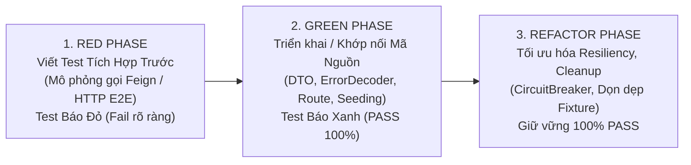
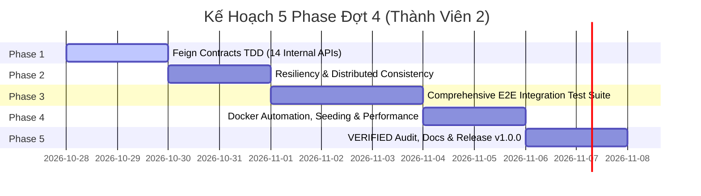

# Kế Hoạch Triển Khai Đợt 4 — Tích Hợp Đa Dịch Vụ, Kiểm Thử Toàn Trình (E2E) Theo TDD & Nghiệm Thu Tổng Thể Release v1.0.0

- **Dự án**: EduLearn LMS (`LMS-main`)
- **Người thực hiện**: Thành viên 2 (`NVCuong3112`)
- **Nhánh làm việc chuyên biệt**: `feature/member-2-dot-4-integration`
- **Phương pháp chủ đạo**: **TDD (Test-Driven Development)** áp dụng cho kiểm thử tích hợp (Integration) và toàn trình (End-to-End)
- **Tiêu chuẩn chất lượng**: Thỏa mãn đủ **13 tiêu chí nghiệm thu nghiêm ngặt** theo quy định tại [AGENTS.md](file:///D:/LMS-main/AGENTS.md) để nâng các chức năng lên trạng thái **`VERIFIED`** trong [docs/FEATURE_PARITY_MATRIX.md](file:///D:/LMS-main/docs/FEATURE_PARITY_MATRIX.md).

---

## I. Bối Cảnh & Mục Tiêu Của Đợt 4

Trải qua 3 đợt triển khai trước đó:
- **Đợt 1**: Thiết lập hạ tầng Docker, Service Registry (Eureka), API Gateway, khung 3 microservices cốt lõi và hệ thống CSDL (20 baseline tests PASS).
- **Đợt 2**: Cài đặt tầng nghiệp vụ Backend chi tiết cho 3 phân hệ do Thành viên 2 phụ trách: `identity-service`, `course-service`, `blog-service` (114 tests PASS).
- **Đợt 3**: Chuyển đổi giao diện toàn diện sang Spring Boot MVC + Thymeleaf + Bootstrap 5 (`web-app`) qua 7 Phase, hoàn thành nghiệm thu Docker stack và Browser E2E (135 tests Java, 45 tests JS, 4 Docker smoke tests, 3 Playwright browser tests PASS).

**Đợt 4** là giai đoạn về đích quan trọng nhất:
1. Khớp nối và tích hợp liên dịch vụ giữa các phân hệ của Thành viên 2 với các phân hệ của Thành viên 1 (`assignment-service`, `chatbot-service`).
2. Kiểm thử hợp đồng Feign nội bộ (`/internal/**`) để đảm bảo không bị lỗi dữ liệu, lỗi phân quyền hay lỗi timeout khi các service gọi chéo nhau.
3. Xây dựng bộ kiểm thử E2E liên hoàn cho 4 luồng nghiệp vụ cốt lõi (Học viên, Giảng viên, Blog công nghệ, Quản trị viên).
4. Chuẩn hóa dữ liệu mẫu (Data Seeding), tinh chỉnh hiệu năng và đóng gói toàn hệ thống sẵn sàng phát hành bản chính thức `v1.0.0`.

---

## II. Nguyên Tắc Áp Dụng TDD Trong Đợt 4

Quy trình TDD trong Đợt 4 tập trung vào cấp độ **Integration & E2E**:

- **Red Phase**: Viết test trước khi sửa hoặc hoàn thiện kết nối. Kiểm tra các ca biên: token hết hạn, ID không tồn tại, xung đột dữ liệu, timeout liên dịch vụ. Xác nhận test FAIL chính xác, không chấp nhận false-positive.
- **Green Phase**: Cài đặt mã nguồn tối giản, chuẩn hóa DTO, cấu hình Gateway filter / Feign client cho tới khi test PASS hoàn toàn.
- **Refactor Phase**: Loại bỏ dữ liệu thừa, tối ưu hóa thời gian chạy test, bổ sung cơ chế cleanup tự động cho database và MinIO.

---

## III. Phân Kỳ Chi Tiết 5 Phase Triển Khai Của Đợt 4

---

### Phase 1: Kiểm Thử Hợp Đồng Feign Nội Bộ (Cross-Service Internal OpenFeign Contracts TDD)

- **Mục tiêu**: Đảm bảo toàn bộ **14 Internal Endpoints** của Thành viên 2 sẵn sàng 100% phục vụ các phân hệ của Thành viên 1 mà không gặp lỗi xác thực, serialization hay sai lệch schema.
- **Danh sách 14 Internal Endpoints cần kiểm thử**:
  1. `identity-service` (4 endpoints):
     - `GET /internal/user/{id}`: Trả về thông tin họ tên, email, avatar của user cho bảng điểm / tác giả bài tập.
     - `POST /internal/users/batch`: Trả về danh sách user theo danh sách IDs cho bảng xếp hạng Leaderboard.
     - `GET /internal/users/{userId}/exists`: Kiểm tra user có tồn tại hay không trước khi lưu nộp bài.
     - `GET /internal/users/search/by-email`: Tìm kiếm user theo email phục vụ mời học viên hoặc phân quyền.
  2. `course-service` (8 endpoints):
     - `GET /internal/courses/{courseId}`: Kiểm tra khóa học tồn tại và hợp lệ.
     - `GET /internal/courses/{courseId}/lessons/{lessonId}`: Kiểm tra bài học tồn tại để gắn Quiz/Coding problem.
     - `GET /internal/courses/{courseId}/enrollments/{userId}`: Xác thực học viên đã ghi danh khóa học trước khi mở đề thi.
     - `GET /internal/courses`: Trả về danh sách khóa học public cho Trợ lý ảo AI Chatbot lấy ngữ cảnh.
     - Các endpoint lấy thống kê sinh viên, cấu trúc bài học nội bộ.
  3. `blog-service` (2 endpoints):
     - `GET /internal/posts/{postId}`: Lấy thông tin bài viết cho bài tập liên quan.
     - `GET /internal/posts/{postId}/exists`: Kiểm tra tồn tại bài viết thảo luận giải thuật.
- **Quy trình TDD (Red -> Green -> Refactor)**:
  - *Red*: Viết các test suite mô phỏng Feign client gửi request không kèm JWT người dùng nhưng phải vượt qua Gateway/Security nội bộ; test các ca: ID không tồn tại (trả về 404 chuẩn `ApiResponse`), batch IDs rỗng, email không khớp.
  - *Green*: Điều chỉnh Security configuration của các service cho phép request từ mạng nội bộ container (`/internal/**`), chuẩn hóa DTO trả về.
  - *Refactor*: Tối ưu hóa truy vấn CSDL batch bằng `IN (...)`, tránh lỗi N+1 query.
- **Tiêu chuẩn hoàn thành**:
  - 14/14 tests kiểm thử hợp đồng Feign PASS 100%.
  - Commit riêng: `test(feign): hoàn thành tdd kiểm thử 14 internal feign contracts liên dịch vụ`.

---

### Phase 2: Cơ Chế Chịu Lỗi & Tính Nhất Quán Dữ Liệu Phân Tán (Gateway Resiliency & Distributed Consistency)

- **Mục tiêu**: Nâng cao độ bền vững của hệ thống khi có sự cố mạng hoặc một microservice phản hồi chậm; đảm bảo tính toàn vẹn dữ liệu khi thay đổi trạng thái user/khóa học.
- **Phạm vi triển khai**:
  1. **Circuit Breaker (Resilience4j) tại API Gateway**:
     - Cấu hình ngưỡng chịu lỗi (`sliding-window-size: 10`, `failure-rate-threshold: 50%`, `wait-duration-in-open-state: 10s`).
     - Định tuyến fallback controller: Khi một service down hoặc timeout, Gateway trả về JSON fallback chuẩn mực (`code: 9999`, thông báo thân thiện "Dịch vụ tạm thời bận, vui lòng thử lại sau") thay vì ngắt kết nối hoặc trả về lỗi thô HTTP 500/504.
  2. **Tính toàn vẹn dữ liệu phân tán (Eventual Consistency / Cascading Rules)**:
     - Khi Admin khóa tài khoản user (`isActive = false`) tại `identity-service`: Session bị hủy, token bị thu hồi, không thể ghi danh khóa học mới tại `course-service` và không thể bình luận/vote tại `blog-service`.
     - Khi một khóa học bị khóa (`CourseStatus.LOCKED`): Biến mất khỏi trang danh sách công khai, học viên chưa ghi danh không thể truy cập, học viên đã ghi danh nhận thông báo khóa học đang tạm bảo trì.
- **Quy trình TDD**:
  - *Red*: Viết test giả lập microservice downstream bị delay > timeout hoặc crash; Gateway phải kích hoạt circuit breaker và trả về fallback response. Viết test tài khoản bị khóa vẫn cố tình gọi API ghi danh / tạo bài viết blog.
  - *Green*: Hoàn thiện Fallback Controller trong `api-gateway`, kiểm tra logic ràng buộc trạng thái tài khoản.
  - *Refactor*: Tinh chỉnh tham số timeout (10s cho các tác vụ thường, 30s cho upload file lớn).
- **Tiêu chuẩn hoàn thành**:
  - Toàn bộ kịch bản Fallback và ràng buộc trạng thái PASS.
  - Commit riêng: `feat(gateway): tích hợp circuit breaker fallback và kiểm thử tính toàn vẹn phân tán`.

---

### Phase 3: Bộ Kiểm Thử E2E Toàn Trình TDD (Comprehensive End-to-End Test Suite)

- **Mục tiêu**: Xây dựng 4 kịch bản kiểm thử E2E liên hoàn bao quát toàn bộ chu trình nghiệp vụ thực tế của người dùng từ giao diện Web-App BFF qua Gateway tới Database thật.
- **4 Luồng Nghiệp Vụ Toàn Trình**:
  1. **E2E Flow 1 (Vòng đời Học viên)**:
     - Đăng ký tài khoản học viên mới kèm họ tên.
     - Đọc mã OTP 6 số từ Mailpit API (`:8025/api/v1/messages`), xác thực tài khoản.
     - Đăng nhập, nhận session cookie sạch.
     - Duyệt danh sách khóa học công khai, tìm kiếm và xem chi tiết khóa học.
     - Nhấn Ghi danh (`POST /courses/{id}/enroll`).
     - Truy cập phòng học (Learning Hub), duyệt cây bài học đệ quy từ MongoDB.
     - Đánh dấu hoàn thành bài học, xác nhận tiến độ % tự động tăng và lưu vào CSDL `lesson_progress`.
  2. **E2E Flow 2 (Vòng đời Giảng viên)**:
     - Đăng nhập với tài khoản Giảng viên (`ROLE_TEACHER`).
     - Tạo khóa học mới kèm ảnh bìa thumbnail (Direct upload MinIO S3).
     - Tạo cây đề cương (Chương & Bài học) trên MongoDB `course_structures`.
     - Cập nhật nội dung bài học tài liệu Markdown và link video bài giảng.
     - Lên lịch học trực tuyến Google Meet và đăng thông báo cho khóa học.
     - Xuất bản khóa học (`PUBLIC`), xác minh khóa học xuất hiện trên trang chủ.
  3. **E2E Flow 3 (Cộng đồng Blog & Diễn đàn)**:
     - Tác giả viết bài blog mới bằng Markdown kèm ảnh thumbnail và thẻ tags.
     - Hệ thống tự sinh slug chuẩn tiếng Việt và lưu trữ an toàn.
     - Người dùng khác vào đọc bài viết, xác nhận `viewCount` tăng atomic.
     - Gửi bình luận gốc (cấp 1) và bình luận trả lời (cấp 2).
     - Kiểm tra chặn bình luận cấp 3 theo đúng quy định kiến trúc.
     - Bình chọn Upvote / Downvote bài viết và bình luận, kiểm tra tính toàn vẹn số phiếu vote.
  4. **E2E Flow 4 (Trung tâm Quản trị Admin)**:
     - Đăng nhập tài khoản có quyền `ROLE_ADMIN`.
     - Xem KPI Dashboard (tổng số người dùng, tổng số khóa học).
     - Thực hiện khóa tài khoản vi phạm (toggle active) và kiểm tra người dùng bị chặn đăng nhập ngay lập tức.
     - Khóa khóa học vi phạm (nhập lý do khóa), kiểm tra khóa học biến mất khỏi trang công khai.
     - Tạo mới tài khoản Admin.
     - Quản lý thêm/sửa/xóa Danh mục khóa học (`Category`) và Thẻ bài viết (`Tag`).
- **Quy trình TDD**:
  - *Red*: Viết test tự động trước bằng Playwright / Java Integration Test. Chạy thử trên môi trường sạch, ghi nhận lỗi khi dữ liệu hoặc luồng chưa khớp nối.
  - *Green*: Khớp nối logic điều hướng, xử lý CSRF, cập nhật trạng thái DOM cho tới khi 4 luồng PASS 100%.
  - *Refactor*: Đảm bảo cơ chế tự động dọn dẹp fixture test sau khi hoàn tất, không lưu rác trong database.
- **Tiêu chuẩn hoàn thành**:
  - 4/4 Luồng E2E thực thi tự động PASS 100%.
  - Commit riêng: `test(e2e): hoàn thành bộ kiểm thử toàn trình 4 luồng nghiệp vụ học viên giảng viên blog admin`.

---

### Phase 4: Tự Động Hóa Môi Trường Docker Compose, Seeding Dữ Liệu & Tinh Chỉnh Hiệu Năng

- **Mục tiêu**: Đảm bảo toàn bộ hệ thống khởi động ổn định chỉ với một lệnh `docker compose up -d`, có sẵn dữ liệu mẫu phong phú cho mục đích trình diễn và kiểm thử.
- **Nội dung công việc**:
  1. **Data Seeding chuẩn mực (`docker/mysql/init/02-seed-data.sql` & `docker/mongo/init/01-seed-mongo.js`)**:
     - Tạo sẵn các tài khoản demo:
       * 1 Admin: `admin` / `${ADMIN_PASSWORD}`
       * 2 Giảng viên: `teacher_nam`, `teacher_hoa`
       * 5 Học viên: `student_an`, `student_binh`, `student_chi`, `student_dung`, `student_em`
     - Tạo sẵn 4 Danh mục khóa học (`Lập trình Web`, `Khoa học Dữ liệu`, `Lập trình Di động`, `DevOps & Cloud`).
     - Tạo sẵn 3 Khóa học mẫu đầy đủ chương mục, bài giảng Markdown và video nhúng an toàn.
     - Tạo sẵn 5 Thẻ bài viết (`Java`, `Spring Boot`, `React`, `Docker`, `Microservices`) và 6 bài viết Blog công nghệ có bình luận và vote mẫu.
  2. **Tinh chỉnh Docker Compose**:
     - Cấu hình `restart: unless-stopped`, `healthcheck` chuẩn xác cho từng container.
     - Phân bổ tài nguyên hợp lý (RAM limits, connection pools) để toàn bộ 11 container vận hành mượt mà trên môi trường máy phát triển.
     - Rà soát toàn bộ log khởi động, triệt tiêu mọi cảnh báo deprecation hoặc kết nối chập chờn.
- **Tiêu chuẩn hoàn thành**:
  - `docker compose up -d --build` khởi động thành công, toàn bộ container báo `healthy`.
  - Khởi tạo dữ liệu mẫu tự động ngay lần chạy đầu tiên.
  - Commit riêng: `chore(docker): tự động hóa cấu hình docker compose và nạp dữ liệu seeding mẫu chuẩn`.

---

### Phase 5: Rà Soát 13 Tiêu Chí Nghiệm Thu VERIFIED, Hoàn Thiện Tài Liệu & Đóng Gói Release v1.0.0

- **Mục tiêu**: Hoàn tất tài liệu kỹ thuật, chuyển trạng thái các tính năng của Thành viên 2 lên `VERIFIED` và sẵn sàng nghiệm thu bàn giao dự án.
- **Nội dung công việc**:
  1. **Kiểm tra 13 Tiêu chí VERIFIED cho từng tính năng**:
     - [x] 1. Giao diện người dùng (UI) hoàn chỉnh với trạng thái Loading, Empty, Success, Error.
     - [x] 2. API endpoint backend tương ứng được định tuyến qua API Gateway.
     - [x] 3. Validation dữ liệu đầu vào chặt chẽ cả 2 phía.
     - [x] 4. Phân quyền theo vai trò (RBAC: `ADMIN`, `INSTRUCTOR`/`TEACHER`, `STUDENT`) chính xác.
     - [x] 5. Xử lý ngoại lệ và trả về ApiResponse chuẩn.
     - [x] 6. Lưu trữ và cập nhật trạng thái trong CSDL thật (MySQL/MongoDB).
     - [x] 7. Kiểm thử tự động (Unit Test / Integration Test) vượt qua thành công.
     - [x] 8. Biên dịch và đóng gói thành công (`mvn clean verify`).
     - [x] 9. Hoạt động ổn định trong môi trường Docker Compose.
     - [x] 10. Ghi nhận tài liệu trong API Contract.
     - [x] 11. Đã có commit giải quyết nhóm chức năng đó.
     - [x] 12. Có hướng dẫn sử dụng và kiểm thử rõ ràng.
     - [x] 13. Hành vi nghiệp vụ tương đương 100% so với project mẫu.
  2. **Đồng bộ hóa tài liệu dự án**:
     - Cập nhật [docs/FEATURE_PARITY_MATRIX.md](file:///D:/LMS-main/docs/FEATURE_PARITY_MATRIX.md): Nâng toàn bộ các tính năng thuộc Identity, Course, Blog, Infrastructure và UI của Thành viên 2 lên trạng thái `VERIFIED`.
     - Cập nhật [docs/API_CONTRACT.md](file:///D:/LMS-main/docs/API_CONTRACT.md): Đồng bộ chi tiết 100% contracts và endpoints thực tế.
     - Cập nhật [docs/progress/member-2.md](file:///D:/LMS-main/docs/progress/member-2.md): Ghi nhận toàn bộ kết quả kiểm thử thật của Đợt 4.
     - Hoàn thiện [README.md](file:///D:/LMS-main/README.md): Hướng dẫn khởi chạy dự án với 1 lệnh Docker duy nhất cho người chấm thi / người dùng cuối.
  3. **Đóng gói phát hành Release v1.0.0**:
     - Mở Pull Request từ `feature/member-2-dot-4-integration` vào `develop`.
     - Chạy toàn bộ pipeline kiểm thử tổng hợp (135+ Java tests, 53+ JS tests, 4 Docker smoke tests, 4 E2E flows).
     - Chuẩn bị gắn Git Tag chính thức **`v1.0.0`**.
- **Tiêu chuẩn hoàn thành**:
  - Tài liệu đồng bộ 100%, không còn sai sót hoặc placeholder chưa hoàn tất.
  - Commit riêng: `docs(release): nghiệm thu toàn diện 13 tiêu chí verified và hoàn tất tài liệu release v1.0.0`.

---

## IV. Bảng Tổng Hợp Kế Hoạch Phase & Cam Kết Cam Đoan

| Phase | Tên Giai Đoạn | Phương Pháp Test | Sản Phẩm Đầu Ra Cụ Thể | Trạng Thái |
| :---: | :--- | :---: | :--- | :---: |
| **Phase 1** | Feign Contracts TDD (14 Internal APIs) | Integration Test TDD | 14 API nội bộ sẵn sàng cho Member 1 | Sẵn sàng triển khai |
| **Phase 2** | Gateway Resiliency & Distributed Consistency | Fault / Chaos Test TDD | Circuit breaker fallback & dữ liệu đồng bộ | Kế tiếp |
| **Phase 3** | Comprehensive E2E Integration Test Suite | Playwright / HTTP E2E TDD | 4 Luồng nghiệp vụ liên hoàn tự động PASS | Kế tiếp |
| **Phase 4** | Docker Automation & Seeding Data | Docker Compose Probe | Stack 11 container + Data Seeding chuẩn | Kế tiếp |
| **Phase 5** | VERIFIED Audit, Docs & Release v1.0.0 | Full Regression Audit | Ma trận tính năng 100% VERIFIED & Tag v1.0.0 | Nghiệm thu cuối |

---

## V. Quy Tắc Git Cho Đợt 4

- Mọi công việc của Đợt 4 được phát triển trên nhánh: `feature/member-2-dot-4-integration`.
- Mỗi Phase được triển khai tuần tự theo chu trình TDD (Red -> Green -> Refactor), kiểm thử thành công 100% mới thực hiện commit và push.
- Thông điệp commit tuân thủ nghiêm ngặt chuẩn Conventional Commits bằng tiếng Việt có dấu.
