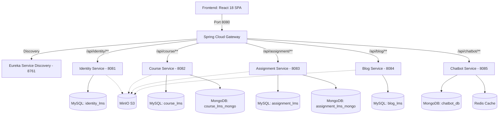

# Tổng Quan Dự Án — EduLearn LMS (PROJECT_OVERVIEW.md)

---

## 1. Bối Cảnh & Đặt Vấn Đề

Trong giáo dục hiện đại, đặc biệt là khối ngành công nghệ thông tin và khoa học máy tính, nhu cầu về một hệ sinh thái học tập tích hợp đa năng ngày càng trở nên cấp thiết. Các hệ thống LMS truyền thống thường chỉ dừng lại ở việc đăng tải slide tài liệu hoặc bài giảng video đơn giản mà thiếu các công cụ tương tác chuyên sâu như:
- Môi trường thực hành lập trình trực tuyến có khả năng biên dịch và chấm điểm tự động tức thì (Online Judge).
- Hệ thống thi trắc nghiệm linh hoạt, tự động xáo trộn đề, chống gian lận và đánh giá đa chiều.
- Khả năng tích hợp trí tuệ nhân tạo (AI Assistant) hỗ trợ giải đáp thắc mắc người học 24/7 và hỗ trợ giảng viên tự động soạn đề thi, tạo testcase bài tập.
- Diễn đàn thảo luận khoa học (Tech Blog) giúp học viên chia sẻ kiến thức, viết bài định dạng Markdown và tương tác cộng đồng.

Dự án **EduLearn LMS** được xây dựng nhằm giải quyết triệt để bài toán trên thông qua việc thiết kế một nền tảng quản lý học tập toàn diện, hiệu năng cao và phân tán theo kiến trúc **Microservices**.

---

## 2. Đối Tượng Người Dùng & Giá Trị Mang Lại

Hệ thống phục vụ bốn nhóm đối tượng chính:

### 2.1 Khách vãng lai (Guest)
- Người dùng chưa đăng nhập hoặc chưa có tài khoản.
- Có thể tham quan hệ thống, xem thông tin giới thiệu, danh sách khóa học mở, danh mục khóa học, các bài viết blog công nghệ được chia sẻ công khai.
- Thực hiện quy trình đăng ký tài khoản mới (chọn vai trò Học viên hoặc Giảng viên) hoặc đăng nhập nhanh bằng Google OAuth.

### 2.2 Học viên (Student)
- Đăng ký ghi danh (Enroll) vào các khóa học mong muốn.
- Học tập theo lộ trình: Xem video bài giảng, đọc tài liệu số, theo dõi phần trăm hoàn thành khóa học theo thời gian thực.
- Tham gia các buổi học trực tuyến qua liên kết Google Meet được tích hợp sẵn trong lịch học.
- Luyện tập và làm bài kiểm tra trắc nghiệm (Quiz): Làm bài theo thời gian quy định, xem điểm số tức thì hoặc sau khi hết hạn, xem lại lịch sử các lần thi.
- Thực hành lập trình trên trình soạn thảo CodeMirror: Viết code nhiều ngôn ngữ (C++, Java, Python, Go, Rust, JavaScript), submit và nhận kết quả chấm tự động từ Judge0 (Accepted, Wrong Answer, Time Limit Exceeded, Memory Limit Exceeded).
- Theo dõi Bảng xếp hạng (Leaderboard) để thi đua học tập.
- Tương tác với Trợ lý AI (Chatbot): Đặt câu hỏi về bài giảng, giải thích thuật toán, tìm lỗi code.
- Viết bài chia sẻ kinh nghiệm trên Blog, thảo luận và upvote/downvote bài viết.

### 2.3 Giảng viên (Instructor)
- Tạo và quản lý toàn diện các khóa học do mình phụ trách.
- Xây dựng cây cấu trúc khóa học (Course Structure): Tạo chương, bài học dạng Video hoặc Document, upload tài nguyên lên MinIO S3.
- Lên lịch học trực tuyến (Schedule) và tự động tạo phòng Google Meet.
- Quản lý ngân hàng câu hỏi (Question Bank) theo chủ đề (Topic) và độ khó; hỗ trợ nhập câu hỏi hàng loạt từ file CSV/TXT hoặc sinh câu hỏi tự động bằng AI.
- Tạo đề thi trắc nghiệm (Quiz) từ ngân hàng câu hỏi hoặc tạo mới, thiết lập thời gian, điểm chuẩn đạt, số lần làm tối đa, chế độ xáo trộn.
- Tạo bài tập lập trình (Coding Problem), quản lý bộ testcase (ẩn/hiện, trọng số điểm, giới hạn bộ nhớ/thời gian) và sử dụng AI sinh bộ testcase biên.
- Quản lý học viên đăng ký, theo dõi tiến độ, xem bảng điểm (Gradebook) và kết quả làm bài của học sinh.

### 2.4 Quản trị viên hệ thống (Admin)
- Giám sát sức khỏe toàn diện của các microservices qua Actuator Health Dashboard (liveness, readiness).
- Quản trị người dùng: Khóa/mở khóa tài khoản, cấp quyền, tạo tài khoản quản trị mới.
- Phê duyệt và quản lý toàn bộ khóa học trên hệ thống (chuyển đổi trạng thái Public, Private, Locked).
- Quản lý các bài tập lập trình, quản lý bài viết Blog (ẩn bài vi phạm, kiểm duyệt nội dung).
- Giám sát tài nguyên lưu trữ và các thông số vận hành.

---

## 3. Phạm Vi Dự Án (Scope of Work)

Dự án bao gồm 7 module backend độc lập và 1 ứng dụng frontend SPA:

---

## 4. Luồng Hoạt Động Tổng Quát (Core Workflows)

### 4.1 Luồng Xác Thực & Ủy Quyền (Authentication & Authorization Flow)
1. Người dùng gửi thông tin đăng nhập (`POST /api/identity/auth/login`) hoặc đăng nhập qua Google OAuth.
2. `identity-service` kiểm tra mật khẩu (BCrypt) hoặc verify ID Token của Google, tạo cặp JWT:
   - `accessToken`: Hiệu lực 30 phút, chứa thông tin `sub` (userId), `scope` (vai trò: STUDENT, INSTRUCTOR, ADMIN).
   - `refreshToken`: Hiệu lực 7 ngày, lưu mã băm an toàn trong MySQL.
3. Với mọi request tiếp theo từ Frontend:
   - Trình duyệt đính kèm header `Authorization: Bearer <token>`.
   - `api-gateway` chạy `AuthFilter` thẩm định token JWT: Nếu hợp lệ, tự động chèn thêm các internal headers: `X-User-Id`, `X-User-Role`, `X-User-Email`, `X-Gateway-Authenticated: true` trước khi chuyển tiếp (forward) đến downstream service.
   - Downstream service chỉ cần đọc trực tiếp thông tin người dùng từ header mà không cần truy vấn lại cơ sở dữ liệu xác thực.

### 4.2 Luồng Học Tập & Theo Dõi Tiến Độ (Learning Progress Flow)
1. Học viên đăng ký khóa học -> Tạo bản ghi `enrollments`.
2. Khi học viên truy cập bài học (video hoặc tài liệu), hệ thống ghi nhận thời gian truy cập `last_accessed`.
3. Học viên nhấn "Hoàn thành bài học" -> API cập nhật `lesson_progress.is_completed = true`.
4. Giao diện Frontend tự động tính toán lại tỷ lệ hoàn thành khóa học dựa trên tổng số bài học trong `course_structure` lưu trên MongoDB.

### 4.3 Luồng Thi Trắc Nghiệm (Quiz Attempt Flow)
1. Học viên vào trang tổng quan Quiz (`/exercises/quiz/:id/overview`), xem hướng dẫn, thời gian và số lượt làm còn lại.
2. Học viên bấm "Bắt đầu làm bài" -> Gọi `POST /quizzes/{id}/attempts`:
   - Hệ thống kiểm tra số lần đã thi so với `max_attempts`.
   - Tạo bản ghi `quiz_attempts` ở trạng thái `IN_PROGRESS` với cơ chế khóa ảo `in_progress_lock` để ngăn chặn việc tạo 2 attempt đồng thời.
   - Trả về danh sách câu hỏi (đã xáo trộn nếu có cờ `shuffle_questions`).
3. Khi làm bài, học viên lưu tạm câu trả lời hoặc bấm "Nộp bài" (`POST /quizzes/{id}/attempts/{attemptId}/submit`).
4. Hệ thống so khớp các câu trả lời với bảng `answers`, tính điểm chi tiết, cập nhật `quiz_answer_records` và cập nhật điểm cao nhất vào bảng `grades`.

### 4.4 Luồng Chấm Bài Lập Trình (Code Judge Flow)
1. Học viên mở bài toán lập trình, xem mô tả, giới hạn thời gian/bộ nhớ và các testcase mẫu.
2. Học viên viết code trên CodeMirror (C++, Python, Java...) và nhấn "Nộp bài".
3. Frontend gửi code tới `POST /submissions`.
4. `assignment-service` lưu bản ghi submission vào MongoDB ở trạng thái `PENDING`.
5. Đẩy tác vụ vào ThreadPool Executor (`judge-executor`) để gửi mã nguồn và testcases sang Judge0 API.
6. Hệ thống poll kết quả từ Judge0 hoặc nhận webhook, so khớp output với `expected_output` của từng testcase (công khai lẫn ẩn).
7. Cập nhật kết quả cuối cùng (`ACCEPTED`, `WRONG_ANSWER`, `TIME_LIMIT_EXCEEDED`, ...) vào MongoDB và cập nhật số bài giải thành công cho học viên trên `Leaderboard`.

### 4.5 Luồng Tương Tác Trợ Lý Trí Tuệ Nhân Tạo (Chatbot Flow)
1. Người dùng mở cửa sổ Chatbot ở góc phải màn hình.
2. Khi gửi tin nhắn, Frontend gọi `POST /api/chatbot/chat`.
3. `chatbot-service` kiểm tra hạn ngạch rate limit trên Redis (50 req/ngày với Student, 100 req/ngày với Instructor).
4. Hệ thống tổng hợp ngữ cảnh (lịch sử trò chuyện gần nhất từ MongoDB + thông tin khóa học/bài học nếu có).
5. Gửi request tới OpenCode/DeepSeek LLM API và trả kết quả về cho người dùng (hỗ trợ hiển thị Markdown).
6. Tương tự, Giảng viên có thể dùng chức năng "AI Generate Quiz" hoặc "AI Generate TestCases" để nhờ AI tự động tạo dữ liệu nhanh chóng.
