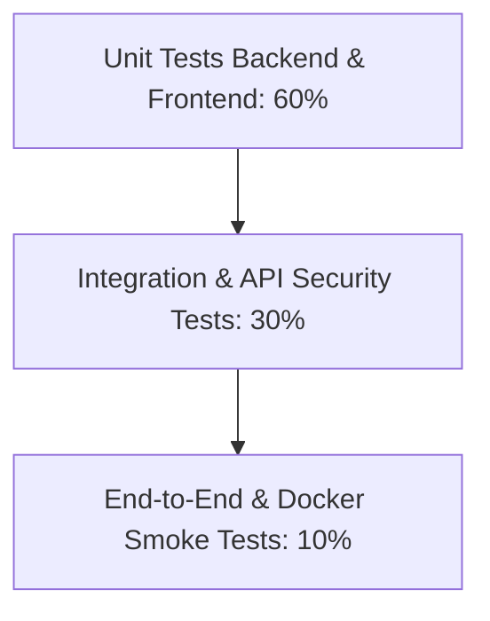

# Kế Hoạch Kiểm Thử Toàn Diện — EduLearn LMS (TESTING_PLAN.md)

Tài liệu này xác định chiến lược, phương pháp luận và các kịch bản kiểm thử chất lượng phần mềm áp dụng cho toàn bộ hệ sinh thái **EduLearn LMS**.

---

## Kim Tự Tháp Kiểm Thử (Testing Pyramid)

Hệ thống áp dụng mô hình kim tự tháp kiểm thử nhiều tầng:



---

## 1. Kiểm Thử Đơn Vị (Unit Testing)

### 1.1 Backend Unit Tests (JUnit 5 & Mockito)
- **Mục tiêu**: Kiểm tra tính đúng đắn của các hàm xử lý logic nghiệp vụ độc lập trong Service Layer mà không cần kết nối tới cơ sở dữ liệu thật.
- **Công nghệ**: JUnit 5, Mockito (`@Mock`, `@InjectMocks`, `when().thenReturn()`), AssertJ.
- **Các class kiểm thử trọng tâm**:
  - `AuthenticationServiceImplTest.java`: Kiểm thử mã hóa mật khẩu, kiểm tra trạng thái user active, sinh token JWT.
  - `EmailVerificationServiceImplTest.java`: Kiểm thử logic sinh mã OTP, kiểm tra hạn 15 phút, giới hạn số lần thử vượt quá 5 lần.
  - `CourseServiceImplTest.java` & `CourseStructureServiceImplTest.java`: Kiểm thử tạo khóa học, sắp xếp thứ tự chương mục và bài học.
  - `QuizServiceImplTest.java` & `QuizAttemptServiceImplTest.java`: Kiểm thử xáo trộn câu hỏi, tính điểm bài thi, kiểm tra số lượt làm bài tối đa.
  - `ProblemServiceImplTest.java` & `TestCaseServiceImplTest.java`: Kiểm thử ràng buộc độ khó, tính hợp lệ của testcase.
  - `CsvQuestionParserTest.java` & `TxtQuestionParserTest.java`: Kiểm thử đọc file câu hỏi với các ký tự đặc biệt, định dạng sai hoặc dòng trống.
  - `ChatServiceImplTest.java` & `RateLimiterServiceImplTest.java`: Kiểm thử logic giới hạn rate limit và xử lý phản hồi từ AI.

### 1.2 Frontend Unit Tests (Vitest & Testing Library)
- **Mục tiêu**: Kiểm thử các hàm tính toán, định dạng dữ liệu, custom hooks và các components độc lập.
- **Công nghệ**: Vitest, React Testing Library, `@testing-library/jest-dom`.
- **Các file kiểm thử trọng tâm**:
  - `quizScoring.test.js`: Kiểm thử thuật toán tính điểm các loại câu hỏi Single, Multiple, True/False.
  - `dateTime.test.js`: Kiểm thử chuyển đổi múi giờ, hiển thị thời gian còn lại đếm ngược.
  - `courseOrder.test.js`, `courseSlug.test.js`: Kiểm thử chuẩn hóa slug và sắp xếp thứ tự bài học.
  - `useFileUpload.test.jsx`: Kiểm thử ràng buộc dung lượng file và định dạng ảnh tải lên MinIO.
  - `useJudge0.test.jsx`: Kiểm thử trạng thái polling kết quả chấm code và xử lý timeout.

---

## 2. Kiểm Thử Tích Hợp (Integration Testing)

- **Mục tiêu**: Kiểm tra sự phối hợp chính xác giữa Repository, Database (MySQL qua H2 hoặc Testcontainers, MongoDB Embedded/Testcontainers) và Spring Context.
- **Công nghệ**: `@SpringBootTest`, `@AutoConfigureMockMvc`, Testcontainers.
- **Kịch bản kiểm thử**:
  - `IdentityApiIntegrationTest.java`: Luồng đăng ký tài khoản -> Lưu vào bảng `users` -> Gửi OTP -> Xác thực tài khoản thành công.
  - `CourseApiIntegrationTest.java`: Luồng tạo khóa học MySQL kết hợp lưu trữ cây phân cấp trên MongoDB `course_structures`.
  - `BlogApiIntegrationTest.java`: Luồng tạo bài viết -> Thêm bình luận -> Upvote -> Kiểm tra cập nhật điểm số và quan hệ khóa ngoại.
  - `ChatbotApiIntegrationTest.java`: Luồng lưu trữ phiên chat và tin nhắn liên hoàn trên MongoDB.

---

## 3. Kiểm Thử Giao Diện Lập Trình (API & Contract Testing)

- **Mục tiêu**: Đảm bảo tất cả endpoint phản hồi đúng định dạng `ApiResponse<T>`, đúng mã HTTP Status Code và kiểm tra validation đầu vào.
- **Phương pháp**: Sử dụng MockMvc hoặc REST-assured để gửi payload JSON kiểm tra:
  - Trường hợp payload hợp lệ -> HTTP 200 OK với mã code 1000.
  - Trường hợp thiếu trường bắt buộc (`@NotBlank`) -> HTTP 400 Bad Request với mã code 1003.
  - Trường hợp ID không tồn tại -> HTTP 404 Not Found hoặc HTTP 400 kèm mã lỗi nghiệp vụ.

---

## 4. Kiểm Thử Bảo Mật & Phân Quyền Vai Trò (Security & Role Testing)

- **Mục tiêu**: Chứng minh cơ chế kiểm soát truy cập dựa trên vai trò (RBAC) hoạt động chặt chẽ, không có lỗ hổng leo thang đặc quyền.
- **Kịch bản kiểm thử bảo mật**:
  1. **Kiểm tra Header Injection tại Gateway**: Gửi request từ bên ngoài có chứa header giả mạo `X-User-Role: ADMIN` tới public route -> Gateway phải tẩy sạch header này trước khi forward.
  2. **Kiểm tra Token hết hạn / Giả mạo chữ ký**: Gửi request với JWT sai chữ ký HMAC hoặc đã quá hạn 30 phút -> Gateway trả về HTTP 401 Unauthorized ngay lập tức.
  3. **Kiểm tra Phân quyền theo Role (RBAC)**:
     - Học viên gọi API tạo khóa học (`POST /api/course/courses`) -> Nhận phản hồi HTTP 403 Forbidden.
     - Giảng viên gọi API khóa tài khoản người dùng (`PATCH /api/identity/admin/users/{id}/status`) -> Nhận HTTP 403 Forbidden.
     - Học viên gọi API xem kết quả của học viên khác khi chưa qua thời hạn -> Bị từ chối truy cập.

---

## 5. Kiểm Thử Giao Diện Phía Client (Frontend Route & UI Testing)

- **Mục tiêu**: Kiểm tra hành vi điều hướng và trạng thái giao diện của người dùng.
- **Kịch bản kiểm thử**:
  - `PrivateRoute.test.jsx`: Người dùng chưa đăng nhập truy cập `/settings` -> Tự động chuyển hướng về `/login`.
  - `RoleRoute.test.jsx`: Người dùng có vai trò `STUDENT` cố tình gõ URL `/instructor/exercises` hoặc `/admin/users` -> Hiển thị trang báo lỗi hoặc chuyển hướng về trang chủ.
  - `Toast.test.jsx`: Hiển thị thông báo thành công khi lưu bài, thông báo lỗi khi mất kết nối mạng.

---

## 6. Kiểm Thử Toàn Trình (End-to-End Testing)

Thực hiện kiểm thử các kịch bản người dùng hoàn chỉnh trên toàn bộ hệ thống đang chạy:

### Kịch bản 1: Chu trình Học viên hoàn chỉnh
1. Học viên mở trình duyệt, đăng ký tài khoản mới và xác thực OTP qua email.
2. Đăng nhập hệ thống, tìm kiếm và đăng ký khóa học "Lập trình Web nâng cao".
3. Vào học bài, xem video bài giảng, bấm hoàn thành bài học và kiểm tra thanh tiến độ đạt 100%.
4. Mở bài thi trắc nghiệm Quiz, làm bài trong thời gian quy định, nộp bài và xem điểm số đạt chuẩn.
5. Mở bài tập lập trình, viết code C++ giải bài toán, submit code và nhận verdict `ACCEPTED` sau khi vượt qua 10/10 testcase.
6. Mở cửa sổ Chatbot AI đặt câu hỏi về bài giảng và nhận phản hồi chi tiết.

### Kịch bản 2: Chu trình Giảng viên hoàn chỉnh
1. Giảng viên đăng nhập, vào trang Quản lý khóa học, tạo khóa học mới kèm thumbnail.
2. Xây dựng cây bài học, thêm bài học video và tài liệu Markdown.
3. Tạo ngân hàng câu hỏi, sử dụng tính năng import file CSV.
4. Tạo bài thi trắc nghiệm từ ngân hàng câu hỏi, thiết lập thời gian làm bài 45 phút.
5. Tạo bài tập lập trình mới, tải lên file zip bộ testcases mẫu, sử dụng AI sinh thêm testcases biên.
6. Xem bảng điểm (Gradebook) của toàn bộ học viên đã nộp bài.

---

## 7. Kiểm Thử Khởi Động Container (Docker Smoke Test)

- **Mục tiêu**: Đảm bảo toàn bộ stack container khởi chạy trơn tru từ đầu mà không gặp lỗi thiếu dependency hoặc xung đột port.
- **Quy trình thực hiện**:
  1. Chạy lệnh: `docker compose up --build -d`.
  2. Theo dõi trạng thái: `docker compose ps`.
  3. Xác nhận tất cả 11 containers (`lms-mysql`, `lms-mongodb`, `lms-redis`, `lms-minio`, `lms-service-registry`, `lms-api-gateway`, 5 services nghiệp vụ và `lms-frontend`) đều ở trạng thái `healthy` hoặc `running`.
  4. Thực hiện lệnh curl kiểm tra HTTP liveness endpoint của từng container:
     ```bash
     curl -f http://localhost:8080/actuator/health/liveness
     curl -f http://localhost:8081/identity/actuator/health
     curl -f http://localhost:8082/course/actuator/health/liveness
     curl -f http://localhost:8083/assignment/actuator/health/liveness
     curl -f http://localhost:8084/blog/actuator/health/liveness
     curl -f http://localhost:8085/chatbot/actuator/health/liveness
     ```
  5. Dừng stack bằng `docker compose down` kiểm tra tài nguyên được giải phóng sạch sẽ.
