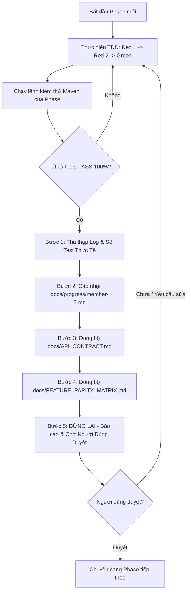

# Nhật Ký Tiến Độ Thực Hiện & Kế Hoạch Chi Tiết — Thành Viên 2 (NVCuong3112)

- **Người thực hiện**: Thành viên 2 (`NVCuong3112`)
- **Nhánh làm việc**: `feature/member-2`
- **Phương pháp**: TDD (Test-Driven Development)
- **Phân công trách nhiệm chính xác**:
  - **Phân hệ chính**: `identity-service` (Port 8081), `course-service` (Port 8082), `blog-service` (Port 8084) và toàn bộ giao diện Frontend tương ứng (Xác thực, Hồ sơ, Khóa học, Bài giảng, Diễn đàn Blog, Trang quản trị Admin).
  - **Thành phần phối hợp dùng chung**: Parent POM, Docker Compose CSDL, Service Registry (`service-registry` Port 8761) và API Gateway (`api-gateway` Port 8080) phối hợp cùng Thành viên 1.
  - **Phân hệ không thuộc phạm vi**: `assignment-service` và `chatbot-service` do Thành viên 1 (Nguyễn Minh Trí) phụ trách. Tuyệt đối không làm trong kế hoạch của Thành viên 2.

---

## I. Nguồn Bằng Chứng Lịch Sử Đợt 1 (Đã Kiểm Thử & Nghiệm Thu Thực Tế)

Dưới đây là bằng chứng kiểm thử thực tế độc lập của Đợt 1 đã được ghi nhận và kiểm chứng trong workspace:

### 1. Bằng chứng kiểm thử chi tiết từng module

1. **Parent POM & Dependency Management**:
   - **Lệnh thực thi**: `mvn validate -f backend/pom.xml`
   - **Kết quả**: `BUILD SUCCESS` (0.165 s), toàn bộ dependencies BOM Spring Cloud `2023.0.4` và Spring Boot `3.3.5` tải về ổn định.
   - **Minh chứng**: [backend/pom.xml](file:///d:/LMS-main/backend/pom.xml), [docker-compose.db.yml](file:///d:/LMS-main/docker-compose.db.yml), [01-init-databases.sql](file:///d:/LMS-main/docker/mysql/init/01-init-databases.sql).

2. **Service Registry — Netflix Eureka Server (Port 8761)**:
   - **Lệnh thực thi**: `mvn test -pl service-registry -f backend/pom.xml`
   - **Kết quả**: **2/2 test cases PASS 100%** (Thời gian chạy: 14.116 s):
     * `contextLoads()`: PASS (Khởi động Spring context)
     * `eurekaAppsEndpointReturns200()`: PASS (`GET /eureka/apps` trả về HTTP 200)
   - **Minh chứng mã kiểm thử**: [ServiceRegistryApplicationTests.java](file:///d:/LMS-main/backend/service-registry/src/test/java/com/lms/serviceregistry/ServiceRegistryApplicationTests.java).

3. **API Gateway — Spring Cloud Gateway (Port 8080)**:
   - **Lệnh thực thi**: `mvn test -pl api-gateway -f backend/pom.xml`
   - **Kết quả**: **15/15 test cases PASS 100%** (Thời gian chạy: 8.472 s):
     * `ApiGatewayApplicationTests`: 1 test PASS (`contextLoads`).
     * `JwtUtilTest`: 3 test cases PASS (`extractToken`, `verify` hợp lệ, `verify` từ chối token giả mạo/hết hạn).
     * `AuthFilterTest`: 6 test cases PASS (Inject 4 headers `X-*`, strip `Authorization`, từ chối 401 khi thiếu/hết hạn token, chặn header giả mạo từ client, whitelist HTTP Method).
     * `GatewayRouteConfigurationTest`: 5 test cases PASS (Định tuyến Identity, Course, Blog, Shortcuts, Sensitive Route Assertions).
   - **Minh chứng mã kiểm thử**:
     * [ApiGatewayApplicationTests.java](file:///d:/LMS-main/backend/api-gateway/src/test/java/com/lms/apigateway/ApiGatewayApplicationTests.java)
     * [JwtUtilTest.java](file:///d:/LMS-main/backend/api-gateway/src/test/java/com/lms/apigateway/configuration/JwtUtilTest.java)
     * [AuthFilterTest.java](file:///d:/LMS-main/backend/api-gateway/src/test/java/com/lms/apigateway/configuration/AuthFilterTest.java)
     * [GatewayRouteConfigurationTest.java](file:///d:/LMS-main/backend/api-gateway/src/test/java/com/lms/apigateway/configuration/GatewayRouteConfigurationTest.java)

4. **Khung 3 Microservices Cốt Lõi (Identity, Course, Blog)**:
   - **`identity-service` (Port 8081)**: [IdentityServiceApplicationTests.java](file:///d:/LMS-main/backend/identity-service/src/test/java/com/lms/identityservice/IdentityServiceApplicationTests.java) — `contextLoads()` PASS (8.163 s trên profile H2 `identity_test`).
   - **`course-service` (Port 8082)**: [CourseServiceApplicationTests.java](file:///d:/LMS-main/backend/course-service/src/test/java/com/lms/courseservice/CourseServiceApplicationTests.java) — `contextLoads()` PASS (7.478 s trên profile H2 `course_test`).
   - **`blog-service` (Port 8084)**: [BlogServiceApplicationTests.java](file:///d:/LMS-main/backend/blog-service/src/test/java/com/lms/blogservice/BlogServiceApplicationTests.java) — `contextLoads()` PASS (7.518 s trên profile H2 `blog_test`).

5. **Tổng nghiệm thu Đợt 1 Monorepo**:
   - **Lệnh thực thi**: `mvn clean test -f backend/pom.xml`
   - **Kết quả thực tế**: **BUILD SUCCESS 100% trên cả 6 module** (Parent, Eureka, Gateway, Identity, Course, Blog). Tổng thời gian 46.4s, 0 Failures, 0 Errors.
   - **Kết luận**: Khung rỗng của 3 service đã hoàn thành và vượt qua kiểm thử; Đợt 2 **không làm lại khung** mà đi thẳng vào cài đặt tầng nghiệp vụ.

6. **Cơ Sở Xác Định Phạm Vi Kiểm Thử Đợt 2 (Không Ép Cứng Con Số 93 Tests)**:
   - **Đợt 1 (Hiện trạng nền tảng đã PASS 100% — Baseline 20 tests)**:
     * `lms-backend` (Parent POM): `mvn validate -f backend/pom.xml` BUILD SUCCESS [0.165s]
     * `service-registry` (Eureka Server): **2/2 tests PASS** [14.116s] (`contextLoads`, `eurekaAppsEndpointReturns200`)
     * `api-gateway` (Spring Cloud Gateway): **15/15 tests PASS** [8.472s] (`ApiGatewayApplicationTests` 1, `JwtUtilTest` 3, `AuthFilterTest` 6, `GatewayRouteConfigurationTest` 5)
     * `identity-service`: **1 test PASS** (`contextLoads` [8.163s])
     * `course-service`: **1 test PASS** (`contextLoads` [7.478s])
     * `blog-service`: **1 test PASS** (`contextLoads` [7.518s])
   - **Đợt 2 (Phạm vi kiểm thử nghiệp vụ TDD — Tập trung vào độ bao phủ toàn diện)**:
     * **Nguyên tắc**: Không ép cứng tổng số 93 tests mà bám sát độ bao phủ 100% của toàn bộ các nghiệp vụ theo cam kết:
       - Xác thực: Đăng ký, Đăng nhập BCrypt, Google OAuth 2.0 (SSO), Token Introspect, Refresh token xoay vòng, Thu hồi khi Logout.
       - Email OTP & Khôi phục: Gửi OTP, Xác thực OTP, Quên mật khẩu gửi OTP 6 số, Đặt lại mật khẩu mới.
       - Hồ sơ & Phân quyền: Xem/sửa hồ sơ cá nhân (`/users/myinfo`), đổi mật khẩu, đổi role, Admin quản lý user, toggle active, reset password.
       - Khóa học & Danh mục: CRUD Danh mục (`Category`), CRUD Khóa học (`CourseStatus`: `PRIVATE`, `PUBLIC`, `LOCKED`), Admin lock/unlock, Thống kê giảng viên.
       - Cấu trúc cây bài học MongoDB: `CourseStructure` tree đệ quy, thêm node đơn/hàng loạt, kéo thả reorder, sửa tiêu đề, xóa node, bài học `Lesson`.
       - Ghi danh & Tiến độ: Học viên ghi danh (`/enroll`), Theo dõi tiến độ học tập %, Đánh dấu hoàn thành bài học, Tính tiến độ trung bình khóa học.
       - Lịch học Google Meet & Bảng tin: Quản lý lịch học trực tuyến có link Meet, Đăng và quản lý thông báo khóa học.
       - Lưu trữ MinIO: Presigned URL tải file, Multipart upload video lớn ghép nối an toàn, Xóa file S3.
       - Diễn đàn Blog: Bài viết Markdown, tự sinh slug, tăng `viewCount`, Thẻ Tag CRUD, Bình luận đa cấp lồng nhau (`parentId`), Bình chọn Upvote/Downvote atomic.
       - Contract nội bộ (OpenFeign): Toàn bộ **14 endpoints: Identity 4, Course 8, Blog 2** (`/internal/**`) phục vụ tích hợp với `assignment-service` và `chatbot-service`.
     * **Số lượng test cases dự kiến phân bổ chi tiết (Tổng cộng ước tính ~131 test cases)**:
       - `identity-service`: 30 test cases nghiệp vụ (5 test classes) + 1 context load = 31 tests
       - `course-service`: 56 test cases nghiệp vụ (Phase 7: 24 tests / 5 classes, Phase 8: 32 tests / 8 classes) + 1 context load = 57 tests
       - `blog-service`: 25 test cases nghiệp vụ (8 test classes) + 1 context load = 26 tests
       - `service-registry`: 2 test cases nền tảng
       - `api-gateway`: 15 test cases nền tảng
       - **Tổng số test cases ước tính**: 2 + 15 + 31 + 57 + 26 = **131 test cases** (kết quả nghiệm thu thực tế sẽ ghi nhận theo số lượng chạy thật sau mỗi phase, được phép và khuyến khích tăng theo kịch bản biên và bảo mật phát sinh).

---

## II. Bảng Đối Chiếu Toàn Diện API Với Controller, Gateway & Frontend Mẫu

Nguồn tham chiếu đối chiếu chỉ đọc: `D:\LMS-main\Learning-Management-System-main`

### 1. Phân Hệ Xác Thực & Người Dùng (`identity-service` — Port 8081, Context `/identity`: 24 Endpoints Thông Thường + 4 Endpoints Nội Bộ = 28 Endpoints)

| Endpoint Controller Mẫu | HTTP Method | Vai trò (RBAC) | Request DTO | Response Model | Tuyến Gateway & Frontend Mẫu | Minh chứng mã nguồn mẫu |
|---|:---:|:---:|---|---|---|---|
| `/auth/register` | `POST` | Public | `UserCreationRequest` | `ApiResponse<UserCreationResponse>` | `Path=/api/identity/auth/**`, Frontend: `ENDPOINTS.AUTH.REGISTER` | [AuthenticationController.java](file:///d:/LMS-main/Learning-Management-System-main/backend/identity-service/src/main/java/com/lms/identityservice/controller/AuthenticationController.java#L23-L28) |
| `/auth/login` | `POST` | Public | `AuthenticationRequest` | `ApiResponse<AuthenticationResponse>` | `Path=/api/identity/auth/**`, Frontend: `ENDPOINTS.AUTH.LOGIN` | [AuthenticationController.java](file:///d:/LMS-main/Learning-Management-System-main/backend/identity-service/src/main/java/com/lms/identityservice/controller/AuthenticationController.java#L30-L35) |
| `/auth/social-login/{provider}` | `POST` | Public | `SocialLoginRequest` | `ApiResponse<AuthenticationResponse>` | `Path=/api/identity/auth/**`, Frontend: `ENDPOINTS.AUTH.SOCIAL_LOGIN` | [AuthenticationController.java](file:///d:/LMS-main/Learning-Management-System-main/backend/identity-service/src/main/java/com/lms/identityservice/controller/AuthenticationController.java#L37-L44) |
| `/auth/introspect` | `POST` | Public | `IntrospectRequest` | `ApiResponse<IntrospectResponse>` | `Path=/api/identity/auth/**` | [AuthenticationController.java](file:///d:/LMS-main/Learning-Management-System-main/backend/identity-service/src/main/java/com/lms/identityservice/controller/AuthenticationController.java#L46-L51) |
| `/auth/refresh` | `POST` | Public | `RefreshTokenRequest` | `ApiResponse<AuthenticationResponse>` | `Path=/api/identity/auth/**`, Frontend: `ENDPOINTS.AUTH.REFRESH` | [AuthenticationController.java](file:///d:/LMS-main/Learning-Management-System-main/backend/identity-service/src/main/java/com/lms/identityservice/controller/AuthenticationController.java#L53-L58) |
| `/auth/logout` | `POST` | Public | `LogoutRequest` | `ApiResponse<Void>` | `Path=/api/identity/auth/**`, Frontend: `ENDPOINTS.AUTH.LOGOUT` | [AuthenticationController.java](file:///d:/LMS-main/Learning-Management-System-main/backend/identity-service/src/main/java/com/lms/identityservice/controller/AuthenticationController.java#L60-L67) |
| `/auth/verify-email/send` | `POST` | Public | `SendEmailVerificationRequest` | `ApiResponse<Void>` | `Path=/api/identity/auth/**`, Frontend: `ENDPOINTS.AUTH.VERIFY_EMAIL_SEND` | [EmailVerificationController.java](file:///d:/LMS-main/Learning-Management-System-main/backend/identity-service/src/main/java/com/lms/identityservice/controller/EmailVerificationController.java#L28-L34) |
| `/auth/verify-email` | `POST` | Public | `VerifyEmailRequest` | `ApiResponse<Void>` | `Path=/api/identity/auth/**`, Frontend: `ENDPOINTS.AUTH.VERIFY_EMAIL` | [EmailVerificationController.java](file:///d:/LMS-main/Learning-Management-System-main/backend/identity-service/src/main/java/com/lms/identityservice/controller/EmailVerificationController.java#L36-L42) |
| `/auth/forgot-password` | `POST` | Public | `ForgotPasswordRequest` | `ApiResponse<Void>` | `Path=/api/identity/auth/**`, Frontend: `ENDPOINTS.AUTH.FORGOT_PASSWORD` | [EmailVerificationController.java](file:///d:/LMS-main/Learning-Management-System-main/backend/identity-service/src/main/java/com/lms/identityservice/controller/EmailVerificationController.java#L44-L50) |
| `/auth/reset-password` | `POST` | Public | `ResetPasswordRequest` | `ApiResponse<Void>` | `Path=/api/identity/auth/**`, Frontend: `ENDPOINTS.AUTH.RESET_PASSWORD` | [EmailVerificationController.java](file:///d:/LMS-main/Learning-Management-System-main/backend/identity-service/src/main/java/com/lms/identityservice/controller/EmailVerificationController.java#L52-L58) |
| `/users/myinfo` | `GET` | Authenticated | — (Header `X-User-Id`) | `ApiResponse<UserFullResponse>` | `AuthFilter`, Frontend: `ENDPOINTS.AUTH.PROFILE` | [UserController.java](file:///d:/LMS-main/Learning-Management-System-main/backend/identity-service/src/main/java/com/lms/identityservice/controller/UserController.java#L24-L29) |
| `/users/myinfo` | `PUT` | Authenticated | `UserUpdateRequest` | `ApiResponse<UserFullResponse>` | `AuthFilter`, Frontend: `authApi.updateProfile` | [UserController.java](file:///d:/LMS-main/Learning-Management-System-main/backend/identity-service/src/main/java/com/lms/identityservice/controller/UserController.java#L31-L36) |
| `/users/myinfo/password` | `PATCH` | Authenticated | `UserUpdatePasswordRequest` | `ApiResponse<UserFullResponse>` | `AuthFilter`, Frontend: `ENDPOINTS.AUTH.UPDATE_PASSWORD` | [UserController.java](file:///d:/LMS-main/Learning-Management-System-main/backend/identity-service/src/main/java/com/lms/identityservice/controller/UserController.java#L38-L43) |
| `/users/myinfo/role` | `PATCH` | Authenticated | `UserRoleUpdateRequest` | `ApiResponse<UserFullResponse>` | `AuthFilter`, Đổi vai trò tài khoản | [UserController.java](file:///d:/LMS-main/Learning-Management-System-main/backend/identity-service/src/main/java/com/lms/identityservice/controller/UserController.java#L45-L50) |
| `/users/{userId}/profile` | `GET` | Public | `@PathVariable userId` | `ApiResponse<UserPublicProfileResponse>` | Public route, Frontend: `ENDPOINTS.AUTH.PUBLIC_PROFILE` | [UserController.java](file:///d:/LMS-main/Learning-Management-System-main/backend/identity-service/src/main/java/com/lms/identityservice/controller/UserController.java#L52-L57) |
| `/admin/users` | `GET` | `ADMIN` | `@RequestParam role, keyword` | `ApiResponse<Page<UserSummaryResponse>>` | `AuthFilter`, Frontend: `ENDPOINTS.ADMIN.USERS` | [AdminUserController.java](file:///d:/LMS-main/Learning-Management-System-main/backend/identity-service/src/main/java/com/lms/identityservice/controller/AdminUserController.java#L30-L38) |
| `/admin/users/stats` | `GET` | `ADMIN` | — | `ApiResponse<UserDashboardResponse>` | `AuthFilter`, Frontend: `ENDPOINTS.ADMIN.USER_STATS` | [AdminUserController.java](file:///d:/LMS-main/Learning-Management-System-main/backend/identity-service/src/main/java/com/lms/identityservice/controller/AdminUserController.java#L40-L45) |
| `/admin/users/{id}` | `GET` | `ADMIN` | `@PathVariable id` | `ApiResponse<UserFullResponse>` | `AuthFilter`, Chi tiết người dùng | [AdminUserController.java](file:///d:/LMS-main/Learning-Management-System-main/backend/identity-service/src/main/java/com/lms/identityservice/controller/AdminUserController.java#L47-L52) |
| `/admin/users/{id}/active` | `PATCH` | `ADMIN` | `@PathVariable id` | `ApiResponse<UserFullResponse>` | `AuthFilter`, Khóa/mở tài khoản | [AdminUserController.java](file:///d:/LMS-main/Learning-Management-System-main/backend/identity-service/src/main/java/com/lms/identityservice/controller/AdminUserController.java#L54-L59) |
| `/admin/users/admins` | `POST` | `ADMIN` | `AdminCreateAdminRequest` | `ApiResponse<UserFullResponse>` | `AuthFilter`, Tạo tài khoản Admin | [AdminUserController.java](file:///d:/LMS-main/Learning-Management-System-main/backend/identity-service/src/main/java/com/lms/identityservice/controller/AdminUserController.java#L61-L66) |
| `/admin/users/{id}` | `PUT` | `ADMIN` | `UserUpdateRequest` | `ApiResponse<UserFullResponse>` | `AuthFilter`, Admin sửa thông tin user | [AdminUserController.java](file:///d:/LMS-main/Learning-Management-System-main/backend/identity-service/src/main/java/com/lms/identityservice/controller/AdminUserController.java#L68-L74) |
| `/admin/users/{id}/password` | `PATCH` | `ADMIN` | `AdminResetPasswordRequest` | `ApiResponse<UserFullResponse>` | `AuthFilter`, Admin reset mật khẩu | [AdminUserController.java](file:///d:/LMS-main/Learning-Management-System-main/backend/identity-service/src/main/java/com/lms/identityservice/controller/AdminUserController.java#L76-L82) |
| `/admin/users/{id}/admin-active` | `PATCH` | `ADMIN` | `@PathVariable id` | `ApiResponse<UserFullResponse>` | `AuthFilter`, Quản lý trạng thái Admin | [AdminUserController.java](file:///d:/LMS-main/Learning-Management-System-main/backend/identity-service/src/main/java/com/lms/identityservice/controller/AdminUserController.java#L84-L89) |
| `/storage/presigned-url` | `POST` | Authenticated | `PresignedUrlRequest` | `ApiResponse<PresignedUrlResponse>` | `AuthFilter`, Frontend: `UPLOAD.IDENTITY_PRESIGNED` | [StorageController.java](file:///d:/LMS-main/Learning-Management-System-main/backend/identity-service/src/main/java/com/lms/identityservice/controller/StorageController.java#L24-L30) |
| `/internal/user/{id}` | `GET` | Internal Feign | `@PathVariable id` | `UserFullResponse` | Không qua Gateway công khai, Assignment gọi | [InternalUserController.java](file:///d:/LMS-main/Learning-Management-System-main/backend/identity-service/src/main/java/com/lms/identityservice/controller/InternalUserController.java#L24-L28) |
| `/internal/users/batch` | `POST` | Internal Feign | `Set<String> userIds` | `List<UserFullResponse>` | Lấy danh sách thông tin người dùng cho Leaderboard | [InternalUserController.java](file:///d:/LMS-main/Learning-Management-System-main/backend/identity-service/src/main/java/com/lms/identityservice/controller/InternalUserController.java#L30-L33) |
| `/internal/users/{userId}/exists` | `GET` | Internal Feign | `@PathVariable userId` | `boolean` | Kiểm tra người dùng tồn tại trong hệ thống | [InternalUserController.java](file:///d:/LMS-main/Learning-Management-System-main/backend/identity-service/src/main/java/com/lms/identityservice/controller/InternalUserController.java#L35-L38) |
| `/internal/users/search/by-email` | `GET` | Internal Feign | `@RequestParam email` | `UserFullResponse` | Tìm kiếm thông tin người dùng theo địa chỉ email | [InternalUserController.java](file:///d:/LMS-main/Learning-Management-System-main/backend/identity-service/src/main/java/com/lms/identityservice/controller/InternalUserController.java#L40-L43) |

---

### 2. Phân Hệ Quản Lý Khóa Học (`course-service` — Port 8082, Context `/course`)

| Endpoint Controller Mẫu | HTTP Method | Vai trò (RBAC) | Request DTO | Response Model | Tuyến Gateway & Frontend Mẫu | Minh chứng mã nguồn mẫu |
|---|:---:|:---:|---|---|---|---|
| `/categories` | `GET` | Public | — | `ApiResponse<List<CategoryResponse>>` | `course-public-read`, Frontend: `ENDPOINTS.COURSES.CATEGORIES` | [CategoryController.java](file:///d:/LMS-main/Learning-Management-System-main/backend/course-service/src/main/java/com/lms/courseservice/controller/CategoryController.java#L26-L31) |
| `/categories` | `POST` | `ADMIN` | `CreateCategoryRequest` | `ApiResponse<CategoryResponse>` | `AuthFilter`, Quản lý danh mục | [CategoryController.java](file:///d:/LMS-main/Learning-Management-System-main/backend/course-service/src/main/java/com/lms/courseservice/controller/CategoryController.java#L33-L41) |
| `/categories/{id}` | `PUT` | `ADMIN` | `UpdateCategoryRequest` | `ApiResponse<CategoryResponse>` | `AuthFilter`, Cập nhật danh mục | [CategoryController.java](file:///d:/LMS-main/Learning-Management-System-main/backend/course-service/src/main/java/com/lms/courseservice/controller/CategoryController.java#L43-L52) |
| `/categories/{id}` | `DELETE` | `ADMIN` | `@PathVariable id` | `ApiResponse<CategoryResponse>` | `AuthFilter`, Xóa danh mục | [CategoryController.java](file:///d:/LMS-main/Learning-Management-System-main/backend/course-service/src/main/java/com/lms/courseservice/controller/CategoryController.java#L54-L64) |
| `/courses` | `GET` | Public | `@RequestParam status, categoryId, keyword, level` | `ApiResponse<Page<CourseResponse>>` | `course-public-read`, Frontend: `ENDPOINTS.COURSES.BASE` | [CourseController.java](file:///d:/LMS-main/Learning-Management-System-main/backend/course-service/src/main/java/com/lms/courseservice/controller/CourseController.java#L39-L49) |
| `/courses/{id}` | `GET` | Public | `@PathVariable id` | `ApiResponse<CourseResponse>` | `course-public-read`, Frontend: `ENDPOINTS.COURSES.DETAIL` | [CourseController.java](file:///d:/LMS-main/Learning-Management-System-main/backend/course-service/src/main/java/com/lms/courseservice/controller/CourseController.java#L51-L56) |
| `/courses` | `POST` | `ADMIN`, `INSTRUCTOR` | `@ModelAttribute CreateCourseRequest` | `ApiResponse<CourseResponse>` | `AuthFilter`, Tạo khóa học kèm thumbnail | [CourseController.java](file:///d:/LMS-main/Learning-Management-System-main/backend/course-service/src/main/java/com/lms/courseservice/controller/CourseController.java#L58-L65) |
| `/courses/{id}` | `PUT` | `ADMIN`, `INSTRUCTOR` | `@ModelAttribute UpdateCourseRequest` | `ApiResponse<CourseResponse>` | `AuthFilter`, Cập nhật khóa học | [CourseController.java](file:///d:/LMS-main/Learning-Management-System-main/backend/course-service/src/main/java/com/lms/courseservice/controller/CourseController.java#L67-L75) |
| `/courses/{id}` | `DELETE` | `ADMIN`, `INSTRUCTOR` | `@PathVariable id` | `ApiResponse<String>` | `AuthFilter`, Xóa khóa học | [CourseController.java](file:///d:/LMS-main/Learning-Management-System-main/backend/course-service/src/main/java/com/lms/courseservice/controller/CourseController.java#L77-L84) |
| `/courses/my` | `GET` | `ADMIN`, `INSTRUCTOR` | `Pageable` | `ApiResponse<Page<CourseResponse>>` | `course-private-read-shortcuts`, `COURSES.MY_COURSES` | [CourseController.java](file:///d:/LMS-main/Learning-Management-System-main/backend/course-service/src/main/java/com/lms/courseservice/controller/CourseController.java#L86-L93) |
| `/courses/enrolled` | `GET` | Authenticated | — | `ApiResponse<List<CourseResponse>>` | `course-private-read-shortcuts`, `COURSES.ENROLLED` | [CourseController.java](file:///d:/LMS-main/Learning-Management-System-main/backend/course-service/src/main/java/com/lms/courseservice/controller/CourseController.java#L95-L101) |
| `/courses/{id}/enroll` | `POST` | Authenticated | `@PathVariable id` | `ApiResponse<EnrollmentResponse>` | `AuthFilter`, Frontend: `ENDPOINTS.COURSES.ENROLL` | [CourseController.java](file:///d:/LMS-main/Learning-Management-System-main/backend/course-service/src/main/java/com/lms/courseservice/controller/CourseController.java#L103-L109) |
| `/courses/{id}/invite` | `POST` | `ADMIN`, `INSTRUCTOR` | `InviteStudentRequest` (`email`) | `ApiResponse<InviteResultResponse>` | `AuthFilter`, Mời học viên vào khóa | [CourseController.java](file:///d:/LMS-main/Learning-Management-System-main/backend/course-service/src/main/java/com/lms/courseservice/controller/CourseController.java#L111-L119) |
| `/courses/{id}/lock` | `PATCH` | `ADMIN` | `LockCourseRequest` (`reason`) | `ApiResponse<CourseResponse>` | `AuthFilter`, Frontend: `ENDPOINTS.COURSES.LOCK` | [CourseController.java](file:///d:/LMS-main/Learning-Management-System-main/backend/course-service/src/main/java/com/lms/courseservice/controller/CourseController.java#L121-L129) |
| `/courses/{id}/unlock` | `PATCH` | `ADMIN` | `@PathVariable id` | `ApiResponse<CourseResponse>` | `AuthFilter`, Frontend: `ENDPOINTS.COURSES.UNLOCK` | [CourseController.java](file:///d:/LMS-main/Learning-Management-System-main/backend/course-service/src/main/java/com/lms/courseservice/controller/CourseController.java#L131-L137) |
| `/courses/my/stats` | `GET` | `ADMIN`, `INSTRUCTOR` | — | `ApiResponse<InstructorStatsResponse>` | `AuthFilter`, Frontend: `INSTRUCTOR.MY_STATS` | [CourseController.java](file:///d:/LMS-main/Learning-Management-System-main/backend/course-service/src/main/java/com/lms/courseservice/controller/CourseController.java#L139-L145) |
| `/courses/my/recent-enrollments` | `GET` | `ADMIN`, `INSTRUCTOR` | `@RequestParam limit` | `ApiResponse<List<RecentEnrollmentResponse>>` | `AuthFilter`, `INSTRUCTOR.RECENT_ENROLLMENTS` | [CourseController.java](file:///d:/LMS-main/Learning-Management-System-main/backend/course-service/src/main/java/com/lms/courseservice/controller/CourseController.java#L147-L154) |
| `/courses/{id}/students/count` | `GET` | Public | `@PathVariable id` | `ApiResponse<Long>` | `course-public-read`, `COURSES.STUDENTS_COUNT` | [CourseController.java](file:///d:/LMS-main/Learning-Management-System-main/backend/course-service/src/main/java/com/lms/courseservice/controller/CourseController.java#L156-L161) |
| `/courses/{id}/lessons/count` | `GET` | Public | `@PathVariable id` | `ApiResponse<Long>` | `course-public-read`, `COURSES.LESSONS_COUNT` | [CourseController.java](file:///d:/LMS-main/Learning-Management-System-main/backend/course-service/src/main/java/com/lms/courseservice/controller/CourseController.java#L163-L168) |
| `/courses/{id}/students` | `GET` | `ADMIN`, `INSTRUCTOR` | `Pageable` | `ApiResponse<Page<CourseStudentResponse>>` | `AuthFilter`, Frontend: `ENDPOINTS.COURSES.STUDENTS` | [CourseController.java](file:///d:/LMS-main/Learning-Management-System-main/backend/course-service/src/main/java/com/lms/courseservice/controller/CourseController.java#L170-L178) |
| `/courses/{id}/students/{userId}` | `DELETE` | `ADMIN`, `INSTRUCTOR` | `@PathVariable id, userId` | `ApiResponse<String>` | `AuthFilter`, `COURSES.REMOVE_STUDENT` | [CourseController.java](file:///d:/LMS-main/Learning-Management-System-main/backend/course-service/src/main/java/com/lms/courseservice/controller/CourseController.java#L180-L187) |
| `/courses/users/search` | `GET` | `ADMIN`, `INSTRUCTOR` | `@RequestParam email` | `ApiResponse<UserInfoDto>` | `AuthFilter`, `ENDPOINTS.COURSES.SEARCH_USER` | [CourseController.java](file:///d:/LMS-main/Learning-Management-System-main/backend/course-service/src/main/java/com/lms/courseservice/controller/CourseController.java#L189-L195) |
| `/courses/{courseId}/structure` | `GET` | Public / Enrolled | `@PathVariable courseId` | `ApiResponse<CourseStructureResponse>` | `course-public-read`, `COURSES.STRUCTURE` | [CourseStructureController.java](file:///d:/LMS-main/Learning-Management-System-main/backend/course-service/src/main/java/com/lms/courseservice/controller/CourseStructureController.java#L28-L34) |
| `/courses/{courseId}/structure/nodes` | `POST` | `ADMIN`, `INSTRUCTOR` | `AddNodeRequest` (`title, parentId, type`) | `ApiResponse<CourseStructureResponse>` | `AuthFilter`, Thêm node cây MongoDB | [CourseStructureController.java](file:///d:/LMS-main/Learning-Management-System-main/backend/course-service/src/main/java/com/lms/courseservice/controller/CourseStructureController.java#L36-L44) |
| `/courses/{courseId}/structure/nodes/batch` | `POST` | `ADMIN`, `INSTRUCTOR` | `AddMultipleNodesRequest` | `ApiResponse<CourseStructureResponse>` | `AuthFilter`, Thêm hàng loạt node | [CourseStructureController.java](file:///d:/LMS-main/Learning-Management-System-main/backend/course-service/src/main/java/com/lms/courseservice/controller/CourseStructureController.java#L46-L54) |
| `/courses/{courseId}/structure/reorder` | `PUT` | `ADMIN`, `INSTRUCTOR` | `ReorderNodesRequest` | `ApiResponse<CourseStructureResponse>` | `AuthFilter`, Kéo thả sắp xếp node | [CourseStructureController.java](file:///d:/LMS-main/Learning-Management-System-main/backend/course-service/src/main/java/com/lms/courseservice/controller/CourseStructureController.java#L56-L64) |
| `/courses/{courseId}/structure/lessons` | `GET` | Public | `@PathVariable courseId` | `ApiResponse<List<StructureNodeResponse>>` | `course-public-read`, `COURSES.LESSON_NODES` | [CourseStructureController.java](file:///d:/LMS-main/Learning-Management-System-main/backend/course-service/src/main/java/com/lms/courseservice/controller/CourseStructureController.java#L66-L72) |
| `/courses/{courseId}/structure/nodes/{nodeId}` | `PATCH` | `ADMIN`, `INSTRUCTOR` | `UpdateNodeTitleRequest` | `ApiResponse<CourseStructureResponse>` | `AuthFilter`, Sửa tên node | [CourseStructureController.java](file:///d:/LMS-main/Learning-Management-System-main/backend/course-service/src/main/java/com/lms/courseservice/controller/CourseStructureController.java#L74-L83) |
| `/courses/{courseId}/structure/nodes/{nodeId}` | `DELETE` | `ADMIN`, `INSTRUCTOR` | `@PathVariable courseId, nodeId` | `ApiResponse<String>` | `AuthFilter`, Xóa node khỏi cây | [CourseStructureController.java](file:///d:/LMS-main/Learning-Management-System-main/backend/course-service/src/main/java/com/lms/courseservice/controller/CourseStructureController.java#L85-L94) |
| `/courses/{courseId}/lessons/{lessonId}` | `GET` | Authenticated | `@PathVariable courseId, lessonId` | `ApiResponse<LessonResponse>` | `AuthFilter`, Frontend: `COURSES.LESSON_DETAIL` | [LessonController.java](file:///d:/LMS-main/Learning-Management-System-main/backend/course-service/src/main/java/com/lms/courseservice/controller/LessonController.java#L22-L30) |
| `/courses/{courseId}/lessons/{lessonId}` | `PUT` | `ADMIN`, `INSTRUCTOR` | `UpdateLessonRequest` | `ApiResponse<LessonResponse>` | `AuthFilter`, Cập nhật video/markdown bài học | [LessonController.java](file:///d:/LMS-main/Learning-Management-System-main/backend/course-service/src/main/java/com/lms/courseservice/controller/LessonController.java#L32-L41) |
| `/courses/{courseId}/lessons/{lessonId}/complete` | `POST` | Authenticated | `CompleteLessonRequest` | `ApiResponse<Void>` | `AuthFilter`, Frontend: `COURSES.LESSON_COMPLETE` | [LessonProgressController.java](file:///d:/LMS-main/Learning-Management-System-main/backend/course-service/src/main/java/com/lms/courseservice/controller/LessonProgressController.java#L18-L28) |
| `/courses/{courseId}/progress` | `GET` | Authenticated | `@PathVariable courseId` | `ApiResponse<CourseProgressResponse>` | `AuthFilter`, Frontend: `COURSES.PROGRESS` | [LessonProgressController.java](file:///d:/LMS-main/Learning-Management-System-main/backend/course-service/src/main/java/com/lms/courseservice/controller/LessonProgressController.java#L30-L37) |
| `/courses/{courseId}/progress/average` | `GET` | `ADMIN`, `INSTRUCTOR` | `@PathVariable courseId` | `ApiResponse<Double>` | `AuthFilter`, `COURSES.AVERAGE_PROGRESS` | [LessonProgressController.java](file:///d:/LMS-main/Learning-Management-System-main/backend/course-service/src/main/java/com/lms/courseservice/controller/LessonProgressController.java#L39-L45) |
| `/courses/{courseId}/schedules` | `GET` | Authenticated | `@PathVariable courseId` | `ApiResponse<List<ScheduleResponse>>` | `AuthFilter`, Frontend: `COURSES.SCHEDULES` | [ScheduleController.java](file:///d:/LMS-main/Learning-Management-System-main/backend/course-service/src/main/java/com/lms/courseservice/controller/ScheduleController.java#L25-L32) |
| `/courses/{courseId}/schedules` | `POST` | `ADMIN`, `INSTRUCTOR` | `CreateScheduleRequest` | `ApiResponse<ScheduleResponse>` | `AuthFilter`, Tạo lịch học Google Meet | [ScheduleController.java](file:///d:/LMS-main/Learning-Management-System-main/backend/course-service/src/main/java/com/lms/courseservice/controller/ScheduleController.java#L34-L42) |
| `/courses/{courseId}/schedules/{scheduleId}` | `PUT` | `ADMIN`, `INSTRUCTOR` | `UpdateScheduleRequest` | `ApiResponse<ScheduleResponse>` | `AuthFilter`, Sửa lịch học | [ScheduleController.java](file:///d:/LMS-main/Learning-Management-System-main/backend/course-service/src/main/java/com/lms/courseservice/controller/ScheduleController.java#L44-L53) |
| `/courses/{courseId}/schedules/{scheduleId}` | `DELETE` | `ADMIN`, `INSTRUCTOR` | `@PathVariable scheduleId` | `ApiResponse<String>` | `AuthFilter`, Xóa lịch học | [ScheduleController.java](file:///d:/LMS-main/Learning-Management-System-main/backend/course-service/src/main/java/com/lms/courseservice/controller/ScheduleController.java#L55-L64) |
| `/courses/{courseId}/announcements` | `GET` | Authenticated | `Pageable` | `ApiResponse<Page<AnnouncementResponse>>` | `AuthFilter`, `COURSES.ANNOUNCEMENTS` | [AnnouncementController.java](file:///d:/LMS-main/Learning-Management-System-main/backend/course-service/src/main/java/com/lms/courseservice/controller/AnnouncementController.java#L25-L33) |
| `/courses/{courseId}/announcements` | `POST` | `ADMIN`, `INSTRUCTOR` | `CreateAnnouncementRequest` | `ApiResponse<AnnouncementResponse>` | `AuthFilter`, Phát thông báo | [AnnouncementController.java](file:///d:/LMS-main/Learning-Management-System-main/backend/course-service/src/main/java/com/lms/courseservice/controller/AnnouncementController.java#L35-L43) |
| `/courses/{courseId}/announcements/{announcementId}` | `DELETE` | `ADMIN`, `INSTRUCTOR` | `@PathVariable announcementId` | `ApiResponse<String>` | `AuthFilter`, Xóa thông báo | [AnnouncementController.java](file:///d:/LMS-main/Learning-Management-System-main/backend/course-service/src/main/java/com/lms/courseservice/controller/AnnouncementController.java#L45-L54) |
| `/storage/presigned-url` | `POST` | Authenticated | `PresignedUrlRequest` | `ApiResponse<PresignedUrlResponse>` | `AuthFilter`, Frontend: `UPLOAD.PRESIGNED` | [StorageController.java](file:///d:/LMS-main/Learning-Management-System-main/backend/course-service/src/main/java/com/lms/courseservice/controller/StorageController.java#L27-L32) |
| `/storage/file` | `DELETE` | Authenticated | `@RequestParam url` | `ApiResponse<Void>` | `AuthFilter`, Xóa file MinIO | [StorageController.java](file:///d:/LMS-main/Learning-Management-System-main/backend/course-service/src/main/java/com/lms/courseservice/controller/StorageController.java#L34-L38) |
| `/storage/multipart/initiate` | `POST` | `ADMIN`, `INSTRUCTOR` | `InitiateMultipartRequest` | `ApiResponse<InitiateMultipartResponse>` | `AuthFilter`, `UPLOAD.MULTIPART_INITIATE` | [StorageController.java](file:///d:/LMS-main/Learning-Management-System-main/backend/course-service/src/main/java/com/lms/courseservice/controller/StorageController.java#L40-L47) |
| `/storage/multipart/complete` | `POST` | `ADMIN`, `INSTRUCTOR` | `CompleteMultipartRequest` | `ApiResponse<CompleteMultipartResponse>` | `AuthFilter`, `UPLOAD.MULTIPART_COMPLETE` | [StorageController.java](file:///d:/LMS-main/Learning-Management-System-main/backend/course-service/src/main/java/com/lms/courseservice/controller/StorageController.java#L49-L55) |
| `/internal/courses/{courseId}` | `GET` | Internal Feign | `@PathVariable courseId` | `InternalCourseResponse` | Assignment gọi để validate khóa học | [InternalCourseController.java](file:///d:/LMS-main/Learning-Management-System-main/backend/course-service/src/main/java/com/lms/courseservice/controller/InternalCourseController.java#L24-L28) |
| `/internal/courses/{courseId}/lessons/{lessonId}` | `GET` | Internal Feign | `@PathVariable lessonId` | `InternalLessonResponse` | Assignment gọi để validate bài học | [InternalCourseController.java](file:///d:/LMS-main/Learning-Management-System-main/backend/course-service/src/main/java/com/lms/courseservice/controller/InternalCourseController.java#L31-L36) |
| `/internal/courses/{courseId}/enrollments/{userId}` | `GET` | Internal Feign | `@PathVariable userId` | `Boolean` | Assignment kiểm tra học viên đã enroll chưa | [InternalCourseController.java](file:///d:/LMS-main/Learning-Management-System-main/backend/course-service/src/main/java/com/lms/courseservice/controller/InternalCourseController.java#L39-L44) |
| `/internal/courses` | `GET` | Internal Feign | — | `ApiResponse<List<ChatbotCourseResponse>>` | Chatbot lấy danh sách khóa học public | [InternalCourseController.java](file:///d:/LMS-main/Learning-Management-System-main/backend/course-service/src/main/java/com/lms/courseservice/controller/InternalCourseController.java#L68-L73) |

---

### 3. Phân Hệ Diễn Đàn & Blog (`blog-service` — Port 8084, Context `/blog`)

| Endpoint Controller Mẫu | HTTP Method | Vai trò (RBAC) | Request DTO | Response Model | Tuyến Gateway & Frontend Mẫu | Minh chứng mã nguồn mẫu |
|---|:---:|:---:|---|---|---|---|
| `/posts/public` | `GET` | Public | `@RequestParam tagId, keyword` | `ApiResponse<Page<PostSummaryResponse>>` | `blog-public`, Frontend: `ENDPOINTS.BLOG.PUBLIC_POSTS` | [PostController.java](file:///d:/LMS-main/Learning-Management-System-main/backend/blog-service/src/main/java/com/lms/blogservice/controller/PostController.java#L29-L38) |
| `/posts/public/{slug}` | `GET` | Public | `@PathVariable slug` | `ApiResponse<PostResponse>` | `blog-public`, `ENDPOINTS.BLOG.PUBLIC_DETAIL` | [PostController.java](file:///d:/LMS-main/Learning-Management-System-main/backend/blog-service/src/main/java/com/lms/blogservice/controller/PostController.java#L40-L45) |
| `/posts/admin` | `GET` | `ADMIN` | `@RequestParam status, tagId, keyword` | `ApiResponse<Page<PostSummaryResponse>>` | `AuthFilter`, Frontend: `ENDPOINTS.BLOG.ADMIN_POSTS` | [PostController.java](file:///d:/LMS-main/Learning-Management-System-main/backend/blog-service/src/main/java/com/lms/blogservice/controller/PostController.java#L48-L58) |
| `/posts/{id}` | `GET` | Authenticated | `@PathVariable id` | `ApiResponse<PostResponse>` | `AuthFilter`, Frontend: `ENDPOINTS.BLOG.DETAIL` | [PostController.java](file:///d:/LMS-main/Learning-Management-System-main/backend/blog-service/src/main/java/com/lms/blogservice/controller/PostController.java#L61-L67) |
| `/posts/me` | `GET` | Authenticated | `Pageable, status` | `ApiResponse<Page<PostSummaryResponse>>` | `AuthFilter`, Frontend: `ENDPOINTS.BLOG.MY_POSTS` | [PostController.java](file:///d:/LMS-main/Learning-Management-System-main/backend/blog-service/src/main/java/com/lms/blogservice/controller/PostController.java#L69-L77) |
| `/posts` | `POST` | Authenticated | `@ModelAttribute CreatePostRequest` | `ApiResponse<PostResponse>` | `AuthFilter`, Frontend: `ENDPOINTS.BLOG.POSTS` (multipart) | [PostController.java](file:///d:/LMS-main/Learning-Management-System-main/backend/blog-service/src/main/java/com/lms/blogservice/controller/PostController.java#L79-L86) |
| `/posts/{id}` | `PUT` | Authenticated | `@ModelAttribute UpdatePostRequest` | `ApiResponse<PostResponse>` | `AuthFilter`, Sửa bài viết (chính tác giả) | [PostController.java](file:///d:/LMS-main/Learning-Management-System-main/backend/blog-service/src/main/java/com/lms/blogservice/controller/PostController.java#L88-L96) |
| `/posts/{id}` | `DELETE` | Authenticated | `@PathVariable id` | `ApiResponse<String>` | `AuthFilter`, Xóa bài viết | [PostController.java](file:///d:/LMS-main/Learning-Management-System-main/backend/blog-service/src/main/java/com/lms/blogservice/controller/PostController.java#L98-L105) |
| `/tags` | `GET` | Public | — | `ApiResponse<List<TagResponse>>` | `blog-public`, Frontend: `ENDPOINTS.BLOG.TAGS` | [TagController.java](file:///d:/LMS-main/Learning-Management-System-main/backend/blog-service/src/main/java/com/lms/blogservice/controller/TagController.java#L26-L31) |
| `/tags/{id}` | `GET` | Public | `@PathVariable id` | `ApiResponse<TagResponse>` | `AuthFilter` | [TagController.java](file:///d:/LMS-main/Learning-Management-System-main/backend/blog-service/src/main/java/com/lms/blogservice/controller/TagController.java#L33-L38) |
| `/tags/search` | `GET` | Public | `@RequestParam keyword` | `ApiResponse<List<TagResponse>>` | `blog-public`, Tìm kiếm thẻ Tag | [TagController.java](file:///d:/LMS-main/Learning-Management-System-main/backend/blog-service/src/main/java/com/lms/blogservice/controller/TagController.java#L40-L46) |
| `/tags` | `POST` | `ADMIN` | `CreateTagRequest` | `ApiResponse<TagResponse>` | `AuthFilter`, Tạo tag mới | [TagController.java](file:///d:/LMS-main/Learning-Management-System-main/backend/blog-service/src/main/java/com/lms/blogservice/controller/TagController.java#L48-L56) |
| `/tags/{id}` | `PUT` | `ADMIN` | `UpdateTagRequest` | `ApiResponse<TagResponse>` | `AuthFilter`, Cập nhật tag | [TagController.java](file:///d:/LMS-main/Learning-Management-System-main/backend/blog-service/src/main/java/com/lms/blogservice/controller/TagController.java#L58-L66) |
| `/tags/{id}` | `DELETE` | `ADMIN` | `@PathVariable id` | `ApiResponse<String>` | `AuthFilter`, Xóa tag | [TagController.java](file:///d:/LMS-main/Learning-Management-System-main/backend/blog-service/src/main/java/com/lms/blogservice/controller/TagController.java#L68-L75) |
| `/posts/{postId}/comments` | `GET` | Public | `Pageable` | `ApiResponse<Page<CommentResponse>>` | `blog-public`, Frontend: `ENDPOINTS.BLOG.COMMENTS` | [CommentController.java](file:///d:/LMS-main/Learning-Management-System-main/backend/blog-service/src/main/java/com/lms/blogservice/controller/CommentController.java#L26-L33) |
| `/posts/{postId}/comments` | `POST` | Authenticated | `CreateCommentRequest` (`content, parentId`) | `ApiResponse<CommentResponse>` | `AuthFilter`, Thêm comment lồng nhau | [CommentController.java](file:///d:/LMS-main/Learning-Management-System-main/backend/blog-service/src/main/java/com/lms/blogservice/controller/CommentController.java#L35-L43) |
| `/posts/{postId}/comments/{commentId}` | `PUT` | Authenticated | `UpdateCommentRequest` | `ApiResponse<CommentResponse>` | `AuthFilter`, Sửa nội dung bình luận | [CommentController.java](file:///d:/LMS-main/Learning-Management-System-main/backend/blog-service/src/main/java/com/lms/blogservice/controller/CommentController.java#L45-L54) |
| `/posts/{postId}/comments/{commentId}` | `DELETE` | Authenticated | `@PathVariable commentId` | `ApiResponse<String>` | `AuthFilter`, Xóa bình luận | [CommentController.java](file:///d:/LMS-main/Learning-Management-System-main/backend/blog-service/src/main/java/com/lms/blogservice/controller/CommentController.java#L56-L65) |
| `/posts/{postId}/vote` | `POST` | Authenticated | `VoteRequest` (`voteType`: `UP`, `DOWN`) | `ApiResponse<VoteResponse>` | `AuthFilter`, Frontend: `ENDPOINTS.BLOG.VOTE` | [VoteController.java](file:///d:/LMS-main/Learning-Management-System-main/backend/blog-service/src/main/java/com/lms/blogservice/controller/VoteController.java#L24-L32) |
| `/posts/{postId}/comments/{commentId}/vote` | `POST` | Authenticated | `VoteRequest` (`voteType`: `UP`, `DOWN`) | `ApiResponse<VoteResponse>` | `AuthFilter`, `ENDPOINTS.BLOG.COMMENT_VOTE` | [VoteController.java](file:///d:/LMS-main/Learning-Management-System-main/backend/blog-service/src/main/java/com/lms/blogservice/controller/VoteController.java#L34-L43) |
| `/internal/posts/{postId}` | `GET` | Internal Feign | `@PathVariable postId` | `ApiResponse<InternalPostResponse>` | Truy vấn bài viết nội bộ | [InternalBlogController.java](file:///d:/LMS-main/Learning-Management-System-main/backend/blog-service/src/main/java/com/lms/blogservice/controller/InternalBlogController.java#L22-L28) |
| `/internal/posts/{postId}/exists` | `GET` | Internal Feign | `@PathVariable postId` | `ApiResponse<Boolean>` | Kiểm tra bài viết tồn tại | [InternalBlogController.java](file:///d:/LMS-main/Learning-Management-System-main/backend/blog-service/src/main/java/com/lms/blogservice/controller/InternalBlogController.java#L30-L35) |

---

### 4. Hợp Đồng Giao Tiếp Nội Bộ (OpenFeign Contracts) Phục Vụ Tích Hợp Với Phần Của Trí

Để đảm bảo các phân hệ do Thành viên 1 (Nguyễn Minh Trí) phụ trách gồm `assignment-service` (Port 8083) và `chatbot-service` (Port 8085) có thể gọi sang các dịch vụ do Thành viên 2 (`NVCuong3112`) phụ trách (`identity-service` Port 8081, `course-service` Port 8082, `blog-service` Port 8084) một cách thông suốt, toàn bộ **14 endpoints: Identity 4, Course 8, Blog 2** (`/internal/**`) sau đây được cam kết triển khai chuẩn xác theo project mẫu:

> [!IMPORTANT]
> **Phân Biệt Rành Mạch: Test HTTP Contract Cô Lập vs Chạy Tích Hợp Thật Với Service Của Trí**:
> 1. **Kiểm thử HTTP Contract Cô Lập (Thực hiện trong Đợt 2 - TDD)**: Chạy hoàn toàn độc lập trong từng module của Thành viên 2 bằng Spring MockMvc/WebMvcTest trên môi trường H2 in-memory. Bắt buộc kiểm thử trực tiếp lớp Controller qua HTTP: đúng HTTP Method, URL pattern, HTTP Status (200/404/400) và định dạng JSON response (bao gồm cả các endpoints `exists` trả về Boolean). **Test tầng Service đơn thuần (như `@InjectMocks`) tuyệt đối không thể thay thế test HTTP contract của Controller**.
> 2. **Chạy Tích Hợp Thật (Integration E2E - Đợt 3)**: Khi toàn bộ 5 microservices (`identity`, `course`, `blog`, `assignment`, `chatbot`) được triển khai và khởi chạy cùng lúc trong Docker Compose với Service Registry (Eureka) và API Gateway. Khi đó các `@FeignClient` của Trí sẽ thực sự gọi qua mạng nội bộ sang các controller của Cường.

#### A. Contract Cho `assignment-service` (Nguyễn Minh Trí) Gọi Sang

| Feign Client Interface | Internal API Endpoint | HTTP Method | Input Param / Body | Kiểu Dữ Liệu Trả Về | Nghiệp Vụ Của Assignment Service | Controller Triển Khai | Minh Chứng Mã Mẫu |
|---|---|:---:|---|---|---|---|---|
| `IdentityClient` | `/internal/user/{userId}` | `GET` | `@PathVariable String userId` | `UserFullResponse` (hoặc `InternalUserResponse`) | Lấy họ tên, email học viên khi nộp bài / hiển thị bài chấm | `InternalUserController` (`identity`) | [IdentityClient.java](file:///d:/LMS-main/Learning-Management-System-main/backend/assignment-service/src/main/java/com/lms/assignmentservice/repository/httpClient/IdentityClient.java#L26-L28) |
| `IdentityClient` | `/internal/users/batch` | `POST` | `@RequestBody Set<String> userIds` | `List<UserFullResponse>` | Lấy danh sách thông tin người dùng cho bảng xếp hạng Leaderboard | `InternalUserController` (`identity`) | [IdentityClient.java](file:///d:/LMS-main/Learning-Management-System-main/backend/assignment-service/src/main/java/com/lms/assignmentservice/repository/httpClient/IdentityClient.java#L30-L32) |
| `IdentityClient` | `/internal/users/{userId}/exists` | `GET` | `@PathVariable String userId` | `boolean` | Kiểm tra học viên tồn tại trước khi giao đề / lưu điểm | `InternalUserController` (`identity`) | [InternalUserController.java](file:///d:/LMS-main/Learning-Management-System-main/backend/identity-service/src/main/java/com/lms/identityservice/controller/InternalUserController.java#L35-L38) |
| `IdentityClient` | `/internal/users/search/by-email` | `GET` | `@RequestParam String email` | `UserFullResponse` | Tìm kiếm người dùng theo email khi gán bài tập | `InternalUserController` (`identity`) | [InternalUserController.java](file:///d:/LMS-main/Learning-Management-System-main/backend/identity-service/src/main/java/com/lms/identityservice/controller/InternalUserController.java#L40-L43) |
| `CourseClient` | `/internal/courses/{courseId}` | `GET` | `@PathVariable String courseId` | `InternalCourseResponse` | Kiểm tra khóa học hợp lệ khi tạo Problem / Quiz | `InternalCourseController` (`course`) | [CourseClient.java](file:///d:/LMS-main/Learning-Management-System-main/backend/assignment-service/src/main/java/com/lms/assignmentservice/repository/httpClient/CourseClient.java#L20-L22) |
| `CourseClient` | `/internal/courses/{courseId}/lessons/{lessonId}` | `GET` | `@PathVariable courseId, lessonId` | `InternalLessonResponse` | Xác thực bài học liên kết với bài tập Quiz | `InternalCourseController` (`course`) | [InternalCourseController.java](file:///d:/LMS-main/Learning-Management-System-main/backend/course-service/src/main/java/com/lms/courseservice/controller/InternalCourseController.java#L31-L36) |
| `CourseClient` | `/internal/courses/{courseId}/enrollments/{userId}` | `GET` | `@PathVariable courseId, userId` | `Boolean` | Kiểm tra học viên đã ghi danh khóa học chưa trước khi cho làm Quiz / nộp code | `InternalCourseController` (`course`) | [CourseClient.java](file:///d:/LMS-main/Learning-Management-System-main/backend/assignment-service/src/main/java/com/lms/assignmentservice/repository/httpClient/CourseClient.java#L27-L29) |
| `CourseClient` | `/internal/courses/{courseId}/students/count` | `GET` | `@PathVariable String courseId` | `Long` | Đếm tổng số học viên trong khóa để tính tỷ lệ nộp bài | `InternalCourseController` (`course`) | [CourseClient.java](file:///d:/LMS-main/Learning-Management-System-main/backend/assignment-service/src/main/java/com/lms/assignmentservice/repository/httpClient/CourseClient.java#L31-L33) |
| `CourseClient` | `/internal/courses/{courseId}/exists` | `GET` | `@PathVariable String courseId` | `Boolean` | Kiểm tra nhanh khóa học có tồn tại không | `InternalCourseController` (`course`) | [InternalCourseController.java](file:///d:/LMS-main/Learning-Management-System-main/backend/course-service/src/main/java/com/lms/courseservice/controller/InternalCourseController.java#L53-L57) |
| `CourseClient` | `/internal/courses/{courseId}/lessons/{lessonId}/exists` | `GET` | `@PathVariable courseId, lessonId` | `Boolean` | Kiểm tra bài học có tồn tại và thuộc khóa học không | `InternalCourseController` (`course`) | [InternalCourseController.java](file:///d:/LMS-main/Learning-Management-System-main/backend/course-service/src/main/java/com/lms/courseservice/controller/InternalCourseController.java#L59-L65) |

#### B. Contract Cho `chatbot-service` (Nguyễn Minh Trí) Gọi Sang

| Feign Client Interface | Internal API Endpoint | HTTP Method | Input Param | Kiểu Dữ Liệu Trả Về | Nghiệp Vụ Của Chatbot Service | Controller Triển Khai | Minh Chứng Mã Mẫu |
|---|---|:---:|---|---|---|---|---|
| `CourseClient` | `/internal/courses` | `GET` | — | `ApiResponse<List<ChatbotCourseResponse>>` | Chatbot AI lấy toàn bộ khóa học PUBLISHED để tư vấn khóa học (Use Case UC3) | `InternalCourseController` (`course`) | [CourseClient.java](file:///d:/LMS-main/Learning-Management-System-main/backend/chatbot-service/src/main/java/com/lms/chatbotservice/feign/CourseClient.java#L23-L24) |
| `CourseClient` | `/internal/courses/enrolled` | `GET` | `@RequestParam String userId` | `ApiResponse<List<ChatbotCourseResponse>>` | Chatbot AI tra cứu các khóa học học viên đã đăng ký để trả lời lộ trình học | `InternalCourseController` (`course`) | [CourseClient.java](file:///d:/LMS-main/Learning-Management-System-main/backend/chatbot-service/src/main/java/com/lms/chatbotservice/feign/CourseClient.java#L19-L20) |
| `BlogClient` (Dự phòng) | `/internal/posts/{postId}` | `GET` | `@PathVariable Long postId` | `ApiResponse<InternalPostResponse>` | Chatbot tra cứu thông tin bài viết blog khi học viên hỏi | `InternalBlogController` (`blog`) | [InternalBlogController.java](file:///d:/LMS-main/Learning-Management-System-main/backend/blog-service/src/main/java/com/lms/blogservice/controller/InternalBlogController.java#L22-L28) |
| `BlogClient` (Dự phòng) | `/internal/posts/{postId}/exists` | `GET` | `@PathVariable Long postId` | `ApiResponse<Boolean>` | Chatbot kiểm tra bài viết có tồn tại trong hệ thống | `InternalBlogController` (`blog`) | [InternalBlogController.java](file:///d:/LMS-main/Learning-Management-System-main/backend/blog-service/src/main/java/com/lms/blogservice/controller/InternalBlogController.java#L30-L35) |

---

## III. Kế Hoạch Chi Tiết Đợt 2 Sửa Đổi — Triển Khai Nghiệp Vụ Backend Cốt Lõi (TDD)

> **Nguyên tắc bất biến**:
> 1. Không làm lại khung rỗng của 3 dịch vụ vì khung đã hoàn thành ở Đợt 1.
> 2. Test trước, code sau theo chu trình TDD (Red 1 -> Red 2 -> Green).
> 3. Mọi bài kiểm thử `mvn test` chạy độc lập với Docker (dùng H2 in-memory, mock External Services/MinIO/Mail).
> 4. **Bắt buộc thêm `-f backend/pom.xml`** vào toàn bộ lệnh kiểm thử Maven để bảo đảm ngữ cảnh module và quản lý dependencies chuẩn từ thư mục gốc workspace.
> 5. Không dùng dữ liệu giả (Hardcode mock JSON) trong code production; toàn bộ controller truy vấn thật qua JPA/Mongo Repository.
> 6. **Chứng minh an toàn tương tranh bằng Test Cạnh Tranh & Giới Hạn Kiểm Thử H2 so với MySQL/InnoDB**:
>    * Không coi `@Transactional` tự bảo đảm an toàn dữ liệu; cũng **không khẳng định suông rằng Unique Key và Atomic Native Queries giải quyết dứt điểm race condition**.
>    * Tính an toàn khi xử lý yêu cầu đồng thời (Concurrent Requests) bắt buộc phải được **chứng minh bằng kiểm thử cạnh tranh cụ thể** (Concurrency Test dùng `ExecutorService` và `CountDownLatch` mô phỏng nhiều thread gửi đồng thời).
>    * **Kết quả kiểm thử trên H2 không thay thế việc xác minh hành vi transaction, isolation và locking trên MySQL/InnoDB**:
>      - Test cạnh tranh trên H2 chỉ chứng minh logic kiểm soát nghiệp vụ, xử lý ngoại lệ `DataIntegrityViolationException` và cập nhật nguyên tử ở tầng ứng dụng/schema.
>      - Việc kiểm chứng an toàn dữ liệu và triệt tiêu race condition dưới tải thực tế bắt buộc phải được thẩm định và xác minh lại trên CSDL MySQL thật khi chạy môi trường Docker Compose.
> 7. **Chỉ đánh dấu `VERIFIED` khi đủ 13 tiêu chí dự án (theo AGENTS.md Mục 5)**: Các unit test / integration test của Đợt 2 chỉ đủ điều kiện nâng trạng thái lên **`TESTED`**. Tuyệt đối không đánh dấu `VERIFIED` khi chưa có UI hoàn chỉnh (Đợt 3) và chưa chạy kiểm thử Full-stack end-to-end trên Docker Compose.
> 8. **Số lượng test là dự kiến, được tăng theo kịch bản cần thiết**:
>    * Các con số test cases phân bổ (30 Phase 6, 24 Phase 7, 32 Phase 8, 25 Phase 9, ~131 Monorepo) là **con số dự kiến (ước tính ban đầu)** để đảm bảo độ bao phủ các luồng cam kết (OAuth, Ghi danh, RBAC, 14 OpenFeign endpoints: Identity 4, Course 8, Blog 2).
>    * Trong quá trình triển khai TDD, số lượng test case **được phép và khuyến khích tăng thêm** theo các kịch bản kiểm thử biên (edge cases), validation ngoại lệ và bảo mật phát sinh thực tế, không bị ép cứng hay giới hạn.
>    * **Chỉ chuyển những chức năng thực sự đã kiểm thử sang `TESTED`** trong ma trận tính năng; tuyệt đối không chuyển hàng loạt cả cụm theo tên phase nếu chức năng đó chưa có bài kiểm thử chạy PASS thực tế.
> 9. Giữ nguyên Conventional Commit messages: Type/scope bằng tiếng Anh, mô tả bằng **tiếng Việt có dấu**.
> 10. Không tự ý commit/push mã nguồn khi chưa có sự xác nhận từ người dùng.

---

### Phase 6: Nghiệp Vụ Xác Thực, Quên/Đặt Lại Mật Khẩu & Quản Lý Người Dùng (`identity-service`)

- **Mục tiêu & Phạm vi**:
  - Xác thực người dùng: Đăng ký (`UserCreationRequest`), Đăng nhập BCrypt cấp JWT Access/Refresh Token, Social login Google OAuth 2.0 (SSO), Introspect token, Refresh token xoay vòng (Token Rotation), Thu hồi Refresh Token khi Logout.
  - Xác thực Email & Khôi phục mật khẩu: Gửi OTP xác minh email, Xác thực OTP email, Quên mật khẩu gửi OTP 6 số qua Gmail SMTP (`/auth/forgot-password`), Đặt lại mật khẩu mới (`/auth/reset-password`).
  - Hồ sơ cá nhân & Phân quyền: Lấy thông tin tài khoản hiện tại (`/users/myinfo`), Cập nhật thông tin cá nhân, Đổi mật khẩu cá nhân (`PATCH /users/myinfo/password`), Yêu cầu đổi vai trò (`PATCH /users/myinfo/role`), Xem hồ sơ công khai của người dùng khác.
  - Quản trị viên (Admin): Danh sách người dùng phân trang & tìm kiếm (`/admin/users`), Thống kê Dashboard (`/admin/users/stats`), Khóa/mở khóa tài khoản (`PATCH /admin/users/{id}/active`), Tạo tài khoản Admin mới, Cập nhật thông tin user, Admin reset mật khẩu.
  - MinIO Presigned URL Avatar: Sinh URL tải ảnh đại diện an toàn trực tiếp lên S3 bucket `lms-identity-bucket` (`POST /storage/presigned-url`).
  - Giao tiếp nội bộ (OpenFeign): Cung cấp 4 API OpenFeign nội bộ cho các microservices khác (`/internal/user/{id}`, `/internal/users/batch`, `/internal/users/{userId}/exists`, `/internal/users/search/by-email`).

- **File sẽ tạo / sửa**:
  - *Entity & Enums*:
    - `backend/identity-service/src/main/java/com/lms/identityservice/entity/User.java`
    - `backend/identity-service/src/main/java/com/lms/identityservice/entity/RefreshToken.java`
    - `backend/identity-service/src/main/java/com/lms/identityservice/entity/EmailVerification.java`
    - `backend/identity-service/src/main/java/com/lms/identityservice/enums/Role.java`
    - `backend/identity-service/src/main/java/com/lms/identityservice/enums/RoleType.java`
    - `backend/identity-service/src/main/java/com/lms/identityservice/enums/AuthProvider.java`
    - `backend/identity-service/src/main/java/com/lms/identityservice/enums/EmailVerificationType.java`
  - *Repository*:
    - `backend/identity-service/src/main/java/com/lms/identityservice/repository/UserRepository.java`
    - `backend/identity-service/src/main/java/com/lms/identityservice/repository/RefreshTokenRepository.java`
    - `backend/identity-service/src/main/java/com/lms/identityservice/repository/EmailVerificationRepository.java`
  - *DTO Request*:
    - `backend/identity-service/src/main/java/com/lms/identityservice/dto/request/UserCreationRequest.java`
    - `backend/identity-service/src/main/java/com/lms/identityservice/dto/request/AuthenticationRequest.java`
    - `backend/identity-service/src/main/java/com/lms/identityservice/dto/request/SocialLoginRequest.java`
    - `backend/identity-service/src/main/java/com/lms/identityservice/dto/request/IntrospectRequest.java`
    - `backend/identity-service/src/main/java/com/lms/identityservice/dto/request/RefreshTokenRequest.java`
    - `backend/identity-service/src/main/java/com/lms/identityservice/dto/request/LogoutRequest.java`
    - `backend/identity-service/src/main/java/com/lms/identityservice/dto/request/SendEmailVerificationRequest.java`
    - `backend/identity-service/src/main/java/com/lms/identityservice/dto/request/VerifyEmailRequest.java`
    - `backend/identity-service/src/main/java/com/lms/identityservice/dto/request/ForgotPasswordRequest.java`
    - `backend/identity-service/src/main/java/com/lms/identityservice/dto/request/ResetPasswordRequest.java`
    - `backend/identity-service/src/main/java/com/lms/identityservice/dto/request/UserUpdateRequest.java`
    - `backend/identity-service/src/main/java/com/lms/identityservice/dto/request/UserUpdatePasswordRequest.java`
    - `backend/identity-service/src/main/java/com/lms/identityservice/dto/request/UserRoleUpdateRequest.java`
    - `backend/identity-service/src/main/java/com/lms/identityservice/dto/request/AdminCreateAdminRequest.java`
    - `backend/identity-service/src/main/java/com/lms/identityservice/dto/request/AdminResetPasswordRequest.java`
    - `backend/identity-service/src/main/java/com/lms/identityservice/dto/request/PresignedUrlRequest.java`
  - *DTO Response*:
    - `backend/identity-service/src/main/java/com/lms/identityservice/dto/ApiResponse.java` (chuẩn `code`, `message`, `data`)
    - `backend/identity-service/src/main/java/com/lms/identityservice/dto/response/UserCreationResponse.java`
    - `backend/identity-service/src/main/java/com/lms/identityservice/dto/response/AuthenticationResponse.java`
    - `backend/identity-service/src/main/java/com/lms/identityservice/dto/response/IntrospectResponse.java`
    - `backend/identity-service/src/main/java/com/lms/identityservice/dto/response/UserFullResponse.java`
    - `backend/identity-service/src/main/java/com/lms/identityservice/dto/response/UserSummaryResponse.java`
    - `backend/identity-service/src/main/java/com/lms/identityservice/dto/response/UserPublicProfileResponse.java`
    - `backend/identity-service/src/main/java/com/lms/identityservice/dto/response/UserDashboardResponse.java`
    - `backend/identity-service/src/main/java/com/lms/identityservice/dto/response/PresignedUrlResponse.java`
  - *Exception & Mapper*:
    - `backend/identity-service/src/main/java/com/lms/identityservice/exception/ErrorCode.java`
    - `backend/identity-service/src/main/java/com/lms/identityservice/exception/AppException.java`
    - `backend/identity-service/src/main/java/com/lms/identityservice/exception/GlobalExceptionHandler.java`
    - `backend/identity-service/src/main/java/com/lms/identityservice/mapper/UserMapper.java`
  - *Service & Controller*:
    - `backend/identity-service/src/main/java/com/lms/identityservice/service/AuthenticationService.java` & `AuthenticationServiceImpl.java`
    - `backend/identity-service/src/main/java/com/lms/identityservice/service/GoogleOAuthService.java` & `GoogleOAuthServiceImpl.java`
    - `backend/identity-service/src/main/java/com/lms/identityservice/service/EmailVerificationService.java` & `EmailVerificationServiceImpl.java`
    - `backend/identity-service/src/main/java/com/lms/identityservice/service/UserService.java` & `UserServiceImpl.java`
    - `backend/identity-service/src/main/java/com/lms/identityservice/service/AdminUserService.java` & `AdminUserServiceImpl.java`
    - `backend/identity-service/src/main/java/com/lms/identityservice/service/StorageService.java` & `MinioStorageServiceImpl.java`
    - `backend/identity-service/src/main/java/com/lms/identityservice/service/InternalUserService.java` & `InternalUserServiceImpl.java`
    - `backend/identity-service/src/main/java/com/lms/identityservice/controller/AuthenticationController.java`
    - `backend/identity-service/src/main/java/com/lms/identityservice/controller/EmailVerificationController.java`
    - `backend/identity-service/src/main/java/com/lms/identityservice/controller/UserController.java`
    - `backend/identity-service/src/main/java/com/lms/identityservice/controller/AdminUserController.java`
    - `backend/identity-service/src/main/java/com/lms/identityservice/controller/StorageController.java`
    - `backend/identity-service/src/main/java/com/lms/identityservice/controller/InternalUserController.java`
  - *File kiểm thử TDD (5 test classes — 30 test cases dự kiến, được tăng theo kịch bản cần thiết)*:
    - `backend/identity-service/src/test/java/com/lms/identityservice/service/impl/AuthenticationServiceImplTest.java` (8 test cases)
    - `backend/identity-service/src/test/java/com/lms/identityservice/service/impl/EmailVerificationServiceImplTest.java` (5 test cases)
    - `backend/identity-service/src/test/java/com/lms/identityservice/service/impl/UserServiceImplTest.java` (8 test cases)
    - `backend/identity-service/src/test/java/com/lms/identityservice/controller/IdentityApiIntegrationTest.java` (7 test cases — Bao gồm 4 HTTP Contract Tests nội bộ)
    - `backend/identity-service/src/test/java/com/lms/identityservice/controller/IdentityFunctionalTest.java` (2 test cases)

- **Chi tiết 30 test cases của Phase 6 (Đồng bộ 100% giữa danh sách lớp và kịch bản — Dự kiến ban đầu)**:
  - *`AuthenticationServiceImplTest` (8 tests)*:
    1. `authenticateReturnsTokensAndStoresHashedRefreshToken`: Đăng nhập với username/mật khẩu đúng -> Cấp JWT access token và refresh token lưu vào CSDL.
    2. `authenticateThrowsWhenPasswordDoesNotMatch`: Đăng nhập sai mật khẩu -> Ném `IdentityException(UNAUTHENTICATED)`.
    3. `authenticateThrowsWhenUserIsLocked`: Tài khoản có `active = false` -> Ném `IdentityException(USER_LOCKED)`.
    4. `refreshTokenReplacesOldTokenWithNewHash`: Làm mới token -> Xoay vòng tạo token mới và thu hồi token cũ trong bảng `refresh_tokens`.
    5. `refreshTokenThrowsWhenTokenIsRevoked`: Gửi refresh token đã bị thu hồi (`revoked = true`) -> Ném lỗi từ chối.
    6. `logoutRevokesRefreshToken`: Đăng xuất -> Đánh dấu `revoked = true` cho token tương ứng trong CSDL.
    7. `socialLoginGoogleSuccess`: Đăng nhập Google OAuth 2.0 (SSO) với auth code hợp lệ -> Tạo mới hoặc liên kết user và cấp token.
    8. `socialLoginInvalidGoogleTokenThrowsException`: Gửi mã Google OAuth giả mạo/hết hạn -> Ném lỗi xác thực SSO.
  - *`EmailVerificationServiceImplTest` (5 tests)*:
    9. `sendVerifyEmailStoresOtpAndCallsMailer`: Yêu cầu gửi OTP email -> Sinh mã 6 số lưu CSDL và gọi JavaMailSender (mock).
    10. `verifyEmailSuccessWithValidOtp`: Nhập đúng mã OTP trong vòng 5 phút -> Đánh dấu email đã xác thực thành công.
    11. `verifyEmailThrowsWhenOtpExpiredOrInvalid`: Nhập sai mã OTP hoặc quá hạn -> Ném ngoại lệ lỗi OTP.
    12. `forgotPasswordGeneratesResetOtp`: Nhập email hợp lệ yêu cầu quên mật khẩu -> Sinh OTP loại `RESET_PASSWORD`.
    13. `resetPasswordUpdatesPasswordWithValidOtp`: Đặt lại mật khẩu với OTP hợp lệ -> Mã hóa BCrypt mật khẩu mới và lưu CSDL.
  - *`UserServiceImplTest` (8 tests)*:
    14. `getMyinfoReturnsCurrentAuthenticatedUser`: Truy vấn thông tin tài khoản hiện tại từ header `X-User-Id` -> Trả về `UserFullResponse`.
    15. `updateMyinfoSavesNewProfileFields`: Cập nhật họ tên, số điện thoại, tiểu sử -> Lưu thành công vào CSDL.
    16. `updatePasswordSuccessWithCorrectOldPassword`: Đổi mật khẩu với mật khẩu cũ chính xác -> Cập nhật hash mới thành công.
    17. `updatePasswordThrowsWhenOldPasswordWrong`: Đổi mật khẩu sai mật khẩu cũ -> Ném `IdentityException(PASSWORD_NOT_MATCH)`.
    18. `updateRoleChangesUserRole`: Người dùng yêu cầu chuyển đổi vai trò (`STUDENT` <-> `INSTRUCTOR`) -> Cập nhật trường `role`.
    19. `updateRoleUserCannotEscalateToAdminThrowsForbidden`: Người dùng tự gửi yêu cầu đổi vai trò thành `ROLE_ADMIN` -> Bị từ chối và ném lỗi 403 `FORBIDDEN`.
    20. `adminGetUsersPaginationAndFilter`: Admin phân trang danh sách người dùng theo vai trò và từ khóa tìm kiếm.
    21. `adminToggleActiveUpdatesStatus`: Admin đảo ngược trạng thái `active` của tài khoản người dùng thành công.
  - *`IdentityApiIntegrationTest` (7 tests — Kiểm tra validation, RBAC và 4 HTTP Contract nội bộ)*:
    22. `registerValidationErrorsReturnFieldMapWithoutCallingService`: Kiểm tra validation `@Valid` trả về HTTP 400 và map lỗi các trường vi phạm.
    23. `loginDelegatesToServiceAndSerializesTokenResponse`: Test controller login tuần tự hóa `ApiResponse<AuthenticationResponse>` chuẩn trường `data`.
    24. `privateEndpointRejectsRequestWithoutGatewayUserHeader`: Phân quyền RBAC từ chối HTTP 401 khi gọi endpoint private mà thiếu header danh tính từ Gateway.
    25. `internalGetUserHttpContractReturns200AndUserDetails`: Test HTTP Contract `GET /internal/user/{userId}` -> Kiểm tra HTTP 200 và JSON `UserFullResponse` cho Assignment Service.
    26. `internalPostUsersBatchHttpContractReturns200`: Test HTTP Contract `POST /internal/users/batch` -> Kiểm tra HTTP 200 và JSON `List<UserFullResponse>`.
    27. `internalUserExistsHttpContractReturnsBoolean`: Test HTTP Contract `GET /internal/users/{userId}/exists` -> Kiểm tra HTTP 200 và boolean `true`/`false`.
    28. `internalSearchUserByEmailHttpContractReturnsUser`: Test HTTP Contract `GET /internal/users/search/by-email?email=...` -> Kiểm tra HTTP 200 và JSON `UserFullResponse`.
  - *`IdentityFunctionalTest` (2 tests)*:
    29. `userRegistersLogsInAndUsesGatewayAuthenticatedProfileWorkflow`: Chu trình hoàn chỉnh: Đăng ký -> Đăng nhập lấy JWT -> Gọi `/users/myinfo` -> Đổi vai trò.
    30. `forgotPasswordAndResetPasswordFlow`: Chu trình hoàn chỉnh: Yêu cầu quên mật khẩu -> Nhận OTP -> Gọi đặt lại mật khẩu mới thành công.

- **Lệnh kiểm thử Maven**:
  ```powershell
  mvn test -f backend/pom.xml -pl identity-service -Dtest=AuthenticationServiceImplTest,EmailVerificationServiceImplTest,UserServiceImplTest,IdentityApiIntegrationTest,IdentityFunctionalTest
  ```

- **Tiêu chí nghiệm thu Phase 6**:
  - Tối thiểu 30 test cases PASS 100% trên H2 in-memory độc lập với Docker (được phép tăng thêm khi bổ sung kịch bản kiểm thử cần thiết); 0 Failures, 0 Errors.
  - Bao phủ đầy đủ: Đăng ký, Đăng nhập, Google OAuth SSO, OTP Email, Quên/Đặt lại mật khẩu, Hồ sơ cá nhân, Chặn tự nâng quyền ADMIN, Phân quyền RBAC và 4 HTTP Contract nội bộ.
  - Cập nhật [docs/progress/member-2.md](file:///d:/LMS-main/docs/progress/member-2.md), đồng bộ [docs/API_CONTRACT.md](file:///d:/LMS-main/docs/API_CONTRACT.md).
  - Rà soát từng chức năng cụ thể trong [docs/FEATURE_PARITY_MATRIX.md](file:///d:/LMS-main/docs/FEATURE_PARITY_MATRIX.md): **chỉ chuyển những chức năng thực sự đã có bài kiểm thử chạy PASS sang trạng thái `TESTED`**, tuyệt đối không chuyển cào bằng hàng loạt theo tên phase. Không đánh dấu `VERIFIED` khi chưa đủ 13 tiêu chí dự án.
  - DỪNG LẠI báo cáo và chờ người dùng phê duyệt trước khi sang Phase 7.

- **Kết Quả Thực Hiện Thực Tế & Nghiệm Thu Phase 6 (Bao gồm Đợt Bổ Sung Kiểm Thử)**:
  - **Trạng thái**: ĐÃ HOÀN THÀNH TOÀN DIỆN (15/15 tính năng TESTED 100%, 0 IMPLEMENTED).
  - **Kết quả kiểm thử thực tế**:
    * Lệnh chạy module: `mvn test -f backend/pom.xml -pl identity-service`
    * Kết quả: **44/44 test cases PASS 100%**, 0 Failures, 0 Errors, 0 Skipped (thời gian chạy: 42.3s).
    * Phân bổ chi tiết các bài kiểm thử:
      1. `IdentityServiceApplicationTests`: 1 test PASS (`contextLoads` - khởi động Spring Boot context và H2 database).
      2. `AuthenticationServiceImplTest`: 8 tests PASS (`authenticateReturnsTokensAndStoresHashedRefreshToken`, `authenticateThrowsWhenPasswordDoesNotMatch`, `authenticateThrowsWhenUserIsLocked`, `refreshTokenReplacesOldTokenWithNewHash`, `refreshTokenThrowsWhenTokenIsRevoked`, `logoutRevokesRefreshToken`, `socialLoginGoogleSuccess`, `socialLoginInvalidGoogleTokenThrowsException`).
      3. `EmailVerificationServiceImplTest`: 5 tests PASS (`sendVerifyEmailStoresOtpAndCallsMailer`, `verifyEmailSuccessWithValidOtp`, `verifyEmailThrowsWhenOtpExpiredOrInvalid`, `forgotPasswordGeneratesResetOtp`, `resetPasswordUpdatesPasswordWithValidOtp`).
      4. `StorageServiceImplTest`: 4 tests PASS:
         - `generatePresignedUrlSuccessWithPutMethodAndExpiry`: Mock `MinioClient`, kiểm tra phương thức `Method.PUT`, thời hạn hết hạn (`expiry`), tiền tố `objectName`, và trường `key` trong `formFields`.
         - `generatePresignedUrlThrowsExceptionWhenMinioFails`: Xử lý lỗi MinIO ném ngoại lệ -> Chuyển thành `IdentityException(FILE_UPLOAD_FAILED)`.
         - `generatePresignedUrlThrowsWhenFileExtensionUnsupported`: Kiểm tra phần mở rộng file không hợp lệ -> Ném `FILE_TYPE_NOT_SUPPORTED`.
         - `deleteFileCallsMinioRemoveObject`: Xóa file gọi `minioClient.removeObject` với đúng `bucket` và `objectName`.
      5. `UserServiceImplTest`: 13 tests PASS:
         - 8 tests cơ bản: `getMyinfoReturnsCurrentAuthenticatedUser`, `updateMyinfoSavesNewProfileFields`, `updatePasswordSuccessWithCorrectOldPassword`, `updatePasswordThrowsWhenOldPasswordWrong`, `updateRoleChangesUserRole`, `updateRoleUserCannotEscalateToAdminThrowsForbidden`, `adminGetUsersPaginationAndFilter`, `adminToggleActiveUpdatesStatus`.
         - 2 tests hồ sơ công khai:
           * `getPublicProfileReturnsPublicDataAndHidesPrivateFields`: Kiểm tra dữ liệu trả về (`userId`, `fullname`, `avatarUrl`, `bio`, `role`), xác minh không để lộ trường nhạy cảm/riêng tư (`password`, `email`, `phone`, `dob`, `active`, `verified`).
           * `getPublicProfileThrowsWhenUserNotFound`: User không tồn tại -> Ném `IdentityException(USER_NOT_EXISTED)`.
         - 3 tests tạo Admin (`createAdmin`):
           * `createAdminSuccess`: Tạo admin thành công với mật khẩu mã hóa BCrypt, `ROLE_ADMIN`, `active=true`, `verified=true`, `roleSelected=true`, `authProvider=LOCAL`.
           * `createAdminThrowsWhenUsernameExists`: Trùng tên đăng nhập -> Ném `IdentityException(USER_EXISTED)`.
           * `createAdminThrowsWhenEmailExists`: Trùng email -> Ném `IdentityException(EMAIL_EXISTED)`.
      6. `IdentityApiIntegrationTest`: 11 tests PASS:
         - `registerValidationErrorsReturnFieldMapWithoutCallingService`: Kiểm tra validation `@Valid` trả về HTTP 400.
         - `loginDelegatesToServiceAndSerializesTokenResponse`: Test controller login trả về `ApiResponse<AuthenticationResponse>`.
         - `privateEndpointRejectsRequestWithoutGatewayUserHeader`: Phân quyền RBAC từ chối HTTP 401 khi thiếu header.
         - 4 tests HTTP contract nội bộ OpenFeign: `internalGetUserHttpContractReturns200AndUserDetails`, `internalPostUsersBatchHttpContractReturns200`, `internalUserExistsHttpContractReturnsBoolean`, `internalSearchUserByEmailHttpContractReturnsUser`.
         - `adminCreateAdminRejectsNonAdminWith403`: Kiểm tra RBAC người không có quyền `ADMIN` (gửi `ROLE_STUDENT`) bị từ chối với HTTP 403 Forbidden (`code: 1002`).
         - `adminCreateAdminSucceedsForAdminRole`: Gọi tạo admin với vai trò `ROLE_ADMIN` trả về HTTP 200 OK.
         - `publicProfileHttpReturns200WithoutAuthentication`: Gọi `GET /users/{userId}/profile` không cần xác thực trả về HTTP 200 và không lộ trường riêng tư.
         - `storagePresignedUrlHttpReturns200WithUploadUrl`: Gọi `POST /storage/presigned-url` trả về HTTP 200 và `uploadUrl`.
      7. `IdentityFunctionalTest`: 2 tests PASS (`userRegistersLogsInAndUsesGatewayAuthenticatedProfileWorkflow`, `forgotPasswordAndResetPasswordFlow`).
    * Lệnh kiểm thử hồi quy toàn Monorepo: `mvn test -f backend/pom.xml` -> **63/63 test cases PASS 100%** trên toàn bộ 6 modules (service-registry: 2, api-gateway: 15, identity-service: 44, course-service: 1, blog-service: 1).
  - **Danh mục mã nguồn đã triển khai**:
    * Flyway Database Migrations: `V1__initial_schema.sql`, `V2__add_indexes.sql`.
    * Cấu hình: `application.yaml`, `application-test.yaml`, `GatewayAuthentication.java`, `SecurityConfig.java`, `MinioConfig.java`, `SocialOAuthConfig.java`, `ApplicationInitConfig.java`.
    * Entities & Repositories: `User`, `RefreshToken`, `EmailVerification`, `Role`, `UserRepository`, `RefreshTokenRepository`, `EmailVerificationRepository`.
    * Services & Business Logic: `AuthenticationServiceImpl`, `EmailVerificationServiceImpl`, `EmailServiceImpl`, `GoogleOAuthServiceImpl`, `OtpAttemptHandlerImpl`, `UserServiceImpl`, `AdminUserServiceImpl`, `StorageServiceImpl`, `InternalUserServiceImpl`, `SelectRoleServiceImpl`.
    * Controllers & Contract: `AuthenticationController`, `EmailVerificationController`, `UserController`, `AdminUserController`, `StorageController`, `InternalUserController`.
    * Scheduled Job: `IdentityTokenCleanupJob`.
  - **Đồng bộ tài liệu**:
    * [docs/API_CONTRACT.md](file:///d:/LMS-main/docs/API_CONTRACT.md): Đồng bộ toàn bộ 28 endpoints của phân hệ identity-service (24 endpoints thông thường qua Gateway + 4 endpoints nội bộ OpenFeign).
    * [docs/FEATURE_PARITY_MATRIX.md](file:///d:/LMS-main/docs/FEATURE_PARITY_MATRIX.md): Chuyển toàn bộ 15 chức năng phân hệ Identity sang `TESTED` 100% (0 IMPLEMENTED, 0 NOT_STARTED). Tổng tỷ lệ hoàn thành thực tế đạt 29.3% (16 TESTED, 6 VERIFIED).
  - **Lịch sử commits**:
    * Commit ban đầu: `eb3acaa` — `feat(identity): hoàn thiện xác thực phân quyền quản lý người dùng và api nội bộ`
    * Commit bổ sung kiểm thử: `test(identity): bổ sung kiểm thử presigned url hồ sơ công khai và tạo admin`

---

### Phase 7: Quản Lý Khóa Học, Danh Mục & Cấu Trúc Bài Học MongoDB (`course-service`)

- **Mục tiêu & Phạm vi**:
  - Danh mục khóa học (`CategoryController` — `/categories`): CRUD danh mục, phân quyền Admin tạo/sửa/xóa, public xem danh sách.
  - Quản lý khóa học (`CourseController` — `/courses`):
    * Enum trạng thái chuẩn mẫu: `CourseStatus { PRIVATE, PUBLIC, LOCKED }`.
    * Tạo khóa học mới: Trạng thái mặc định ban đầu là `CourseStatus.PRIVATE`.
    * Xuất bản khóa học: Chuyển sang `CourseStatus.PUBLIC`.
    * Admin khóa khóa học vi phạm: Chuyển sang `CourseStatus.LOCKED` kèm lý do.
    * Admin mở khóa: Chuyển lại trạng thái `CourseStatus.PRIVATE`.
    * Danh sách public phân trang, lọc theo Category, Level, Status, Keyword.
    * Xem khóa học do tôi tạo (`/courses/my`), thống kê giảng viên (`/courses/my/stats`), đếm số học viên/bài học.
  - Cấu trúc cây bài học MongoDB (`CourseStructureController` — `/courses/{courseId}/structure`):
    * Quản lý cây phân cấp chương mục bài học dạng Tree trong MongoDB document `CourseStructure`.
    * Thêm node đơn (`/nodes`), thêm hàng loạt node (`/nodes/batch`), kéo thả sắp xếp thứ tự node (`/reorder`).
    * Xem danh sách bài học (`/structure/lessons`), sửa tiêu đề node, xóa node khỏi cây.
  - Quản lý bài học (`LessonController` — `/courses/{courseId}/lessons`):
    * Xem chi tiết bài học (`/lessons/{lessonId}`), cập nhật nội dung video URL và Markdown lý thuyết.

- **File sẽ tạo / sửa**:
  - *Entity MySQL & MongoDB*:
    - `backend/course-service/src/main/java/com/lms/courseservice/entity/mysql/Category.java`
    - `backend/course-service/src/main/java/com/lms/courseservice/entity/mysql/Course.java`
    - `backend/course-service/src/main/java/com/lms/courseservice/entity/mongo/CourseStructure.java`
    - `backend/course-service/src/main/java/com/lms/courseservice/entity/mongo/StructureNode.java`
    - `backend/course-service/src/main/java/com/lms/courseservice/entity/mongo/Lesson.java`
    - `backend/course-service/src/main/java/com/lms/courseservice/enums/CourseLevel.java`
    - `backend/course-service/src/main/java/com/lms/courseservice/enums/CourseStatus.java` (`PRIVATE`, `PUBLIC`, `LOCKED`)
    - `backend/course-service/src/main/java/com/lms/courseservice/enums/LessonType.java`
    - `backend/course-service/src/main/java/com/lms/courseservice/enums/NodeType.java`
  - *Repository*:
    - `backend/course-service/src/main/java/com/lms/courseservice/repository/mysql/CategoryRepository.java`
    - `backend/course-service/src/main/java/com/lms/courseservice/repository/mysql/CourseRepository.java`
    - `backend/course-service/src/main/java/com/lms/courseservice/repository/mongo/CourseStructureRepository.java`
    - `backend/course-service/src/main/java/com/lms/courseservice/repository/mongo/LessonRepository.java`
  - *DTO Request & Response*:
    - `backend/course-service/src/main/java/com/lms/courseservice/dto/ApiResponse.java`
    - `backend/course-service/src/main/java/com/lms/courseservice/dto/request/CreateCategoryRequest.java`
    - `backend/course-service/src/main/java/com/lms/courseservice/dto/request/UpdateCategoryRequest.java`
    - `backend/course-service/src/main/java/com/lms/courseservice/dto/request/CreateCourseRequest.java`
    - `backend/course-service/src/main/java/com/lms/courseservice/dto/request/UpdateCourseRequest.java`
    - `backend/course-service/src/main/java/com/lms/courseservice/dto/request/LockCourseRequest.java`
    - `backend/course-service/src/main/java/com/lms/courseservice/dto/request/AddNodeRequest.java`
    - `backend/course-service/src/main/java/com/lms/courseservice/dto/request/AddMultipleNodesRequest.java`
    - `backend/course-service/src/main/java/com/lms/courseservice/dto/request/ReorderNodesRequest.java`
    - `backend/course-service/src/main/java/com/lms/courseservice/dto/request/UpdateNodeTitleRequest.java`
    - `backend/course-service/src/main/java/com/lms/courseservice/dto/request/UpdateLessonRequest.java`
    - `backend/course-service/src/main/java/com/lms/courseservice/dto/response/CategoryResponse.java`
    - `backend/course-service/src/main/java/com/lms/courseservice/dto/response/CourseResponse.java`
    - `backend/course-service/src/main/java/com/lms/courseservice/dto/response/CourseStructureResponse.java`
    - `backend/course-service/src/main/java/com/lms/courseservice/dto/response/StructureNodeResponse.java`
    - `backend/course-service/src/main/java/com/lms/courseservice/dto/response/LessonResponse.java`
  - *Service & Controller*:
    - `backend/course-service/src/main/java/com/lms/courseservice/service/CategoryService.java` & `CategoryServiceImpl.java`
    - `backend/course-service/src/main/java/com/lms/courseservice/service/CourseService.java` & `CourseServiceImpl.java`
    - `backend/course-service/src/main/java/com/lms/courseservice/service/CourseStructureService.java` & `CourseStructureServiceImpl.java`
    - `backend/course-service/src/main/java/com/lms/courseservice/service/LessonService.java` & `LessonServiceImpl.java`
    - `backend/course-service/src/main/java/com/lms/courseservice/controller/CategoryController.java`
    - `backend/course-service/src/main/java/com/lms/courseservice/controller/CourseController.java`
    - `backend/course-service/src/main/java/com/lms/courseservice/controller/CourseStructureController.java`
    - `backend/course-service/src/main/java/com/lms/courseservice/controller/LessonController.java`
  - *File kiểm thử TDD (5 test classes — 24 test cases dự kiến, được tăng theo kịch bản cần thiết)*:
    - `backend/course-service/src/test/java/com/lms/courseservice/service/impl/CategoryServiceImplTest.java` (4 test cases)
    - `backend/course-service/src/test/java/com/lms/courseservice/service/impl/CourseServiceImplTest.java` (8 test cases)
    - `backend/course-service/src/test/java/com/lms/courseservice/service/impl/CourseStructureServiceImplTest.java` (6 test cases)
    - `backend/course-service/src/test/java/com/lms/courseservice/service/impl/LessonServiceImplTest.java` (2 test cases)
    - `backend/course-service/src/test/java/com/lms/courseservice/controller/CourseApiIntegrationTest.java` (4 test cases)

- **Chi tiết 24 test cases của Phase 7 (Đồng bộ 100% giữa danh sách lớp và kịch bản — Dự kiến ban đầu)**:
  - *`CategoryServiceImplTest` (4 tests)*:
    1. `getAllCategoriesReturnsList`: Lấy danh sách danh mục public thành công.
    2. `createCategoryAdminSuccess`: Admin tạo danh mục mới thành công.
    3. `updateCategoryAdminSuccess`: Admin cập nhật tên danh mục thành công.
    4. `deleteCategoryAdminSuccess`: Admin xóa danh mục thành công.
  - *`CourseServiceImplTest` (8 tests)*:
    5. `createCourseInstructorSuccess`: Giảng viên tạo khóa học mới -> Trạng thái mặc định là `CourseStatus.PRIVATE`.
    6. `updateCourseOwnerSuccess`: Chủ sở hữu cập nhật thông tin khóa học thành công.
    7. `updateCourseNotOwnerThrowsForbidden`: Người không phải tác giả cập nhật -> Ném lỗi 403 `FORBIDDEN`.
    8. `deleteCourseOwnerSuccess`: Tác giả xóa khóa học của mình thành công.
    9. `getMyCoursesInstructorReturnsPage`: Giảng viên xem danh sách các khóa học do chính mình tạo.
    10. `lockCourseAdminUpdatesStatus`: Admin khóa khóa học vi phạm -> Cập nhật trạng thái thành `CourseStatus.LOCKED`.
    11. `unlockCourseAdminUpdatesStatus`: Admin mở khóa khóa học -> Cập nhật trạng thái thành `CourseStatus.PRIVATE`.
    12. `getCourseByIdPublicReturnsDetails`: Người dùng xem chi tiết khóa học kèm thông tin giảng viên và danh mục.
  - *`CourseStructureServiceImplTest` (6 tests)*:
    13. `getStructureExistingCourseReturnsMongoTree`: Lấy cây cấu trúc bài giảng từ MongoDB `course_structures`.
    14. `addNodeValidParentAddsNodeToTree`: Thêm node chương mục mới vào cây thành công.
    15. `addMultipleNodesBatchSuccess`: Thêm hàng loạt node vào cây cấu trúc thành công.
    16. `reorderNodesValidListUpdatesOrderInMongo`: Kéo thả cập nhật thứ tự các node trong MongoDB.
    17. `updateNodeTitleExistingNodeUpdatesTitle`: Cập nhật tiêu đề node thành công.
    18. `deleteNodeRemovesNodeAndCleansChildren`: Xóa node khỏi cây và dọn dẹp các node con.
  - *`LessonServiceImplTest` (2 tests — Nghiệp vụ cập nhật nội dung bài học)*:
    19. `updateLessonContentOwnerSuccess`: Giảng viên chủ sở hữu khóa học cập nhật nội dung video URL và Markdown lý thuyết bài học thành công.
    20. `updateLessonContentUnauthorizedThrowsForbidden`: Người không phải tác giả khóa học cập nhật nội dung bài học -> Bị từ chối và ném lỗi 403 `FORBIDDEN`.
  - *`CourseApiIntegrationTest` (4 tests)*:
    21. `categoryControllerEnforcesAdminRole`: Phân quyền RBAC từ chối gọi tạo danh mục nếu không có role `ADMIN`.
    22. `courseControllerValidationFailsOnBlankTitle`: Bắt lỗi validation khi tạo khóa học thiếu tiêu đề bắt buộc.
    23. `courseStructureEndpointReturnsTreeJson`: Controller trả về cấu trúc cây JSON chuẩn format `data`.
    24. `lessonControllerEnforcesOwnerAuthorizationOnUpdate`: Controller chặn request sửa bài học từ người không có quyền (HTTP 403).

- **Lệnh kiểm thử Maven**:
  ```powershell
  mvn test -f backend/pom.xml -pl course-service -Dtest=CategoryServiceImplTest,CourseServiceImplTest,CourseStructureServiceImplTest,LessonServiceImplTest,CourseApiIntegrationTest
  ```

- **Tiêu chí nghiệm thu Phase 7**:
  - Tối thiểu 24 test cases PASS 100% trên H2 in-memory và MongoDB test double (được phép tăng thêm theo kịch bản cần thiết); 0 Failures, 0 Errors.
  - Cây MongoDB liên kết chính xác với khóa chính MySQL `Course`.
  - Phân quyền RBAC bảo vệ chặt chẽ các hành động Admin và Giảng viên.
  - Cập nhật [docs/progress/member-2.md](file:///d:/LMS-main/docs/progress/member-2.md), đồng bộ [docs/API_CONTRACT.md](file:///d:/LMS-main/docs/API_CONTRACT.md).
  - Rà soát từng dòng chức năng trong [docs/FEATURE_PARITY_MATRIX.md](file:///d:/LMS-main/docs/FEATURE_PARITY_MATRIX.md): **chỉ chuyển những chức năng thực sự đã có bài test chạy PASS sang trạng thái `TESTED`**, tuyệt đối không chuyển cào bằng hàng loạt theo tên phase. Không đánh dấu `VERIFIED` khi chưa đủ 13 tiêu chí dự án.
  - DỪNG LẠI báo cáo và chờ người dùng phê duyệt trước khi sang Phase 8.

- **Commit message dự kiến**:
  - `feat(course): thêm quản lý khóa học danh mục và cấu trúc bài giảng mongodb`

---

### Phase 8: Ghi Danh, Tiến Độ Học Tập, Lịch Học Google Meet, Thông Báo & MinIO Upload (`course-service`)

- **Mục tiêu & Phạm vi**:
  - Ghi danh khóa học: Học viên đăng ký ghi danh (`POST /courses/{id}/enroll`), xem khóa đã ghi danh (`GET /courses/enrolled`), mời học viên qua email (`POST /courses/{id}/invite`), danh sách học viên, xóa học viên. Chống ghi danh trùng lặp bằng Unique Composite Key tại CSDL (`UNIQUE KEY uq_enrollment_user_course (user_id, course_id)`).
  - Tiến độ bài học (`LessonProgressController` — `/courses/{courseId}`):
    * Đánh dấu hoàn thành bài học (`POST /lessons/{lessonId}/complete`).
    * Xem tiến độ cá nhân của khóa học (`GET /progress`).
    * Giảng viên xem tiến độ trung bình của toàn bộ học viên (`GET /progress/average`).
  - Lịch học Google Meet (`ScheduleController` — `/courses/{courseId}/schedules`):
    * Giảng viên tạo lịch học có link Google Meet, thời gian bắt đầu, kết thúc.
    * Xem danh sách lịch học, sửa lịch học, xóa lịch học.
  - Bảng tin thông báo (`AnnouncementController` — `/courses/{courseId}/announcements`):
    * Giảng viên đăng thông báo khóa học, học viên xem thông báo phân trang, xóa thông báo.
  - Lưu trữ MinIO Storage (`StorageController` — `/storage`):
    * Tạo Presigned URL upload tài liệu (`POST /storage/presigned-url`).
    * Khởi tạo tải lên nhiều phần (`POST /storage/multipart/initiate`) và Hoàn tất (`POST /storage/multipart/complete`) cho video dung lượng lớn.
    * Xóa file trên bucket MinIO (`DELETE /storage/file`).
  - Toàn bộ Contract nội bộ OpenFeign (`InternalCourseController` — `/internal`):
    * Cung cấp đủ 8 endpoints cho `assignment-service` và `chatbot-service` (kiểm tra ghi danh, kiểm tra tồn tại, lấy danh sách khóa học).

- **File sẽ tạo / sửa**:
  - *Entity MySQL*:
    - `backend/course-service/src/main/java/com/lms/courseservice/entity/mysql/Enrollment.java`
    - `backend/course-service/src/main/java/com/lms/courseservice/entity/mysql/LessonProgress.java`
    - `backend/course-service/src/main/java/com/lms/courseservice/entity/mysql/Schedule.java`
    - `backend/course-service/src/main/java/com/lms/courseservice/entity/mysql/Announcement.java`
    - `backend/course-service/src/main/java/com/lms/courseservice/enums/EnrollmentStatus.java`
  - *Repository*:
    - `backend/course-service/src/main/java/com/lms/courseservice/repository/mysql/EnrollmentRepository.java`
    - `backend/course-service/src/main/java/com/lms/courseservice/repository/mysql/LessonProgressRepository.java`
    - `backend/course-service/src/main/java/com/lms/courseservice/repository/mysql/ScheduleRepository.java`
    - `backend/course-service/src/main/java/com/lms/courseservice/repository/mysql/AnnouncementRepository.java`
  - *DTO Request & Response*:
    - `backend/course-service/src/main/java/com/lms/courseservice/dto/request/CompleteLessonRequest.java`
    - `backend/course-service/src/main/java/com/lms/courseservice/dto/request/InviteStudentRequest.java`
    - `backend/course-service/src/main/java/com/lms/courseservice/dto/request/CreateScheduleRequest.java`
    - `backend/course-service/src/main/java/com/lms/courseservice/dto/request/UpdateScheduleRequest.java`
    - `backend/course-service/src/main/java/com/lms/courseservice/dto/request/CreateAnnouncementRequest.java`
    - `backend/course-service/src/main/java/com/lms/courseservice/dto/request/InitiateMultipartRequest.java`
    - `backend/course-service/src/main/java/com/lms/courseservice/dto/request/CompleteMultipartRequest.java`
    - `backend/course-service/src/main/java/com/lms/courseservice/dto/response/EnrollmentResponse.java`
    - `backend/course-service/src/main/java/com/lms/courseservice/dto/response/CourseProgressResponse.java`
    - `backend/course-service/src/main/java/com/lms/courseservice/dto/response/ScheduleResponse.java`
    - `backend/course-service/src/main/java/com/lms/courseservice/dto/response/AnnouncementResponse.java`
    - `backend/course-service/src/main/java/com/lms/courseservice/dto/response/InitiateMultipartResponse.java`
    - `backend/course-service/src/main/java/com/lms/courseservice/dto/response/CompleteMultipartResponse.java`
    - `backend/course-service/src/main/java/com/lms/courseservice/dto/response/InternalCourseResponse.java`
    - `backend/course-service/src/main/java/com/lms/courseservice/dto/response/InternalLessonResponse.java`
    - `backend/course-service/src/main/java/com/lms/courseservice/dto/response/ChatbotCourseResponse.java`
  - *Service & Controller*:
    - `backend/course-service/src/main/java/com/lms/courseservice/service/LessonProgressService.java` & `LessonProgressServiceImpl.java`
    - `backend/course-service/src/main/java/com/lms/courseservice/service/ScheduleService.java` & `ScheduleServiceImpl.java`
    - `backend/course-service/src/main/java/com/lms/courseservice/service/AnnouncementService.java` & `AnnouncementServiceImpl.java`
    - `backend/course-service/src/main/java/com/lms/courseservice/service/StorageService.java` & `MinioStorageServiceImpl.java`
    - `backend/course-service/src/main/java/com/lms/courseservice/service/InternalCourseService.java` & `InternalCourseServiceImpl.java`
    - `backend/course-service/src/main/java/com/lms/courseservice/controller/LessonProgressController.java`
    - `backend/course-service/src/main/java/com/lms/courseservice/controller/ScheduleController.java`
    - `backend/course-service/src/main/java/com/lms/courseservice/controller/AnnouncementController.java`
    - `backend/course-service/src/main/java/com/lms/courseservice/controller/StorageController.java`
    - `backend/course-service/src/main/java/com/lms/courseservice/controller/InternalCourseController.java`
  - *File kiểm thử TDD (8 test classes — 32 test cases dự kiến, được tăng theo kịch bản cần thiết)*:
    - `backend/course-service/src/test/java/com/lms/courseservice/service/impl/LessonProgressServiceImplTest.java` (3 test cases)
    - `backend/course-service/src/test/java/com/lms/courseservice/service/impl/ScheduleServiceImplTest.java` (4 test cases)
    - `backend/course-service/src/test/java/com/lms/courseservice/service/impl/AnnouncementServiceImplTest.java` (3 test cases)
    - `backend/course-service/src/test/java/com/lms/courseservice/service/impl/StorageServiceImplTest.java` (4 test cases)
    - `backend/course-service/src/test/java/com/lms/courseservice/service/impl/InternalCourseServiceImplTest.java` (7 test cases — Service logic nội bộ)
    - `backend/course-service/src/test/java/com/lms/courseservice/service/impl/EnrollmentConcurrencyTest.java` (1 test case — Kiểm thử cạnh tranh ghi danh)
    - `backend/course-service/src/test/java/com/lms/courseservice/controller/InternalCourseApiIntegrationTest.java` (8 test cases — HTTP Contract Tests độc lập cho 8 API nội bộ)
    - `backend/course-service/src/test/java/com/lms/courseservice/controller/CourseFunctionalTest.java` (2 test cases)

- **Chi tiết 32 test cases của Phase 8 (Đồng bộ 100% giữa danh sách lớp và kịch bản — Dự kiến ban đầu)**:
  - *`LessonProgressServiceImplTest` (3 tests)*:
    1. `completeLessonValidStudentMarksCompleted`: Học viên đánh dấu hoàn thành bài học -> Lưu bản ghi `LessonProgress` với `completed = true`.
    2. `getCourseProgressEnrolledStudentReturnsPercentage`: Tính toán chuẩn xác tỷ lệ phần trăm tiến độ hoàn thành khóa học.
    3. `getAverageProgressInstructorReturnsAverage`: Giảng viên xem tiến độ trung bình của tất cả học viên trong khóa.
  - *`ScheduleServiceImplTest` (4 tests)*:
    4. `createScheduleValidDataReturnsSchedule`: Giảng viên tạo lịch học Google Meet thành công.
    5. `createScheduleInvalidTimeThrowsException`: Tạo lịch học thất bại khi `startTime >= endTime` -> Ném ngoại lệ validation.
    6. `updateScheduleOwnerSuccess`: Cập nhật lịch học thành công bởi chính chủ giảng viên.
    7. `deleteScheduleOwnerSuccess`: Xóa lịch học thành công khỏi CSDL.
  - *`AnnouncementServiceImplTest` (3 tests)*:
    8. `createAnnouncementInstructorSuccess`: Giảng viên đăng thông báo khóa học thành công.
    9. `getAnnouncementsEnrolledStudentReturnsList`: Học viên xem danh sách thông báo của khóa học đã ghi danh.
    10. `deleteAnnouncementInstructorSuccess`: Giảng viên xóa thông báo của mình thành công.
  - *`StorageServiceImplTest` (4 tests)*:
    11. `generatePresignedUrlSuccess`: Tạo Presigned URL upload tài liệu trực tiếp lên MinIO.
    12. `initiateMultipartUploadLargeVideoReturnsUploadId`: Khởi tạo tải lên video nhiều phần MinIO thành công.
    13. `completeMultipartUploadValidPartsCombinesFile`: Hoàn tất ghép nối các phần video trên MinIO.
    14. `deleteFileValidUrlDeletesFromMinio`: Xóa file khỏi MinIO bucket thành công.
  - *`InternalCourseServiceImplTest` (7 tests — Kiểm thử tầng Service nội bộ)*:
    15. `internalGetCourseReturnsCourseResponse`: Service truy vấn thông tin khóa học hợp lệ -> Trả về `InternalCourseResponse`.
    16. `internalGetLessonReturnsLessonResponse`: Service xác thực bài học đính kèm quiz -> Trả về `InternalLessonResponse`.
    17. `internalCheckEnrollmentEnrolledUserReturnsTrue`: Service kiểm tra học viên đã ghi danh -> Trả về `true`.
    18. `internalCheckEnrollmentUnenrolledUserReturnsFalse`: Học viên chưa ghi danh -> Trả về `false` (ngăn nộp bài / làm quiz).
    19. `internalCountStudentsReturnsCount`: Trả về số lượng học viên ghi danh trong khóa học.
    20. `internalGetAllPublishedCoursesReturnsChatbotList`: Service lấy danh sách toàn bộ khóa học công khai (`CourseStatus.PUBLIC`).
    21. `internalGetEnrolledCoursesReturnsChatbotList`: Service lấy danh sách khóa học của học viên theo `userId`.
  - *`EnrollmentConcurrencyTest` (1 test — Kiểm thử cạnh tranh ghi danh đồng thời)*:
    22. `concurrentEnrollmentRequestsDoNotCreateDuplicateRecords`: Hai thread gửi yêu cầu ghi danh đồng thời cho cùng một học viên và khóa học (`POST /courses/{id}/enroll`) -> CSDL bắt lỗi trùng khóa `uq_enrollment_user_course`, đảm bảo chỉ có duy nhất 1 bản ghi ghi danh được tạo.
  - *`InternalCourseApiIntegrationTest` (8 tests — Kiểm thử HTTP Contract trực tiếp Controller qua MockMvc, độc lập với Service)*:
    23. `internalGetCourseHttpContractReturns200`: HTTP Contract `GET /internal/courses/{courseId}` -> HTTP 200, JSON `InternalCourseResponse`.
    24. `internalGetLessonHttpContractReturns200`: HTTP Contract `GET /internal/courses/{courseId}/lessons/{lessonId}` -> HTTP 200, JSON `InternalLessonResponse`.
    25. `internalCheckEnrollmentHttpContractReturnsBoolean`: HTTP Contract `GET /internal/courses/{courseId}/enrollments/{userId}` -> HTTP 200, body `Boolean`.
    26. `internalCountStudentsHttpContractReturnsLong`: HTTP Contract `GET /internal/courses/{courseId}/students/count` -> HTTP 200, body `Long`.
    27. `internalCourseExistsHttpContractReturnsBoolean`: HTTP Contract `GET /internal/courses/{courseId}/exists` -> HTTP 200, body `Boolean`.
    28. `internalLessonExistsHttpContractReturnsBoolean`: HTTP Contract `GET /internal/courses/{courseId}/lessons/{lessonId}/exists` -> HTTP 200, body `Boolean`.
    29. `internalGetAllCoursesHttpContractReturnsList`: HTTP Contract `GET /internal/courses` -> HTTP 200, JSON `ApiResponse<List<ChatbotCourseResponse>>`.
    30. `internalGetEnrolledCoursesHttpContractReturnsList`: HTTP Contract `GET /internal/courses/enrolled?userId={id}` -> HTTP 200, JSON `ApiResponse<List<ChatbotCourseResponse>>`.
  - *`CourseFunctionalTest` (2 tests)*:
    31. `studentEnrollsInCourseAndTracksProgressWorkflow`: Chu trình hoàn chỉnh: Học viên ghi danh (`/enroll`) -> Học bài -> Hoàn thành bài học -> Tiến độ cập nhật.
    32. `instructorPublishesAnnouncementAndSchedulesMeetingWorkflow`: Giảng viên tạo lịch học Google Meet và phát thông báo cho lớp.

- **Lệnh kiểm thử Maven**:
  ```powershell
  mvn test -f backend/pom.xml -pl course-service -Dtest=LessonProgressServiceImplTest,ScheduleServiceImplTest,AnnouncementServiceImplTest,StorageServiceImplTest,InternalCourseServiceImplTest,EnrollmentConcurrencyTest,InternalCourseApiIntegrationTest,CourseFunctionalTest
  ```

- **Tiêu chí nghiệm thu Phase 8**:
  - Tối thiểu 32 test cases PASS 100% trên H2 in-memory (được phép tăng thêm theo kịch bản cần thiết); 0 Failures, 0 Errors.
  - Kiểm tra toàn diện 8 HTTP Contract Tests nội bộ của `InternalCourseController` và chứng minh an toàn tương tranh ghi danh bằng Concurrency Test. Ghi nhận rõ: **Kết quả kiểm thử trên H2 không thay thế việc xác minh hành vi transaction, isolation và locking trên MySQL/InnoDB**; việc kiểm chứng tính toàn vẹn và chống duplicate enrollment dưới tải đồng thời thực tế bảo lưu sang môi trường Docker Compose.
  - Cập nhật [docs/progress/member-2.md](file:///d:/LMS-main/docs/progress/member-2.md), đồng bộ [docs/API_CONTRACT.md](file:///d:/LMS-main/docs/API_CONTRACT.md).
  - Rà soát từng dòng chức năng trong [docs/FEATURE_PARITY_MATRIX.md](file:///d:/LMS-main/docs/FEATURE_PARITY_MATRIX.md): **chỉ chuyển những chức năng thực sự đã có bài kiểm thử chạy PASS sang trạng thái `TESTED`**, tuyệt đối không chuyển cào bằng hàng loạt theo tên phase. Không đánh dấu `VERIFIED` khi chưa đủ 13 tiêu chí dự án.
  - DỪNG LẠI báo cáo và chờ người dùng phê duyệt trước khi sang Phase 9.

- **Commit message dự kiến**:
  - `feat(course): bổ sung ghi danh tiến độ học tập lịch học trực tuyến và minio storage`

---

### Phase 9: Diễn Đàn Blog Markdown, Tag, Bình Luận Lồng Nhau & Vote Post/Comment (`blog-service`)

- **Mục tiêu & Phạm vi**:
  - Bài viết blog (`PostController` — `/posts`):
    * Xem bài viết công khai phân trang và lọc theo Tag (`GET /posts/public`).
    * Xem chi tiết bài viết công khai qua slug (`GET /posts/public/{slug}`), tự động tăng `viewCount`.
    * Admin xem toàn bộ bài viết kể cả ẩn/nháp (`GET /posts/admin`).
    * Tác giả xem bài viết của mình (`GET /posts/me`).
    * Tạo bài viết mới nhận nội dung Markdown và upload file ảnh thumbnail (`POST /posts` multipart).
    * Sửa bài viết, Xóa bài viết.
  - Quản lý thẻ gắn (`TagController` — `/tags`):
    * Public lấy danh sách tag, tìm kiếm tag (`/tags/search?keyword=...`).
    * Admin tạo tag mới, sửa tag, xóa tag.
  - Bình luận đa cấp (`CommentController` — `/posts/{postId}/comments`):
    * Lấy danh sách bình luận phân trang.
    * Thêm bình luận gốc hoặc trả lời bình luận lồng nhau qua `parentId`.
    * Sửa bình luận, Xóa bình luận.
  - Hệ thống bình chọn (`VoteController`):
    * Vote bài viết (`POST /posts/{postId}/vote` In: `VoteRequest` với `voteType`: `UP` hoặc `DOWN`).
    * Vote bình luận (`POST /posts/{postId}/comments/{commentId}/vote`).
    * Cơ chế kỹ thuật chống race condition:
      - Sử dụng Unique Composite Constraint trong CSDL: `UNIQUE KEY uq_vote_user_post (user_id, post_id)` và `UNIQUE KEY uq_vote_user_comment (user_id, comment_id)` để ngăn 1 user tạo nhiều vote khi nhấn liên tục (Double-click).
      - Sử dụng câu lệnh cập nhật nguyên tử Native Query: `UPDATE posts SET upvote_count = upvote_count + 1 WHERE id = :id` tại InnoDB engine thay vì read-modify-write trên Java memory để chống Lost Updates.
      - Xử lý toggle hủy vote an toàn (bấm lại cùng loại hủy vote, đổi chiều dịch chuyển -2 điểm).
  - Giao tiếp nội bộ (`InternalBlogController` — `/internal`):
    * Cung cấp endpoint lấy bài viết nội bộ (`/internal/posts/{postId}`) và kiểm tra tồn tại.

- **File sẽ tạo / sửa**:
  - *Entity MySQL*:
    - `backend/blog-service/src/main/java/com/lms/blogservice/entity/Post.java`
    - `backend/blog-service/src/main/java/com/lms/blogservice/entity/Tag.java`
    - `backend/blog-service/src/main/java/com/lms/blogservice/entity/Comment.java`
    - `backend/blog-service/src/main/java/com/lms/blogservice/entity/Vote.java`
    - `backend/blog-service/src/main/java/com/lms/blogservice/enums/PostStatus.java`
    - `backend/blog-service/src/main/java/com/lms/blogservice/enums/VoteType.java`
  - *Repository*:
    - `backend/blog-service/src/main/java/com/lms/blogservice/repository/PostRepository.java`
    - `backend/blog-service/src/main/java/com/lms/blogservice/repository/TagRepository.java`
    - `backend/blog-service/src/main/java/com/lms/blogservice/repository/CommentRepository.java`
    - `backend/blog-service/src/main/java/com/lms/blogservice/repository/VoteRepository.java`
  - *DTO Request & Response*:
    - `backend/blog-service/src/main/java/com/lms/blogservice/dto/ApiResponse.java`
    - `backend/blog-service/src/main/java/com/lms/blogservice/dto/request/CreatePostRequest.java`
    - `backend/blog-service/src/main/java/com/lms/blogservice/dto/request/UpdatePostRequest.java`
    - `backend/blog-service/src/main/java/com/lms/blogservice/dto/request/CreateTagRequest.java`
    - `backend/blog-service/src/main/java/com/lms/blogservice/dto/request/UpdateTagRequest.java`
    - `backend/blog-service/src/main/java/com/lms/blogservice/dto/request/CreateCommentRequest.java`
    - `backend/blog-service/src/main/java/com/lms/blogservice/dto/request/UpdateCommentRequest.java`
    - `backend/blog-service/src/main/java/com/lms/blogservice/dto/request/VoteRequest.java`
    - `backend/blog-service/src/main/java/com/lms/blogservice/dto/response/PostResponse.java`
    - `backend/blog-service/src/main/java/com/lms/blogservice/dto/response/PostSummaryResponse.java`
    - `backend/blog-service/src/main/java/com/lms/blogservice/dto/response/TagResponse.java`
    - `backend/blog-service/src/main/java/com/lms/blogservice/dto/response/CommentResponse.java`
    - `backend/blog-service/src/main/java/com/lms/blogservice/dto/response/VoteResponse.java`
    - `backend/blog-service/src/main/java/com/lms/blogservice/dto/response/InternalPostResponse.java`
  - *Service & Controller*:
    - `backend/blog-service/src/main/java/com/lms/blogservice/service/PostService.java` & `PostServiceImpl.java`
    - `backend/blog-service/src/main/java/com/lms/blogservice/service/TagService.java` & `TagServiceImpl.java`
    - `backend/blog-service/src/main/java/com/lms/blogservice/service/CommentService.java` & `CommentServiceImpl.java`
    - `backend/blog-service/src/main/java/com/lms/blogservice/service/VoteService.java` & `VoteServiceImpl.java`
    - `backend/blog-service/src/main/java/com/lms/blogservice/service/InternalBlogService.java` & `InternalBlogServiceImpl.java`
    - `backend/blog-service/src/main/java/com/lms/blogservice/controller/PostController.java`
    - `backend/blog-service/src/main/java/com/lms/blogservice/controller/TagController.java`
    - `backend/blog-service/src/main/java/com/lms/blogservice/controller/CommentController.java`
    - `backend/blog-service/src/main/java/com/lms/blogservice/controller/VoteController.java`
    - `backend/blog-service/src/main/java/com/lms/blogservice/controller/InternalBlogController.java`
  - *File kiểm thử TDD (8 test classes — 25 test cases dự kiến, được tăng theo kịch bản cần thiết)*:
    - `backend/blog-service/src/test/java/com/lms/blogservice/service/impl/PostServiceImplTest.java` (6 test cases)
    - `backend/blog-service/src/test/java/com/lms/blogservice/service/impl/TagServiceImplTest.java` (3 test cases)
    - `backend/blog-service/src/test/java/com/lms/blogservice/service/impl/CommentServiceImplTest.java` (3 test cases)
    - `backend/blog-service/src/test/java/com/lms/blogservice/service/impl/VoteServiceImplTest.java` (4 test cases)
    - `backend/blog-service/src/test/java/com/lms/blogservice/service/impl/VoteConcurrencyTest.java` (1 test case — Kiểm thử cạnh tranh vote đồng thời)
    - `backend/blog-service/src/test/java/com/lms/blogservice/service/impl/InternalBlogServiceImplTest.java` (2 test cases — Service logic nội bộ)
    - `backend/blog-service/src/test/java/com/lms/blogservice/controller/BlogApiIntegrationTest.java` (5 test cases — Bao gồm 2 HTTP Contract Tests nội bộ)
    - `backend/blog-service/src/test/java/com/lms/blogservice/controller/BlogFunctionalTest.java` (1 test case)

- **Chi tiết 25 test cases của Phase 9 (Đồng bộ 100% giữa danh sách lớp và kịch bản — Dự kiến ban đầu)**:
  - *`PostServiceImplTest` (6 tests)*:
    1. `getPublicPostsPublishedOnlyReturnsPage`: Xem danh sách bài viết public chỉ lấy các bài có trạng thái `PUBLISHED`.
    2. `getPostBySlugPublicIncrementsViewCount`: Lấy bài viết qua slug -> Tự động tăng `viewCount` lên 1.
    3. `createPostValidMarkdownSuccess`: Tạo bài viết mới thành công với nội dung Markdown, tự động sinh slug.
    4. `updatePostAuthorSuccess`: Tác giả cập nhật bài viết của mình thành công.
    5. `updatePostNotAuthorThrowsForbidden`: Người không phải tác giả cập nhật -> Ném lỗi 403 `FORBIDDEN`.
    6. `deletePostAuthorSuccess`: Tác giả xóa bài viết của mình thành công.
  - *`TagServiceImplTest` (3 tests)*:
    7. `getAllTagsPublicReturnsList`: Lấy danh sách toàn bộ thẻ tag công khai.
    8. `createTagAdminSuccess`: Admin tạo mới thẻ tag thành công.
    9. `deleteTagAdminSuccess`: Admin xóa thẻ tag thành công khỏi CSDL.
  - *`CommentServiceImplTest` (3 tests)*:
    10. `createRootCommentValidPostSuccess`: Bình luận gốc vào bài viết thành công.
    11. `createReplyCommentValidParentSuccess`: Trả lời bình luận khác lồng vào `parentId` thành công.
    12. `deleteCommentAuthorSuccess`: Tác giả bình luận xóa bình luận của mình thành công.
  - *`VoteServiceImplTest` (4 tests)*:
    13. `votePostUpvoteFirstTimeIncreasesScore`: Bấm UPVOTE lần đầu -> Tăng 1 điểm vote.
    14. `votePostToggleSameVoteCancelsVote`: Bấm lại UPVOTE lần thứ hai -> Hủy vote, giảm 1 điểm.
    15. `votePostSwitchUpToDownDecreasesTwo`: Đổi chiều từ UPVOTE sang DOWNVOTE -> Giảm 2 điểm.
    16. `voteCommentValidCommentUpdatesScore`: Bình chọn UPVOTE cho bình luận thành công.
  - *`VoteConcurrencyTest` (1 test — Kiểm thử cạnh tranh vote đồng thời)*:
    17. `concurrentVoteRequestsDoNotDuplicateVoteOrCorruptScore`: Nhiều thread gửi yêu cầu vote đồng thời vào cùng một bài viết (`POST /posts/{postId}/vote`) -> CSDL chặn bản ghi vote trùng qua Unique Key `uq_vote_user_post` và cập nhật nguyên tử Native Query, đảm bảo không tạo vote trùng và không làm sai lệch tổng điểm số.
  - *`InternalBlogServiceImplTest` (2 tests — Kiểm thử tầng Service nội bộ)*:
    18. `internalGetPostReturnsPostResponse`: Service truy vấn thông tin bài viết theo `postId` -> Trả về `InternalPostResponse`.
    19. `internalExistsPostReturnsTrueWhenExists`: Service kiểm tra bài viết tồn tại trong CSDL -> Trả về `true`/`false`.
  - *`BlogApiIntegrationTest` (5 tests — Kiểm tra validation, RBAC và 2 HTTP Contract nội bộ trực tiếp Controller qua MockMvc)*:
    20. `postControllerEnforcesAuthenticationOnCreate`: Phân quyền RBAC từ chối gọi tạo bài viết nếu chưa đăng nhập.
    21. `tagControllerEnforcesAdminRoleOnCreate`: Phân quyền RBAC yêu cầu quyền `ADMIN` khi tạo thẻ tag mới.
    22. `voteControllerValidatesVoteTypeEnum`: Kiểm tra validation tham số `voteType` chỉ nhận giá trị hợp lệ (`UP`, `DOWN`).
    23. `internalGetPostHttpContractReturns200`: HTTP Contract `GET /internal/posts/{postId}` -> Kiểm tra HTTP 200 và JSON `InternalPostResponse`.
    24. `internalPostExistsHttpContractReturnsBoolean`: HTTP Contract `GET /internal/posts/{postId}/exists` -> Kiểm tra HTTP 200 và JSON `ApiResponse<Boolean>`.
  - *`BlogFunctionalTest` (1 test)*:
    25. `userCreatesPostAddsCommentAndVotesWorkflow`: Chu trình hoàn chỉnh: Tạo bài viết -> Đọc bài -> Bình luận lồng nhau -> Vote bài viết và vote bình luận.

- **Lệnh kiểm thử Maven**:
  ```powershell
  mvn test -f backend/pom.xml -pl blog-service -Dtest=PostServiceImplTest,TagServiceImplTest,CommentServiceImplTest,VoteServiceImplTest,VoteConcurrencyTest,InternalBlogServiceImplTest,BlogApiIntegrationTest,BlogFunctionalTest
  ```

- **Tiêu chí nghiệm thu Phase 9**:
  - Tối thiểu 25 test cases PASS 100% trên H2 in-memory (được phép tăng thêm theo kịch bản cần thiết); 0 Failures, 0 Errors.
  - Chứng minh tính an toàn tương tranh của Vote bằng bài kiểm thử cạnh tranh `VoteConcurrencyTest` (chạy đa luồng song song); ghi nhận rõ: **Kết quả kiểm thử trên H2 không thay thế việc xác minh hành vi transaction, isolation và locking trên MySQL/InnoDB**. Toàn bộ việc kiểm chứng bảo toàn điểm số và triệt tiêu Lost Updates dưới tải thực tế bảo lưu việc thẩm định sang CSDL MySQL trong môi trường Docker Compose.
  - Kiểm tra toàn diện HTTP Contract độc lập cho 2 API nội bộ của `InternalBlogController`.
  - Cập nhật [docs/progress/member-2.md](file:///d:/LMS-main/docs/progress/member-2.md), đồng bộ [docs/API_CONTRACT.md](file:///d:/LMS-main/docs/API_CONTRACT.md).
  - Rà soát từng dòng chức năng trong [docs/FEATURE_PARITY_MATRIX.md](file:///d:/LMS-main/docs/FEATURE_PARITY_MATRIX.md): **chỉ chuyển những chức năng thực sự đã có bài kiểm thử chạy PASS sang trạng thái `TESTED`**, tuyệt đối không chuyển cào bằng hàng loạt theo tên phase. Không đánh dấu `VERIFIED` khi chưa đủ 13 tiêu chí dự án.
  - DỪNG LẠI báo cáo và chờ người dùng phê duyệt trước khi sang Phase 10.

- **Commit message dự kiến**:
  - `feat(blog): thêm bài viết markdown tag bình luận đa cấp và bình chọn post comment`

---

### Phase 10: Tổng Kiểm Thử Monorepo & Nghiệm Thu Đợt 2 (Backend Core)

- **Mục tiêu & Phạm vi**:
  - Chạy toàn diện bộ kiểm thử `mvn clean test -f backend/pom.xml` trên toàn bộ Monorepo.
  - Đảm bảo 100% test cases của cả 6 modules backend vượt qua độc lập mà không cần bật Docker.
  - Xác nhận tính toàn vẹn của API Contracts, đồng bộ ma trận tính năng `FEATURE_PARITY_MATRIX.md`.

- **Lệnh thực thi**:
  ```powershell
  mvn clean test -f backend/pom.xml
  ```

- **Tổng hợp số lượng test cases nghiệm thu dự kiến toàn Monorepo**:
  1. `lms-backend` (Parent POM): Validate Build Config (BUILD SUCCESS)
  2. `service-registry`: 2 test cases PASS
  3. `api-gateway`: 15 test cases PASS
  4. `identity-service`: 31 test cases PASS (1 context load + 30 nghiệp vụ Phase 6)
  5. `course-service`: 57 test cases PASS (1 context load + 24 Phase 7 + 32 Phase 8)
  6. `blog-service`: 26 test cases PASS (1 context load + 25 Phase 9)
  - **Tổng số lượng test dự kiến**: **~131 test cases PASS 100%**, 0 Failures, 0 Errors.
  - *Lưu ý*: Không ép cứng số lượng; số lượng thực tế được ghi nhận chính xác theo log của Maven khi chạy.

- **Tiêu chí nghiệm thu Đợt 2**:
  - `mvn clean test -f backend/pom.xml` BUILD SUCCESS 100%.
  - Toàn bộ 3 microservices của Thành viên 2 hoàn thành đầy đủ Entity, Repository, Service, Controller, DTO theo đúng 100% API contract mẫu.
  - Các chức năng backend thực sự đã có bài kiểm thử chạy PASS được chuyển sang trạng thái **`TESTED`** trong [docs/FEATURE_PARITY_MATRIX.md](file:///d:/LMS-main/docs/FEATURE_PARITY_MATRIX.md) (chưa đánh dấu `VERIFIED` vì cần Đợt 3 hoàn thiện UI và kiểm thử Docker Compose theo đủ 13 tiêu chí dự án).
  - Dừng lại và trình báo cáo nghiệm thu chi tiết cho người dùng trước khi thực hiện bất kỳ thao tác Git commit/push nào.

- **Commit message dự kiến**:
  - `test(monorepo): kiểm thử tích hợp toàn diện backend identity course và blog`

---

## IV. Lộ Trình Phát Triển Frontend Toàn Diện (Dành Riêng Cho Đợt 3)

Tách bạch hoàn toàn phần Backend (Đợt 2) và phần Frontend (Đợt 3). Toàn bộ giao diện React 18 + Vite của Thành viên 2 sẽ được triển khai trong Đợt 3, tích hợp qua API Gateway (Port 8080) và tuân thủ các chuẩn UI/UX cao cấp (Loading Skeleton, Empty State, Error Toast, Responsive):

### 1. Kiến trúc Frontend & Thư viện Cốt lõi
- **Framework**: React 18, Vite SPA, Tailwind CSS / Vanilla CSS tokens.
- **Quản lý trạng thái & API**: `AuthContext.jsx` lưu JWT Access Token trong memory và LocalStorage, Axios Interceptors (`services/api.client.js`) tự động gắn `Authorization: Bearer <token>` và xử lý xoay vòng Refresh Token (`POST /api/identity/auth/refresh`).
- **Định tuyến bảo vệ**: `PrivateRoute.jsx` kiểm tra đăng nhập, `RoleRoute.jsx` kiểm tra quyền `ADMIN`, `INSTRUCTOR`, `STUDENT`.
- **Lệnh kiểm thử & Build**: `npm run lint`, `npm run build` (Vite build production bundle không lỗi), `npm run preview`.

### 2. Chi tiết 5 Phân hệ Giao diện Của Thành viên 2

#### A. Phân hệ Xác thực & Quản lý Tài khoản cá nhân (`features/auth`, `features/settings`)
- **Trang Đăng nhập / Đăng ký**:
  - `features/auth/pages/AuthPage.jsx`: Form chuyển đổi mượt mà giữa Đăng nhập (`AuthenticationRequest`) và Đăng ký (`UserCreationRequest`).
  - Validation: Kiểm tra định dạng email regex, mật khẩu tối thiểu 6 ký tự, trùng khớp confirm password.
  - Xử lý trạng thái: Nút Submit có spinner loading, hiển thị lỗi validation trực tiếp dưới từng ô input.
- **Xác thực OTP Email & Khôi phục Mật khẩu**:
  - `features/auth/components/VerifyOtpModal.jsx`: Modal 6 ô nhập số OTP với countdown timer 60s đếm ngược, nút gửi lại mã (`POST /api/identity/auth/verify-email/send`).
  - `features/auth/pages/ForgotPasswordPage.jsx`: Form 2 bước — Bước 1 nhập email nhận OTP; Bước 2 nhập OTP và mật khẩu mới (`POST /api/identity/auth/reset-password`).
- **Đăng nhập Google SSO**:
  - `features/auth/pages/SocialCallbackPage.jsx`: Tiếp nhận OAuth callback redirect từ Google, trích xuất mã code và gửi sang `POST /api/identity/auth/social-login/google`, lưu token và chuyển hướng về trang chủ.
- **Hồ sơ Cá nhân & Cài đặt**:
  - `features/settings/pages/SettingsPage.jsx` & `ProfilePage.jsx`:
    * Xem và sửa thông tin cá nhân: Họ tên, số điện thoại, tiểu sử (`GET` và `PUT /api/identity/users/myinfo`).
    * Đổi mật khẩu tài khoản (`PATCH /api/identity/users/myinfo/password`).
    * Yêu cầu chuyển đổi vai trò sang Giảng viên (`PATCH /api/identity/users/myinfo/role`).
    * Tải ảnh đại diện: Modal crop ảnh, gọi `POST /api/identity/storage/presigned-url` upload trực tiếp lên MinIO, cập nhật avatar URL.

#### B. Phân hệ Khám phá Khóa học & Trình Học Trực tuyến (`features/courses/pages/student`)
- **Danh mục & Tìm kiếm Khóa học**:
  - `features/courses/pages/student/ListCoursePage.jsx`: Hiển thị lưới thẻ khóa học (Course Cards), thanh tìm kiếm từ khóa, bộ lọc đa chiều (Category, Level, Trạng thái).
  - Trạng thái: Skeleton shimmer khi tải dữ liệu, Empty state thân thiện khi không tìm thấy khóa học.
- **Trang Chi tiết Khóa học**:
  - `features/courses/pages/student/DetailCoursePage.jsx`: Video/Ảnh bìa preview, thông tin giảng viên, mục tiêu học tập, yêu cầu tiên quyết, cây đề cương chương mục (Accordion).
  - Nút hành động: "Ghi danh ngay" (`POST /api/course/courses/{id}/enroll`) -> Chuyển hướng sang giao diện học tập sau khi ghi danh thành công.
- **Trình Học Trực Tuyến Hiện Đại (Learning Player Hub)**:
  - `features/courses/pages/student/DetailMyCoursePage.jsx` & `CourseHubPage.jsx`:
    * Khung phát video bài giảng hỗ trợ tua, chỉnh tốc độ.
    * Khung hiển thị tài liệu lý thuyết Markdown có cú pháp code highlighting.
    * Nút "Đánh dấu hoàn thành" (`POST /api/course/courses/{courseId}/lessons/{lessonId}/complete`) -> Cập nhật thanh tiến độ phần trăm khóa học real-time.
    * Sidebar danh sách bài học có checkmark xanh cho các bài đã học xong.
- **Lịch Học Trực Tuyến & Google Meet**:
  - `features/courses/components/ScheduleModal.jsx`: Hiển thị danh sách các buổi học trực tuyến sắp tới, nút "Tham gia Meet" mở tab Google Meet an toàn.

#### C. Phân hệ Quản trị Khóa học Dành Cho Giảng Viên (`features/courses/pages/teacher`)
- **Trung tâm Quản trị Giảng viên**:
  - `features/courses/pages/teacher/CourseManagementCenter.jsx`: Bảng thống kê tổng số khóa học, tổng số học viên, danh sách học viên mới ghi danh (`GET /api/course/courses/my/stats`, `recent-enrollments`).
- **Tạo & Cập nhật Khóa học**:
  - `features/courses/pages/teacher/CreateCoursePage.jsx` & `EditCoursePage.jsx`: Form nhập tiêu đề, mô tả, danh mục, level, kéo thả tải ảnh thumbnail đại diện (multipart).
- **Trình Xây Dựng Cây Bài Giảng (Course Structure Builder)**:
  - `features/courses/components/CourseStructureBuilder.jsx`:
    * Quản lý cấu trúc cây chương mục trong MongoDB.
    * Kéo thả sắp xếp thứ tự chương/bài (`PUT /api/course/courses/{courseId}/structure/reorder`).
    * Thêm chương mới, thêm bài giảng mới, đổi tên node trực tiếp (inline edit), xóa node.
- **Quản lý Học viên & Lịch học**:
  - Mời học viên qua email (`POST /courses/{id}/invite`), xóa học viên khỏi khóa.
  - `ScheduleManagement.jsx`: Tạo lịch học Google Meet (nhập thời gian bắt đầu, kết thúc, link Meet), sửa và xóa lịch học.

#### D. Phân hệ Diễn Đàn & Blog Cộng Đồng (`features/blog/pages/student`)
- **Danh sách Bài viết Blog**:
  - `features/blog/pages/student/BlogHubPage.jsx`: Danh sách bài viết công khai, lọc theo danh sách Thẻ Tag, tìm kiếm bài viết, hiển thị số lượt xem, lượt vote và tác giả.
- **Đọc Bài viết Chi tiết**:
  - `features/blog/pages/student/BlogDetailPage.jsx`: Trình xem nội dung Markdown phong phú, gắn thẻ bài viết, thông tin tác giả.
  - Hệ thống bình chọn Upvote/Downvote real-time (`POST /api/blog/posts/{postId}/vote`), tự động cập nhật số điểm hiển thị.
- **Hệ thống Bình luận Đa cấp (Nested Comments)**:
  - `features/blog/components/CommentSection.jsx`: Hiển thị cây bình luận lồng nhau theo cấp độ, nút "Trả lời" mở form con, nút sửa/xóa bình luận của chính mình, vote bình luận.
- **Trình Soạn Thảo Bài Viết Blog**:
  - `features/blog/pages/student/CreateBlogPostPage.jsx` & `EditBlogPostPage.jsx`: Trình soạn thảo Markdown chia đôi màn hình (Live Split Preview), tải ảnh bìa bài viết, chọn thẻ tag.

#### E. Phân hệ Quản trị Viên Hệ Thống (`features/dashboard/pages/admin`, `layouts/AdminLayout`)
- **Bố cục Quản trị Admin**:
  - `layouts/AdminLayout/AdminLayout.jsx`: Thanh điều hướng riêng biệt, bảo vệ bằng `RoleRoute` (chỉ role `ADMIN` được truy cập).
- **Quản lý Người dùng Toàn diện**:
  - `features/dashboard/components/admin/Management/UserManagement.jsx`: Danh sách người dùng phân trang, tìm kiếm theo email/tên, lọc theo vai trò.
  - Nút Khóa / Mở khóa tài khoản (`PATCH /api/identity/admin/users/{id}/active`).
  - Modal Admin Reset mật khẩu cho người dùng (`PATCH /api/identity/admin/users/{id}/password`).
  - `AdminManagement.jsx`: Quản trị viên cấp cao tạo tài khoản Admin mới (`POST /api/identity/admin/users/admins`).
- **Quản lý Khóa học & Nội dung**:
  - `features/dashboard/components/admin/Management/CourseManagement.jsx`: Xem danh sách tất cả các khóa học trong hệ thống, Khóa khóa học vi phạm kèm lý do (`/lock`), Mở khóa (`/unlock`).
- **Quản lý Danh mục & Thẻ Tag**:
  - `features/dashboard/components/admin/Management/WebContentMgmt.jsx`: CRUD danh mục khóa học (`/categories`) và CRUD thẻ bài viết Blog (`/tags`).

---

## V. Quy Định Vận Hành Bắt Buộc Sau Mỗi Phase (Mandatory Operational Protocol)

Tuân thủ nghiêm ngặt chỉ đạo bắt buộc: **Sau mỗi phase bắt buộc cập nhật docs/progress/member-2.md, đồng bộ docs/API_CONTRACT.md và docs/FEATURE_PARITY_MATRIX.md theo kết quả thật; không đợi phase cuối.**

### Trình tự 5 bước vận hành sau mỗi Phase:



1. **Bước 1 — Thu thập Log & Số Test Thực Tế**:
   - Chạy lệnh Maven kiểm thử tương ứng cho phase vừa hoàn thành.
   - Trích xuất: Số lượng test cases PASS, thời gian chạy thực tế, không có lỗi biên dịch hay cảnh báo nghiêm trọng.

2. **Bước 2 — Cập nhật `docs/progress/member-2.md`**:
   - Ghi nhận trạng thái hoàn thành của phase vừa chạy.
   - Liệt kê chính xác danh sách file đã tạo/sửa thực tế.
   - Ghi nhận kết quả test thực tế (số test pass/tổng số test, log thời gian).

3. **Bước 3 — Đồng bộ `docs/API_CONTRACT.md`**:
   - Rà soát các endpoint thực tế được triển khai trong phase.
   - Đảm bảo Request DTO, Response DTO, HTTP status codes và cấu trúc trường `data` của `ApiResponse<T>` khớp 100% với mã nguồn thực tế.

4. **Bước 4 — Đồng bộ `docs/FEATURE_PARITY_MATRIX.md`**:
   - Rà soát từng dòng chức năng cụ thể trong bảng ma trận đối chiếu.
   - **Chỉ chuyển những chức năng thực sự đã có bài kiểm thử chạy PASS sang trạng thái `TESTED`**. Tuyệt đối **không chuyển hàng loạt cả cụm theo tên phase** nếu chức năng đó chưa có bài kiểm thử chạy thực tế.
   - Tuyệt đối không chuyển sang `VERIFIED` trong Đợt 2 (vì trạng thái `VERIFIED` đòi hỏi thỏa mãn đủ 13 tiêu chí dự án tại Mục 5 AGENTS.md, bao gồm cả UI và kiểm thử end-to-end trên Docker Compose).
   - Tính toán lại tỷ lệ hoàn thành thực tế trong **Bảng Tổng Hợp Trạng Thái Tiến Độ**.

5. **Bước 5 — DỪNG LẠI và Chờ Người Dùng Phê Duyệt (Awaiting User Review)**:
   - Trình bày tóm tắt kết quả phase vừa xong cho người dùng kèm bằng chứng log chạy test thực tế và danh sách tính năng được chuyển trạng thái.
   - **TUYỆT ĐỐI DỪNG LẠI**, không tự ý thực hiện phase tiếp theo.
   - **TUYỆT ĐỐI KHÔNG** tự ý chạy `git commit` hoặc `git push` trừ khi người dùng ra lệnh rõ ràng. Mọi commit khi được phép phải có mô tả bằng **tiếng Việt có dấu**.